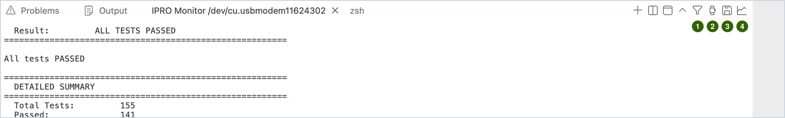
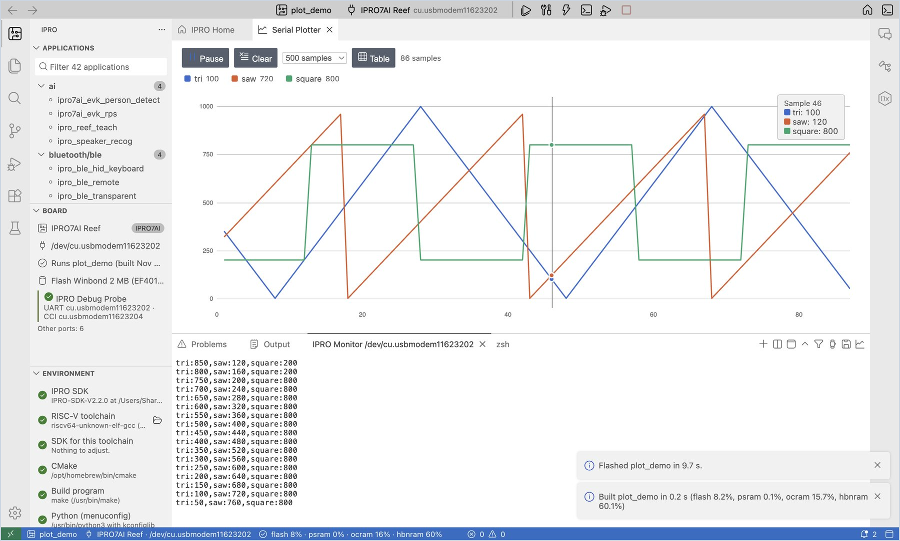

# シリアルモニター

**IPRO Monitor** は、下部パネルの **Terminal** にあるシリアルモニターです。ボードが UART で出力した内容を表示し、ボードに直接コマンドを入力できます。

## モニターを開いてコマンドを入力する { #open }

1. **モニターを開きます。** **Serial Monitor** をクリックします（`Cmd+Alt+M` / `Ctrl+Alt+M`）。**Build, Flash and Monitor** の場合は、書き込みの後に自動的に開きます。

    **期待される結果**：下部に **IPRO Monitor &lt;port&gt;** ターミナルが開きます。デフォルトのボーレートは 115200 です。

2. **コマンドを入力します。** モニターに入力して Enter キーを押すと送信されます。例えば `help` と入力します。

    **期待される結果**：ボードのシェルが、対応しているコマンドを返します。

3. **ボードを再起動します。** **Reset Board** をクリックすると、IDE がプローブを介してボードをリセットします。モニターは開いたままで、起動の最初の行からすべて表示されます。

!!! note
    - 書き込みやリセットの前に、IDE はすべてのモニターを閉じ、完了すると再び開きます。
    - ボーレートは `ipro.monitor.baudRate` 設定で変更します。変更すると、モニターが自動的に開き直されます。
    - モニターは、ボードが出力したアドレスを自動的にソースの位置にデコードします。[デバッグと解析](debug.md#crash-decode)を参照してください。

## モニタータブのツール { #tools }

**IPRO Monitor** タブがあるパネルの右上には、いくつかのボタンがあります。コマンドパレットと IPRO メニューにも同じコマンドがあります。

| 番号 | アイコン | コマンド | 用途 |
|---|---|---|---|
| 1 | じょうご | **Filter Monitor Output…** | 一致する行だけを表示する |
| 2 | ストップウォッチ | **Show Monitor Timestamps** | 各行の先頭に受信時刻を付ける |
| 3 | ディスク | **Save Monitor Output…** | 現在の内容をテキストファイルとして保存する |
| 4 | 折れ線グラフ | **Serial Plotter** | ボードが出力した数値を曲線としてプロットする |

### フィルター { #filter }

1. **フィルターを設定します。** じょうごのアイコン（**Filter Monitor Output…**）をクリックし、残したい内容（例：`ERROR|WARN` や `PASS|FAIL`。大文字と小文字を区別しない正規表現）を入力して Enter キーを押します。

    **期待される結果**：モニターが開き直され、タブのタイトルの末尾に `/ERROR|WARN/` が付き、一致する行だけが表示されます。クラッシュのメッセージ（MEPC、ra、stack backtrace）は常に表示されます。

2. **フィルターを解除します。** もう一度じょうごのアイコンをクリックし、入力ボックスを空にして Enter キーを押します。

フィルターは 1 行全体が届いてから判定するため、シェルのプロンプトは Enter キーを押した後に表示されます。

フィルターが変えるのは表示だけです。ファームウェアの確認、パーティションテーブルの比較、ボードテストは、引き続きボードが出力するすべての行を読み取るため、フィルターを設定したままでも動作します。

### タイムスタンプ { #timestamps }

ストップウォッチのアイコン（**Show Monitor Timestamps**）をクリックします。

**期待される結果**：各行の先頭に受信時刻（例：`[23:33:13.227]`。このコンピューターの時計による）が付きます。もう一度クリックするとオフになります。

### 保存と全ログ { #save-log }

1. **画面の内容を保存します。** ディスクのアイコン（**Save Monitor Output…**）をクリックし、保存場所を選んで **Save** をクリックします。

    **期待される結果**：「Saved the monitor output to monitor-….txt.」という通知が表示されます。保存されるのは、ターミナルが現在保持している内容（デフォルトでは最後の 1000 行）です。

2. **すべてのセッションの全ログを残します。** 設定を開いて `ipro.monitor` を検索し、**Log To File** にチェックを入れます。

    **期待される結果**：モニターの最初の行に `logging to …/build/logs/monitor-<date>-<time>.log` と表示されます。このファイルには、ボードが出力したすべての内容が、フィルターも色もない状態で記録されます。消費電力を測定するときは、このログを電流波形と並べて確認できます（[テストと測定](measure.md#power)を参照）。

## シリアルプロッター { #plotter }

1. **数値を出力します。** ファームウェアから各行に数値を出力させます。例えば `temp:23.5,hum:40`（名前:値）や `1.2 3.4`（スペースまたはカンマ区切り）です。

2. **プロッターを開きます。** モニターを開いた状態で、モニタータブの折れ線グラフのアイコン（**Serial Plotter**）をクリックします。

    **期待される結果**：エディター領域に **Serial Plotter** が開き、名前ごとに 1 本の線（最大 8 本）が描かれ、上部の凡例に最新の値が表示されます。グラフにマウスポインターを合わせると、そのサンプルのすべての値が一覧表示されます。

3. **表示を操作します。** **Pause** / **Resume** をクリックすると表示を停止・再開し、**Clear** をクリックすると最初からやり直します。凡例の名前をクリックすると、その線を非表示・表示にします。**Table** をクリックすると、数値で表示します。

## 別のポートを同時にモニターする { #second-port }

2 つのボードを同時に見る場合や、プローブの CCI ポートを見る場合は、次のようにします。

1. **2 つ目のモニターを開きます。** IPRO メニューから **Open Monitor on Another Port…** を選択し、ポートを選びます。

    **期待される結果**：一覧の上部にプローブのポート（UART、CCI）があります。すでにモニターが開いているポートは表示されません。ポートを選ぶと、もう 1 つ **IPRO Monitor** タブが表示されます。

2. **両方を使用します。** どちらのモニターにも入力できます。書き込みやリセットのときは、まずすべてのモニターが閉じられます。

!!! note
    Windows では、1 つの COM ポートを同時に使用できるのは 1 つのプログラムだけです。別のシリアルツールを使うには、先に IPRO Monitor を閉じてください。
