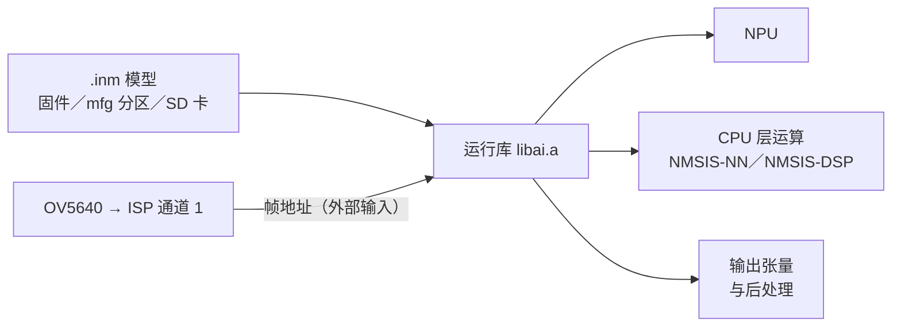

# AI 与 NPU

IPRO7AI 的 NPU 通过预编译运行库 `components/ai/lib/libai.a` 与公开头文件运行 `.inm` 模型（芯片与 IPRO7 的差异见 [IPRO7AI](../hardware/chips/ipro7ai.md)）。IPRO7AI Reef EVK 上有三个应用使用它：`ipro7_uvc_cam` 的 `defconfig_reef_rps`（与 NPU 对战的摄像头游戏）、`ipro_ai_link`（按命令从 SD 卡运行任意模型），以及 `ipro_reef_teach`（[IPRO AI Teach](../teach/index.md) 背后的 Edge AI 固件）。先用其中一个应用及其自带的模型跑出结果，再换成自己的模型。

!!! abstract "要点"
    - 随附：预编译运行库与头文件（单模型用 `iproai_core.h`，多模型用 `ipro_ai.h` 及其他 Edge AI 层）、示例 `.inm` 模型，以及上述 Reef 应用。
    - 用 `CONFIG_AI_SUPPORT=y` 启用，并自行在 `.config` 中写入 `CONFIG_USE_PSRAM=y`：模型与张量都放在 PSRAM 中。
    - 模型可以链接进固件、存放在 `mfg` Flash 分区，或从 SD 卡读取。
    - 不在 SDK 包内：运行库源代码与模型转换工具（请联系 INTELPRO）；IPRO AI Studio 另行提供（见[安装 IPRO AI Studio](../teach/install.md)）。

## 架构 { #architecture }



模型的每一层在 NPU 还是 CPU 上运行，由模型本身决定；`iproai_getNetInfo()` 会报告总层数与 NPU 层数。不要假设任何模型都能完全在 NPU 上运行。

| 路径 | 模型格式 | 运行方式 | Reef 示例 |
|---|---|---|---|
| NPU | `.inm` | `libai.a` 加载模型，逐层分派到 NPU 或 CPU | `ipro7_uvc_cam`（`defconfig_reef_rps`）、`ipro_ai_link`、`ipro_reef_teach` |
| CPU | `.tflite` | TensorFlow Lite Micro 配合 NMSIS-NN（`components/3rdparty`） | —（IPRO7 EVB 示例 `ipro_tflm_test`、`ipro_tflm_yolo`） |

两种格式不能互换，改扩展名不等于转换。

## 运行库与 API { #iproai-framework }

```text title="components/ai/"
components/ai/
├── CMakeLists.txt        # 链接 lib/libai.a 并加入下列头文件路径
├── iproai_def.h
├── lib/libai.a           # 预编译运行库
├── src/core/include/     # iproai_core.h：单模型，直接调用
├── src/inst/include/     # NPU、CPU 运算、后处理；detect/、audio/
├── runtime/include/      # ipro_ai.h：多模型，共享 NPU
├── store/include/        # ipro_ai_store.h：Flash 中的模型槽
├── source/include/       # ipro_ai_source.h：数据源
├── preproc/include/      # ipro_ai_preproc.h、sensor_front.h
└── app/include/          # ipro_ai_app.h：数据源 → 模型 → 结果
```

SDK 包不含运行库源代码，`.config` 无法改变 `libai.a` 的编译方式。

**直接 API（`iproai_core.h`）**，`ipro_ai_link` 与石头剪刀布版本使用：

| 函数 | 用途 |
|---|---|
| `iproai_create()` | 创建模型实例 |
| `iproai_load_model_from_buffer(hdl, buf)` | 从内存加载：链接进固件的模型，或经 XIP 读取的 `mfg` 分区 |
| `iproai_load_model_from_file(hdl, "sd:/…")` | 经 FatFS 把整个 `.inm` 读入 PSRAM 后加载 |
| `iproai_getNetInfo(hdl)` | 输入尺寸、层数、NPU 层数 |
| `iproai_getInputBuffer(hdl)`、`iproai_getOutputBuffer(hdl, &size)` | 输入与输出缓冲区 |
| `iproai_startCompute(hdl)` | 执行推理（同步） |
| `iproai_setResultCB()`、`iproai_setCustom_Postproc_CB()` | 结果回调、自定义后处理 |
| `iproai_free(hdl)` | 释放模型 |

成功时返回 `IPROAI_STATUS_NO_ERROR`。首次加载前，参照 `ipro_ai_link`，先打开多媒体时钟（`GLB_PER_Clock_UnGate(GLB_AHB_CLOCK_MM)`）并调用 `iproai_npu_init()`（`iproai_inst_npu.h`）。

- **输入**：以摄像头帧为输入的模型使用外部输入。运行库从 `imgBuffer + 4` 读取（前 4 个字节是大小头），每次执行前用 `NPU_Img_Ext_Addr_Cfg()`（`hal_npu.h`）设置帧地址。Reef 摄像头路径每个像素 4 个字节（ARGB）。
- **输出**：`iproai_getOutputBuffer()` 返回的大小是 patch 大小，不是整个张量。NPU 会把通道数补齐到 4 的倍数（`BALI_CHN_ALIGN`，`iproai_inst_util.h`），读取输出时要按补齐后的间距计算。
- NPU 的基地址与外部输入寄存器只在加载模型时写入。一个镜像只用一个模型时没有影响；要同时使用多个模型，请使用下面的运行库层。

**Edge AI 层**，`ipro_reef_teach` 使用（都在 `libai.a` 内）：

| 头文件 | 用途 |
|---|---|
| `ipro_ai.h` | `ipro_ai_init()`、`ipro_ai_model_open()`、`ipro_ai_invoke()`、`ipro_ai_model_close()`：可同时打开任意数量的模型；共用一把 NPU 锁，每次执行前把 NPU 指回正在执行的模型。同一镜像中仍直接调用 `iproai_*` 的代码，要用 `ipro_ai_npu_lock()` 包起来 |
| `ipro_ai_store.h` | Flash 分区中的模型槽：安装时使用日志扇区与提交字，断电后只会留下旧模型、新模型或空槽，不会出现半个模型 |
| `ipro_ai_source.h` | 数据源（PDM 麦克风、传感器等样本流，或摄像头帧），共用同一套生命周期 |
| `ipro_ai_preproc.h`、`sensor_front.h` | 共用预处理：量化、语音 log-mel 特征、传感器窗口转 64×64×8 输入、图像裁剪与缩放 |
| `ipro_ai_app.h` | 数据源 → 预处理 → 模型 → 任务适配（分类、嵌入向量、异常分数）→ 回调 |

## 配置 { #configuration }

```ini title=".config（Reef 上的 AI）"
CONFIG_IPRO7AI_REEF=y
CONFIG_BOARD="IPRO7AI_REEF"
CONFIG_USE_PSRAM=y           # 必需：模型与张量放在 PSRAM 中
CONFIG_AI_SUPPORT=y          # 加入 components/ai 并链接 libai.a
CONFIG_MM_SUPPORT=y          # 需要把摄像头画面送入 NPU 的应用
```

| 配置 | 说明 |
|---|---|
| `CONFIG_AI_SUPPORT` | 加入 AI 组件。与 `CONFIG_MM_SUPPORT` 同时开启时还会缩小 OCRAM 区域；见[内存规划](#dev-guide) |
| `CONFIG_USE_PSRAM` | 每个 AI 应用都设置了。构建系统不应用 Kconfig 的 `select`，必须写在 `.config` 中 |
| `CONFIG_AI_MODEL_FROM_FILE` | `ipro_ai_link` 设置了，从 SD 卡加载模型（配合 FatFS：`CONFIG_EVFS=y`、`CONFIG_EVFS_USE_FATFS=y`、`CONFIG_COMPONENTS_FATFS_ENABLE=y`） |
| `CONFIG_AI_CPU_NN_OPS` | `ipro_ai_link` 与 `ipro_reef_teach` 设置了，供含 CPU 层的模型使用；`ipro_ai_link` 另外设置了 `CONFIG_COMPONENTS_NMSIS_NN_ENABLE` |
| `CONFIG_AI_CYCLE_PROFILE` | `ipro_ai_link` 设置了：为 `ai_prof` 提供逐层周期数 |
| `CONFIG_UVC_RPS`、`CONFIG_RPS_EMBED_MODEL` | `ipro7_uvc_cam` 的 `defconfig_reef_rps` 应用配置：编入游戏，并把 `rps_v3.inm` 链接进固件 |

## 在 Reef 上动手实践 { #hands-on }

构建一台和您玩石头剪刀布的摄像头：ISP 通道 1 把 OV5640 画面正中央裁剪为 128×128，送入 NPU 上的 4 类 CNN，结果绘制到 USB 视频画面中。

<div class="ipro-steps" markdown>

1. **配置**

    `defconfig_reef_rps` 就是 Reef 普通摄像头配置（`defconfig_reef_ov5640`）多加三行：

    ```ini title="apps/multimedia/ipro7_uvc_cam/defconfig_reef_rps（摘录）"
    #
    # Rock-paper-scissors on the stream (uvc_rps.c): the EVK app's classifier and
    # game, model linked into the image.
    #
    CONFIG_AI_SUPPORT=y
    CONFIG_UVC_RPS=y
    CONFIG_RPS_EMBED_MODEL=y
    ```

    摄像头配置本身已包含 `CONFIG_USE_PSRAM=y`、`CONFIG_MM_SUPPORT=y` 与 `CONFIG_SENSOR_OV5640=y`。

2. **代码**

    模型由一个汇编文件拉入镜像：

    ```text title="apps/ai/ipro7ai_evk_rps/src/model_blob.S（摘录）"
        .section .rodata.rps_model, "a", @progbits
        .balign 16

        .global g_rps_model
        .type   g_rps_model, @object
    g_rps_model:
        .incbin "rps_v3.inm"
        .global g_rps_model_end
    g_rps_model_end:
        .size   g_rps_model, g_rps_model_end - g_rps_model
    ```

    启动时从这块缓冲区加载。Reef 版本直接编译 IPRO7AI EVK 应用的分类器源代码，不做修改：

    ```c title="apps/ai/ipro7ai_evk_rps/src/rps_model.c（摘录自 load_model）"
    s_hdl = iproai_create();
    if (!s_hdl) {
        s_fail = "NPU CREATE FAILED";
        return -1;
    }
    t0 = xTaskGetTickCount();
    st = iproai_load_model_from_buffer(s_hdl, xip);
    s_stats.load_ms = (uint32_t)((xTaskGetTickCount() - t0) * portTICK_PERIOD_MS);
    if (st != IPROAI_STATUS_NO_ERROR) {
        IPRO_LOGE(LOG_TAG, "NPU load failed (status %d)", (int)st);
        s_fail = "NPU LOAD FAILED";
        return -1;
    }
    s_net = iproai_getNetInfo(s_hdl);
    ```

    之后模型任务把每一帧送入 NPU：

    ```c title="apps/ai/ipro7ai_evk_rps/src/rps_model.c（摘录自模型任务）"
    feed(addr);
    IPROAI_Status_e st = iproai_startCompute(s_hdl);
    TickType_t t1 = xTaskGetTickCount();

    if (st != IPROAI_STATUS_NO_ERROR) {
        s_stats.errors++;
        IPRO_LOGE(LOG_TAG, "NPU compute failed (status %d)", (int)st);
    } else {
        uint32_t osz = 0;
        const uint8_t *out = iproai_getOutputBuffer(s_hdl, &osz);
        /* ... */
    }
    ```

    这个模型的 `feed()` 只调用 `NPU_Img_Ext_Addr_Cfg(addr)`：NPU 直接读取 ISP 通道 1 写入的 128×128 ARGB 帧。四个输出在 CPU 上换算为概率。

    `CONFIG_UVC_RPS` 开启时，`apps/multimedia/ipro7_uvc_cam/CMakeLists.txt` 会加入 `rps_model.c`、`rps_game.c` 与 `model_blob.S`。在您自己的应用中放入自己的模型也是同样做法；见[创建第一个应用](../tutorials/first-own-app.md)。

3. **构建**

    ```bash
    make -C apps/multimedia/ipro7_uvc_cam DEFCONFIG=defconfig_reef_rps
    ```

    输出：`apps/multimedia/ipro7_uvc_cam/build_reef_rps/build_out/ipro7_uvc_cam_IPRO7.bin`

4. **烧录**

    把 SW7 拨到 **CAM**，进入下载模式（按住 SW1、按一下 SW2、松开 SW1），再到 IntelProCube 目录执行：

    ```bash
    cd <ICUBE>
    ./ipro_iot_tool_macos --chipname ipro7 --chip-variant IPRO7AI \
        --port /dev/cu.usbserial-XXXX --baudrate 921600 \
        --pt chips/ipro7/partition/partition_cfg_2M.toml \
        --firmware <SDK>/apps/multimedia/ipro7_uvc_cam/build_reef_rps/build_out/ipro7_uvc_cam_IPRO7.bin
    ```

    模型已在固件内，无需另外烧录。确认输出中有 `[All Success]` 后按 SW2；其他操作系统见[烧录与串口控制台](../get-started/flash-and-monitor.md)。

5. **运行并确认**

    U6 控制台（115200 baud）的启动信息包含：

    ```text
    [UVC] Bringing up USB UVC webcam (720p MJPEG)...
    I (…) RPS_MODEL: model: … B linked into the firmware at 0x…
    I (…) RPS_MODEL: loaded in … ms: input 128x128x…, 1 outputs, ext_input …, unsigned …, … layers (… NPU), out scale … zp …
    I (…) RPS_MODEL: PSRAM heap left after the model: … KB
    [UVC] Streaming pipeline started
    ```

    把 Reef 的 USB-C 连接到电脑，用任意相机程序打开。把手放进画面中央的框内；倒计时结束后每一局都会被记录下来，`rps` 显示模型与 NPU 状态：

    ```text
    [GAME] round 1: you ROCK, me PAPER -> I WIN  (you 0 me 1 draw 0)
    ipro /> rps
    model   : ready, … B from firmware, loaded in … ms, … KB heap left
    npu     : … frames, 0 errors, … fps, last … ms
    now     : … …%  (r … p … s … n …)
    game    : round 1, you 0 me 1 draw 0, conf >= …%, mirror on
    ```

    模型未加载时，控制台会打印 `[RPS] model not loaded: … - streaming without the game`，视频流画面上也会显示原因。

</div>

把这类检查写成可重复运行的测试，见[测试您的应用](../tutorials/testing.md)。

## 随附模型 { #supported-models }

| 文件 | 使用方 |
|---|---|
| `apps/ai/ipro7ai_evk_rps/model/rps_v3.inm`（默认）、`rps_v1.inm` | 4 类 int8 石头剪刀布分类器，输入 128×128；链接进 `ipro7_uvc_cam` 的 `defconfig_reef_rps` |
| `apps/ai/ipro_reef_teach/model/model_b.spkb` | `ipro_reef_teach` `voice` 模式的声纹模型，用 `mfg_payload.py` 烧录到 `mfg` 分区 |
| `tools/teach_web/assets/mnv1_025.inm`、`mnv2_035.inm` | 浏览器版图像 Teach（`tools/teach_web/`）使用的图像特征模型 |
| `apps/platform/ipro7_demo/demo/ai/ai_model/*.inm`、`apps/test/ipro_npu_yolo/src/person_pet_detect.inm` | IPRO7 EVB 与 IPRO7AI EVK 示例的人形与人／宠物检测模型 |
| `apps/test/ipro_tflm_test/src/*.tflite`、`apps/test/ipro_tflm_yolo/src/*.tflite` | IPRO7 EVB 的 TensorFlow Lite Micro（CPU）示例 |

## 模型部署 { #model-pipeline }

| 模型存放位置 | 方式 | Reef 示例 |
|---|---|---|
| 链接进固件 | 用汇编文件中的 `.incbin` 把 `.inm` 拉入镜像，用 `iproai_load_model_from_buffer()` 加载；换模型就要重新构建 | `ipro7_uvc_cam` `defconfig_reef_rps` |
| `mfg` Flash 分区 | 用 IntelProCube 的 `--mfg` 选项烧录，经 XIP 读取。标准的 `partition_cfg_2M.toml` 中，`mfg` 位于 1,180 KB 固件分区之后的 0x12A000（824 KB） | `ipro_reef_teach`：自带的 `partition_reef_teach.toml`（固件 640 KB、`mfg` 1,364 KB），每个模式一个槽，由 `ipro_ai_store.h` 管理 |
| SD 卡 | `iproai_load_model_from_file()` 经 FatFS 读取；路径用 `sd:/`，不是 `/sdcard/` | `ipro_ai_link` |

`ipro_reef_teach` 首次的 `mfg` 内容由 `mfg_payload.py` 生成；之后训练出的模型由 IPRO AI Studio 部署到各自的槽，无需重新烧录。完整烧录命令与槽位布局见[烧录 Edge AI 固件](../teach/firmware.md)与应用的 README。

**自己的模型**：模型转换工具不在 SDK 包内，请联系 INTELPRO。部署前请确认算子支持、张量形状、量化参数与内存需求；下方的 `ipro_ai_link` 可显示任何 `.inm` 的层分配与输入输出形状。

## 示例应用 { #reference-apps }

| 应用 | Reef 配置 | 内容 |
|---|---|---|
| `apps/multimedia/ipro7_uvc_cam` | `defconfig_reef_rps` | USB 摄像头，在视频流画面上叠加 NPU 石头剪刀布游戏 |
| `apps/test/ipro_ai_link` | `defconfig_reef` | IPRO AI Studio “Run on board” 的板端固件：模型与输入来自 SD 卡 |
| `apps/ai/ipro_reef_teach` | `.config` | Edge AI 固件：`image`、`voice`、`sensor` 三种 Teach，一次运行一种；见 [IPRO AI Teach](../teach/index.md) |
| `apps/multimedia/ipro_agora_sentino` | `.config` | 云端语音助手；见[云端 AI](#cloud-llm) |

IPRO7AI EVK（`ipro7ai_evk_person_detect`、`ipro7ai_evk_rps`、`ipro7ai_evk_launcher`）与 IPRO7 EVB（`ipro_npu_yolo`、`ipro_ai_bench`、`ipro_tflm_*`、`ipro_nmsis_nn_test`、`ipro_tinymaix_demo`）的 NPU 示例列在[示例](../examples/index.md)中。

### IPRO AI Studio 板端固件（ipro_ai_link） { #ai-link }

`ipro_ai_link` 只需烧录一次；之后由主机通过命令替换模型与输入、执行推理、取回结果，无需重新烧录。模型与输入从 SD 卡读取，输出行带有机器可读的前缀（`AIINFO`、`AIRUN`、`AIOUT`、`AIERR`）。Reef 版本还会在 USB-C 上枚举一个 USB CDC 设备（VID 0x3896、PID 0x0704），用于快速传输文件。

```bash
make -C apps/test/ipro_ai_link DEFCONFIG=defconfig_reef   # 输出在 build_reef/build_out/
```

也可以手动操作。把模型复制到 FAT 格式的 microSD 卡（例如 `apps/ai/ipro7ai_evk_rps/model/` 中的 `rps_v3.inm`），插入卡，用 `--chip-variant IPRO7AI` 烧录这个版本，然后在 U6 控制台（115200 baud）中：

```text
ipro /> ai_mount
AIMOUNT ok
ipro /> ai_load sd:/rps_v3.inm
AILOAD ok sd:/rps_v3.inm
ipro /> ai_info
AIINFO path=sd:/rps_v3.inm layers=… npu=… in=…x…x… out=…x…x… patch_size=… patch_count=… app_type=… feed=0
```

| 命令 | 用途 |
|---|---|
| `ai_mount`／`ai_unmount` | 挂载／释放 SD 卡 |
| `ai_ls [dir]` | 列出文件 |
| `ai_load sd:/model.inm` | 加载模型 |
| `ai_input sd:/input.bin` | 加载符合模型输入格式的原始字节 |
| `ai_run [reps]` | 执行推理（1–100 次）；打印 `AIRUN rep=… total=… npu=… dispatches=…` 周期数 |
| `ai_out [max_bytes]` | 转储输出 |
| `ai_info` | 模型信息（层数、NPU 层数、输入与输出形状） |
| `ai_prof` | 上一次执行的逐层周期数 |

## 集成与内存规划 { #dev-guide }

**OCRAM**：同时开启 `CONFIG_AI_SUPPORT` 与 `CONFIG_MM_SUPPORT` 时，链接器把 OCRAM 区域缩小为 64 KB（无 BLE，`CONFIG_EM_SIZE` 为 0 或未设置）或 48 KB（有 BLE）；所有组合见[构建系统与配置](build-system.md#memory-layout)。请查看构建结束时链接器打印的内存用量。

**PSRAM**：模型、中间张量与摄像头帧都从 PSRAM 分配。在加载前后与连续推理期间测量剩余 heap（`xPortGetFreeHeapSize()`）；石头剪刀布版本在加载后会记录这个数值。

**摄像头到 NPU**：一次只交一帧给 NPU，避免 ISP 覆盖正在推理的缓冲区，并保持缓存一致（NPU 是总线主设备，看不到 CPU 的 D-cache）。

**多个模型**：用 `ipro_ai.h` 打开，不要对两个 handle 分别调用 `iproai_startCompute()`；否则第二次加载会让 NPU 一直指向最后加载的模型。

**错误处理**：检查 `iproai_create()`、加载函数与 `iproai_startCompute()` 的返回值；失败时用 `iproai_free()` 释放模型，并释放自己分配的缓冲区。`ipro_reef_teach` 还启用了 AON 看门狗，SoC 卡死时会自动重启。

**浮点运算**：IPRO7 的 FreeRTOS port 在任务切换与中断时会保存浮点寄存器，因此与 NPU 任务并行的任务可以使用浮点运算。

## 性能测量 { #performance }

| 工具 | 命令 | 测量内容 |
|---|---|---|
| `ipro_ai_link` | `ai_run [reps]`、`ai_prof` | 每次执行的总周期、NPU 周期与 NPU 分派次数；自己模型的逐层周期数 |
| `ipro7_uvc_cam` `defconfig_reef_rps` | `rps` | 游戏运行中的 NPU 帧数、错误数、帧率与最近一次推理时间 |

请记录模型文件、输入尺寸、构建配置、heap 用量与多次推理时间，并把预处理、推理、后处理分开测量。第一次执行包含 PSRAM 与缓存的冷启动开销，请取之后的结果。参考数据：`ipro7ai_evk_rps` README 记载 `rps_v3.inm`（11 层，全部在 NPU 上）每次推理 7 ms，是在 IPRO7AI EVK 上用同一颗 IPRO7AI 测得的。

## 云端 AI { #cloud-llm }

SDK 没有通用的云端 AI 客户端组件。`apps/multimedia/ipro_agora_sentino` 是 Reef 上的云端语音助手：经 BLE 配网，通过 IPRO6S FIN 卡连接 Wi-Fi（见[网络](networking.md)），再经 Sentino 平台与 Agora RTC 对话。直接 `make` 构建的就是 Reef 版本（默认 `BOARD=reef`）。

- 需要 AOSL 内核，它不在 SDK 内。请获取一次，并切换到 Agora RTC 库构建时所用的 commit；目录为空时构建会停止并打印这些步骤：

    ```bash
    git clone https://github.com/AgoraIO-Community/aosl components/3rdparty/agora/aosl
    git -C components/3rdparty/agora/aosl checkout d825607
    ```

- 另需 Sentino 设备三元组，未包含在 V2.2.1 中，请联系 INTELPRO。

## 本版本的限制 { #limitations }

- 运行库只以预编译的 `libai.a` 提供，内部选项无法通过 `.config` 更改。
- 模型转换工具不在 SDK 包内，请联系 INTELPRO。
- Zephyr 下没有 NPU 驱动；所有 AI 应用都是 FreeRTOS 应用。
- AI、摄像头与 BLE 同时开启时，OCRAM 区域只有 48 KB；见[内存规划](#dev-guide)。

## 相关文档 { #related }

- [IPRO AI Teach](../teach/index.md)：在 Reef 上通过 IPRO AI Studio 训练图像、声纹与传感器模型
- [摄像头与图像](camera.md)：ISP 与摄像头管线
- [构建系统与配置](build-system.md)：`.config`、`DEFCONFIG=` 与内存布局
- [AI API](../reference/api/ai.md)
- [IPRO7AI Reef EVK](../hardware/boards/reef-evk.md)
