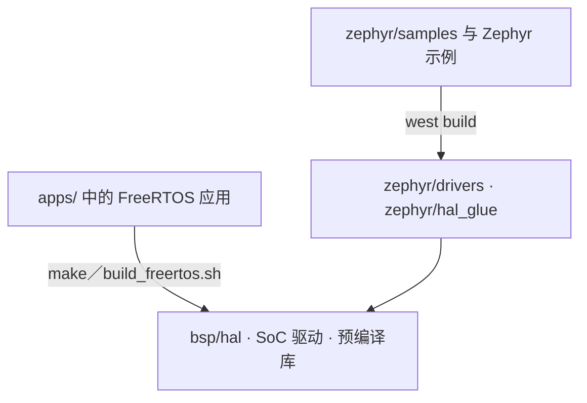

# 系统架构

同一份源代码树涵盖两款芯片与两种 RTOS：`apps/` 下 40 个 FreeRTOS 应用（IPRO7 与 IPRO7AI 37 个、IPRO6S 3 个），以及供 IPRO7 使用的 Zephyr v4.4.0 模块。两条路径共用 HAL、SoC 驱动与预编译库。构建流程与内存布局见[构建系统与配置](build-system.md)。

!!! abstract "要点"
    - 分层：应用（`apps/`）→ 组件（`components/`）→ RTOS（FreeRTOS V11.1.0 或 Zephyr v4.4.0）→ BSP（`bsp/`）→ 芯片。
    - IPRO7 与 IPRO7AI：RISC-V RV32IMAFC（含 DSP 扩展）、BLE 5.4 与 LE Audio、IEEE 802.15.4；IPRO7AI 另有 NPU 与 ISP。联网方式为以太网（RMII），或经 SDIO 连接 IPRO6S 使用 Wi-Fi；在 IPRO7AI Reef EVK 上，这颗 IPRO6S 就是插在 microSD 插槽中的 FIN 卡。
    - IPRO6S：相同内核、芯片内置 Wi-Fi 6，仅支持 FreeRTOS。
    - BLE 控制器、RF 驱动、Wi-Fi 6 MAC、低功耗框架、AI 推理运行库、ISP 算法与 LC3 编解码器以预编译库提供，其余为源代码。
    - 本站所有示例都在 IPRO7AI Reef EVK 上运行；需要其他 INTELPRO 开发板的应用会另行注明。

## 系统总览 { #overview }

<div class="ipro-stack">
  <div class="l-app"><strong>应用 apps/</strong><span>ai · bluetooth · multimedia · platform · test</span></div>
  <div class="l-host"><strong>组件 components/</strong><span>BLE Host · lwIP · mbedTLS · CherryUSB · audio · ai · fs · shell</span></div>
  <div class="l-hci"><strong>RTOS</strong><span>FreeRTOS V11.1.0 · Zephyr v4.4.0（模块，IPRO7）</span></div>
  <div class="l-ctlr"><strong>BSP bsp/</strong><span>HAL · SoC 驱动 · 板级配置 · 链接脚本</span></div>
  <div style="--layer: #64748b"><strong>芯片</strong><span>IPRO7／IPRO7AI：BLE 5.4 · 802.15.4 · ISP · NPU；IPRO6S：Wi-Fi 6</span></div>
</div>

| 层 | 位置 | 职责 |
|---|---|---|
| 应用 | `apps/<分类>/<应用>/` | 每个应用自带 `.config`、`CMakeLists.txt` 与 `Makefile`，可单独构建 |
| 组件 | `components/` | 中间件与库；根据应用 `.config` 中的 `CONFIG_*` 加入构建 |
| RTOS | `components/os/`、`zephyr/` | FreeRTOS 调度、队列与定时器，加上公共的 `freertos_app_hooks`；或 Zephyr kernel |
| BSP | `bsp/` | HAL API、寄存器与 SoC 驱动、板级头文件、链接脚本生成器 |

预编译库连同公开头文件一起提供，构建时自动链接，无需额外配置。库已去除调试信息，但保留符号名称，map 文件与 `nm` 仍可使用。

## FreeRTOS 与 Zephyr { #rtos-paths }



| 项目 | FreeRTOS | Zephyr |
|---|---|---|
| 应用与示例 | `apps/` 下 40 个应用 | `zephyr/samples/` 中的 SDK 示例与 Zephyr 上游示例；驱动测试在 `zephyr/tests/` |
| 构建 | `make -C apps/<分类>/<应用>` 或 `./build_freertos.sh` | `tools/zephyr/bootstrap.sh` 创建工作区后用 `west build` 构建 |
| 芯片 | IPRO7、IPRO7AI、IPRO6S | IPRO7、IPRO7AI |
| 开发板 | IPRO7AI Reef EVK（9 个应用、11 组配置）与其他 INTELPRO 开发板 | `ipro7_evb`、`ipro7ai_evk`；本版本没有 Reef 的板级定义 |
| BLE | Zephyr v4.4 Host 经移植层运行于 FreeRTOS，配合 IPRO BLE 控制器（预编译库） | Zephyr Host 配合同一组控制器库 |
| IEEE 802.15.4／Thread | 未提供 | Zephyr IEEE 802.15.4 驱动与 OpenThread |
| 低功耗、摄像头、音频 codec、USB、SD Host、以太网、NPU | 提供 | 尚未提供 |
| 控制台 | 取决于应用的 `CONFIG_PLATFORM_UART_BAUDRATE`，未配置时为 115200 | UART0，2,000,000 baud |

在 Reef 上，以及需要低功耗、摄像头、音频或 NPU 的产品，请走 FreeRTOS 路径。Zephyr 的开发板、示例与烧录见 [Zephyr RTOS](zephyr.md)。

## 组件 { #components }

以下路径都在 `components/` 之下。

| 类别 | 路径 | 内容 |
|---|---|---|
| 蓝牙 | `wireless/bluetooth/ipro_bt_host/` | BLE Host，移植自 Zephyr v4.4.0（源代码） |
| | `wireless/bluetooth/ipro_ble_controller/` | IPRO7 BLE 控制器（预编译库） |
| 射频 | `wireless/rf/ipro7_rf/`、`wireless/rf/ipro6_rf/` | IPRO7 与 IPRO6S 的 RF 驱动（预编译库） |
| | `wireless/ieee802154/` | 供 Zephyr 使用的 IEEE 802.15.4 MAC（预编译库） |
| Wi-Fi 6（IPRO6S） | `wireless/macsw/`、`wireless/wifi6/` | MAC、fhost API、wpa_supplicant 与 lwIP 适配层（预编译库） |
| 网络 | `network/lwip/` | lwIP 2.1.2 |
| | `network/ipronet_host/` | 经 SDIO 通过 IPRO6S 使用 Wi-Fi 的 IPRO7 端（netif `iproeth0`）；Reef 的 FIN 卡就是用它 |
| | `network/rtsp_server/` | RTSP MJPEG 视频流 |
| 安全 | `crypto/mbedtls/` | mbedTLS 2.28.2 |
| 操作系统 | `os/freertos/` | FreeRTOS V11.1.0 内核与公共 hook（`freertos_app_hooks`） |
| | `os/freertos_posix/`、`os/ipro_osal/` | POSIX 层、OS 抽象层 |
| 系统服务 | `sys/shell/`、`sys/ipro_event/`、`sys/ipro_pm/`、`sys/usb_console/` | Shell、事件框架、电源管理、USB 控制台 |
| | `utils/` | 日志（`ipro_log.h`）与公共工具 |
| 音频 | `audio/` | 音频采集与输出（DAC、I2S、UAC）、重采样、扬声器均衡、MP3 解码 |
| AI | `ai/` | NPU 推理运行库（`lib/libai.a` 与头文件） |
| 图像 | `isp_firmware/`、`isp_algorithm/`、`isp_iq_param/`、`isp_iq_cmd/` | ISP 控制、ISP 算法（预编译）、IQ 参数 |
| | `sensor/` | 摄像头传感器驱动 |
| 开发板库 | `board/ipro7ai_evk/` | IPRO7AI EVK（另一款 INTELPRO 开发板）的库，Reef 不使用 |
| USB | `cherryusb/` | USB 设备类：CDC、CDC-ECM、HID、MSC、UAC、UVC |
| 文件系统 | `fs/` | FatFS、LittleFS、EasyFlash4、EVFS、ROMFS |
| 第三方 | `3rdparty/` | LC3（预编译）、SBC、Opus、minimp3、TensorFlow Lite Micro、NMSIS-NN、TinyMaix、cJSON、xz、zmodem、Agora RTC SDK（预编译）等 |

IPRO7 如何连接网络，以及 SDIO 另一端的 IPRO6S 应用，见[网络](networking.md)。

## 目录结构 { #directory }

```text
IPRO-SDK-V2.2.0/
├── apps/                    FreeRTOS 应用（40 个）
│   ├── ai/                  NPU 与 Edge AI 应用
│   ├── bluetooth/ble/       BLE 示例
│   ├── bluetooth/le_audio/  LE Audio 耳机
│   ├── multimedia/          USB 摄像头、JPEG 解码、PDM 录音、云端语音
│   ├── platform/            芯片与开发板参考、IPRO6S Wi-Fi；common/ 为公共 OTA 代码
│   ├── test/                驱动测试、硬件验证与性能测试（19 个）
│   └── turnkey/common/      公共 USB 控制台代码
├── bsp/                     HAL、SoC 驱动（ipro7_soc、ipro6_soc）、板级配置、链接脚本
├── components/              中间件与库
├── cmake/                   工具链检测、构建宏、autoconf.h 生成器
├── tools/                   serial_monitor.py、create_ota.py、teach_web/、zephyr/ 脚本、随附的 CMake、Android 示例 App 源代码
├── zephyr/                  Zephyr 模块：boards、soc、dts、drivers、samples、tests
├── build_freertos.sh        FreeRTOS 构建、烧录、监视的前端脚本
├── project.build            各应用 Makefile 调用的构建驱动
├── west.yml                 Zephyr west manifest
├── CMakeLists.txt
├── Kconfig
└── VERSION.txt
```

完整应用列表可运行 `./build_freertos.sh -l`，或见[示例](../examples/index.md)。

## BLE 协议栈 { #ble-stack }

<div class="ipro-stack">
  <div class="l-app"><strong>应用</strong><span>Zephyr bt_* API</span></div>
  <div class="l-host"><strong>BLE Host（Zephyr v4.4.0）</strong><span>ipro_bt_host：GAP · GATT · L2CAP · SMP · ISO · LE Audio</span></div>
  <div class="l-hci"><strong>芯片内 HCI</strong><span>内存中的字节流（ipro_ble_ctlr_hcitl）</span></div>
  <div class="l-ctlr"><strong>IPRO BLE 控制器（预编译库）</strong><span>ipro_ble_controller/lib/ · RF 驱动 ipro7_rf</span></div>
</div>

Host 以源代码提供，经 `ipro_bt_host/port/` 移植层运行于 FreeRTOS；Host 与控制器之间没有 UART HCI。控制器根据 `.config` 中的三个配置项，从 16 个 IPRO7 控制器归档文件中选择一个链接。本版本不含 IPRO6S 的蓝牙控制器，IPRO6S 应用只有 Wi-Fi。控制器选择、初始化顺序与 API 用法见 [BLE 开发](ble.md)。

## BSP 与驱动 { #bsp }

| 路径 | 内容 |
|---|---|
| `bsp/hal/` | HAL API（`inc/hal_*.h`、`src/hal_*.c`） |
| `bsp/hal/lp_framework/` | 低功耗框架：IPRO7 PDS（预编译 `liblp_framework.a`）、IPRO6S 低功耗固件镜像 |
| `bsp/drivers/ipro7_soc/` | 寄存器定义、启动代码（`startup/`）、标准驱动（`std_drv/`）、NMSIS-DSP 预编译库（`DSP/`） |
| `bsp/drivers/ipro6_soc/` | IPRO6S SoC 驱动 |
| `bsp/drivers/soc_common/` | 跨芯片共用的驱动 |
| `bsp/board/ipro7/` | 板级头文件与 `board.c`；`board_config.h` 根据板型配置选用头文件，`CONFIG_IPRO7AI_REEF` 对应 `ipro7ai_reef_board_config.h`（见[板型配置](build-system.md#board-keys)） |
| `bsp/board/ipro6/` | IPRO6S 板级文件 |
| `bsp/board/linker/` | 链接脚本生成器（模板与 `configs/ipro7_flash.cmake`） |
| `bsp/common/platform_utils/` | 平台初始化、控制台 UART 波特率 |

HAL 涵盖的外设：

| 类别 | HAL |
|---|---|
| 通信 | UART、SPI、I2C、I2S、SDIO |
| 存储 | SPI Flash、PSRAM、SD Host（SDH）、PIO 软件 SD Host |
| 模拟与定时 | ADC、DAC、AUADC（音频 ADC）、模拟比较器、PWM、定时器、RTC、看门狗 |
| 输入 | GPIO、QDEC、Keyscan |
| 图像与 AI | DVP 摄像头、ISP、MJPEG 编码、NPU |
| 网络 | EMAC 以太网、lwIP netif、以太网 PHY |
| 安全 | AES、SHA、ECDSA、P-256、GMAC、TRNG |
| 系统 | DMA、时钟、电源管理、boot2 分区表 |

Reef 的引脚、扬声器使能等定义，以 `BOARD_*` 宏写在 `bsp/board/ipro7/ipro7ai_reef_board_config.h` 中；开发板引脚见 [IPRO7AI Reef EVK](../hardware/boards/reef-evk.md#pinout)，芯片引脚功能见[引脚与外设对照](../hardware/pinmux.md)。

## 在 Reef 上动手实践 { #hands-on }

从出厂固件 `ipro7ai_reef_demo` 看各层如何衔接：`.config` 选定 RTOS 与组件，`main.c` 调用公共的平台初始化并使用板级头文件，运行时再通过 FreeRTOS shell 查看结果。

<div class="ipro-steps" markdown>

1. **配置文件决定使用哪些层。** 随附 `.config` 中的这几行选定芯片、板级头文件、FreeRTOS 与 shell：

    ```ini title="apps/platform/ipro7ai_reef_demo/.config（节选）"
    CONFIG_IPRO7=y
    CONFIG_CHIP="IPRO7"
    CONFIG_IPRO7AI_REEF=y
    CONFIG_BOARD="IPRO7AI_REEF"
    CONFIG_USE_PSRAM=y
    CONFIG_PLATFORM_UART_BAUDRATE=115200
    CONFIG_FREERTOS_SUPPORT=y
    CONFIG_COMPONENTS_FREERTOS_ENABLE=y
    CONFIG_SHELL=y
    CONFIG_IPRO_LOG_ENABLE=y
    ```

2. **`main()` 对每一层各调用一次。** `ipro_platform_init()` 来自 `components/os/freertos/freertos_app_hooks`，`BOARD_*` 引脚来自 `bsp/board/ipro7/` 中的 Reef 板级头文件，任务则交给 FreeRTOS：

    ```c title="apps/platform/ipro7ai_reef_demo/main.c（节选）"
    int main(void)
    {
        static StackType_t  s_app_stack[2048];
        static StaticTask_t s_app_tcb;

        ipro_platform_init();   /* heap + boot2 + log + shell */
        ...
        IPRO_LOGI(LOG_TAG, "  IPRO7AI Reef carrier demo");
        IPRO_LOGI(LOG_TAG, "  UART0 TX=%d RX=%d  RGB=G%d  SPK_EN=G%d(hi)",
                  BOARD_UART_TX_PIN, BOARD_UART_RX_PIN, BOARD_RGB_LED_PIN, BOARD_SPK_EN_PIN);
        ...
        xTaskCreateStatic(app_task, "evk_app",
                          sizeof(s_app_stack) / sizeof(StackType_t), NULL,
                          configMAX_PRIORITIES - 2,
                          s_app_stack, &s_app_tcb);
        vTaskStartScheduler();
        ...
    }
    ```

3. **构建。**

    ```bash
    make -C apps/platform/ipro7ai_reef_demo
    ```

    链接 map `apps/platform/ipro7ai_reef_demo/build/build_out/ipro7ai_reef_demo_IPRO7.map` 列出镜像用到的每个组件归档文件。

4. **烧录**，然后以 115200 baud 打开控制台，步骤见[烧录与串口](../get-started/flash-and-monitor.md)。

5. **查看运行中的系统。** 启动横幅打印出来自板级头文件的引脚（省略日志前缀）：

    ```text
      IPRO7AI Reef carrier demo
      UART0 TX=20 RX=21  RGB=G24  SPK_EN=G25(hi)
    ```

    接着输入 `free` 与 `ps`，这两个是 `components/sys/shell` 提供的 FreeRTOS 命令：

    ```text
    Heap: total <bytes>, free <bytes>, min free <bytes>

    Task             State  Prio  Stack   #   CPU%
    ---------------------------------------------------
    ```

    任务列表中有 `evk_app`，也就是 `main()` 创建的应用任务。`help` 会列出镜像注册的所有命令。

</div>

接下来：按照[创建第一个自己的应用](../tutorials/first-own-app.md)自己搭建同样的结构，再用[测试你的应用](../tutorials/testing.md)进行验证。

## 相关文档 { #related }

- [构建系统与配置](build-system.md)：构建流程、`.config`、内存布局、创建新应用
- [BLE 开发](ble.md)：控制器选择、初始化顺序、GATT 示例
- [网络](networking.md)：以太网、lwIP，经 SDIO 通过 IPRO6S 使用 Wi-Fi
- [Zephyr RTOS](zephyr.md)：Zephyr 开发板、示例与烧录
- [IPRO7AI Reef EVK](../hardware/boards/reef-evk.md)：所有示例使用的开发板
- [IPRO7](../hardware/chips/ipro7.md)、[IPRO7AI](../hardware/chips/ipro7ai.md)、[IPRO6S](../hardware/chips/ipro6s.md)：芯片规格
