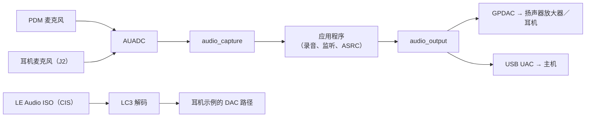
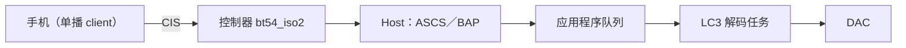

# 音频与 LE Audio

IPRO7 有连接模拟与 PDM 麦克风的音频 ADC（AUADC）、10 位 DAC（GPDAC）与 I2S。SDK 在此之上提供 `components/audio` 的采集与输出架构，加上 LC3 等编解码器、CherryUSB 的 USB 音频，以及 BLE Host 的 LE Audio 协议。IPRO7AI Reef EVK 的出厂固件 `ipro7ai_reef_demo` 可从 shell 操作板上的每个音频模块，它的 `src/audio.c` 就是本页的参考代码。

!!! abstract "要点"
    - Reef 音频：PDM 麦克风、耳机插孔 J2 的耳机麦克风、GPDAC 驱动的扬声器放大器与耳机输出。`ipro7ai_reef_demo` 可录音、播放、实时监听、录制 WAV 文件到 SD 卡（`mic sdrec`），也能把开发板变成 USB 麦克风（`mic usb`）。
    - 配置：`CONFIG_AUDIO_CAPTURE=y`、`CONFIG_AUDIO_OUTPUT=y`、`CONFIG_DMA_CHANNEL_ALLOCATOR=y`；USB 音频再加 `CONFIG_CHERRYUSB_DEVICE_AUDIO=y`。
    - LE Audio：单播耳机 `ipro_le_audio_headset`（`defconfig_reef`），控制器 `bt54_iso2` 配合 `CONFIG_EM_SIZE=32`，LC3 为预编译库。其 README 注明从手机播放音频尚未验证。
    - 未包含于 V2.2.0：FreeRTOS 的 LE Audio 广播示例、USB 转 BLE 的音频桥接示例。

## 架构 { #overview }



| 部分 | 位置 | 说明 |
|---|---|---|
| 音频 HAL | `bsp/hal/inc/hal_auadc.h`、`hal_dac.h`、`hal_i2s.h` | 音频 ADC、DAC、I2S |
| 采集 | `components/audio/include/audio_capture.h` | 将模拟麦克风（`AUDIO_SRC_AMIC`）、PDM 麦克风（`AUDIO_SRC_DMIC`）或 I2S（`AUDIO_SRC_I2S`）转换成 16 位单声道 PCM；多个使用者各读取一份 |
| 输出 | `components/audio/include/audio_output.h` | 以同一组 API 输出到 `AUDIO_OUTPUT_DAC`、`AUDIO_OUTPUT_UAC`、`AUDIO_OUTPUT_I2S`、`AUDIO_OUTPUT_DUMP` |
| 处理 | `audio_resampler.h`、`audio_asrc.h`、`audio_speaker_eq.h`、`audio_bass_boost.h`、`mp3_decoder.h` | 采样率转换、带水位控制的时钟漂移重采样、扬声器均衡、低音增强、MP3 解码 |
| 编解码器 | `components/3rdparty/liblc3`（预编译）、`libsbc`、`opus`、`minimp3` | LC3 用于 LE Audio |
| LE Audio | `components/wireless/bluetooth/ipro_bt_host/upstream/zephyr/subsys/bluetooth/audio/` | Zephyr v4.4.0 的 LE Audio 协议源代码 |
| USB 音频 | `components/cherryusb/class/audio/` | USB Audio Class 设备 |

## 音频硬件 { #audio-hardware }

IPRO7AI Reef EVK V4.0 的音频模块，以及代码使用的板级头文件名称（`bsp/board/ipro7/ipro7ai_reef_board_config.h`）：

| 模块 | 引脚 | 板级头文件 |
|---|---|---|
| PDM 麦克风 MK1 | CLK GPIO16、DATA GPIO17，左声道 | `BOARD_MIC_CLK_PIN`、`BOARD_MIC_DAT_PIN`、`BOARD_MIC_PDM_CHANNEL` |
| 耳机麦克风（耳机插孔 J2） | AIN7（GPIO13）+、AIN6（GPIO12）−，差分输入 | `BOARD_HSMIC_POS_CH`、`BOARD_HSMIC_NEG_CH` |
| GPDAC 输出 | DAC 通道 A，GPIO23；同时连接耳机级（J2）与扬声器放大器 | `BOARD_SPK_DAC_PIN` |
| 扬声器放大器 PAM8302A（J_SPK） | 使能 GPIO25，高电平开启 | `BOARD_SPK_EN_PIN`、`BOARD_SPK_EN_ACTIVE`（1） |
| 耳机插入检测 | GPIO26，低电平表示已插入 | `BOARD_HP_DET_PIN`、`BOARD_HP_DET_ACTIVE`（0） |

- 耳机插孔始终能收到 DAC 信号。“只用耳机”就是让扬声器放大器保持关闭，没有其他切换开关。
- PDM 路径不是正好 16,000 Hz：标称 15,875 Hz（2.032 MHz ÷ 128），Reef 实测约 15,872 Hz。`mic sdrec` 会把测得的采样率写进 WAV 头，`mic usb` 则通过 `audio_asrc` 转换成主机的 16,000 Hz。
- `audio_output` 的 DAC 后端固定以 32 kHz 运行（`audio_capture.h` 中的 `DAC_RATE`），其他采样率会先转换。
- 放大器增益很高（demo README 写的是 30 V/V），demo 默认以 20% 振幅播放测试音。
- 设置 `CONFIG_DMA_CHANNEL_ALLOCATOR=y`，让采集、播放与 USB 同步传输端点在运行时获取 DMA 通道，不会互相冲突。

耳机插孔类型、接口与完整引脚见 [IPRO7AI Reef EVK](../hardware/boards/reef-evk.md)。IPRO7 EVB 与 IPRO7AI EVK 另有各自的音频示例（`ipro_pdm_mic_demo`、`ipro7ai_evk_demo`），见各自的开发板页面。

## 音频组件 { #audio-framework }

```ini title=".config（音频，取自 apps/platform/ipro7ai_reef_demo/.config）"
CONFIG_AUDIO_OUTPUT=y
CONFIG_AUDIO_CAPTURE=y
CONFIG_DMA_CHANNEL_ALLOCATOR=y
# 通过 audio_output 的 UAC 后端用作 USB 麦克风
CONFIG_COMPONENTS_CHERRYUSB_ENABLE=y
CONFIG_CHERRYUSB_DEVICE=y
CONFIG_CHERRYUSB_DEVICE_AUDIO=y
```

| 配置项 | 作用 |
|---|---|
| `CONFIG_AUDIO_CAPTURE` | 编入 `audio_capture.c` 与 PDM 麦克风处理链 `audio_pdm_mic.c` |
| `CONFIG_AUDIO_OUTPUT` | 编入 `audio_output.c` 与 DAC、dump 后端 |
| `CONFIG_CHERRYUSB_DEVICE_AUDIO` | 与 `CONFIG_AUDIO_OUTPUT` 同时开启时，也编入 UAC 后端 `audio_output_uac.c` |
| `CONFIG_AUDIO_OUTPUT_UAC_EXCLUDE` | 不编入 UAC 后端；应用程序自己实现 USB 音频设备时使用（否则两边会定义相同的 `usbd_audio_*` 回调） |
| `CONFIG_BSP_USING_I2S0` | 与 `CONFIG_AUDIO_OUTPUT` 同时开启时编入 I2S 后端 |

采样率转换、时钟漂移重采样（`audio_asrc`）、扬声器均衡与低音增强始终编入。

使用方法：

- `audio_capture_init()` 接收 `audio_capture_cfg_t`（来源类型、采样率、每帧样本数，以及 PDM 或模拟的配置）；`audio_capture_add_consumer()` 返回一个拥有独立缓冲区的使用者编号；`audio_capture_start()` 启动 DMA；`audio_capture_read(id, buf, bytes, timeout_ms)` 获取 PCM。
- `audio_output_create()` 接收 `audio_output_cfg_t`。`AUDIO_OUTPUT_MODE_STREAMING` 以循环 DMA 环形缓冲区连续播放，缓冲区满时 `audio_output_write(out, pcm, samples)` 只会短暂阻塞；`AUDIO_OUTPUT_MODE_ONESHOT` 会阻塞到整段播放完毕。`audio_output_write()` 的第三个参数是每声道的样本数，不是字节数。
- DAC 后端要提供放大器使能引脚与有效电平（`dac_spk_gpio`、`dac_spk_en_active`）；`audio_output_start()` 会打开放大器。

## 在 Reef 上动手实践 { #hands-on }

从 PDM 麦克风录制 3 秒、用耳机播放，再录制一个 WAV 文件到 SD 卡，最后把开发板用作 USB 麦克风。全部在 `ipro7ai_reef_demo` 中完成；摘录的代码就是您在自己的应用程序中要复用的部分。

<div class="ipro-steps" markdown>

1. **配置**

    应用程序需要的就是 demo `.config` 中的音频配置（见[音频组件](#audio-framework)），加上 Reef 开发板配置：

    ```ini title="apps/platform/ipro7ai_reef_demo/.config（摘录）"
    CONFIG_IPRO7AI_REEF=y
    CONFIG_BOARD="IPRO7AI_REEF"
    CONFIG_USE_PSRAM=y
    CONFIG_AUDIO_OUTPUT=y
    CONFIG_AUDIO_CAPTURE=y
    CONFIG_DMA_CHANNEL_ALLOCATOR=y
    ```

2. **代码**

    打开 PDM 麦克风与 DAC 输出。引脚与电平宏来自 Reef 板级头文件：

    ```c title="apps/platform/ipro7ai_reef_demo/src/audio.c（摘录）"
    static audio_output_t *sink_open(uint32_t rate, audio_route_t route)
    {
        audio_output_cfg_t cfg = {
            .type             = AUDIO_OUTPUT_DAC,
            .mode             = AUDIO_OUTPUT_MODE_STREAMING,
            .sample_rate      = rate,
            .channels         = 1,
            .dac_spk_gpio     = BOARD_SPK_EN_PIN,
            .dac_spk_en_active = BOARD_SPK_EN_ACTIVE ? 1 : -1,
        };
        audio_output_t *out = audio_output_create(&cfg);

        if (!out) {
            IPRO_LOGE(LOG_TAG, "audio_output_create failed");
            return NULL;
        }
        if (audio_output_start(out) != 0) {
            IPRO_LOGE(LOG_TAG, "audio_output_start failed");
            audio_output_destroy(out);
            return NULL;
        }
        /* start() switched the amplifier on; the route decides whether it stays. */
        route_apply(route);
        return out;
    }

    static int capture_open(audio_in_t src, uint32_t consumer_bytes, int *consumer)
    {
        audio_capture_cfg_t cfg = {
            .sample_rate   = AUDIO_RATE_HZ,          /* 16000 */
            .frame_samples = AUDIO_FRAME_SAMPLES,    /* 320 = 20 ms */
        };

        switch (src) {
        case AUDIO_IN_PDM:
            cfg.type = AUDIO_SRC_DMIC;
            cfg.dmic.clk_pin         = BOARD_MIC_CLK_PIN;
            cfg.dmic.data_pin        = BOARD_MIC_DAT_PIN;
            cfg.dmic.channel         = (uint8_t)s_pdm_ch;
            cfg.dmic.digital_gain_db = MIC_DIGITAL_GAIN_DB;   /* 18.0f */
            break;
        case AUDIO_IN_HSMIC:
            cfg.type = AUDIO_SRC_AMIC;
            cfg.amic.single_ended = 0;
            cfg.amic.pos_ch       = BOARD_HSMIC_POS_CH;
            cfg.amic.neg_ch       = BOARD_HSMIC_NEG_CH;
            cfg.amic.gain_db      = HSMIC_ANALOG_GAIN_DB; /* 24 */
            break;
        /* ... */
        }

        if (audio_capture_init(&cfg) != 0) {
            return -1;
        }
        *consumer = audio_capture_add_consumer(consumer_bytes);
        if (*consumer < 0) {
            audio_capture_deinit();
            return -1;
        }
        if (audio_capture_start() != 0) {
            audio_capture_deinit();
            return -1;
        }
        return 0;
    }
    ```

    实时监听（`mic loop`）就是把音频帧从一端搬到另一端：

    ```c title="apps/platform/ipro7ai_reef_demo/src/audio.c（摘录自 do_loop）"
    while (!s_stop_req && (frames == 0 || done < frames)) {
        size_t got = audio_capture_read(consumer, chunk, sizeof(chunk), 200);
        if (got == 0) {
            IPRO_LOGW(LOG_TAG, "capture stalled");
            break;
        }
        gain_apply(chunk, got / sizeof(int16_t));
        audio_output_write(out, chunk, got / sizeof(int16_t));
        done++;
    }
    ```

    要在自己的应用程序中使用同一份代码，按照 `ipro_ble_remote` 的 Reef 构建方式，在 `CMakeLists.txt` 中加入 demo 的 `src/audio.c`（它也列出了 `audio.c` 会调用的 `rgb_led.c`、`keys.c`、`sdcard.c`）。创建应用程序的步骤见[创建第一个应用程序](../tutorials/first-own-app.md)。

3. **构建**

    ```bash
    make -C apps/platform/ipro7ai_reef_demo
    ```

    输出：`apps/platform/ipro7ai_reef_demo/build/build_out/ipro7ai_reef_demo_IPRO7.bin`

4. **烧录**

    让 Reef 进入下载模式（按住 SW1、按一下 SW2、松开 SW1），在 IntelProCube 目录中运行烧录工具：

    ```bash
    cd <ICUBE>
    ./ipro_iot_tool_macos --chipname ipro7 --chip-variant IPRO7AI \
        --port /dev/cu.usbserial-XXXX --baudrate 921600 \
        --pt chips/ipro7/partition/partition_cfg_2M.toml \
        --firmware <SDK>/apps/platform/ipro7ai_reef_demo/build/build_out/ipro7ai_reef_demo_IPRO7.bin
    ```

    确认输出中有 `[All Success]`，再按 SW2。其他操作系统与 `build_freertos.sh` 的用法见[烧录与串口控制台](../get-started/flash-and-monitor.md)。

5. **运行并确认**

    把耳机插入 J2，以 115200 baud 打开 U6 控制台。启动消息的最后一行是 `REEF: shell ready`，后面列出各组命令。接着：

    ```text
    ipro /> spk tone 1000 500
    1000 Hz for 500 ms at 20% -> speaker+headphone
    ipro /> mic rec pdm 3
    recording 3 s from pdm...
    I (…) AUDIO: recorded 48000 samples from pdm: peak … dBFS, rms … dBFS, dc …, voice band (300-3400 Hz) rms … dBFS; first 100 ms left out (peak there … dBFS)
    ipro /> mic play hp
    playing 48000 samples, +20 dB
    ```

    扬声器与耳机会先响起测试音，接着只有耳机播放刚才的录音（`hp` 让放大器保持关闭）。插入 FAT 格式的 microSD 卡后：

    ```text
    ipro /> mic sdrec pdm take1 10
    recording 10 s from pdm to sd:/rec/take1.wav (LED red; `mic stop` ends it)
    I (…) AUDIO: sdrec: sd:/rec/take1.wav … samples (10 s) at … Hz, measured … Hz, peak … dBFS, stalls 0
    ipro /> mic usb pdm
    USB microphone from pdm: 16 kHz mono UAC on the board's USB-C (LED red; `mic stop` ends it)
    ```

    `mic usb` 运行期间，连接在 Reef USB-C 上的电脑会看到一个 USB 麦克风（VID 0x3896、PID 0x0003），可直接录音；`mic status` 显示 USB 队列水位，`mic stop` 结束。

</div>

要把这些检查变成可重复运行的测试，见[测试您的应用程序](../tutorials/testing.md)。

## LE Audio { #le-audio-pipeline }

LE Audio 经 ISO 通道传输 LC3 音频：单播用 CIS，广播用 BIS。接收端的数据路径：



`.config` 需要的配置（摘自 `ipro_le_audio_headset/defconfig_reef`）：

```ini title="apps/bluetooth/le_audio/ipro_le_audio_headset/defconfig_reef（摘录）"
CONFIG_BT_CTLR_IPRO=y
CONFIG_IPRO_BLE_CTLR_LIB="link1_periph"
CONFIG_IPRO_BLE_CTLR_FEATURE="bt54_iso2"
CONFIG_IPRO_BLE_CTLR_CFG_DBG=y
CONFIG_EM_SIZE=32
CONFIG_BT_CONN=1
CONFIG_BT_SETTINGS=y
CONFIG_BT_AUDIO=y
CONFIG_BT_AUDIO_RX=y
CONFIG_COMPONENTS_LC3_ENABLE=y
```

构建系统不会解析 Kconfig 依赖，请以完整的 `defconfig_reef` 为起点，不要只抄摘录部分；它另外开启了 BAP、PACS、ASCS、ISO、CAP、CSIP 与 VCP。控制器库的选择规则见 [BLE 开发](ble.md#controller-variants)。

### 单播耳机 { #unicast-audio }

`apps/bluetooth/le_audio/ipro_le_audio_headset` 以 `IPRO-LE-Audio` 广播；LE Audio 单播 client 连接后会与开发板建立 CIS。

!!! info "本版本状态"
    应用程序 README 说明它是 LE Audio 协议与 ISO 接收路径的 bring-up，不是成品耳机：CIS 建立与 ISO 接收路径已通过双板测试验证，从手机播放音频则列为尚未验证。

| 项目 | 内容 |
|---|---|
| 角色 | BAP 单播服务器、PACS、ASCS（只有 sink ASE）、CAP acceptor（含 CSIP set member）、VCP 音量 renderer |
| PACS 能力 | LC3，16/32/48 kHz，7.5/10 ms 帧，单声道，每帧 26–155 octets |
| 安全 | SMP 配对；通过 `CONFIG_BT_SETTINGS` 把配对信息存在 Flash 中 |
| 控制器 | `link1_periph`／`bt54_iso2`，EM 32 KB，调试版库（`CONFIG_IPRO_BLE_CTLR_CFG_DBG=y`） |

```bash
make -C apps/bluetooth/le_audio/ipro_le_audio_headset DEFCONFIG=defconfig_reef   # 输出在 build_reef/build_out/
```

在 Reef 上，`defconfig_reef` 是 DAC 版本：输出到 GPDAC（J2 耳机；J2 未插耳机时也送到扬声器放大器），SW3、SW4 调低与调高音量，SW5 静音，都经由 VCP 音量 renderer。这个应用程序的其他配置文件（`.config`、`DAC.config`、`UAC.config`）是给 IPRO7 EVB 用的。构建、配对与确认方法见 [LE Audio 入门](../tutorials/le-audio.md)。

`src/bap_server.c` 注册 PACS 与 ASCS 的方式（摘录并简化：已删除日志与条件编译；`unicast_server_cb` 定义在同一文件中）：

```c title="apps/bluetooth/le_audio/ipro_le_audio_headset/src/bap_server.c（摘录）"
static const struct bt_audio_codec_cap lc3_sink_codec_cap =
	BT_AUDIO_CODEC_CAP_LC3(BT_AUDIO_CODEC_CAP_FREQ_16KHZ |
				       BT_AUDIO_CODEC_CAP_FREQ_32KHZ |
				       BT_AUDIO_CODEC_CAP_FREQ_48KHZ,
			       BT_AUDIO_CODEC_CAP_DURATION_7_5 |
				       BT_AUDIO_CODEC_CAP_DURATION_10 |
				       BT_AUDIO_CODEC_CAP_DURATION_PREFER_10,
			       BT_AUDIO_CODEC_CAP_CHAN_COUNT_SUPPORT(1),
			       26, 155, 1,
			       BT_AUDIO_CONTEXT_TYPE_MEDIA |
				       BT_AUDIO_CONTEXT_TYPE_CONVERSATIONAL);

static struct bt_pacs_cap lc3_sink_cap = {
	.codec_cap = &lc3_sink_codec_cap,
};

int bap_server_init(void)
{
	struct bt_pacs_register_param pacs_param = {
		.snk_pac = true,
		.snk_loc = true,
	};
	struct bt_bap_unicast_server_register_param server_param = {
		.snk_cnt = CONFIG_BT_ASCS_MAX_ASE_SNK_COUNT,
		.src_cnt = CONFIG_BT_ASCS_MAX_ASE_SRC_COUNT,
	};
	int err;

	err = bt_pacs_register(&pacs_param);                     /* 1. PACS service */
	if (err != 0 && err != -EALREADY) {
		return err;
	}
	err = bt_pacs_cap_register(BT_AUDIO_DIR_SINK, &lc3_sink_cap);  /* 2. LC3 capability */
	if (err != 0) {
		return err;
	}
	err = bt_pacs_set_location(BT_AUDIO_DIR_SINK, BT_AUDIO_LOCATION_FRONT_LEFT);
	if (err != 0) {
		return err;
	}
	bt_pacs_set_supported_contexts(BT_AUDIO_DIR_SINK,
				       BT_AUDIO_CONTEXT_TYPE_MEDIA |
				       BT_AUDIO_CONTEXT_TYPE_CONVERSATIONAL |
				       BT_AUDIO_CONTEXT_TYPE_UNSPECIFIED);
	bt_pacs_set_available_contexts(BT_AUDIO_DIR_SINK,
				       BT_AUDIO_CONTEXT_TYPE_MEDIA |
				       BT_AUDIO_CONTEXT_TYPE_CONVERSATIONAL |
				       BT_AUDIO_CONTEXT_TYPE_UNSPECIFIED);

	err = bt_bap_unicast_server_register(&server_param);      /* 3. ASCS endpoints */
	if (err != 0 && err != -EALREADY) {
		return err;
	}
	return bt_bap_unicast_server_register_cb(&unicast_server_cb);  /* 4. BAP callbacks */
}
```

### 广播 { #broadcast-audio }

本版本没有 FreeRTOS 的 BIS 广播应用程序。Host 包含 `bt_bap_broadcast_source_*` 与 `bt_bap_broadcast_sink_*` API，`zephyr/samples/bap_broadcast_source` 与 `bap_broadcast_sink` 演示了在 Zephyr 下于 IPRO7 EVB 与 IPRO7AI EVK 上的用法；Reef 没有 Zephyr 板级定义（见 [Zephyr RTOS](zephyr.md)）。

### 协议 { #audio-profiles }

Host 的 `subsys/bluetooth/audio/` 包含 Zephyr v4.4.0 的 LE Audio 协议源代码（BAP、CAP、PACS、ASCS、VCP、CSIP、MICP、MCP、TMAP 等）。耳机示例开启的有：

| 协议 | `.config` | 角色 |
|---|---|---|
| BAP | `CONFIG_BT_BAP_UNICAST_SERVER=y` | 单播服务器 |
| PACS | `CONFIG_BT_PACS=y`、`CONFIG_BT_PAC_SNK=y` | 发布 sink 能力 |
| ASCS | `CONFIG_BT_ASCS=y` | 音频流端点 |
| CAP | `CONFIG_BT_CAP_ACCEPTOR=y` | Acceptor |
| CSIP | `CONFIG_BT_CSIP_SET_MEMBER=y` | Set member |
| VCP | `CONFIG_BT_VCP_VOL_REND=y` | 音量 renderer |

### LC3 { #lc3 }

- 预编译库 `components/3rdparty/liblc3/lib/libliblc3.a`，头文件 `lc3.h`；通过 `CONFIG_COMPONENTS_LC3_ENABLE=y` 加入。
- 比特率 16 至 320 kbps（`LC3_MIN_BITRATE`、`LC3_MAX_BITRATE`）。
- `components/3rdparty` 中的其他编解码器：SBC（`libsbc`）、Opus（`opus`，`ipro_agora_sentino` 使用）、minimp3。

## USB 音频 { #usb-audio }

USB 音频使用 CherryUSB 的 UAC 设备类，走 Reef 的 USB-C（Full Speed）：

```ini
CONFIG_COMPONENTS_CHERRYUSB_ENABLE=y
CONFIG_CHERRYUSB_DEVICE=y
CONFIG_CHERRYUSB_DEVICE_AUDIO=y
```

再加上 `CONFIG_AUDIO_OUTPUT=y`，`audio_output` 就有了 UAC 后端：以 `.type = AUDIO_OUTPUT_UAC` 创建输出，写入 PCM 的方式与 DAC 相同。`ipro7ai_reef_demo` 有两个命令用到它：

| 命令 | USB 设备 | 作用 |
|---|---|---|
| `mic usb <pdm\|headset>` | 16 kHz 单声道麦克风 | 把选定的麦克风推流给主机。采集经过 `audio_asrc`，水位控制把 UAC 队列维持在约 1,800 个样本，较慢的 PDM 时钟不会让主机端断流 |
| `mic usb host` | 16 kHz 单声道扬声器兼麦克风 | 用于数字注入的回环：主机播放进开发板的声音经过弱符号钩子 `audio_usbhost_process()` 后，再作为麦克风信号送回 |

两者都以 VID 0x3896、PID 0x0003 枚举。自己实现 USB 音频设备的应用程序要设置 `CONFIG_AUDIO_OUTPUT_UAC_EXCLUDE=y`。IPRO7 EVB 的示例 `ipro_pdm_mic_demo` 与 `ipro_le_audio_headset` 的 `UAC.config` 各有自己的 UAC 设备。

## PDM 录音 { #pdm-recording }

`ipro7ai_reef_demo` 可从 PDM 麦克风（`pdm`）或耳机麦克风（`headset`）录音：

| 命令 | 录制到哪里 | 上限 |
|---|---|---|
| `mic rec <src> <s>` | PSRAM，16 kHz 单声道；`mic play [hp]` 加上补偿增益后播放 | 10 秒 |
| `mic sdrec <src> <name> <s>` | `sd:/rec/<name>.wav`，16 位单声道；文件头写入测得的采样率 | 2 小时 |
| `mic loop <src> [s] [hp]` | 实时监听到输出；不指定秒数则持续到 `mic stop` | — |

- `mic gain <dB>` 设置播放补偿增益（0–40 dB，默认 20 dB）；`mic ch <0|1>` 选择 PDM 声道。
- `mic status` 显示最后一段录音的峰值、RMS 与语音频带（300–3,400 Hz）电平，单位 dBFS。开始后的前 100 ms 不计入，因为抽取滤波器启动时有一个阶跃。
- `mic sdrec` 每 30 秒同步一次文件，突然断电时最多只会丢失最后 30 秒。测得的采样率若与标称的 15,875 Hz 相差超过 80 Hz，会报告有样本丢失，并在头部改写为 15,875 Hz。
- 麦克风监听输出到扬声器会产生啸叫，请使用耳机并加上 `hp`。

IPRO7 EVB 与 IPRO7AI EVK 的 PDM 录音示例是 `ipro_pdm_mic_demo`（用 LC3 经 BLE 传输，Android 示例 App 源代码在 `tools/android/IproMicDemo/`）。

## 本版本的限制 { #limitations }

- `ipro_le_audio_headset`：从手机播放音频尚未验证（见其 README）；耳机没有 source ASE，不会把麦克风声音送回手机。
- FreeRTOS 没有 LE Audio 广播示例；广播只有供 IPRO7 EVB 与 IPRO7AI EVK 使用的 Zephyr 示例。
- `bt54_iso2` 至少需要 32 KB EM，而控制器的 PDS 睡眠只支持 16 KB EM，因此在 LE Audio 配置下控制器不会进入 PDS。
- Reef V4.0 没有线路输入；demo README 中的 `aux` 来源与 AUX-IN 说明是上一版载板的内容。
- 未包含 USB 转 BLE 的音频桥接示例。

## 相关示例与文档 { #reference-apps }

| 示例 | Reef 配置 | 内容 |
|---|---|---|
| `ipro7ai_reef_demo` | `.config` | 扬声器、耳机、PDM 与耳机麦克风、SD 卡录音、USB 麦克风；见 [ipro7ai_reef_demo](../examples/ipro7ai_reef_demo.md) |
| `ipro_le_audio_headset` | `defconfig_reef` | LE Audio 单播耳机，DAC 版本；见 [ipro_le_audio_headset](../examples/ipro_le_audio_headset.md) |
| `ipro_ble_remote` | `defconfig_reef` | Reef 硬件服务复用 demo 的 `audio.c` |
| `ipro_reef_teach` | `.config` | `voice` 模式：用 PDM 麦克风做声纹识别；见[声纹识别](../teach/voice.md) |

- [LE Audio 入门](../tutorials/le-audio.md)
- [BLE 开发](ble.md)：控制器选择、启动顺序与 GATT
- [音频 API](../reference/api/audio.md)
- [IPRO7AI Reef EVK](../hardware/boards/reef-evk.md)：耳机插孔、扬声器接口与引脚
