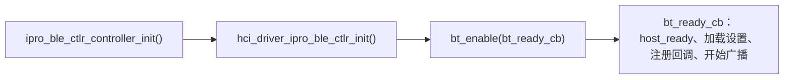

# BLE 开发

FreeRTOS 应用的 BLE 由两部分组成：Zephyr v4.4.0 的 BLE Host（源代码）与 IPRO BLE 控制器（预编译库）。应用使用 Zephyr 的 `bt_*` 回调 API 编写，`.config` 中的三个配置项决定从 16 个控制器归档文件中链接哪一个。本页示例取自 `apps/bluetooth/ble/ipro_ble_remote`，以 `defconfig_reef` 为 IPRO7AI Reef EVK 构建。

!!! abstract "要点"
    - Host：Zephyr v4.4.0，含 GAP、GATT、L2CAP、SMP、ISO 与 LE Audio；Host 与控制器之间是芯片内的 HCI，没有 UART。
    - 控制器：16 个 IPRO7 归档文件，`link1_periph`／`link1`／`link2`／`link4` × `bt52`／`bt54_iso2` × 调试版／release 版，由 `CONFIG_IPRO_BLE_CTLR_LIB`、`CONFIG_IPRO_BLE_CTLR_FEATURE`、`CONFIG_IPRO_BLE_CTLR_CFG_DBG` 选择。
    - 初始化顺序：`ipro_ble_ctlr_controller_init()` → `hci_driver_ipro_ble_ctlr_init()` → `bt_enable()`。
    - Reef 的 BLE 配置：`ipro_ble_remote`、`ipro_throughput_test`、`ipro_le_audio_headset` 加 `DEFCONFIG=defconfig_reef`，以及 `ipro_agora_sentino`（BLE 配网）。
    - 未包含于 V2.2.0：控制器源代码、PAwR／ESL 应用、IPRO6S 的 BLE 控制器。

## 协议栈架构 { #stack-architecture }

<div class="ipro-stack">
  <div class="l-app"><strong>应用</strong><span>Zephyr bt_* API：GAP · GATT · SMP · LE Audio</span></div>
  <div class="l-host"><strong>BLE Host（Zephyr v4.4.0）</strong><span>ipro_bt_host：GAP · GATT · L2CAP · SMP · ISO</span></div>
  <div class="l-hci"><strong>芯片内 HCI</strong><span>内存中的字节流（ipro_ble_ctlr_hcitl）</span></div>
  <div class="l-ctlr"><strong>IPRO BLE 控制器（预编译库）</strong><span>Link Layer · 1M／2M／Coded PHY</span></div>
</div>

```text title="components/wireless/bluetooth/"
ipro_bt_host/
├── upstream/zephyr/        Zephyr v4.4.0 Host 源代码（include/、subsys/bluetooth/）
├── port/                   FreeRTOS 移植层：HCI 驱动、kernel 接口、设置存储、加密
└── tinycrypt/
ipro_ble_controller/
├── include/                公开头文件 ipro_ble_controller.h
├── hcitl/                  芯片内 HCI 传输
├── plf/ipro7/              控制器 API 头文件（初始化、低功耗、NVDS）
├── lib/                    16 个 IPRO7 预编译归档文件
└── cmake/                  归档文件选择规则（ipro7_build.cmake）
```

每个 BLE 应用的 `.config` 都需要：

```ini
CONFIG_BLUETOOTH_LE_ENABLE=y
CONFIG_BT_CTLR_IPRO=y
CONFIG_BT_HOST_IPRO_V44=y
```

缺少 `CONFIG_BT_CTLR_IPRO` 或 `CONFIG_BT_HOST_IPRO_V44` 时，构建在 CMake 配置阶段就会停止。Host 与控制器组件会导出自己的 include 路径，应用的 `CMakeLists.txt` 不需要另外添加 `zephyr/bluetooth/*.h` 的路径。

Zephyr RTOS 镜像使用 Zephyr 自身的 Host，配合同一组控制器归档文件；V2.2.0 的 Zephyr 只有 IPRO7 EVB 与 IPRO7AI EVK 的板级定义，见 [Zephyr RTOS](zephyr.md)。

## 控制器选择 { #controller-variants }

| 配置项 | 值 | 未设置时 | 含义 |
|---|---|---|---|
| `CONFIG_IPRO_BLE_CTLR_LIB` | `link1_periph`、`link1`、`link2`、`link4` | `link1_periph` | `link1_periph` 只有 peripheral 与 broadcaster 角色；其余的数字是连接数 |
| `CONFIG_IPRO_BLE_CTLR_FEATURE` | `bt52`、`bt54_iso2` | `bt52` | `bt54_iso2` 加入 ISO 通道（LE Audio） |
| `CONFIG_IPRO_BLE_CTLR_CFG_DBG` | `y` 或不设置 | 不设置 | 不设置时链接 `_release` 归档文件；设为 `y` 时链接调试版 |

文件名规则为 `libipro_ble_controller_ipro7_<LIB>[_bt54_iso2][_release].a`，`bt52` 没有功能后缀。`lib/` 下的 16 个归档文件：

| LIB | `bt52` | `bt52` release | `bt54_iso2` | `bt54_iso2` release |
|---|---|---|---|---|
| `link1_periph` | `…_link1_periph.a` | `…_link1_periph_release.a` | `…_link1_periph_bt54_iso2.a` | `…_link1_periph_bt54_iso2_release.a` |
| `link1` | `…_link1.a` | `…_link1_release.a` | `…_link1_bt54_iso2.a` | `…_link1_bt54_iso2_release.a` |
| `link2` | `…_link2.a` | `…_link2_release.a` | `…_link2_bt54_iso2.a` | `…_link2_bt54_iso2_release.a` |
| `link4` | `…_link4.a` | `…_link4_release.a` | `…_link4_bt54_iso2.a` | `…_link4_bt54_iso2_release.a` |

配置阶段会检查：

- `CONFIG_EM_SIZE`（BLE Exchange Memory，单位 KB）必须设置。
- `bt54_iso2` 要求 `CONFIG_EM_SIZE` 至少为 32。
- `LIB` 或 `FEATURE` 的值不在上表中时，构建停止。

`CONFIG_BT_CONN`（Host 的连接数）不可超过归档文件的连接数。Exchange Memory 从 OCRAM 顶端保留，见[内存布局](build-system.md#memory-layout)。

V2.2.0 随附的 Reef 配置可作为起点：

| 应用与配置 | LIB | FEATURE | 调试版归档文件 | `CONFIG_BT_CONN` | `CONFIG_EM_SIZE` |
|---|---|---|---|---|---|
| `ipro_ble_remote` `defconfig_reef` | `link1_periph` | `bt52` | 否 | 1 | 16 |
| `ipro_throughput_test` `defconfig_reef` | `link2` | `bt52` | 否 | 2 | 32 |
| `ipro_le_audio_headset` `defconfig_reef` | `link1_periph` | `bt54_iso2` | 是 | 1 | 32 |
| `ipro_agora_sentino` `.config` | `link1_periph` | `bt52` | 否 | 1 | 16 |

`ipro_ble_transparent`、`ipro_ble_hid_keyboard` 与 `ipro_pdm_mic_demo` 是 IPRO7 EVB 与 IPRO7AI EVK 的 BLE 示例，不能为 Reef 构建。

```ini title="apps/bluetooth/ble/ipro_ble_remote/defconfig_reef（节选）"
CONFIG_BLUETOOTH_LE_ENABLE=y
CONFIG_BT_CTLR_IPRO=y
CONFIG_IPRO_BLE_CTLR_LIB="link1_periph"
CONFIG_IPRO_BLE_CTLR_FEATURE="bt52"
CONFIG_EM_SIZE=16
CONFIG_BT_CONN=1
CONFIG_BT_PERIPHERAL=y
CONFIG_BT_OBSERVER=y
CONFIG_BT_BROADCASTER=y
CONFIG_PHY_UPDATE=y
CONFIG_BT_DATA_LEN_UPDATE=y
CONFIG_BT_HOST_IPRO_V44=y
CONFIG_BT_SMP=y
CONFIG_BT_GATT_CLIENT=y
CONFIG_ENABLE_NVDS=y
CONFIG_CFG_NVDS=y
```

构建不解析 Kconfig 的依赖关系，请从最接近的随附应用复制整份配置文件再修改，见[构建系统与配置](build-system.md)。

## 初始化顺序 { #bring-up }



```c title="apps/bluetooth/ble/ipro_ble_remote/src/app/remote_app.c（节选，省略错误处理）"
ipro_ble_ctlr_controller_init(configMAX_PRIORITIES - 1);
vTaskDelay(pdMS_TO_TICKS(50));
hci_driver_ipro_ble_ctlr_init();
vTaskDelay(pdMS_TO_TICKS(50));
bt_enable(bt_ready_cb);
```

- 在调度器启动后的 FreeRTOS 任务中执行；中间的 `vTaskDelay()` 需要调度器。
- `ipro_ble_ctlr_controller_init()` 创建控制器任务。控制器有无线电时序的硬性时限，优先级要高于应用任务；随附应用使用 `configMAX_PRIORITIES - 1`。成功返回 0，控制器已启动过返回 -1，任务创建失败返回 -2。
- 在 `bt_ready_cb` 中先调用 `ipro_ble_ctlr_hcitl_host_ready()`，告知 HCI 初始化完成，控制器才能在事件之间睡眠。
- 启用 `CONFIG_BT_SETTINGS` 时，在 `bt_ready_cb` 中先用 `settings_load_subtree("bt")` 加载配对数据，再开始广播。
- Reef 没有 32.768 kHz 晶振。根据 `ipro_throughput_test` 的 README，Reef 在复位后约 7 秒才打印 BLE 就绪的消息，因为控制器会先检验 32 kHz 时钟，再回退到 RC32K（日志中出现 `XTAL32K rejected`）。

## API 用法 { #api-patterns }

以下三段按顺序放在同一个 `.c` 文件中即可编译，内容取自 `ipro_ble_remote` 的 `src/services/remote_services.c` 与 `src/app/remote_app.c`。应用使用 Zephyr 的回调式 API；控制器内部的消息机制不对应用开放。

### GATT 服务 { #gatt-service }

使用 `BT_GATT_SERVICE_DEFINE` 在编译期定义服务。下例是一个可读取并通知温度的服务（UUID 沿用 `ipro_ble_remote` 的环境服务 0xFF30／0xFF31；在 Reef 上报告芯片内置温度传感器的读数）：

```c title="GATT 服务"
#include <FreeRTOS.h>
#include <task.h>

#include <zephyr/bluetooth/bluetooth.h>
#include <zephyr/bluetooth/conn.h>
#include <zephyr/bluetooth/gatt.h>
#include <zephyr/bluetooth/uuid.h>
#include <zephyr/settings/settings.h>
#include <hci_driver_ipro_ble_ctlr.h>
#include <ipro_ble_controller.h>

#define BT_UUID_ENV_SVC   BT_UUID_DECLARE_16(0xFF30)
#define BT_UUID_ENV_TEMP  BT_UUID_DECLARE_16(0xFF31)

static int16_t temperature = 2500;      /* 0.01 °C */
static bool temp_notify_enabled;

static ssize_t temp_read(struct bt_conn *conn, const struct bt_gatt_attr *attr,
                         void *buf, uint16_t len, uint16_t offset)
{
    return bt_gatt_attr_read(conn, attr, buf, len, offset,
                             &temperature, sizeof(temperature));
}

static void temp_ccc_changed(const struct bt_gatt_attr *attr, uint16_t value)
{
    temp_notify_enabled = (value == BT_GATT_CCC_NOTIFY);
}

BT_GATT_SERVICE_DEFINE(env_svc,
    BT_GATT_PRIMARY_SERVICE(BT_UUID_ENV_SVC),
    BT_GATT_CHARACTERISTIC(BT_UUID_ENV_TEMP,
                           BT_GATT_CHRC_READ | BT_GATT_CHRC_NOTIFY,
                           BT_GATT_PERM_READ,
                           temp_read, NULL, NULL),
    BT_GATT_CCC(temp_ccc_changed, BT_GATT_PERM_READ | BT_GATT_PERM_WRITE),
);

/* attr_env_svc[1] 是温度特征值的声明；
 * bt_gatt_notify() 使用紧随其后的值属性 */
static int notify_temperature(struct bt_conn *conn)
{
    if (!temp_notify_enabled) {
        return 0;
    }
    return bt_gatt_notify(conn, &attr_env_svc[1], &temperature, sizeof(temperature));
}
```

### 广播与连接 { #gap-connection }

```c title="广播与连接回调"
#define DEVICE_NAME     "IPRO-Remote"
#define DEVICE_NAME_LEN (sizeof(DEVICE_NAME) - 1)

static struct bt_conn *current_conn;

static const struct bt_data ad[] = {
    BT_DATA_BYTES(BT_DATA_FLAGS, (BT_LE_AD_GENERAL | BT_LE_AD_NO_BREDR)),
    BT_DATA(BT_DATA_NAME_COMPLETE, DEVICE_NAME, DEVICE_NAME_LEN),
};

static int start_advertising(void)
{
    struct bt_le_adv_param adv_param = {
        .id = BT_ID_DEFAULT,
        .options = BT_LE_ADV_OPT_CONN,   /* 可连接 */
        .interval_min = 160,             /* 100 ms，单位 0.625 ms */
        .interval_max = 320,             /* 200 ms */
    };

    return bt_le_adv_start(&adv_param, ad, ARRAY_SIZE(ad), NULL, 0);
}

static void connected(struct bt_conn *conn, uint8_t err)
{
    if (err) {
        return;
    }
    current_conn = bt_conn_ref(conn);
    (void)notify_temperature(current_conn);
}

static void disconnected(struct bt_conn *conn, uint8_t reason)
{
    (void)conn;
    (void)reason;
    if (current_conn) {
        bt_conn_unref(current_conn);
        current_conn = NULL;
    }
    /* 此回调在 Host 线程中执行，不可阻塞。ipro_ble_remote 不在这里
     * 重新广播，而是用 FreeRTOS 定时器在 500 ms 后重新开始。 */
}

static struct bt_conn_cb conn_callbacks = {
    .connected = connected,
    .disconnected = disconnected,
};
```

本版本的 Host 没有 `BT_LE_ADV_CONN_NAME` 宏。请如上例把设备名称放进广播数据，或使用 Host 预定义的参数宏，例如 `BT_LE_ADV_CONN_FAST_1`。

### 启动 { #ble-init }

```c title="初始化"
static void bt_ready_cb(int err)
{
    if (err) {
        return;
    }
    ipro_ble_ctlr_hcitl_host_ready();

#if defined(CONFIG_BT_SETTINGS)
    (void)settings_load_subtree("bt");
#endif
    bt_conn_cb_register(&conn_callbacks);
    (void)start_advertising();
}

/* 在应用任务中调用 */
int ble_init(void)
{
    int err;

    err = ipro_ble_ctlr_controller_init(configMAX_PRIORITIES - 1);
    if (err) {
        return err;
    }
    vTaskDelay(pdMS_TO_TICKS(50));

    err = hci_driver_ipro_ble_ctlr_init();
    if (err) {
        return err;
    }
    vTaskDelay(pdMS_TO_TICKS(50));

    return bt_enable(bt_ready_cb);
}
```

- 要把配对数据存入 Flash，设置 `CONFIG_BT_SETTINGS=y` 与 `CONFIG_EASYFLASH4=y`（Host 的设置存储使用 EasyFlash，数据写在分区表的 `PSM` 分区中）。`ipro_le_audio_headset` 的 `defconfig_reef` 就是这样配置的；`ipro_ble_remote` 的 `defconfig_reef` 不保存配对数据。
- 连接后提高传输速率：`ipro_ble_remote` 在 `connected` 中用 `bt_gatt_exchange_mtu()` 交换 MTU，并在 `CONFIG_BT_USER_DATA_LEN_UPDATE` 时用 `bt_conn_le_data_len_update()` 请求 251 字节的 DLE。

## 在 Reef 上动手实践 { #hands-on }

把 `ipro_ble_remote` 构建给 Reef，从手机或电脑连接，通过 GATT 改变 Reef 上 RGB LED 的颜色。需要：U6 已接好控制台线的 Reef、IntelProCube 命令行工具（下文用 `<ICUBE>` 表示），以及装有通用 BLE App（nRF Connect、LightBlue）的手机，或装有 Python 并带蓝牙的 macOS／Linux 电脑。

<div class="ipro-steps" markdown>

1. **确认配置**

    `defconfig_reef` 随附即已完整。下面是其中与本例相关的配置：2 MB Flash 与 boot2 分区表的 Reef 开发板配置、应用本身的 OTA 开关，以及 BLE 部分。新的 Reef BLE 应用保留开发板与 BLE 的配置即可；`CONFIG_IPRO_BLE_REMOTE_OTA` 只属于 `ipro_ble_remote`。

    ```ini title="apps/bluetooth/ble/ipro_ble_remote/defconfig_reef（节选）"
    CONFIG_IPRO7AI_REEF=y
    CONFIG_IPRO7_FLASH_2M=y
    CONFIG_PARTITION=y
    CONFIG_IPRO_BLE_REMOTE_OTA=y

    CONFIG_BLUETOOTH_LE_ENABLE=y
    CONFIG_BT_CTLR_IPRO=y
    CONFIG_IPRO_BLE_CTLR_LIB="link1_periph"
    CONFIG_IPRO_BLE_CTLR_FEATURE="bt52"
    CONFIG_EM_SIZE=16
    CONFIG_BT_CONN=1
    CONFIG_BT_PERIPHERAL=y
    CONFIG_BT_BROADCASTER=y
    CONFIG_BT_HOST_IPRO_V44=y
    CONFIG_BT_SMP=y
    ```

2. **看懂要写入的特征值**

    Reef 专用的 0xFF80 服务有一个 LED Colour 特征值 0xFF81：3 个字节 R、G、B。写入处理函数检查长度、记录颜色，再交给 LED 驱动：

    ```c title="apps/bluetooth/ble/ipro_ble_remote/src/services/reef_service.c（节选）"
    static ssize_t color_write(struct bt_conn *conn, const struct bt_gatt_attr *attr,
                               const void *buf, uint16_t len, uint16_t offset, uint8_t flags)
    {
        const uint8_t *d = buf;

        (void)conn; (void)attr; (void)flags;
        if (offset != 0u) {
            return BT_GATT_ERR(BT_ATT_ERR_INVALID_OFFSET);
        }
        if (len != sizeof(s_ctx.rgb)) {
            return BT_GATT_ERR(BT_ATT_ERR_INVALID_ATTRIBUTE_LEN);
        }
        memcpy(s_ctx.rgb, d, sizeof(s_ctx.rgb));
        IPRO_LOGI(LOG_TAG, "[LED] Colour %u,%u,%u", d[0], d[1], d[2]);
        if (s_ctx.h.led_color) {
            s_ctx.h.led_color(d[0], d[1], d[2]);
        }
        return len;
    }

    BT_GATT_SERVICE_DEFINE(reef_svc,
        BT_GATT_PRIMARY_SERVICE(BT_UUID_REEF_SVC),
        BT_GATT_CHARACTERISTIC(BT_UUID_REEF_LED_COLOR,
                               BT_GATT_CHRC_READ | BT_GATT_CHRC_WRITE,
                               BT_GATT_PERM_READ | BT_GATT_PERM_WRITE,
                               color_read, color_write, NULL),
        /* ... 按键事件、音量、提示音与开发板信息特征值 ... */
    );
    ```

    这个文件的 `LOG_TAG` 是 `"REEF_SVC"`。要加入自己的特征值，按同样方式多写一个 `BT_GATT_CHARACTERISTIC` 项与读写处理函数。

3. **构建**

    ```bash
    make -C apps/bluetooth/ble/ipro_ble_remote DEFCONFIG=defconfig_reef
    ```

    输出：`apps/bluetooth/ble/ipro_ble_remote/build_reef/build_out/ipro_ble_remote_IPRO7.bin`。

4. **连同 boot2 与 A/B 分区表一起烧录**

    让 Reef 进入下载模式（按住 SW1 BOOT、按一下 SW2 RESET、松开 SW1；或在运行中的控制台输入 `reboot_dl`），再在 IntelProCube 目录下烧录：

    ```bash
    cd <ICUBE>
    ./ipro_iot_tool_macos --chipname ipro7 --chip-variant IPRO7AI \
        --port /dev/cu.usbserial-XXXX --baudrate 921600 \
        --boot2 chips/ipro7/builtin_imgs/boot2_v0.6.0/ipro_boot2_IPRO7_v0.6.0.bin \
        --pt <SDK>/apps/bluetooth/ble/ipro_ble_remote/partition_cfg_2M_remote_ab.toml \
        --firmware <SDK>/apps/bluetooth/ble/ipro_ble_remote/build_reef/build_out/ipro_ble_remote_IPRO7.bin
    ```

    烧录失败时工具也返回 0，请确认输出中有 `[All Success]`，再按 SW2（RESET）。这份分区表就是 [OTA 更新](ota.md)使用的布局；烧录细节见[烧录与串口](../get-started/flash-and-monitor.md)。

5. **查看控制台并连接**

    以 115200 baud 打开控制台。在 boot2 的 `[BOOT2] IPRO7 Boot2 v0.6.0` 之后，应用会打印下列消息（省略日志前缀，中间还有其他行）：

    ```text
    [BLE] Initialized
    [BLE] Services ready
    [OTA] Service ready
    [BLE] All services initialized
    [BLE] Advertising: IPRO-Remote
    ```

    连接到 `IPRO-Remote`，向特征值 0xFF81 写入 `FF 00 00`。控制台打印 `Connected! Peer: …`，接着是 `[LED] Colour 255,0,0`。再向 0xFF11（LED State）写入 `01`，LED 就以这个颜色点亮。没有手机时，可在电脑上运行随附的 bleak 测试，它会写入颜色并读回开发板信息：

    ```bash
    python3 -m venv .venv && .venv/bin/pip install bleak
    .venv/bin/python apps/bluetooth/ble/ipro_ble_remote/tools/reef_ble_test.py info led
    ```

    屏幕上打印 `board info:` 与 `LED colour [255, 0, 0] …`，LED 以红色闪烁。在控制台输入 `reef status` 可从开发板端看到同样的状态。

</div>

下一步：以 Reef 配置为起点创建自己的应用，见[创建第一个应用](../tutorials/first-own-app.md)；用控制台与主机端脚本检查应用，见[测试应用](../tutorials/testing.md)。配合 Android App 的完整 GATT 操作见[第一个 BLE 应用](../tutorials/first-ble-app.md)。

## 性能与吞吐量 { #throughput }

`ipro_throughput_test` 的 README 实测：两块运行 `defconfig_reef` 的 Reef EVK（`link2` 控制器），ATT MTU 247，DLE 251 octets，每个数据包 244 字节，连接间隔 50 ms，启用 `CONFIG_IPRO7_BLE_HOTCODE=y`：

| PHY | 单向吞吐量 |
|---|---|
| 2M | 1.34 Mbps |
| 1M | 747 kbps |

- `CONFIG_IPRO7_BLE_HOTCODE=y` 把控制器、Host 与 FreeRTOS kernel 的每包处理路径放到 OCRAM 中执行，约占 88 KB OCRAM。相同条件下不启用时（代码在 Flash 中），2M PHY 约 0.6 Mbps。
- 此选项不能与 AI＋图像的 OCRAM 布局，或低功耗配置（`CONFIG_HAL_LP`、`CONFIG_IPRO_PM_*`、`CONFIG_OCRAM_NORET_SPLIT`）同时使用，链接脚本生成器会拒绝。
- 大量数据建议使用 2M PHY、连接间隔 30–50 ms、244 字节的数据包。

测试在控制台中用 `tp slave`、`tp master`、`tp conn`、`tp phy`、`tp start` 操作，见 [BLE 吞吐量测试](../tutorials/ble-throughput.md)。

## LE Audio { #le-audio }

LE Audio 需要 `CONFIG_IPRO_BLE_CTLR_FEATURE="bt54_iso2"` 与 `CONFIG_EM_SIZE=32`，再加上 `CONFIG_BT_AUDIO=y` 与 BAP、PACS、ASCS 等角色配置，LC3 通过 `CONFIG_COMPONENTS_LC3_ENABLE=y` 加入。Host 的 LE Audio 头文件在 `ipro_bt_host/upstream/zephyr/include/zephyr/bluetooth/audio/`。随附的 FreeRTOS 示例是单播耳机 `ipro_le_audio_headset`，以 `DEFCONFIG=defconfig_reef` 为 Reef 构建；配置、协议、音频路径与当前状态见[音频与 LE Audio](audio.md)。

## 低功耗 { #low-power }

- `ipro_ble_remote` 的 `defconfig_reef` 不使用 PDS：Reef 由 USB 供电，摄像头与音频也需要时钟。
- 控制器的 PDS 睡眠只接受 16 KB EM 的布局；在 `bt54_iso2`（32 KB EM）配置下，控制器保留原生睡眠，但不进入 PDS。
- `CONFIG_IPRO_PM_BLE` 与 `CONFIG_IPRO_PM_PDS_CONNECTED` 会强制从源代码构建控制器，V2.2.0 无法构建，见[本版本的限制](#limitations)。
- BLE 配合 PDS31 睡眠与配对后重新连接的示例是 `ipro_pdm_mic_demo`，属于 IPRO7 EVB／IPRO7AI EVK。

睡眠模式、唤醒源与测量方法见[低功耗](low-power.md)。

## 本版本的限制 { #limitations }

- 控制器只以预编译库提供，V2.2.0 不含其源代码。以下配置需要从源代码构建控制器，会让构建停止：`CONFIG_IPRO_BLE_CTLR_FORCE_SOURCE_BUILD`、`CONFIG_IPRO_BLE_CTLR_SUBRATING`、`CONFIG_IPRO_BLE_CTLR_CSSA`、`CONFIG_IPRO_PM_BLE`、`CONFIG_IPRO_PM_PDS_CONNECTED`。
- PAwR 与 ESL：Host 头文件含周期性广播相关 API，但没有 PAwR／ESL 应用。未包含于 V2.2.0，请联系 INTELPRO。
- `ipro_ble_remote` 的 OTA 服务只在 `defconfig_reef` 中开启；默认 `.config` 构建的是不含 OTA 的 IPRO7 EVB 镜像。
- V2.2.0 不含 IPRO6S 的 BLE 控制器；本套件中的 IPRO6S 应用只有 Wi-Fi。

## 参考应用 { #reference-apps }

| 应用（Reef 构建） | 内容 |
|---|---|
| `ipro_ble_remote`（`DEFCONFIG=defconfig_reef`） | Reef 的 GATT 服务：WS2812 LED、按键、芯片温度、UART、OV5640 JPEG 拍照与移动侦测、图片上传、PDM 麦克风音量、提示音，以及 BLE OTA。附带 Android App `ipro_remote_demo.apk` 与主机端脚本 `tools/reef_ble_test.py`、`tools/reef_ota.py` |
| `ipro_throughput_test`（`DEFCONFIG=defconfig_reef`） | 双板吞吐量测试：1M／2M／Coded PHY、DLE、MTU 247 |
| `ipro_le_audio_headset`（`DEFCONFIG=defconfig_reef`） | LE Audio 单播耳机 |
| `ipro_agora_sentino`（`.config`） | 云端语音应用的 BLE 配网，Wi-Fi 经由 IPRO6S FIN 卡 |

`ipro_ble_transparent`（AT 接口的数据通道）、`ipro_ble_hid_keyboard`（HID over GATT）与 `ipro_pdm_mic_demo` 只能为 IPRO7 EVB 或 IPRO7AI EVK 构建。

- [第一个 BLE 应用](../tutorials/first-ble-app.md)
- [BLE 吞吐量测试](../tutorials/ble-throughput.md)
- [OTA 更新](ota.md)
- [音频与 LE Audio](audio.md)
- [API 参考](../reference/api/index.md)
