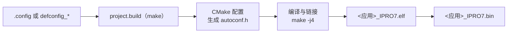

# 构建系统与配置

FreeRTOS 应用由 `make` 驱动 CMake 构建。应用的 `.config` 列出所有 `CONFIG_*` 配置项，构建时转换成 C 头文件 `autoconf.h`，并据此决定要编译哪些组件。本页说明这套流程与 Reef 各组配置的构建方式；Zephyr 使用 `west` 构建，见 [Zephyr RTOS](zephyr.md)。

!!! abstract "要点"
    - 构建：`make -C apps/<分类>/<应用>` 或 `./build_freertos.sh build <应用>`。镜像文件是 `build/build_out/<应用>_<CONFIG_CHIP>.bin`：IPRO7 与 IPRO7AI 应用为 `_IPRO7.bin`，IPRO6S 应用为 `_IPRO6.bin`。
    - `.config` 按原样读取。Kconfig 文件只用来说明选项，`select`、`depends on` 与默认值都不会生效；唯一的例外是 Reef 的晶振微调，`.config` 未写时构建会自动设为 95。
    - Reef 的构建大多使用替代配置：`DEFCONFIG=defconfig_reef` 输出到 `build_reef/`。直接 `make` 就得到 Reef 版本的只有 `ipro7ai_reef_demo`、`ipro_reef_teach` 与 `ipro_agora_sentino`。
    - 发布包中 `make menuconfig` 与 `make defconfig` 无法使用，请用文本编辑器修改 `.config` 或 `defconfig_*` 文件。
    - 工具链（GCC 14，`/opt/toolchain/riscv_ipro7/`）不随 SDK 提供，请向 INTELPRO 获取。

## 构建流程 { #build-pipeline }



所有命令都在 SDK 根目录运行：

```bash
make -C apps/platform/ipro7ai_reef_demo          # 构建出厂固件
make -C apps/platform/ipro7ai_reef_demo clean    # 删除 build/
./build_freertos.sh -l                           # 按分类列出全部应用
./build_freertos.sh build ipro7ai_reef_demo      # 按应用名称构建，日志写入 build/build.log
```

构建时依次发生：

1. 应用的 `Makefile` 调用 `make -C <SDK> -f project.build PROJECT_PATH=<应用目录>`。项目名称取自应用目录名称。
2. `project.build` 从配置文件读取 `CONFIG_CPU_ID` 与 `CONFIG_CROSS_COMPILE`，并查找 CMake：先用 `PATH` 中的 `cmake`，再用随附的 `tools/cmake/`（CMake 3.15，仅 Linux x86-64）。两者都没有时以 `No cmake found` 停止。
3. CMake 以 Unix Makefiles 生成器配置构建目录，由 `cmake/generate_autoconf.cmake` 根据配置文件写出 `include/generated/autoconf.h`，再加入 `bsp/`、`components/` 与应用目录。
4. `make -j4` 编译与链接。多数 SDK 组件库以 `-Werror` 编译，其中任何警告都会让构建停止。链接器在结尾打印各内存区域的用量，`objcopy` 生成 `.bin`。
5. `compile_commands.json` 复制到 SDK 根目录，供编辑器的代码索引使用。

CMake 开始前，构建会打印 `[INFO] Build Path: <目录>` 与 `CPU: intelpro_ipro7`，可以确认所用的目录与工具链目标。

### 工具链前缀 { #toolchain }

编译器前缀按以下顺序取第一个已设置的来源：

1. 环境变量或 make 命令行中的 `CROSS_COMPILE`：`make -C <应用> CROSS_COMPILE=<目录>/bin/riscv64-unknown-elf-`。
2. 配置文件中的 `CONFIG_CROSS_COMPILE`。多数随附配置写的是 `/opt/toolchain/riscv_ipro7/bin/riscv64-unknown-elf-`。
3. `/opt/toolchain/riscv_ipro7/bin/riscv64-unknown-elf-`（不适用于 Windows）。

`cmake/toolchain.cmake` 只在前缀后面接上 `gcc`、`g++`、`ld` 与 `objcopy`，不会另外搜索路径。接着它试编译 DSP 扩展指令：编译器接受时加上 DSP 编译选项，否则改用标准 GCC 的编译选项。

发布包记载的构建主机是 macOS 与 Linux（bash）。`project.build` 虽有 Windows 分支（用 `python` 解析配置文件、使用 `PATH` 中的 `cmake`），但在 Windows 上不设默认前缀，必须自行提供 `CROSS_COMPILE`；`build_freertos.sh` 与 `tools/serial_monitor.py` 需要 POSIX shell。

### 输出文件 { #outputs }

位于 `build/build_out/`（替代配置则是 `build_<名称>/build_out/`）：

| 文件 | 内容 |
|---|---|
| `<应用>_<CHIP>.elf` | 含符号的镜像，供调试与 `size` 使用 |
| `<应用>_<CHIP>.bin` | 用于烧录的二进制文件 |
| `<应用>_<CHIP>.map` | 链接 map |
| `<应用>_<CHIP>.asm` | 反汇编，仅在 `CONFIG_GENERATE_ASM=y` 时生成 |

`<CHIP>` 是 `CONFIG_CHIP` 的值：所有 IPRO7 与 IPRO7AI 配置（包括 Reef）为 `IPRO7`，`ipro6_demo`、`ipro6_if_wifi` 与 `ipro6_fmac` 为 `IPRO6`。`build_freertos.sh` 的其他操作与选项见[工具命令行](../reference/tools.md)。

## 配置文件 .config { #configuration }

`.config` 每行一个配置项，格式与 Linux kernel 相同。构建时的转换规则：

| `.config` | `autoconf.h` |
|---|---|
| `CONFIG_SHELL=y` | `#define CONFIG_SHELL 1` |
| `CONFIG_EM_SIZE=16` | `#define CONFIG_EM_SIZE 16` |
| `CONFIG_CHIP="IPRO7"` | `#define CONFIG_CHIP "IPRO7"` |
| `# CONFIG_EASYFLASH4 is not set` 或 `CONFIG_X=n` | `#undef`，不定义 |
| 其他注释行 | C 注释 |

每个配置项也会以 `-D` 传给编译器，并设为同名的 CMake 变量，应用的 `CMakeLists.txt` 可以直接写 `if(CONFIG_SHELL)`。

选项的说明位于根目录 `Kconfig`、`bsp/Kconfig`、`components/**/Kconfig` 与部分应用的 `Kconfig` 中，但构建只读取配置文件，不会解析 Kconfig。因此：

- `select` 不会生效。例如 `CONFIG_IPRO7AI_REEF` 与 `CONFIG_MM_SUPPORT` 在 Kconfig 中 select `USE_PSRAM`，配置文件仍要明确写出 `CONFIG_USE_PSRAM=y`。
- Kconfig 的默认值不会生效。配置文件没写的选项就是未设置。
- 只有一个默认值由构建补上：Reef 的配置文件中没有 `CONFIG_IPRO7_XTAL_CAPCODE` 时，`bsp/board/ipro7/CMakeLists.txt` 会加上 `-DCONFIG_IPRO7_XTAL_CAPCODE=95`，并打印 `[board] IPRO7AI Reef: CONFIG_IPRO7_XTAL_CAPCODE=95 (board default)`。配置文件中明确写出的值优先；`0` 表示沿用芯片启动时的值。这是编译器定义，不会出现在 `autoconf.h` 中。
- 新的配置请从最接近的随附配置复制后再修改，不要从空白文件开始。

### 板型配置 { #board-keys }

板型配置项通过 `board_config.h` 决定使用 `bsp/board/ipro7/` 中的哪个板级头文件，只能设置一个。`board_config.h` 按固定顺序判断，`CONFIG_EVB`／`CONFIG_DVK` 与 `CONFIG_IPRO7AI_EVK` 都排在 `CONFIG_IPRO7AI_REEF` 之前：同时设置了 `CONFIG_EVB=y` 与 `CONFIG_IPRO7AI_REEF=y` 的配置会构建成 IPRO7 EVB 版本，而且不会有任何提示。

| 配置项 | 板级头文件 |
|---|---|
| `CONFIG_IPRO7AI_REEF=y` | `ipro7ai_reef_board_config.h`（IPRO7AI Reef EVK） |
| `CONFIG_EVB=y`、`CONFIG_IPRO7AI_EVK=y`、`CONFIG_IPRO7_ARDUINO=y` 等 | 其他 INTELPRO 开发板 |

所有随附的 Reef 配置都设置了 `CONFIG_IPRO7AI_REEF=y` 与 `CONFIG_BOARD="IPRO7AI_REEF"`，没有其他板型配置项。

### 常用配置项 { #common-settings }

| 配置项 | 说明 |
|---|---|
| `CONFIG_IPRO7=y`、`CONFIG_CHIP="IPRO7"` | 芯片；`CONFIG_CHIP` 也是输出文件名的后缀（IPRO6S 为 `CONFIG_IPRO6=y`、`CONFIG_CHIP="IPRO6"`） |
| `CONFIG_CPU_ID="intelpro_ipro7"` | 工具链目标，两种芯片相同 |
| `CONFIG_CROSS_COMPILE="…/riscv64-unknown-elf-"` | 工具链前缀，见[工具链前缀](#toolchain) |
| `CONFIG_IPRO7AI_REEF=y`、`CONFIG_BOARD="IPRO7AI_REEF"` | 板型，见[板型配置](#board-keys) |
| `CONFIG_FREERTOS_SUPPORT=y` | 使用 FreeRTOS |
| `CONFIG_LINK_FLASH=y` | 程序直接从 Flash 执行（XIP） |
| `CONFIG_IPRO7_FLASH_2M=y`（或 `_4M`、`_8M`） | Flash 链接大小，未设置时为 1 MB |
| `CONFIG_USE_PSRAM=y` | 启用 8 MB PSRAM |
| `CONFIG_PLATFORM_UART_BAUDRATE=115200` | 控制台波特率，未设置时为 115200 |
| `CONFIG_SHELL=y` | 控制台 shell |
| `CONFIG_MM_SUPPORT=y` | ISP、摄像头与 MJPEG；需同时设置 `CONFIG_USE_PSRAM=y` |
| `CONFIG_AI_SUPPORT=y` | NPU 推理运行库；需同时设置 `CONFIG_USE_PSRAM=y` |
| `CONFIG_BLUETOOTH_LE_ENABLE=y` | BLE；控制器与 Host 的配置见 [BLE 开发](ble.md) |

构建后，构建目录下的 `include/generated/autoconf.h` 就是实际生效的值。以 `make -C apps/bluetooth/ble/ipro_ble_remote DEFCONFIG=defconfig_reef` 为例：

```c title="apps/bluetooth/ble/ipro_ble_remote/build_reef/include/generated/autoconf.h（节选）"
#define CONFIG_IPRO7 1
#define CONFIG_CHIP "IPRO7"
#define CONFIG_IPRO7AI_REEF 1
#define CONFIG_BOARD "IPRO7AI_REEF"
#define CONFIG_IPRO7_FLASH_2M 1
/* CONFIG_EASYFLASH4 is not set */
#undef CONFIG_EASYFLASH4
#define CONFIG_IPRO_BLE_REMOTE_OTA 1
#define CONFIG_IPRO_BLE_CTLR_LIB "link1_periph"
#define CONFIG_EM_SIZE 16
```

### 配置工具 { #config-tools }

| 工具 | 在发布包中 |
|---|---|
| 文本编辑器 | 直接修改 `.config` 或 `defconfig_*` 文件，这是受支持的做法 |
| `make menuconfig` | 无法使用：需要未随附的 `tools/kconfig/menuconfig.py`，应用的 Makefile 也不转交这个目标 |
| `make defconfig`、`make list-defconfigs` | 部分 Makefile（例如 `ipro_ble_remote`）有这些目标。它们先查找未随附的 `configs/` 目录，再把应用目录下的 `defconfig` 复制成 `.config` |
| `make savedefconfig`、`make show-config` | 把 `.config` 复制成 `defconfig`；打印 `.config` |
| `tools/script/parse_kconfig_dynamic.py` | 把 Kconfig 树打印成 JSON（需要 `kconfiglib`），构建不会用到 |

## 替代配置 { #variants }

支持多种开发板或功能的应用会附带多个配置文件。选用其中一个即可，不必改动 `.config`：

| 方式 | 示例 | 构建目录 |
|---|---|---|
| `DEFCONFIG=<文件名>` | `make -C apps/bluetooth/ble/ipro_ble_remote DEFCONFIG=defconfig_reef` | `build_reef/` |
| `build_freertos.sh -d <文件名>` | `./build_freertos.sh -d defconfig_reef build ipro_ble_remote` | `build_reef/` |
| `BOARD=<板>` | `make -C apps/multimedia/ipro_agora_sentino`（默认 `BOARD=reef`，即 `.config`） | `build/` |

- `DEFCONFIG=` 把指定文件复制成 `build_<名称>/.config` 再构建。`<名称>` 是文件名去掉 `defconfig_` 前缀与扩展名：`defconfig_reef_ov5640` 输出到 `build_reef_ov5640/`，`config_evk` 输出到 `build_config_evk/`。
- 输出文件名不变，同样是 `<应用>_IPRO7.bin`，位于 `build_<名称>/build_out/`。
- `BOARD=` 只有两个 Makefile 实现：`ipro_agora_sentino`（默认 `reef`，即 `.config`；`BOARD=evk` 选用 `config_evk`）与 `ipro_pdm_mic_demo`（IPRO7 EVB／IPRO7AI EVK 的应用），其他应用会忽略它。`build_freertos.sh` 没有 `BOARD` 选项，请用 `-d` 指定配置文件。
- `make clean` 的行为取决于应用的 Makefile。把 `clean` 交给 `project.build` 的应用（`ipro_ble_remote`、`ipro_throughput_test`、`ipro_le_audio_headset`、`ipro7_uvc_cam`、`ipro_agora_sentino`），`make clean DEFCONFIG=<文件名>` 会删除 `build_<名称>/`；`ipro7ai_reef_demo`、`ipro_reef_teach` 与 `ipro_ai_link` 只删除 `build/`，`ipro7_jpeg_decode` 删除 `build/` 与所有 `build_*/`。其他构建目录请自行删除。
- 命令行中的 `-j N` 或 `build_freertos.sh -j N` 只作用于外层 make；实际编译固定以 `-j4` 执行。

本版本的 Reef 配置：

| 应用 | 构建命令 | Flash 链接大小 | 控制台 |
|---|---|---|---|
| `ipro7ai_reef_demo` | `make -C apps/platform/ipro7ai_reef_demo` | 1 MB | 115200 |
| `ipro7ai_reef_demo` + Wi-Fi | `make -C apps/platform/ipro7ai_reef_demo DEFCONFIG=defconfig_wifi_ipro6s` | 1 MB | 115200 |
| `ipro_reef_teach` | `make -C apps/ai/ipro_reef_teach` | 2 MB | 115200 |
| `ipro_ble_remote` | `make -C apps/bluetooth/ble/ipro_ble_remote DEFCONFIG=defconfig_reef` | 2 MB | 115200 |
| `ipro_throughput_test` | `make -C apps/bluetooth/ble/ipro_throughput_test DEFCONFIG=defconfig_reef` | 1 MB | 115200 |
| `ipro_le_audio_headset` | `make -C apps/bluetooth/le_audio/ipro_le_audio_headset DEFCONFIG=defconfig_reef` | 2 MB | 115200 |
| `ipro7_uvc_cam` 网络摄像头 | `make -C apps/multimedia/ipro7_uvc_cam DEFCONFIG=defconfig_reef_ov5640` | 自带 `ipro7_uvc_cam.ld` | 115200 |
| `ipro7_uvc_cam` 石头剪刀布 | `make -C apps/multimedia/ipro7_uvc_cam DEFCONFIG=defconfig_reef_rps` | 自带 `ipro7_uvc_cam.ld` | 115200 |
| `ipro7_jpeg_decode` | `make -C apps/multimedia/ipro7_jpeg_decode DEFCONFIG=defconfig_reef` | 1 MB | **921600** |
| `ipro_ai_link` | `make -C apps/test/ipro_ai_link DEFCONFIG=defconfig_reef` | 2 MB | 115200 |
| `ipro_agora_sentino` | `make -C apps/multimedia/ipro_agora_sentino` | 2 MB | 115200 |

`ipro_ble_remote`、`ipro_throughput_test`、`ipro_le_audio_headset`、`ipro7_uvc_cam`、`ipro_ai_link` 与 `ipro7_jpeg_decode` 直接 `make` 会构建成其他开发板的版本；在 Reef 上一律指定 Reef 的配置文件。除了 `ipro_throughput_test/defconfig_reef`，所有 Reef 配置都设置了 `CONFIG_USE_PSRAM=y`。各配置的烧录方式（包括分区表、boot2 与 `mfg` 数据）见[示例](../examples/index.md)与应用的 README。

## 内存布局 { #memory-layout }

| 区域 | 起始地址 | 大小 | 用途 |
|---|---|---|---|
| Flash | `0x13000000` | 默认按 1 MB 链接；`CONFIG_IPRO7_FLASH_2M`／`_4M`／`_8M` 改为 2／4／8 MB | 代码与只读数据，XIP 执行 |
| PSRAM | `0x1e000000` | 8 MB | `CONFIG_USE_PSRAM=y` 时，`.data`、`.bss` 与主 heap 放在这里 |
| OCRAM | `0x11010000` | 256 KB，扣除下列保留部分 | 未启用 PSRAM 时的主 RAM；`.ocram_*` 段、栈与需要高速执行的代码 |
| HBNRAM | `0x20090000` | 4 KB | 休眠期间保留的数据 |

OCRAM 可用大小随配置而变：

| 配置 | 链接器可用的 OCRAM |
|---|---|
| 未启用 AI（一般情况） | 256 KB 减 `CONFIG_EM_SIZE`（BLE Exchange Memory，从 OCRAM 顶端保留） |
| `CONFIG_AI_SUPPORT=y` 且 `CONFIG_MM_SUPPORT=y`，未用 BLE（`CONFIG_EM_SIZE` 为 0 或未设置） | 64 KB |
| `CONFIG_AI_SUPPORT=y` 且 `CONFIG_MM_SUPPORT=y`，使用 BLE | 48 KB |

AI 与图像同时开启时，NPU 会占用 OCRAM 的高地址区段，再加上 BLE 的 Exchange Memory，OCRAM 就很紧张；三者都需要的应用，可能得拆成不同的配置。

- Flash 链接大小不可超过板上实际容量，默认 1 MB 是为了避免镜像在不知不觉中超出物理 Flash。Reef 的 IPRO7AI 内封 2 MB Flash（见 [IPRO7AI Reef EVK](../hardware/boards/reef-evk.md)），上表中的 Reef 配置分别按 1 MB 或 2 MB 链接。`ipro7ai_reef_demo` 的 `.config` 注明 1 MB 布局适用于两种内封 Flash，加上 `CONFIG_IPRO7_FLASH_2M=y` 可让链接器使用整颗 Flash。
- 按 2 MB 链接不会加大固件分区：镜像仍要放得进烧录时所用分区表的固件区（`partition_cfg_2M.toml` 为 1180 KB）。
- 链接脚本由 `bsp/board/linker/` 生成（模板 `ipro7/ipro7_common.ld.in`，内存参数在 `configs/ipro7_flash.cmake` 中）。应用目录下有 `<应用>.ld`（例如 `ipro7_uvc_cam.ld`），或配置文件设置了 `CONFIG_LINKER_SCRIPT="<文件名>"` 时，改用该链接脚本，Flash 大小配置项也就不再适用。
- 构建结尾打印的内存用量是判断能否放得下的依据。

## 应用结构 { #app-structure }

```text
apps/<分类>/<应用>/
├── .config            构建配置（必需）
├── Makefile           调用 SDK 根目录的 project.build
├── CMakeLists.txt     源文件、include 路径与 setup_project()
├── main.c             入口
├── Kconfig            （可选）应用专属选项的说明
├── defconfig_*        （可选）替代配置
├── <应用>.ld          （可选）应用自带的链接脚本
├── src/  include/
└── build/             构建输出（自动生成）
    ├── include/generated/autoconf.h
    └── build_out/<应用>_IPRO7.{elf,bin,map}
```

应用的 `CMakeLists.txt` 不需要 `cmake_minimum_required()` 或 `project()`，直接使用 SDK 的构建宏：

| 宏或属性 | 作用 |
|---|---|
| `__component_add_include_dirs(<目录>)` | 添加 include 路径 |
| `target_sources(app PRIVATE ...)` | 把源文件加入 `app` 库；`main.c` 不要放在这里 |
| `set_property(GLOBAL APPEND PROPERTY SDK_LIBS app)` | 链接 `app` 库 |
| `set_property(GLOBAL APPEND PROPERTY SDK_WHOLE_ARCHIVE_LIBS app)` | 以 whole-archive 方式链接；注册了 shell 命令时必须添加 |
| `__set_main_file(main.c)` | 指定主程序，只编译进 ELF |
| `setup_project(<应用>)` | 生成 `<应用>_<CHIP>.elf`、`.bin`、`.map`；名称要与目录名称相同 |

在 `CMakeLists.txt` 中使用 `if(CONFIG_…)`，可以只在需要的配置中加入源文件。出厂固件就是这样加入 Wi-Fi 与 RTSP 的源文件，同一个目录同时构建 `.config` 与 `defconfig_wifi_ipro6s`：

```cmake title="apps/platform/ipro7ai_reef_demo/CMakeLists.txt（节选）"
# Wi-Fi through the IPRO6S_FIN in CARD1 (ipronet_host over SDIO).
if(CONFIG_WIFI_USE_IPRO6S)
    target_sources(app PRIVATE ${CMAKE_CURRENT_SOURCE_DIR}/src/wifi_ipro6s.c)
    ...
endif()

# RTSP MJPEG camera stream over that Wi-Fi; camera ch0 at sensor / 2.
if(CONFIG_WIFI_USE_IPRO6S AND CONFIG_RTSP_SERVER)
    target_sources(app PRIVATE ${CMAKE_CURRENT_SOURCE_DIR}/src/wifi_rtsp.c)
    target_compile_definitions(app PRIVATE CAM_SCALE_DIV=2u)
endif()
```

所有 FreeRTOS 应用共用 `components/os/freertos/freertos_app_hooks`：heap、FreeRTOS hook（idle、tick、stack overflow、malloc failed）与 assert 都有 weak 默认实现。`main()` 只需调用 `ipro_platform_init()`、创建任务并启动调度器。

- `ipro_platform_init()` 依次完成平台初始化（开发板配置与控制台 UART）、heap、boot2 分区表、日志，以及 `CONFIG_SHELL=y` 时的 shell。应用不要再初始化一次 shell。
- `main.c` 中不要再添加 heap、hook 或 assert 的样板代码。要覆盖某个 hook（例如 `vApplicationIdleHook`），在自己的源文件中定义同名的非 weak 版本即可，链接器会自动采用。

## 在 Reef 上动手实践 { #hands-on }

为出厂固件创建自己的替代配置，确认构建如何处理它，再上板运行。本例按照 `.config` 注释中的建议，让 `ipro7ai_reef_demo` 按整颗 2 MB 内封 Flash 链接。

<div class="ipro-steps" markdown>

1. **创建配置文件。** 复制 `.config` 并添加一行：

    ```bash
    cp apps/platform/ipro7ai_reef_demo/.config apps/platform/ipro7ai_reef_demo/defconfig_2m
    echo 'CONFIG_IPRO7_FLASH_2M=y' >> apps/platform/ipro7ai_reef_demo/defconfig_2m
    ```

    ```ini title="apps/platform/ipro7ai_reef_demo/defconfig_2m（新增的一行）"
    CONFIG_IPRO7_FLASH_2M=y
    ```

2. **查看这个配置项在哪里用到。** 链接脚本生成器把它转换成 `flash` 内存区域的大小：

    ```cmake title="bsp/board/linker/configs/ipro7_flash.cmake（节选）"
    elseif(CONFIG_IPRO7_FLASH_2M)
        set(FLASH_SIZE "2M")
        message(STATUS "IPRO7 flash: 2M (CONFIG_IPRO7_FLASH_2M=y, SF3 external flash)")
    ...
    else()
        set(FLASH_SIZE "1M")
        message(STATUS "IPRO7 flash: 1M (default, on-chip)")
    endif()
    ```

3. **构建。**

    ```bash
    make -C apps/platform/ipro7ai_reef_demo DEFCONFIG=defconfig_2m
    ```

    构建输出中会有（路径已缩短）：

    ```text
    [INFO] Using defconfig: defconfig_2m -> <SDK>/apps/platform/ipro7ai_reef_demo/build_2m/.config
    [INFO] Build Path: <SDK>/apps/platform/ipro7ai_reef_demo/build_2m
    -- IPRO7 flash: 2M (CONFIG_IPRO7_FLASH_2M=y, SF3 external flash)
    -- [board] IPRO7AI Reef: CONFIG_IPRO7_XTAL_CAPCODE=95 (board default)
    Memory region         Used Size  Region Size  %age Used
               flash:          …         2 MB       …%
    ```

    镜像文件是 `apps/platform/ipro7ai_reef_demo/build_2m/build_out/ipro7ai_reef_demo_IPRO7.bin`；原有的 `.config` 与 `build/` 都没有变动。

4. **确认生效的配置。**

    ```bash
    grep -E '^#define CONFIG_(IPRO7AI_REEF|IPRO7_FLASH_2M) ' \
        apps/platform/ipro7ai_reef_demo/build_2m/include/generated/autoconf.h
    ```

    ```text
    #define CONFIG_IPRO7AI_REEF 1
    #define CONFIG_IPRO7_FLASH_2M 1
    ```

5. **烧录并运行。** 使用 `build_2m/` 下的镜像文件，按出厂固件的方式烧录（见[烧录与串口](../get-started/flash-and-monitor.md)），或用一条命令完成：

    ```bash
    export IPRO_FLASH_TOOL=<ICUBE>/ipro_iot_tool_macos
    ./build_freertos.sh -d defconfig_2m -p /dev/cu.usbserial-XXXX \
        -P <ICUBE>/chips/ipro7/partition/partition_cfg_2M.toml \
        build flash monitor ipro7ai_reef_demo
    ```

6. **查看控制台**（115200 baud）。开头几行中（省略日志前缀），`Build:` 行是这次构建的时间，`[XTAL]` 行是构建补上的微调值：

    ```text
    Build:<时间>,<日期>
    [XTAL] capcode <开机值> -> 95
      IPRO7AI Reef carrier demo
      UART0 TX=20 RX=21  RGB=G24  SPK_EN=G25(hi)
    shell ready - `reef`, `led`, `btn`, `spk`, `mic`, `sd`, `fin`, `cam`, `hp`
    ```

</div>

要还原时，重新烧录 `build/` 下的镜像即可。接下来：按照[创建第一个自己的应用](../tutorials/first-own-app.md)编写一个自己的应用，再用[测试你的应用](../tutorials/testing.md)验证它。

## 创建新应用 { #creating-apps }

[创建第一个自己的应用](../tutorials/first-own-app.md)从空目录开始一步步创建 Reef 应用。它遵循的规则：

- 应用放在 `apps/<分类>/<应用>/`。复制来的 Makefile 用 `IPRO_SDK_BASE ?= $(abspath ../../../)` 找到 SDK 根目录；多一层（例如 `apps/bluetooth/ble/<应用>`）时要改成 `../../../../`。Makefile 请复制现有文件，不要从网页粘贴：recipe 行必须以 tab 开头。
- `.config` 从 `apps/platform/ipro7ai_reef_demo/.config` 开始，删掉用不到的部分。第一行的注释就是 `./build_freertos.sh -l` 显示的说明。
- `CMakeLists.txt` 使用[应用结构](#app-structure)中列出的宏；`setup_project()` 的名称要与目录名称相同。
- `main.c` 保持精简：

    ```c title="main.c"
    #include <FreeRTOS.h>
    #include <task.h>

    #include "freertos_app_hooks.h"

    static void app_task(void *arg)
    {
        (void)arg;
        for (;;) {
            vTaskDelay(pdMS_TO_TICKS(1000));
        }
    }

    int main(void)
    {
        ipro_platform_init();   /* platform, heap, boot2, log, shell */
        xTaskCreate(app_task, "app", 1024, NULL, 5, NULL);
        vTaskStartScheduler();
        for (;;) {
        }
    }
    ```

## 本版本的限制 { #limitations }

- 没有交互式配置工具：发布包中 `make menuconfig` 与 `make defconfig` 无法使用（见[配置工具](#config-tools)）。
- 不解析 Kconfig，依赖的选项必须自己写进配置文件；构建唯一补上的默认值是 Reef 的晶振微调。
- `BOARD=` 只在 `ipro_agora_sentino` 与 `ipro_pdm_mic_demo` 中有作用。
- 发布包只记载 macOS 与 Linux 构建主机。

## 相关文档 { #related }

- [创建第一个自己的应用](../tutorials/first-own-app.md)：从空目录创建 Reef 应用。
- [测试你的应用](../tutorials/testing.md)：控制台检查、自检与 `build_freertos.sh test`。
- [架构](architecture.md)：分层、组件与目录。
- [BLE 开发](ble.md)：`.config` 中的 BLE 配置。
- [工具命令行](../reference/tools.md)：`build_freertos.sh` 的所有操作与选项。
- [示例](../examples/index.md)：各应用附带的配置文件。
