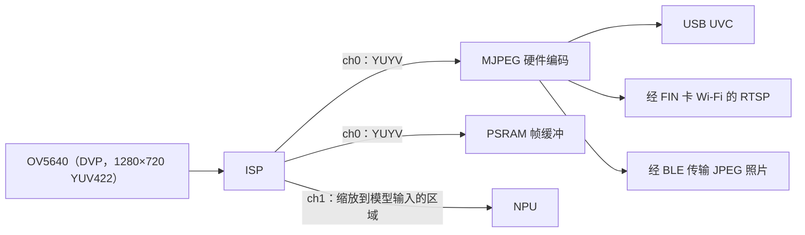

# 摄像头与图像

IPRO7AI 通过 8 位 DVP 接口连接摄像头传感器。芯片内的 ISP 有两个输出通道：通道 0 用于预览或 MJPEG 硬件编码，通道 1 缩小后交给 NPU。SDK 提供传感器驱动、ISP 与 MJPEG 组件，以及 CherryUSB 的 UVC 类。IPRO7AI Reef EVK 的摄像头是连接在 FPC1 上的 OV5640 模组；`ipro7ai_reef_demo` 可从 shell 启动摄像头，`ipro7_uvc_cam` 则把开发板变成 USB 摄像头。

!!! abstract "要点"
    - Reef 摄像头：FPC1 上的 OV5640 FLEX-24 模组，1280×720 YUV422，自动曝光与白平衡由传感器处理。SW7 拨到 **CAM**，连接排线前先拔掉 USB-C。
    - 配置：`CONFIG_MM_SUPPORT=y`、`CONFIG_USE_PSRAM=y`、`CONFIG_COMPONENTS_SENSOR_ENABLE=y`、`CONFIG_SENSOR_OV5640=y`；用作 USB 摄像头时再加 UVC 配置。
    - 示例：`ipro7ai_reef_demo`（`cam` 命令）、`ipro7_uvc_cam`（`defconfig_reef_ov5640` 摄像头、`defconfig_reef_rps` NPU 游戏）、`defconfig_wifi_ipro6s` 经 Wi-Fi 的 RTSP 视频流、`ipro7_jpeg_decode` 的 JPEG 解码。
    - MJPEG 硬件只能编码；JPEG 图片由 CPU 解码。Zephyr 没有摄像头驱动。

## 图像管线 { #camera-video }



- 每个 ISP 通道有各自的输出尺寸。通道 0 是主机或您的程序看到的画面；通道 1 取传感器图像中的一块区域，缩放成模型的输入（例如石头剪刀布版本把正中央 512×512 的方块缩小成 128×128）。
- OV5640 与 OV2640 驱动让传感器自己完成自动曝光、增益与白平衡，因此不启动 ISP 固件的 3A。IQ 参数表只提供给其他 INTELPRO 开发板所用的 SC101IOT 传感器。
- ISP 的 DMA 把帧写入 PSRAM；CPU 读取前要先使该范围的 D-cache 失效（`L1C_DCACHE_INVALID_RANGE`）。
- Reef 的 OV5640 模组读出的图像上下颠倒；`ipro7ai_reef_demo/src/cam.c` 在采集 DMA 中翻转（`CAM_DVP_VFLIP`），而不是在传感器端翻转。

## 组件与配置 { #configuration }

| 部分 | 位置 | 说明 |
|---|---|---|
| 摄像头 HAL | `bsp/hal/inc/hal_cam.h`、`hal_isp.h`、`hal_mjpeg.h` | DVP 采集、ISP、MJPEG 编码器 |
| 传感器 | `components/sensor/` | 传感器驱动与 SCCB；`camera_module_init()` 依次探测已注册的传感器 |
| ISP 控制 | `components/isp_firmware/` | ISP 配置与图像参数处理 |
| ISP 算法 | `components/isp_algorithm/` | 预编译的 `libisp_algorithm.a` |
| IQ 参数 | `components/isp_iq_param/`、`components/isp_iq_cmd/` | IQ 参数表与调校命令（SC101IOT） |
| UVC | `components/cherryusb/class/video/` | USB Video Class 设备 |
| RTSP | `components/network/rtsp_server/` | RTSP MJPEG 视频流（`CONFIG_RTSP_SERVER`） |

```ini title=".config（Reef 摄像头，取自 apps/multimedia/ipro7_uvc_cam/defconfig_reef_ov5640）"
CONFIG_IPRO7AI_REEF=y
CONFIG_BOARD="IPRO7AI_REEF"
CONFIG_USE_PSRAM=y
CONFIG_MM_SUPPORT=y
CONFIG_COMPONENTS_SENSOR_ENABLE=y
CONFIG_SENSOR_OV5640=y
# USB 摄像头
CONFIG_COMPONENTS_CHERRYUSB_ENABLE=y
CONFIG_CHERRYUSB_DEVICE=y
CONFIG_CHERRYUSB_DEVICE_VIDEO=y
```

Kconfig 中 `CONFIG_MM_SUPPORT` 与 `CONFIG_IPRO7AI_REEF` 会 select `USE_PSRAM`，但构建系统不应用 Kconfig 的 `select`，所以 `.config` 中一定要写 `CONFIG_USE_PSRAM=y`；见[构建系统与配置](build-system.md#configuration)。

### 支持的传感器 { #sensors }

| 传感器 | `.config` | 输出 | 说明 |
|---|---|---|---|
| OV5640 | `CONFIG_SENSOR_OV5640=y` | 1280×720 YUV422（2×2 binning），SCCB 地址 0x3C | Reef 的 FPC1 采用 OV5640 FLEX-24 引脚定义。30 fps，光线暗时降到 15 fps |
| OV2640 | `CONFIG_SENSOR_OV2640=y` | 1280×720 YUV422（由 UXGA 缩放），SCCB 0x30 | `ipro7ai_reef_demo` 与 OV5640 驱动一起开启 |
| SC101IOT | 随 `CONFIG_COMPONENTS_SENSOR_ENABLE=y` 编入 | 1280×720 | IPRO7 EVB 与 IPRO7AI EVK 的传感器 |

OV5640 与 OV2640 驱动需要显式开启，这样其他开发板不必承担它们占用的空间。`components/sensor/` 另有 GC6133、GC032A 驱动，没有随附示例使用。

## 在 Reef 上动手实践 { #hands-on }

探测 OV5640、启动视频流、确认帧率与错误计数，再以 ASCII 图形查看一帧画面。这些都在 `ipro7ai_reef_demo` 中运行，它的摄像头模块 `src/cam.c` 可直接在您的应用程序中复用。

<div class="ipro-steps" markdown>

1. **硬件与配置**

    拔掉 USB-C，把摄像头排线连接到 FPC1，SW7 拨到 **CAM**，再插回 USB-C。demo `.config` 中的摄像头配置：

    ```ini title="apps/platform/ipro7ai_reef_demo/.config（摘录）"
    CONFIG_IPRO7AI_REEF=y
    CONFIG_BOARD="IPRO7AI_REEF"
    CONFIG_USE_PSRAM=y
    CONFIG_MM_SUPPORT=y
    CONFIG_COMPONENTS_SENSOR_ENABLE=y
    CONFIG_SENSOR_OV5640=y
    CONFIG_SENSOR_OV2640=y
    ```

2. **代码**

    `cam.h` 封装了上电时序、SCCB 探测，以及送入 PSRAM 的 ISP 通道 0 视频流（传感器尺寸除以 `CAM_SCALE_DIV`，默认为 4）。shell 的 `cam` 命令这样调用它：

    ```c title="apps/platform/ipro7ai_reef_demo/src/app_cli.c（摘录自 cmd_cam）"
    if (strcmp(argv[1], "probe") == 0) {
        if (cam_probe() == 0) {
            uint16_t w, h;
            cam_sensor_size(&w, &h);
            printf("sensor %s at SCCB 0x%02X, %ux%u\n", cam_sensor_name(),
                   cam_sensor_addr(), w, h);
        } else {
            printf("no sensor found\n");
        }
    } else if (strcmp(argv[1], "start") == 0) {
        int rc = cam_start();
        printf(rc == CAM_OK ? "streaming - `cam status` in a second\n"
                            : "start failed (%d)\n", rc);
    } else if (strcmp(argv[1], "status") == 0) {
        cam_stats_t st;
        uint16_t w, h, ow, oh;
        /* ... */
        cam_get_stats(&st);
        cam_out_size(&ow, &oh);
        printf("ch0     : YUYV %ux%u, frames %u, %u.%u fps, luma mean %u\n", ow, oh,
               (unsigned)st.frames, (unsigned)(st.fps_x10 / 10), (unsigned)(st.fps_x10 % 10),
               (unsigned)st.luma_mean);
        printf("errors  : fifo %u, vsync %u, hsync %u\n", (unsigned)st.fifo_err,
               (unsigned)st.vsync_err, (unsigned)st.hsync_err);
    }
    ```

    `cam_latest_frame()` 返回最新一帧完整 YUYV 帧的地址，供您自行处理。`ipro_ble_remote` 的 Reef 构建就是在 CMake 中加入这个模块来复用它，只是换了缩放倍率：

    ```cmake title="apps/bluetooth/ble/ipro_ble_remote/CMakeLists.txt（摘录）"
    if(CONFIG_IPRO7AI_REEF)
        set(REEF_DEMO_SRC ${CMAKE_SOURCE_DIR}/apps/platform/ipro7ai_reef_demo/src)
        __component_add_include_dirs(${REEF_DEMO_SRC})
        target_sources(app PRIVATE
            ${REEF_DEMO_SRC}/cam.c
            # ... the remote's other Reef sources
        )
        target_compile_definitions(app PRIVATE CAM_SCALE_DIV=1u)
    endif()
    ```

    创建自己的应用程序见[创建第一个应用程序](../tutorials/first-own-app.md)。

3. **构建**

    ```bash
    make -C apps/platform/ipro7ai_reef_demo
    ```

4. **烧录**

    进入下载模式（按住 SW1、按一下 SW2、松开 SW1），再到 IntelProCube 目录中运行：

    ```bash
    cd <ICUBE>
    ./ipro_iot_tool_macos --chipname ipro7 --chip-variant IPRO7AI \
        --port /dev/cu.usbserial-XXXX --baudrate 921600 \
        --pt chips/ipro7/partition/partition_cfg_2M.toml \
        --firmware <SDK>/apps/platform/ipro7ai_reef_demo/build/build_out/ipro7ai_reef_demo_IPRO7.bin
    ```

    确认输出中有 `[All Success]` 后按 SW2。其他操作系统见[烧录与串口控制台](../get-started/flash-and-monitor.md)。

5. **运行并确认**

    在 U6 控制台（115200 baud）中：

    ```text
    ipro /> cam probe
    sensor __rti_name_ov5640 at SCCB 0x3C, 1280x720
    ipro /> cam start
    streaming - `cam status` in a second
    ipro /> cam status
    sensor  : __rti_name_ov5640 @0x3C 1280x720, streaming
    ch0     : YUYV 320x180, frames …, … fps, luma mean …
    errors  : fifo 0, vsync 0, hsync 0
    dvp     : byte order lower-first, vsync high, hsync high
    ```

    间隔一秒运行两次 `cam status`：帧数持续增加，错误计数不变。接着运行 `cam bar on` 再运行 `cam snap`，会打印带竖条纹的 ASCII 缩略图（传感器的彩条测试图）；`cam bar off` 后再运行 `cam snap` 就是实际画面。出现 `no sensor found` 时检查排线、SW7 与模组；demo README 的摄像头章节列出了下一步可用的检查（`cam pins`、`cam sync`、`cam order`）。

</div>

每次构建后自动检查摄像头的做法见[测试您的应用程序](../tutorials/testing.md)。

## USB 摄像头 ipro7_uvc_cam { #uvc-cam }

`apps/multimedia/ipro7_uvc_cam` 让 Reef 在 USB-C 上枚举成普通的 UVC 摄像头：OV5640 → ISP → MJPEG 硬件编码 → USB Full Speed 同步传输端点。主机使用内置的 UVC 驱动即可。

| Reef 配置 | 视频流（MJPEG） | NPU | 输出 |
|---|---|---|---|
| `defconfig_reef_ov5640` | 1280×720（画面复杂时约 15 fps，受限于 Full-Speed USB）或 640×360（30 fps），由主机选择 | 不使用 | `build_reef_ov5640/build_out/ipro7_uvc_cam_IPRO7.bin` |
| `defconfig_reef_rps` | 640×360，画面上叠加石头剪刀布游戏 | 128×128 分类器，模型链接进固件 | `build_reef_rps/build_out/ipro7_uvc_cam_IPRO7.bin` |

```bash
make -C apps/multimedia/ipro7_uvc_cam DEFCONFIG=defconfig_reef_ov5640
```

烧录方式与 demo 相同，使用 `--chip-variant IPRO7AI` 与 `--pt chips/ipro7/partition/partition_cfg_2M.toml`。控制台为 115200 baud，会显示：

```text
[UVC] Bringing up USB UVC webcam (720p MJPEG)...
[UVC] Streaming pipeline started
```

把 Reef 的 USB-C 连接到电脑，用任意摄像头程序打开（USB VID 0x3896、PID 0x0701）。shell 可调校传感器：`cam rd <reg> [n]`、`cam wr <reg> <hexbytes>`、`cam grid [cols rows]`。

- 画面尺寸与格式写死在公共摄像头管线的描述符中（`apps/ai/ipro_reef_teach/image/uvc.c`、`uvc_isp.h`），没有 `.config` 配置项。
- 这个应用程序使用自己的链接脚本 `ipro7_uvc_cam.ld`。
- 默认的 `.config` 是给 IPRO7 EVB 与 SC101IOT 传感器用的。
- 石头剪刀布版本的分步说明见 [AI 与 NPU](ai-npu.md#hands-on)。

## JPEG 解码 { #jpeg-decode }

IPRO7 的 MJPEG 硬件只支持编码：`hal_mjdec.h` 虽然存在，但硬件解码器在 IPRO7 上无法完成任何一帧。`apps/multimedia/ipro7_jpeg_decode` 在 CPU 上用 TJpgDec R0.03 解码 JPEG，外加封装层 `jdec_rgb`：输出真正的 RGB565（小端或大端）或 RGB888，并为摄像头 MJPEG 帧补上省略的标准 Huffman 表。

```bash
make -C apps/multimedia/ipro7_jpeg_decode DEFCONFIG=defconfig_reef   # 输出在 build_reef/build_out/
```

这个版本的控制台是 **921600** baud。`jdec run all` 解码内置测试图，逐一与同一解码器的 PC 版比对，最后打印 `14 images, 0 failed -> ALL PASS`。使用 CMake 3.18 以上版本构建时，解码器以 `-O2` 编译，在 192 MHz 下解码一张 1280×720 4:2:0 图片约需 570 ms（应用程序 README）。要在自己的应用程序中使用，复制 `jdec_rgb.c`、`jdec_rgb.h` 与 `tjpgd/`。

## IPRO7AI EVK 摄像头库 { #evk-camera }

`components/board/ipro7ai_evk`（`evk_cam_*`）是 IPRO7AI EVK 及其 SC101IOT 传感器的摄像头库，Reef 不使用。该开发板请联系 INTELPRO。

## 使用摄像头的示例 { #camera-apps }

| 示例 | Reef 配置 | 内容 |
|---|---|---|
| `ipro7ai_reef_demo` | `.config` | `cam` 命令：探测、视频流、状态、ASCII 快照、彩条、寄存器读写、DVP 引脚活动 |
| `ipro7ai_reef_demo` | `defconfig_wifi_ipro6s` | 通过 IPRO6S FIN 卡的 Wi-Fi，把通道 0（640×360）以 RTSP MJPEG 推流到 `rtsp://<ip>:8554/av0_0`；见[网络](networking.md)与 [Wi-Fi 与 RTSP 视频流](../tutorials/wifi-rtsp.md) |
| `ipro7_uvc_cam` | `defconfig_reef_ov5640`、`defconfig_reef_rps` | USB 摄像头；视频流画面上叠加 NPU 石头剪刀布游戏 |
| `ipro7_jpeg_decode` | `defconfig_reef` | 软件 JPEG 解码为 RGB565／RGB888 |
| `ipro_ble_remote` | `defconfig_reef` | 1280×720 JPEG 照片经 BLE 图像服务传到手机；画面中有运动时自动拍照；插有 SD 卡时另存到 `sd:/REMOTE/` |
| `ipro_reef_teach` | `.config` | `image` 模式：USB 摄像头加上在 IPRO AI Studio 中训练出的板上分类器；见[图像识别](../teach/image.md) |

IPRO7 EVB 与 IPRO7AI EVK 的摄像头示例（`ipro7ai_evk_*`、`ipro7_demo`）列在[示例](../examples/index.md)中。

## 本版本的限制 { #limitations }

- IPRO7 没有硬件 JPEG 解码；请使用 `ipro7_jpeg_decode`。
- USB 为 Full Speed，画面复杂时 720p MJPEG 约只有 15 fps。
- ISP IQ 参数表只有 SC101IOT；OV5640 与 OV2640 使用传感器自己的 3A。
- Zephyr 没有摄像头、ISP 与 USB 驱动。

## 相关文档 { #related }

- [AI 与 NPU](ai-npu.md)：把 ISP 通道 1 交给 NPU
- [网络](networking.md)：RTSP 视频流使用的 Wi-Fi
- [IPRO7AI Reef EVK](../hardware/boards/reef-evk.md)：FPC1、SW7 与摄像头引脚
- [摄像头 API](../reference/api/camera.md)
- [构建系统与配置](build-system.md)：`DEFCONFIG=` 与内存布局
