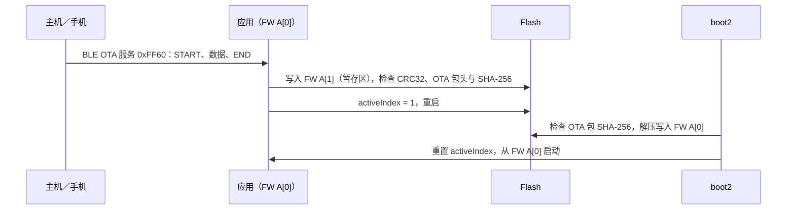

# OTA 更新

FreeRTOS 应用的 OTA 由 boot2 完成：运行中的应用把 OTA 包写入分区表中空闲的 FW 位置并切换激活索引，重启后 boot2 检查 OTA 包、解压写入运行区后再启动。SDK 随附打包工具 `tools/create_ota.py`、各种传输方式共用的 OTA 组件 `components/sys/ipro_ota`（V2.3.0 起），以及在 IPRO7AI Reef EVK 上经 BLE 更新的完整参考：`ipro_ble_remote` 的 `defconfig_reef`，配合 A/B 分区表、打包脚本、Python 发送程序与 Android App。

!!! abstract "要点"
    - 参考：`ipro_ble_remote` 的 `defconfig_reef`＋`partition_cfg_2M_remote_ab.toml`＋boot2 v0.6.0（随 IntelProCube 提供）；默认 `.config` 不含 OTA。
    - OTA 包：`tools/create_ota.py` 把 IntelProCube 生成的合并镜像 `whole_img.bin` 打包为 `.xz.ota`（512 字节头＋XZ 内容）；Reef 用 `make_reef_ota.sh` 一次完成这两个步骤。
    - 组件：`components/sys/ipro_ota`（`CONFIG_IPRO_OTA`）在切换分区表之前检查写入 Flash 的 OTA 包头与 SHA-256；传输方式有 BLE OTA 服务 0xFF60（`CONFIG_IPRO_OTA_BLE`）与控制台 UART 命令 `ota_uart`（`CONFIG_IPRO_OTA_UART`）。
    - 发送端：`tools/reef_ota.py`（Python，bleak）或 `ipro_remote_demo.apk`（Android）经 BLE；IPRO Workbench 0.2.0 的 OTA 包页面经控制台 UART。
    - IPRO6S FIN 卡通过 `ipro7ai_reef_demo` `defconfig_wifi_ipro6s` 的 `ipro6s_ota <http url>` 经 Wi-Fi 更新。
    - 在 Reef 上绝对不要用标准的 `partition_cfg_2M.toml` 做 OTA。未包含：签名 OTA 包所需的产品配置（`tools/ota_products.py`）。

## 架构 { #architecture }



V2.3.0 起，应用在切换分区表之前，先由 OTA 组件读回暂存区、检查 OTA 包头与 SHA-256：误发的 `.bin` 或传输中损坏的 OTA 包在这一步就会被拒绝，不必等到下次启动。根据 `ipro_ble_remote` 的 README，OTA 包通过 SHA-256 检查后 boot2 才擦除运行区。检查失败时 boot2 停留在 USB 救援模式，原有的运行区不受影响。

## 分区表与 A/B 布局 { #partitions }

`apps/bluetooth/ble/ipro_ble_remote/partition_cfg_2M_remote_ab.toml`（2 MB Flash，含 boot2）：

| 地址 | 分区 | 大小 | 用途 |
|---|---|---|---|
| 0x000000 | boot2 | 64 KB | IntelProCube 的 boot2 v0.6.0 |
| 0x010000 | PT0／PT1 | 4 KB＋4 KB | 分区表 |
| 0x012000 | FW A[0] | 824 KB | 运行区，boot2 把 OTA 包解压到这里 |
| 0x0E0000 | FW A[1] | 512 KB | OTA 暂存区，应用把 `.xz.ota` 写到这里 |
| 0x160000 | PSM | 112 KB | 持久化配置 |
| 0x17C000 | backup | 4 KB | |
| 0x17D000 | media | 16 KB | |
| 0x1FF000 | factory | 4 KB | |

- 这个布局需要 2 MB Flash；`defconfig_reef` 设置了 `CONFIG_IPRO7_FLASH_2M=y`。
- boot2 镜像位于 IntelProCube 目录下的 `chips/ipro7/builtin_imgs/boot2_v0.6.0/ipro_boot2_IPRO7_v0.6.0.bin`，不在 SDK 包中。
- 分区表有意不包含 boot2 条目：有这个条目时，烧录工具写出的 boot2 头不会被启动 ROM 加载。boot2 请用 `--boot2` 指定。

!!! danger "不要用标准分区表做 OTA"
    在 IPRO7AI Reef EVK 上，绝对不要用标准的 `partition_cfg_2M.toml` 做 OTA：写入它第二个 FW 位置（0x12A000）并切换后的镜像无法启动，控制台没有任何输出，只能进入下载模式重新烧录。请使用 `partition_cfg_2M_remote_ab.toml`。

## OTA 打包（create_ota.py） { #ota-package }

`tools/create_ota.py` 的输入必须是以 `IPNP` boot header 开头的合并镜像，例如 IntelProCube 命令行工具用 `--build` 生成的 `chips/ipro7/img_create_iot/whole_img.bin`，而不是 SDK 构建输出的 `.bin`；输入格式不符时脚本会停止。

```bash
# 1. 用 IntelProCube 生成 whole_img.bin（在 IntelProCube 目录下执行；失败时工具也返回 0，
#    请确认输出中有 "PT Check: whole_img.bin"）
cd <ICUBE>
./ipro_iot_tool_macos --chipname ipro7 --chip-variant IPRO7AI --build \
    --boot2 chips/ipro7/builtin_imgs/boot2_v0.6.0/ipro_boot2_IPRO7_v0.6.0.bin \
    --pt <SDK>/apps/bluetooth/ble/ipro_ble_remote/partition_cfg_2M_remote_ab.toml \
    --firmware <SDK>/apps/bluetooth/ble/ipro_ble_remote/build_reef/build_out/ipro_ble_remote_IPRO7.bin

# 2. 打包（默认 XZ 压缩）
python3 <SDK>/tools/create_ota.py chips/ipro7/img_create_iot/whole_img.bin \
    --fw-ver <fw-version> -o firmware.xz.ota
```

| 参数 | 含义 |
|---|---|
| `<input>` | 合并镜像（以 `IPNP` boot header 开头） |
| `--raw` | 不压缩。未指定 `-o` 时，输出文件名是把输入文件名的扩展名换成 `.ota`（`--raw`）或 `.xz.ota` |
| `-o FILE` | 输出文件 |
| `--hw-ver`、`--fw-ver` | 写入头部的硬件与固件版本字符串（各最多 15 个字符）。boot2 不检查硬件版本 |
| `--sign-key`、`--product`、`--hw-id`、`--fw-version`、`--force-version`、`--key-id` | 用于签名 OTA 包。需要 V2.3.0 未包含的 `tools/ota_products.py`，因此无法使用 |

| 头部偏移 | 内容 |
|---|---|
| 0–15 | 标识字符串 `IPRO_OTA_Ver1.0` |
| 16–19 | 类型：`XZ  ` 或 `RAW ` |
| 20–23 | 内容长度（little-endian） |
| 32–47、48–63 | 硬件与固件版本字符串 |
| 64–95 | 内容的 SHA-256 |
| 96–511 | 保留（0xFF）；签名 OTA 包在此存放签名块 |
| 512 起 | 内容（XZ，字典 32 KB，与 boot2 解码器一致） |

Reef 可用 `apps/bluetooth/ble/ipro_ble_remote/tools/make_reef_ota.sh` 一次完成上述两步，并以构建时间作为固件版本，见[在 Reef 上动手实践](#hands-on)。脚本会使用 IntelProCube 文件夹里最新的 boot2（0.7.0.1 为 v0.6.0）。

## BLE OTA（ipro_ble_remote） { #ble-ota }

只有 `defconfig_reef` 开启了 OTA 服务。`ipro_ble_remote` 的默认 `.config` 构建的是不含 OTA 的 IPRO7 EVB 镜像（`# CONFIG_IPRO_BLE_REMOTE_OTA is not set`）。

```ini title="apps/bluetooth/ble/ipro_ble_remote/defconfig_reef（节选）"
CONFIG_IPRO7AI_REEF=y
CONFIG_IPRO7_FLASH_2M=y
CONFIG_LINK_FLASH=y
CONFIG_PARTITION=y
CONFIG_IPRO_BLE_REMOTE_OTA=y
CONFIG_IPRO_OTA=y
CONFIG_IPRO_OTA_BLE=y
CONFIG_IPRO_OTA_UART=y
```

V2.3.0 起，OTA 服务由 OTA 组件提供（`components/sys/ipro_ota/src/ipro_ota_ble.c`），`ipro_ble_remote` 的 `include/ota_service.h` 只转接到 `ipro_ota_ble.h`；同一个镜像也有控制台 UART 的 `ota_uart` 命令，见[经控制台 UART 更新](#uart-ota)。

服务与特征值（面向 App 开发者的完整说明在 `apps/bluetooth/ble/ipro_ble_remote/OTA_IMPLEMENTATION_GUIDE.md` 中）：

| 特征值 | UUID | 属性 | 格式 |
|---|---|---|---|
| OTA Control | `0xFF61` | Write | `01`＋大小（u32 LE）START；`02`＋CRC32（u32 LE）END；`03` ABORT；`04` VERIFY；`05` REBOOT |
| OTA Data | `0xFF62` | Write Without Response | 序号 u16、长度 u16、保留 u16，后接数据；每个数据包的数据最多 MTU − 9 字节 |
| OTA Status | `0xFF63` | Read、Notify | 状态、错误码、进度 %、保留 u16；状态 0 空闲、1 接收中、2 校验中、3 就绪、4 完成（发送 REBOOT）、0xFF 错误 |

- 要发送的是 `.xz.ota` 包，不是 `.bin`。CRC32 是对整个发送文件计算的标准 CRC-32（与 `zlib.crc32` 相同）。
- 发送 START 后等状态变为 1（接收中）再发送数据。V2.3.0 起设备在写入每个 4 KB 之前才擦除它，不再先擦除整个暂存区，START 后不到半秒就开始接收（V2.2.x 约 4 秒）。
- END 的 CRC32 通过后，设备还会检查 OTA 包头与 SHA-256；不符时状态变为 0xFF（错误），不会切换分区表。
- 设备最多缓存 20 个数据包，边收边写 Flash。发送端要控制节奏（`reef_ota.py` 每 8 个数据包读一次 OTA Status），否则数据包会被丢弃，END 时报告错误。
- 先协商较大的 MTU；README 建议连接后请求 513 以上的 MTU。

## 经控制台 UART 更新（ota_uart） { #uart-ota }

V2.3.0 起，开启 `CONFIG_IPRO_OTA_UART=y` 的应用有 shell 命令 `ota_uart <OTA 包字节数> [noapply]`：经控制台 UART 接收 `.xz.ota` 包，不需要第二个 UART、不改波特率，应用也无需编写任何代码。`ipro_ble_remote` 的 `defconfig_reef` 已开启该命令。开发板要用 boot2 和带第二个 FW 位置的分区表（例如 `partition_cfg_2M_remote_ab.toml`）烧录过。

最简单的发送端是 IPRO Workbench 0.2.0 的 **OTA Package** 页面：生成 OTA 包后点击 **Send to Board**，或点击 **Check on Board** 让开发板检查完整性但不安装，步骤见 IPRO Workbench 的 [OTA Package](../workbench/flash.md#ota)。115200 波特率下 200 KB 约需 22 秒。

自己编写发送端时，协议如下（整数为 little-endian；CRC 是对 seq、len 与数据计算的 CRC-16/CCITT-FALSE）：

```text title="ota_uart 协议（components/sys/ipro_ota/README.md）"
主机：ota_uart 200776
开发板：==OTA_UART_READY:1024==                  每个数据包可接受的最大数据量
主机：A5 5A  seq(u16)  len(u16)  数据  crc16       发送一个数据包后等待响应
开发板：A5 06  seq(u16)                           已接收；A5 15 seq：请重发
开发板：==OTA_UART_OK==                           检查通过、已切换，重启
        ==OTA_UART_FAIL:<原因>==
```

- 命令行要逐个字符发送：shell 会丢弃一次整行到达的输入。
- 加上 `noapply` 时，开发板接收并检查完就停止，不切换分区表；OTA 包留在暂存区，运行中的固件不变。
- 开发板返回 `==OTA_UART_OK==` 后重启，由 boot2 安装，控制台接着打印 `[BOOT2] OTA ok` 与新固件的启动信息。

## 在 Reef 上动手实践 { #hands-on }

先通过 UART 烧录一次 `ipro_ble_remote`，修改代码后经 BLE 安装新版本，再根据构建时间确认更新成功。需要：U6 已接好控制台线的 Reef、IntelProCube 命令行工具（`<ICUBE>`），以及带蓝牙与 Python 3 的 macOS 或 Linux 电脑（或装有 `ipro_remote_demo.apk` 的 Android 手机）。

<div class="ipro-steps" markdown>

1. **确认配置**

    直接使用随附的 `DEFCONFIG=defconfig_reef`；让 OTA 工作的配置见 [BLE OTA](#ble-ota) 中的节选。要在自己的 Reef 应用中加入 OTA，保留 `CONFIG_IPRO7_FLASH_2M=y` 与 `CONFIG_PARTITION=y`，用 boot2 和类似 `partition_cfg_2M_remote_ab.toml` 的 A/B 分区表烧录，再按下面的方式把 OTA 包写入空闲的 FW 位置。

2. **理解应用如何暂存 OTA 包**

    OTA 服务通过 boot2 的分区表 API 获取空闲的 FW 位置，把 OTA 包写进去；CRC32 检查通过、OTA 组件确认 OTA 包头与 SHA-256 之后，才把该位置设为激活：

    ```c title="components/sys/ipro_ota/src/ipro_ota_ble.c（节选）"
    static int ota_get_backup_partition(uint32_t *addr, uint32_t *size)
    {
        int ret = hal_boot2_partition_addr_inactive("FW", addr, size);
        if (ret != 0) {
            IPRO_LOGE(LOG_TAG, "Failed to get backup partition: %d", ret);
            return -1;
        }
        return 0;
    }

    static int ota_switch_partition(void)
    {
        int ret;
        PtTable_Entry_Config pt_entry;

        ret = hal_boot2_get_active_entries(PT_ENTRY_FW_CPU0, &pt_entry);
        if (ret != 0) {
            IPRO_LOGE(LOG_TAG, "Failed to get partition entry: %d", ret);
            return -1;
        }
        /* 省略与 pt_entry.maxLen[] 比较大小的检查 */

    #if !defined(CONFIG_IPRO_OTA_BLE_RAW_IMAGE)
        /* The image runs under boot2 (an A/B table such as
         * partition_cfg_2M_remote_ab.toml): the slot holds an OTA package that boot2
         * checks and unpacks by its own header, so the entry length is not used. */
        pt_entry.len = 0;
        /* Before boot2 is told to install it, the OTA core checks the package's
         * header and the SHA-256 of the payload read back from the slot. */
        ret = ota_validate_flash(g_ota_ctx.backup_partition_addr, g_ota_ctx.firmware_size);
        if (ret != OTA_PKG_OK) {
            return OTA_SWITCH_NOT_A_PACKAGE;   /* message left out */
        }
        IPRO_LOGI(LOG_TAG, "[OTA] Package header and SHA-256 OK");
    #else
        pt_entry.len = g_ota_ctx.firmware_size;
    #endif

        ret = hal_boot2_update_ptable(&pt_entry);
        if (ret != 0) {
            IPRO_LOGE(LOG_TAG, "Failed to update partition table: %d", ret);
            return -1;
        }
        return 0;
    }
    ```

    之后 REBOOT 命令复位芯片，boot2 在启动过程中安装 OTA 包。

3. **构建并烧录第一个版本**

    ```bash
    make -C apps/bluetooth/ble/ipro_ble_remote DEFCONFIG=defconfig_reef
    ```

    让 Reef 进入下载模式（按住 SW1 BOOT、按一下 SW2 RESET、松开 SW1），再执行：

    ```bash
    cd <ICUBE>
    ./ipro_iot_tool_macos --chipname ipro7 --chip-variant IPRO7AI \
        --port /dev/cu.usbserial-XXXX --baudrate 921600 \
        --boot2 chips/ipro7/builtin_imgs/boot2_v0.6.0/ipro_boot2_IPRO7_v0.6.0.bin \
        --pt <SDK>/apps/bluetooth/ble/ipro_ble_remote/partition_cfg_2M_remote_ab.toml \
        --firmware <SDK>/apps/bluetooth/ble/ipro_ble_remote/build_reef/build_out/ipro_ble_remote_IPRO7.bin
    ```

    确认输出中有 `[All Success]`（失败时工具也返回 0），再按 SW2（RESET）。以 115200 baud 打开控制台，会先看到 `[BOOT2] IPRO7 Boot2 v0.6.0`，接着应用从 FW A（0x12000）启动并打印 `[OTA] Service ready`。烧录细节见[烧录与串口](../get-started/flash-and-monitor.md)。

4. **修改代码并生成 OTA 包**

    做任何修改后用同一条 `make` 命令重新构建，再把新版本打包。打包脚本会使用 IntelProCube 文件夹里最新的 boot2（0.7.0.1 为 v0.6.0），并打印所用的文件。Linux 用 `ipro_iot_tool_linux`：

    ```bash
    IPRO_FLASH_TOOL=<ICUBE>/ipro_iot_tool_macos \
        sh apps/bluetooth/ble/ipro_ble_remote/tools/make_reef_ota.sh
    ```

    输出：`apps/bluetooth/ble/ipro_ble_remote/build_reef/build_out/ipro_ble_remote_reef.xz.ota`，约 345 KB。

5. **经 BLE 发送**

    ```bash
    python3 -m venv .venv && .venv/bin/pip install bleak
    .venv/bin/python apps/bluetooth/ble/ipro_ble_remote/tools/reef_ota.py \
        apps/bluetooth/ble/ipro_ble_remote/build_reef/build_out/ipro_ble_remote_reef.xz.ota
    ```

    脚本会查找 `IPRO-Remote`（名称不同时设置 `REMOTE_NAME`），打印当前镜像的开发板信息，发送 OTA 包，再等待开发板重新上线。README 中的实测：macOS、MTU 247，345 KB 的 OTA 包传输耗时 13–17 秒。

6. **验证结果**

    Reef 控制台会打印下列信息（省略了日志前缀，中间还有其他行）：

    ```text
    [OTA] START: … bytes, … packets (… bytes/pkt, MTU=…)
    [OTA] Progress: 5% (…)
    [OTA] Transfer complete: … bytes in … ms (… bytes/s)
    [OTA] END: CRC32=0x…, …/… bytes
    [OTA] CRC32 OK! Switching partition...
    [OTA] Package header and SHA-256 OK
    [OTA] Ready to reboot
    [OTA] Rebooting...
    [BOOT2] IPRO7 Boot2 v0.6.0
    ...
    [BOOT2] OTA pending
    [OTA] E0000->12000
    [OTA] no eFuse key, package unverified
    [OTA] XZ …
    [OTA] …
    [OTA] OK
    [BOOT2] OTA ok
    ```

    `[BOOT2] OTA ok` 表示 boot2 已校验包的 SHA256 并解压到 FW A，接着启动新镜像；`no eFuse key, package unverified` 表示芯片没有烧录签名密钥，不校验签名。电脑端 `reef_ota.py` 打印 `verified, slot switched; rebooting`，开发板重新连接后打印 `running: IPRO7AI Reef; camera …; SD …; build <date> <time>`。这个构建时间取自 `src/board/reef_hw.c`，只有该文件重新编译时才会改变，所以请以控制台的 `[BOOT2] OTA ok` 确认更新。

</div>

下一步：[创建第一个应用](../tutorials/first-own-app.md)说明如何用 Reef 配置创建新应用；[测试应用](../tutorials/testing.md)说明如何像上面这样用控制台与主机端脚本检查结果。

## 其他更新路径 { #other-paths }

| 路径 | 说明 |
|---|---|
| IPRO6S FIN 卡固件 | 用 `DEFCONFIG=defconfig_wifi_ipro6s` 构建的 `ipro7ai_reef_demo` 有控制台命令 `ipro6s_ota <http url>`：经 Wi-Fi 下载 OTA 包，再通过 `ipronet_ota_update()`（`components/network/ipronet_host/ipronet_ota.h`）交给 FIN 卡，约需 30–60 秒，完成时控制台打印 `[ota] RESULT OK`。OTA 包是 IntelProCube 生成、硬件版本为 IPRO6 的 `FW_OTA.bin.xz.ota`；其他芯片的 OTA 包在开始前就会被主机端拒绝。FIN 卡的固件是用 `defconfig_ipro6_sdio` 构建的 `ipro6_if_wifi`，其中的 `CONFIG_RNM_OTA=y` 提供设备端功能。见[网络](networking.md) |
| 自行实现接收端 | 使用 OTA 组件的流式接口：`ota_get_fw_b()` 获取暂存区、`ota_sink_begin_ex()`／`ota_sink()`／`ota_sink_end()` 边收边写并计算哈希、`ota_validate()` 检查、`ota_mark_fwb_active()` 切换分区表；签名 OTA 包的检查在 `ipro_ota_sig.h`（`CONFIG_IPRO_OTA_SIGNATURE`）。说明在 `components/sys/ipro_ota/README.md`。`apps/platform/common/ota/` 的 UART（zmodem）与 USB CDC 接收端也改用这个组件；随附的配置都不会构建它们 |

## Zephyr：MCUboot 与 MCUmgr { #zephyr-mcuboot }

Zephyr 镜像不使用 boot2 OTA 包，而是经 MCUboot 更新：boot2 启动 MCUboot，由 MCUboot 从 `slot1_partition` 以 swap-move 方式换入新镜像。示例 `zephyr/samples/ble_ota` 通过 MCUmgr SMP 经 BLE 上传镜像。V2.3.0 的 Zephyr 只有 IPRO7 EVB 与 IPRO7AI EVK 的开发板定义，没有 Reef；构建与烧录见 [Zephyr RTOS](zephyr.md)。

## 本版本的限制 { #limitations }

- 签名 OTA 包（`create_ota.py --sign-key`）所需的 `tools/ota_products.py` 未包含在 V2.3.0 中。
- BLE OTA 的参考流程是 `ipro_ble_remote` 的 `defconfig_reef`；`ipro_ble_remote` 的默认构建不含 OTA。
- 控制台 UART 的 OTA 只适用于 IPRO7 的 boot2 OTA 包（IPRO7、IPRO7AI）；IPRO6S 没有 `ota_uart`。
- 没有经 Wi-Fi 或 Ethernet 更新 IPRO7 固件的示例；`ipro6s_ota` 只更新 IPRO6S FIN 卡。
- `build_freertos.sh flash` 无法指定 boot2 镜像；支持 OTA 的镜像首次烧录请按上文使用 IntelProCube 命令行。
- boot2 镜像与标准分区表随 IntelProCube 提供，不在 SDK 包中。

## 相关文档 { #related }

- [IPRO7AI Reef EVK](../hardware/boards/reef-evk.md)：下载模式、开关与 U6 控制台接口。
- [烧录与串口](../get-started/flash-and-monitor.md)：IntelProCube 命令行工具。
- [BLE 开发](ble.md)：`ipro_ble_remote` 的 GATT 服务。
- [网络](networking.md)：`ipronet_host` 与 FIN 卡。
- [Zephyr RTOS](zephyr.md)：sysbuild、MCUboot 与 `west flash`。
