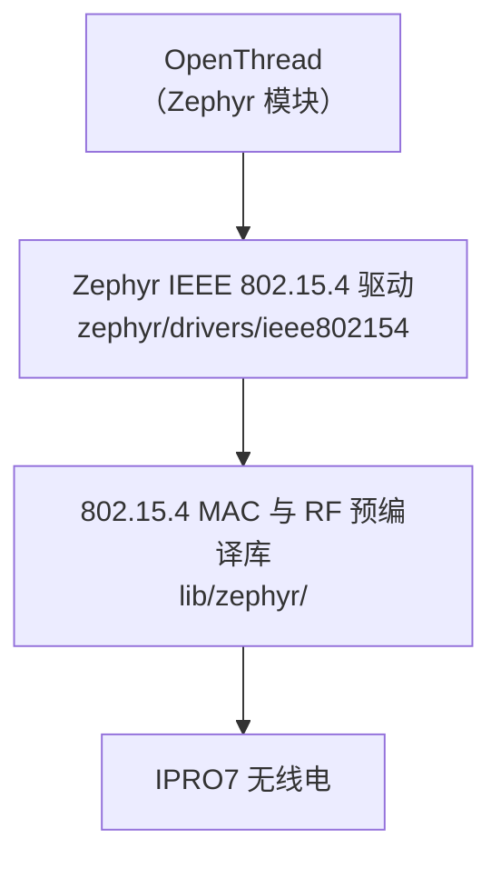

# Thread 与 Matter

Thread 在 Zephyr RTOS 下使用 IPRO7 的 IEEE 802.15.4 无线电，由 Zephyr 的 OpenThread 配合 SDK 的 802.15.4 驱动提供。FreeRTOS 应用没有 802.15.4 与 Thread，本版本也没有 Matter 协议栈。

!!! abstract "要点"
    - **Thread**：只在 Zephyr RTOS 下提供，示例开发板为 `ipro7_evb`。供 Zephyr OpenThread shell 示例使用的配置片段在 `zephyr/samples/ieee802154_shell/` 中。
    - **IPRO7AI Reef EVK**：V2.2.1 没有 Reef 的 Thread 路径。Reef 没有 Zephyr 开发板定义，它运行的 FreeRTOS 应用也不含 802.15.4。
    - **Matter**：未包含在 V2.2.1 中，没有 Matter 协议栈、应用或构建命令。请联系 INTELPRO。
    - 本页内容不代表此版本已通过 Thread 或 Matter 认证。

## 交付状态 { #overview }

| 项目 | 本版本 |
|---|---|
| Matter 协议栈与应用 | 未包含 |
| Thread（OpenThread） | Zephyr RTOS，示例开发板 `ipro7_evb`；FreeRTOS 没有 |
| Thread Border Router | 未包含 |
| IEEE 802.15.4 无线电 | Zephyr 驱动，配合预编译的 MAC 与 RF 库 |
| BLE（可用于配网） | FreeRTOS 与 Zephyr 均可用，但未与 Matter 集成 |

## OpenThread（Zephyr RTOS） { #openthread }



RF 驱动与 802.15.4 MAC 以预编译库的形式链接（`components/wireless/rf/ipro7_rf/lib/zephyr/`、`components/wireless/ieee802154/lib/zephyr/`）。OpenThread 是 `west.yml` 允许列表中的 Zephyr 模块。

SDK 为 Zephyr 自带的 `samples/net/openthread/shell` 提供配置片段：

| 文件（`zephyr/samples/ieee802154_shell/`） | 内容 |
|---|---|
| `ot.conf` | Thread 1.4、OpenThread CLI 的 ping、CSL 所需的无线电时间戳与定时发送、栈大小，以及 RF 晶振微调 |
| `csl.conf` | 叠加在 `ot.conf` 之上：CSL 接收端（sleepy end device）、CSL 周期与超时，以及驱动的数据包跟踪 |
| `app.overlay` | 启用 `ieee802154` 节点，并设为默认的 802.15.4 设备 |

```ini title="zephyr/samples/ieee802154_shell/ot.conf（节选）"
CONFIG_OPENTHREAD_THREAD_VERSION_1_4=y
CONFIG_OPENTHREAD_PING_SENDER=y
CONFIG_NET_PKT_TIMESTAMP=y
CONFIG_NET_PKT_TXTIME=y
CONFIG_SOC_IPRO7_XTAL_CAPCODE=165
```

```ini title="zephyr/samples/ieee802154_shell/csl.conf（节选）"
CONFIG_OPENTHREAD_CSL_RECEIVER=y
CONFIG_IEEE802154_IPRO_OT_CSL_PERIOD_US=500000
CONFIG_IEEE802154_IPRO_OT_CSL_TIMEOUT_S=20
```

!!! warning "RF 晶振微调值因板而异"
    `ot.conf` 中的 `CONFIG_SOC_IPRO7_XTAL_CAPCODE=165` 是在 IPRO7 EVB 上测得的。换到其他电路板时，请用 `ipro154 xtal` 与 `ipro154 cfo` 测量后设置自己的值：频率误差过大会影响与其他 Thread 设备的连接。

## 在 IPRO7 EVB 上试用 { #reference-apps }

本版本没有 Reef 的 Thread 操作步骤。在 IPRO7 EVB 上：

<div class="ipro-steps" markdown>

1. **创建工作区**：按照 [Zephyr RTOS](zephyr.md#workspace) 执行 `tools/zephyr/bootstrap.sh` 与 `source zephyr-workspace/env.sh`。

2. **构建 OpenThread shell**（在 `zephyr-workspace/` 中执行；`<SDK>` 是 SDK 根目录的绝对路径）

    ```bash
    west build -b ipro7_evb zephyr/samples/net/openthread/shell -d build/ot -- \
        -DEXTRA_CONF_FILE=<SDK>/zephyr/samples/ieee802154_shell/ot.conf \
        -DEXTRA_DTC_OVERLAY_FILE=<SDK>/zephyr/samples/ieee802154_shell/app.overlay
    ```

    要试用 CSL 接收端时，把 `csl.conf` 也加入 `EXTRA_CONF_FILE`。

3. **烧录**：`west flash -d build/ot`；没有探针时加上 `-- --boot shell` 或 `-- --boot manual`（见 [Zephyr RTOS](zephyr.md)）。

4. **使用**：用 `../tools/zephyr/monitor.sh --port /dev/cu.usbserial-XXXX`（2,000,000 baud）打开控制台，用 `ot` 命令操作 OpenThread CLI。创建或加入网络需要另一个 Thread 设备或 Border Router。

</div>

只想测试 802.15.4 数据包收发时，构建 SDK 的 `ieee802154_shell` 示例（Zephyr 的 IEEE 802.15.4 与网络 shell）：

```bash
west build -b ipro7_evb ../zephyr/samples/ieee802154_shell -d build/154
```

驱动另外提供 `ipro154` 调试命令：

| 命令 | 用途 |
|---|---|
| `ipro154 stats` | 驱动与 HAL 的计数器 |
| `ipro154 clk` | 无线电时钟与 kernel 时钟的比率 |
| `ipro154 cfo` | 各发送端的频率偏移、SFD 相关值与 RSSI |
| `ipro154 xtal` | RF 晶振微调值 |
| `ipro154 crc` | 把 CRC 错误的数据包计入 HAL 计数器 |
| `ipro154 trace` | HAL 数据包跟踪（`on`／`off`／`clear`／`dump`） |

`tools/zephyr/csl_pcap.py` 可分析 802.15.4 sniffer 抓包文件中的 CSL 时序。

## 集成前需确认的事项 { #configuration }

- **RTOS**：Thread 只在 Zephyr 下提供，没有任何配置能把它加入 FreeRTOS 应用。产品如果还需要低功耗、摄像头、USB 或 NPU，先确认它们在 Zephyr 下的状态（[Zephyr RTOS](zephyr.md)）。
- **开发板**：本版本的 Zephyr 开发板是 IPRO7 EVB 与 IPRO7AI EVK；产品板需要自己的开发板定义。
- **低功耗**：本版本的 Zephyr 不会让 SoC 进入 PDS 或 HBN。`csl.conf` 展示的是 CSL 时序行为，不代表设备能达到睡眠级别的电流。
- **RF 晶振**：每一种电路板设计都要设置并验证 `CONFIG_SOC_IPRO7_XTAL_CAPCODE`。
- **Border Router 与配网**：未附带 Border Router。请规划外部 Border Router、网络凭据如何分发，以及如何安全存储。
- **资源**：确认 flash 与 RAM 预算、持久化存储、熵源（`CONFIG_ENTROPY_GENERATOR`）与更新路径（MCUboot，见 [OTA 更新](ota.md)）。
- **验证顺序**：先验证开发板驱动、无线连接、IP 传输与安全存储，再进行协议集成、配网、重启后的恢复与互操作性验证。

## Matter 规划 { #matter-architecture }

Matter 是 IP 层的应用协议，可运行在 Wi-Fi、以太网或 Thread 上，并通过 BLE 配网。本版本中各种传输都有对应的组件：FreeRTOS 下经 IPRO6S 的 Wi-Fi 与以太网（[网络](networking.md)）、Zephyr 下的 Thread、两者都有的 BLE；但没有 Matter 协议栈、配网流程、设备认证证书或 Matter OTA。具备传输组件不等于完成了 Matter 集成。Matter 的规划与时间表请联系 INTELPRO。

## 相关文档 { #related }

- [Zephyr RTOS](zephyr.md)：工作区、烧录、功能与限制。
- [网络](networking.md)：lwIP、Reef 经 IPRO6S FIN 卡的 Wi-Fi、以太网。
- [BLE 开发](ble.md)：BLE host 与控制器。
