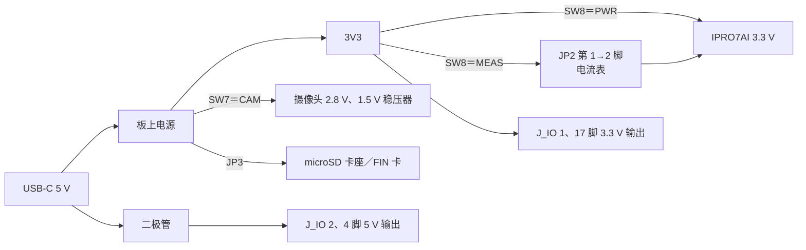

# 电源与功耗测量

测量电流前，先确认 Reef 的电源从哪里来、要测的那一段电流在哪里断开，再让开发板进入要测量的状态。SDK 没有提供适用于所有板型的电流数值；请以芯片规格书的测量条件为准，并在自己的开发板上实测。

## 开发板电源架构 { #power }

### IPRO7AI Reef EVK { #reef-power }

Reef V4.0 只从 USB-C 供电，由板上电源产生 3.3 V（3V3）与摄像头所需的电压。IPRO7AI 的 3.3 V 由 SW8 选择来源：PWR 时直接取自板上 3.3 V，MEAS 时改经 JP2，让电流表或外部电源串接在中间。



| 开关／跳线 | 位置 | 对电源的作用 |
|---|---|---|
| SW8 | PWR | 正常使用：IPRO7AI 的 3.3 V 直接由板上电源供电 |
| | MEAS | IPRO7AI 的 3.3 V 改经 JP2 供电；JP2 必须接电流表或外部 3.3 V 电源 |
| JP2 | — | 3 pin：1＝3V3（板上 3.3 V）、2＝SOC（IPRO7AI 的 3.3 V）、3＝GND；仅在 SW8＝MEAS 时使用 |
| SW7 | CAM | 摄像头的 2.8 V 与 1.5 V 稳压器开启 |
| | GPIO | 摄像头稳压器关闭，16 个摄像头引脚改接到 J_IO |
| JP3 | ON | microSD 卡座始终有电 |
| | GPIO | 卡座电源由 GPIO14 控制：低电平或未驱动时有电，高电平时断电；FIN 卡的 `fin cycle` 需要这个位置 |

- 调试插座 U6 不供电；接上 IPRO Debug Probe 或 USB 转 UART 线之外，仍要接 USB-C。
- J_IO 的 2、4 脚是 USB 5 V 经二极管的输出，1、17 脚是 3.3 V 输出，都不能用来给开发板供电。

!!! warning "上电前"
    - 只从 USB-C 供电。
    - SW8 平时放在 PWR。放在 MEAS 时，若 JP2 没有接电流表或外部 3.3 V 电源，就不要接 USB-C：IPRO7AI 没有电，外设的 3.3 V 却会经 IO 引脚倒灌。
    - 插拔摄像头排线前先拔掉 USB-C。

其他开发板（IPRO7 EVB、IPRO7AI EVK）的电源架构见各开发板的硬件文档，请联系 INTELPRO。

## 电源设计建议 { #design-recommendations }

| 项目 | 建议 |
|---|---|
| 输入保护 | 电源输入端加 TVS，防静电与浪涌 |
| 去耦电容 | 每个电源引脚放一颗 100 nF，尽量靠近芯片 |
| 大容量电容 | 5 V 与 3.3 V 电源放 10 µF–47 µF 以稳定电源 |
| 上电顺序 | 依据芯片规格书与开发板的电源时序设计 |
| 接地 | 使用完整的地平面，模拟与数字区域分开 |
| LDO 选择 | 模拟电源（AVDD）使用低噪声 LDO |
| 电流测量 | 在 SoC 的电源路径上保留可断开的测量点，例如 Reef 的 SW8 与 JP2 |

天线与匹配电路见[引脚与外设对照](pinmux.md#antenna)。

## 测量电流 { #current-measurement }

记录每次测量的条件，结果才有可比性：测量点、CPU 时钟、RF 发射功率、启用的外设、内存保持设置与睡眠模式。

### 测量点 { #measurement-points }

| 测量点 | 接法 | 包含的电路 |
|---|---|---|
| 整块开发板 | 在 USB-C 与电脑之间串接 USB 电流表 | 板上所有电路，含 LED、扬声器功放、摄像头与 microSD 卡 |
| IPRO7AI 的 3.3 V | SW8＝MEAS，电流表接在 JP2 的 1、2 脚之间 | IPRO7AI 的 3.3 V 引脚及其去耦电容、启动引脚上拉电阻；不含外设 |

### 测量 IPRO7AI 的电流 { #reef-soc-current }

<div class="ipro-steps" markdown>

1. **烧录要测量的固件**：例如出厂固件 `ipro7ai_reef_demo`，步骤见 [IPRO7AI Reef EVK 快速上手](boards/reef-evk.md#quick-start)。确认它在 SW8＝PWR 时可以正常启动。

2. **接上电流表**：拔掉 USB-C，把电流表接在 JP2 的第 1 脚（3V3）与第 2 脚（SOC）之间，再把 SW8 拨到 MEAS。要用外部电源供电时，改把外部 3.3 V 电源接在 JP2 的第 2 脚（SOC）与第 3 脚（GND）。

3. **上电并确认启动**：接上 USB-C，以 115200 baud 打开控制台并输入 `reef status`。

    ```bash
    python3 tools/serial_monitor.py /dev/cu.usbserial-XXXX --send "reef status" --timeout 5
    ```

    控制台打印开发板状态，表示 IPRO7AI 经 JP2 正常供电；电流表读到的就是 IPRO7AI 3.3 V 的电流。没有任何输出时，检查电流表的量程与 JP2 的接线。

4. **读取各状态的电流**：在控制台执行要测量的操作，等数值稳定后记录读数与当时的条件。

5. **恢复正常供电**：先拔掉 USB-C，把 SW8 拨回 PWR，再拆下电流表。

</div>

### 睡眠电流 { #lp-test }

`apps/test/ipro_lp_test`（PDS31 进出与 RTC 唤醒，`lp` 命令）只附带 IPRO7 EVB 的配置（`CONFIG_EVB=y`）；本版本没有 Reef 的睡眠电流测试配置。

PDS31 睡眠时，OCRAM 只保持前 64 KB；其余部分只在 MISC 电源域保持供电时保持（`bsp/hal/inc/hal_pm.h` 的 `pm_pds_set_misc_keep()`）。HBN RAM 的 4 KB 在休眠期间保持。芯片处于 PDS 时 UART 关闭，睡眠期间输入的字符会丢失。

### 应用中的自动低功耗 { #ipro-pm }

应用通常不自己调用睡眠。`components/sys/ipro_pm` 接管 FreeRTOS 的 tickless idle，根据每段空闲时间选择可进入的最深模式：`IPRO_PM_MODE_WFI`（CPU 时钟门控）、`IPRO_PM_MODE_NATIVE`（BLE 内核以自己的 32 kHz 定时器睡眠时的 WFI）、`IPRO_PM_MODE_PDS`（PDS31）。启用 `CONFIG_IPRO_PM=y` 后，shell 命令 `pm stats` 列出各模式的停留比例与平均电流估计值；估计值不能代替实测。配置方法见[低功耗指南](../guides/low-power.md)。

## 相关文档 { #documents }

- [IPRO7AI Reef EVK](boards/reef-evk.md#jumpers)：SW7、SW8、JP2、JP3 的位置与设置。
- [低功耗指南](../guides/low-power.md)：PDS、`ipro_pm` 与 BLE 低功耗配置。
- IPRO7 规格书与硬件设计指南（电气特性、电源时序）：见[文档下载](../documents/index.md)。
