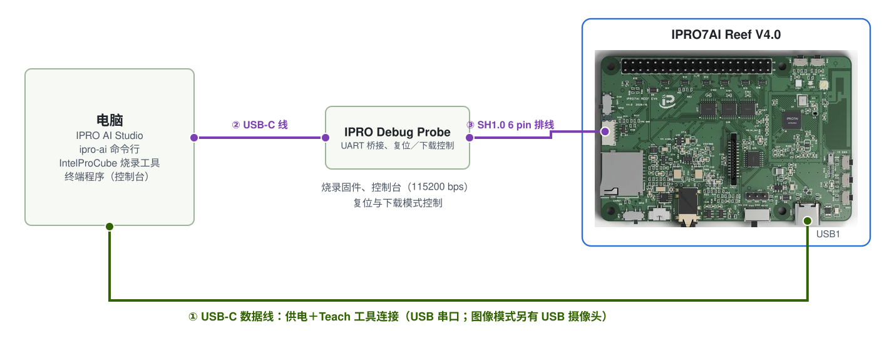

# 烧录 Edge AI 固件

三个 Teach 工具都在 Edge AI 固件 `ipro_reef_teach` 中。完成本页后，Reef 会带着自己的分区表、启动模式与声纹模型启动，电脑枚举出当前模式的 USB 设备，IPRO AI Studio 就能找到开发板。固件只需烧录一次；之后图像与传感器的模型由 Studio 经 USB-C 部署，无需再次烧录。

## 前提条件 { #prerequisites }

- IPRO7AI Reef EVK V4.0，以及一条连接 Reef USB-C（USB1）的数据线：烧录时开发板也由它供电。
- IPRO Debug Probe：用 USB-C 线连接电脑，再用两端线序对调的 SH1.0 6 pin 排线连接 Reef 的 U6，见[调试接口 U6](../hardware/boards/reef-evk.md#debug-connector)。探针不为 Reef 供电。
- IntelProCube 0.7.0.1 命令行烧录工具（`ipro_iot_tool_macos`、`ipro_iot_tool_linux`、`ipro_iot_tool.exe`），在其工具目录下运行。安装方法见[准备开发环境](../get-started/environment.md#intelprocube)。
- 固件文件：IPRO Edge AI 套件的 `firmware/` 文件夹，或用 SDK V2.2.1 自行构建（需要[工具链](../get-started/environment.md)与 Python 3）。



平时使用 Teach 工具只需要 Reef 的 USB-C（①）。烧录固件或查看控制台时，另外连接探针（②、③）。控制台在探针的“IPRO7 UART”串口上，115200 baud、8N1；烧录时速率为 921600 baud。

## 烧录所需的文件 { #files }

| 文件 | 说明 | 来源 |
|---|---|---|
| `ipro_reef_teach_IPRO7.bin` | Edge AI 固件 | 套件 `firmware/`；或 SDK 构建输出 `apps/ai/ipro_reef_teach/build/build_out/` |
| `partition_reef_teach.toml` | Edge AI 固件的分区表 | 套件 `firmware/`；或 SDK `apps/ai/ipro_reef_teach/` |
| `model_b.spkb` | 声纹模型（437,200 B，CRC `db073b9e`） | 套件 `firmware/`；或 SDK `apps/ai/ipro_reef_teach/model/` |
| `reef_teach_mfg.bin` | mfg 载荷：启动时的模式加上声纹模型 | 套件 `firmware/`（启动为 `image` 模式）；或用 `mfg_payload.py` 生成 |

图像与传感器的模型不在 mfg 载荷中，之后由 IPRO AI Studio 部署。

## 从 SDK 构建（可选） { #build }

使用套件 `firmware/` 中的文件时跳过本节。在 SDK 根目录运行：

<div class="ipro-steps" markdown>

1. **构建固件**

    ```bash
    make -C apps/ai/ipro_reef_teach
    ```

    输出：`apps/ai/ipro_reef_teach/build/build_out/ipro_reef_teach_IPRO7.bin`。应用的 `.config` 已配置 Reef 板型（`CONFIG_IPRO7AI_REEF=y`）、2 MB Flash、AI 支持与看门狗，不需要另外选择配置文件。

2. **生成 mfg 载荷**：`--mode` 是启动时进入的模式，可以是 `image`、`voice` 或 `sensor`（默认 `image`）。

    ```bash
    python3 apps/ai/ipro_reef_teach/mfg_payload.py \
        --voice apps/ai/ipro_reef_teach/model/model_b.spkb \
        --mode image -o reef_teach_mfg.bin
    ```

    载荷包含模式扇区、声纹模型及其提交记录，所以开发板启动时就能找到经过 CRC 检查的声纹模型。

</div>

## 烧录步骤 { #flashing }

<div class="ipro-steps" markdown>

1. **接线**：Reef 的 USB-C 连接电脑供电；IPRO Debug Probe 连接电脑与 Reef 的 U6。使用图像识别时，先在断电状态下把 OV5640 摄像头排线插入 FPC1，并确认 SW7 在 CAM 位置。

2. **确认串口**：列出电脑上的串口（macOS 运行 `ls /dev/cu.*`，Windows 查看“设备管理器”中的“端口 (COM 和 LPT)”）。用终端程序以 115200 baud 打开探针的“IPRO7 UART”串口，按下 SW2（RESET），从启动信息确认这就是要烧录的那块开发板。macOS 上一律使用 `/dev/cu.*`。

3. **进入下载模式**，根据情况选择一种：

    - **在控制台输入 `reboot_dl`（推荐）**：Edge AI 固件在每个模式下都有 shell。输入后关闭终端程序，进入下载模式后控制台不会有输出。
    - **由探针控制**：在 Windows 与 Linux 上，IntelProCube 会自动通过探针让 Reef 进入下载模式。在 macOS 上改用 IntelProCube 目录中的 `utils/ipro_flash.sh`，它会找到探针、让 Reef 进入下载模式，再把参数原样传给 `ipro_iot_tool_macos`（此时可省略 `--port`）。
    - **按键**：按住 SW1（BOOT），按一下 SW2（RESET），再松开 SW1。

    固件死机、控制台没有任何输出时，`reboot_dl` 无效，请改用探针或按键；进入下载模式后照样可以重新烧录。

4. **烧录固件、分区表与 mfg 载荷**：在 IntelProCube 目录下运行。`--chip-variant IPRO7AI` 是 Reef 的 Flash 引脚配置，必须带上；`--skip-ota` 与 `--pt` 指定 Edge AI 固件自己的分区表。

    === "macOS"

        ```bash
        ./ipro_iot_tool_macos --chipname ipro7 --chip-variant IPRO7AI \
            --port /dev/cu.usbserial-XXXX --baudrate 921600 --skip-ota \
            --pt <SDK>/apps/ai/ipro_reef_teach/partition_reef_teach.toml \
            --firmware ipro_reef_teach_IPRO7.bin \
            --mfg reef_teach_mfg.bin
        ```

    === "Linux"

        ```bash
        ./ipro_iot_tool_linux --chipname ipro7 --chip-variant IPRO7AI \
            --port /dev/ttyUSB0 --baudrate 921600 --skip-ota \
            --pt <SDK>/apps/ai/ipro_reef_teach/partition_reef_teach.toml \
            --firmware ipro_reef_teach_IPRO7.bin \
            --mfg reef_teach_mfg.bin
        ```

    === "Windows"

        ```powershell
        .\ipro_iot_tool.exe --chipname ipro7 --chip-variant IPRO7AI --port COM5 --baudrate 921600 --skip-ota --pt <SDK>\apps\ai\ipro_reef_teach\partition_reef_teach.toml --firmware ipro_reef_teach_IPRO7.bin --mfg reef_teach_mfg.bin
        ```

    `--firmware`、`--mfg` 与 `--pt` 写成文件的实际路径。使用套件中的文件时，`--pt` 指向套件 `firmware/` 中的 `partition_reef_teach.toml`。

5. **确认 `[All Success]`**：烧录工具失败时也会以 0 退出，输出中出现 `[All Success]` 才算成功。成功后工具会复位开发板，开发板从 Flash 启动。

6. **确认 USB 设备**：Reef 的 USB-C 连接着电脑时，电脑会枚举出当前模式的 USB 设备。套件的 mfg 载荷启动为 `image` 模式，电脑上出现名为 **IPRO7 UVC Cam** 的摄像头与串口。

</div>

!!! warning "不要用 Studio 的 Board 页面烧录 Edge AI 固件"
    IPRO AI Studio 的 **Board** 页面也有 **Flash** 按钮，但它以标准 2 MB 分区表写入单个固件文件，不写入 mfg 载荷。Edge AI 固件需要自己的分区表与 mfg 载荷，请使用本页的 IntelProCube 命令。

## 只更新固件 { #firmware-only }

之后只更新固件时，同一条命令省略 `--mfg`。板上的模式、三个工具的模型与已注册的声纹都会保留：

```bash
./ipro_iot_tool_macos --chipname ipro7 --chip-variant IPRO7AI \
    --port /dev/cu.usbserial-XXXX --baudrate 921600 --skip-ota \
    --pt <SDK>/apps/ai/ipro_reef_teach/partition_reef_teach.toml \
    --firmware ipro_reef_teach_IPRO7.bin
```

要更改启动模式或换回出厂的声纹模型时，再用 `mfg_payload.py` 生成载荷并带 `--mfg` 烧录。开发板原本运行的是使用标准分区表的其他固件时，改烧 Edge AI 固件后，图像与传感器的模型需要重新部署。

## 分区表与 mfg 分区 { #mfg-slots }

`partition_reef_teach.toml` 把固件分区缩小、mfg 分区扩大，让三个工具的模型能同时放下；其他分区的位置与 IntelProCube 的标准 2 MB 分区表相同。

| 分区 | 标准 2 MB 分区表 | Edge AI 固件的分区表 | 用途 |
|---|---|---|---|
| FW | 0x003000，1180 KB | 0x003000，640 KB | 固件 |
| mfg | 0x12A000，824 KB | 0x0A3000，1364 KB | 启动模式与三个模型槽位 |
| media | 0x1FB000，16 KB | 0x1FB000，16 KB | 声纹识别：已注册者的声纹与阈值 |

mfg 分区内的布局（偏移相对于 mfg 起始地址）：

| 偏移 | 大小 | 内容 | 可容纳的模型 |
|---|---|---|---|
| 0x000000 | 4 KB | 分区头 | |
| 0x001000 | 4 KB | 启动模式（`RTMD`）；为空时为 `image` | |
| 0x002000 | 448 KB | 声纹模型（`model_b.spkb` 437 KB） | 444 KB |
| 0x072000 | 512 KB | 图像模型（`.inm`＋类别名称；MobileNetV2 0.35 为 461 KB） | 508 KB |
| 0x0F2000 | 256 KB | 传感器模型（`.inm`＋预处理参数；large 为 191 KB） | 252 KB |
| 0x132000 | 140 KB | 未使用 | |

每个槽位的最后 4 KB 是提交记录。部署时，开发板先在内存中检查模型的大小、CRC-32 与格式，再依次擦除提交记录、写入“安装中”记录、写入并回读比对模型，最后写入提交字。因此断电、复位或拔线时，板上只会留下旧模型、新模型或没有模型三种结果之一，不会加载写了一半的模型。

开发板报告没有模型时，原因会出现在启动信息、`ipro-ai model list` 与图像识别的摄像头画面上：

| 原因 | 含义 | 处理 |
|---|---|---|
| `empty` | 这个槽位没有模型 | 部署一个 |
| `install_interrupted` | 上次部署没有完成 | 重新部署 |
| `crc` | 已提交的模型内容与 CRC 不符 | 重新部署 |
| `too_big` | 槽位中的数据比这个固件的槽位大 | 重新部署 |
| `no_xip` | 分区无法读取 | 用正确的分区表重新烧录固件 |

## 切换模式 { #modes }

Edge AI 固件一次运行一个工具，称为模式。模式保存在 Flash 中，重启后保持不变；切换时开发板重启（约 2 秒），三个工具的模型都不会被清除。

| 模式 | 工具 | USB 设备 | VID:PID | Studio 页面 | 控制台命令 |
|---|---|---|---|---|---|
| `image` | 图像识别 | IPRO7 UVC Cam：USB 摄像头＋串口 | 3896:0705 | **Teach** | `teach` |
| `voice` | 声纹识别 | IPRO Reef Voice：串口 | 3896:0720 | **Audio** | `spk` |
| `sensor` | 传感器识别 | IPRO Reef Sensor：串口 | 3896:0721 | **Sensor** | `sens` |

切换方式：

- **IPRO AI Studio**：打开要使用的工具所在的页面。开发板处于其他模式时，页面上方出现 **Switch to Teach**、**Switch to Audio** 或 **Switch to Sensor**；点击后页面会自动重新找到开发板。
- **控制台**：`mode` 显示当前模式；`mode image`、`mode voice` 或 `mode sensor` 切换并重启。

    ```text
    mode
    mode: image (of image voice sensor); `mode <image|voice|sensor>` restarts into another
    ```

- **命令行**：`ipro-ai deploy <套件.ipkg> --switch` 先切换到模型套件所属的模式再部署；`ipro-ai model list --all` 依次切换、列出三个模式的模型，最后切回原模式。
- **USB 指令**：声纹与传感器的串口协议为 `APP` 与 `APP <模式>`；图像工具为 16 字节的 `TAPP` 头。格式见《IPRO7AI Edge AI 编程指南》。

## 启动信息 { #boot-log }

按下 SW2（RESET）或在控制台输入 `reboot`，启动信息先列出当前模式，最后一行说明该工具已就绪，例如 `voice` 模式：

```text
RTCH:   mode: voice (`mode <image|voice|sensor>` to switch)
SPKM: model 'b3-e12': 437200 B, trunk 16/16 layers on the NPU, ...
RTCH: voice ready - shell `spk`, IPRO AI Studio Audio page over USB-C
```

其他模式的最后一行：

| 模式 | 就绪信息 |
|---|---|
| `image` | ``image Teach ready - shell `teach`, IPRO AI Studio Teach page over USB-C`` |
| `voice` | `voice ready - …`；板上没有有效的声纹模型时为 `voice NO MODEL: flash the voice model to its mfg slot - …` |
| `sensor` | ``sensor Teach ready - shell `sens`, IPRO AI Studio Sensor page over USB-C; model: deployed``；尚未部署模型时，`model:` 后面是没有模型的原因 |

`sensor` 模式的启动信息另有一行 `SENM: model …`，列出模型大小、NPU 层数、类别数、数据源与窗口。每个模式也会打印 `[WDT] AON watchdog armed: …`，表示看门狗已启用。

## 看门狗 { #watchdog }

Edge AI 固件启用了 AON 看门狗（`CONFIG_APP_WATCHDOG=y`，标称 8 秒）。系统卡死时，例如 NPU 执行了损坏的模型，看门狗会让开发板重启，回到原来的模式，模型都会保留。Reef 的看门狗时钟偏快，实际约在 5.6～8 秒触发。进入下载模式前看门狗会自动关闭，不影响烧录。

| 控制台命令 | 作用 |
|---|---|
| `watchdog` | 看门狗的状态：超时时间、喂狗间隔与次数 |
| `watchdog test` | 停止喂狗，确认看门狗会让开发板重启 |

没有任何操作、开发板却自行重启（控制台重新出现启动信息）时，见[故障排除](troubleshooting.md#runtime)。

## 验证结果 { #verify }

1. IntelProCube 的输出中有 `[All Success]`。
2. 控制台的启动信息显示 `mode:` 与该模式的就绪信息。
3. 电脑枚举出该模式的 USB 设备（例如 **IPRO7 UVC Cam**）。
4. `ipro-ai device info --json` 的 `version` 显示 `"fw": "ipro_reef_teach"`、`"platform": "2.0"`，`caps.modes` 为 `["image", "voice", "sensor"]`。

## 故障排除 { #troubleshooting }

| 现象 | 原因 | 处理 |
|---|---|---|
| 工具已退出，但输出中没有 `[All Success]` | 烧录失败；工具失败时也以 0 退出 | 确认开发板处于下载模式、串口正确，再烧录一次 |
| 握手成功，但 Flash ID 为 `00000000`，ErrorCode `003D` | 没有带 `--chip-variant IPRO7AI` | 加上 `--chip-variant IPRO7AI` 再烧录 |
| 握手失败或无法打开串口 | 终端程序仍占用串口，或开发板不在下载模式 | 关闭终端程序，重新进入下载模式 |
| macOS 使用 `utils/ipro_flash.sh` 时出现 `[Errno 83] Device error`，ErrorCode `0003` | 探针让 Reef 进入下载模式后，它的串口短暂消失 | 等一两秒，再运行一次同样的命令 |
| 控制台看不到任何字符 | 排线两端线序相同，或打开了探针的另一个串口 | 改用两端线序对调的排线；打开“IPRO7 UART”串口，115200 baud |
| 烧录到了另一块开发板 | 多块开发板同时连接，`--port` 指向了别的板 | 烧录前通过启动信息确认开发板；不确定时一次只连接一块 |
| 启动后摄像头画面显示 `NO MODEL: NO MFG PARTITION` | 烧录时使用的分区表不是 `partition_reef_teach.toml` | 用正确的分区表重新烧录 |

## 下一步 { #next-steps }

- [图像识别](image.md)：套件的 mfg 载荷启动即为 `image` 模式。
- [声纹识别](voice.md)、[传感器识别](sensor.md)：用 Studio 的 **Switch to …** 或控制台的 `mode` 切换。
