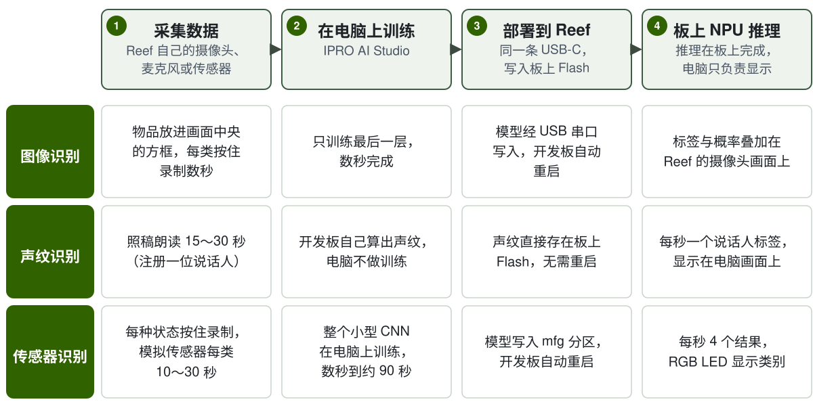

# IPRO AI Teach

IPRO AI Teach 让 IPRO7AI Reef EVK 无需编写代码就能学会识别：用开发板自身的摄像头、麦克风或传感信号采集数据，在电脑上用 IPRO AI Studio 训练，再经同一条 USB-C 线部署到开发板，由 IPRO7AI 的 NPU 执行推理。三个识别工具（图像、声纹、传感器）都在同一个 Edge AI 固件 `ipro_reef_teach` 中，一次运行一个，切换时三个模型都保留在板上。

!!! info "获取方式"
    IPRO AI Studio（macOS、Windows）可从 [GitHub](https://github.com/INTELPRO-INC/ipro-ai-studio/releases/latest) 下载；可直接烧录的 Edge AI 固件文件随 IPRO Edge AI 套件提供，请联系 INTELPRO。SDK 包含 Edge AI 固件的源代码 `apps/ai/ipro_reef_teach` 与浏览器版图像 Teach `tools/teach_web`。

!!! abstract "要点"
    - 一份固件、三种模式：`image`（图像识别）、`voice`（声纹识别）、`sensor`（传感器识别）。模式保存在 Flash 中，切换时开发板重启，约 2 秒。
    - 电脑端使用 IPRO AI Studio 的 **Teach**、**Audio**、**Sensor** 三个页面；训练在电脑的 CPU 上运行，不需要 GPU。
    - 推理全部在板上的 NPU 完成；图像、声音与传感数据不会上传到网络，声纹识别的声音不会离开开发板。
    - 硬件：IPRO7AI Reef EVK V4.0。固件只需烧录一次，之后更换模型都经 USB-C 部署。

## 介绍视频 { #video }

<video controls preload="metadata" playsinline width="100%" poster="/ipro-sdk-docs/assets/videos/ipro-ai-teach-2-intro.jpg">
  <source src="/ipro-sdk-docs/assets/videos/ipro-ai-teach-2-intro.mp4" type="video/mp4">
</video>

硬件导览、烧录，以及图像、声纹、传感器三个工具从采集数据到在板上识别的流程（约 3 分钟）。

## 三个工具 { #tools }

| | 图像识别 | 声纹识别 | 传感器识别 |
|---|---|---|---|
| 做什么 | 识别摄像头画面中央方框里的物品 | 每秒标示一次谁在说话：已注册的人显示名字，其他人显示 Speaker 1、Speaker 2… | 根据传感信号判断机器或环境的状态；没教过的状态回答 `UNKNOWN`，或只录制正常状态做异常检测 |
| 数据源 | OV5640 摄像头模组 | 板载 PDM 麦克风 | 固件内置的 5 种模拟传感器、板载麦克风，或自行添加的传感器 |
| 固件模式 | `image` | `voice` | `sensor` |
| USB 设备（VID:PID） | IPRO7 UVC Cam（3896:0705），USB 摄像头＋串口 | IPRO Reef Voice（3896:0720），串口 | IPRO Reef Sensor（3896:0721），串口 |
| IPRO AI Studio 页面 | **Teach** | **Audio** | **Sensor** |
| 类别或人数 | 2～8 类（含 BACKGROUND） | 最多 19 人，保存在板上的 Flash 中 | 最多 8 类（开启 UNKNOWN 时教 7 类） |
| 结果频率 | 随摄像头每帧更新 | 每秒 1 次 | 每秒 4 次 |
| 结果显示 | 叠加在 Reef 的摄像头画面上 | Audio 页面的时间轴；聆听时 RGB LED 亮红灯 | Sensor 页面；RGB LED 以颜色显示类别 |

声纹识别不在电脑上训练：注册一个人时，开发板自己计算出声纹并保存在 Flash 中，电脑只发送指令和显示结果。

## 需要准备 { #requirements }

| 项目 | 说明 | 图像 | 声纹 | 传感器 |
|---|---|---|---|---|
| IPRO7AI Reef EVK V4.0 | 见 [IPRO7AI Reef EVK](../hardware/boards/reef-evk.md) | ● | ● | ● |
| OV5640 摄像头模组 | FLEX-24 排线，接 FPC1；SW7 拨到 CAM | ● | | |
| USB-C 数据线 | 连接 Reef 的 USB-C 与电脑：供电、工具连接与模型传输。仅支持充电的线无法使用 | ● | ● | ● |
| 电脑 | Apple 芯片的 Mac（macOS 11 及以上），或 Windows 64 位（x64） | ● | ● | ● |
| IPRO AI Studio | 0.4.2，见[安装 IPRO AI Studio](install.md) | ● | ● | ● |
| IPRO Debug Probe | 接 Reef 的调试接口 U6；仅在烧录固件、查看控制台时需要 | ● | ● | ● |
| IntelProCube 0.7.0.1 | 命令行烧录工具，从 [GitHub](https://github.com/INTELPRO-INC/ipro-cube/releases) 下载；仅在烧录固件时需要 | ● | ● | ● |
| Edge AI 固件文件 | IPRO Edge AI 套件的 `firmware/`，或用 SDK 自行构建，见[烧录 Edge AI 固件](firmware.md) | ● | ● | ● |

传感器识别不需要外接传感器：固件内置 5 种模拟传感器，只需一块 Reef 和一条 USB-C 线就能走完整个流程。接入自己的传感器需要在固件中添加数据源，见[传感器识别](sensor.md#own-sensor)。

## 整体流程 { #workflow }

1. **安装 IPRO AI Studio。** 在 macOS 或 Windows 上安装并打开 Studio，允许它使用摄像头。见[安装 IPRO AI Studio](install.md)。

2. **烧录 Edge AI 固件（只需一次）。** 通过 IPRO Debug Probe 用 IntelProCube 烧录 `ipro_reef_teach`、它的分区表与 mfg 载荷（启动模式＋声纹模型）。输出中出现 `[All Success]` 才算成功。见[烧录 Edge AI 固件](firmware.md)。

3. **接上 USB-C，确认开发板。** 电脑枚举出当前模式的 USB 设备，例如 **IPRO7 UVC Cam**；Studio 的页面通过这个设备找到开发板。开发板处于其他模式时，页面上方出现 **Switch to …** 按钮。

4. **采集数据。** 图像：把物品放进方框，按住 **Hold to record**。声纹：在 **TEACH A VOICE** 输入名字，点击 **Record** 朗读。传感器：选择数据源，每种状态按住 **Hold to record**。

5. **训练。** 图像与传感器在电脑上点击 **Train**，数秒到约 90 秒完成。声纹注册完成即可使用，不需要训练。

6. **部署。** 点击 **Deploy**：Studio 依次完成 **Compile the model**、**Send and write**、**Restart the board**，开发板重启后加载新模型。

7. **在板上运行并确认。** 图像结果叠加在摄像头画面上；声纹点击 **Start listening** 查看时间轴；传感器查看 **On the board** 区域每秒 4 次的结果。

## 本节页面 { #pages }

-   **[安装 IPRO AI Studio](install.md)**

    ---

    在 macOS 与 Windows 上安装 Studio、首次打开、摄像头权限、Studio 如何找到开发板，以及 `ipro-ai` 命令行。

-   **[烧录 Edge AI 固件](firmware.md)**

    ---

    构建或获取固件、生成 mfg 载荷、用 IntelProCube 烧录、只更新固件、mfg 分区、切换模式、启动信息与看门狗。

-   **[图像识别](image.md)**

    ---

    切换到 `image` 模式、确认摄像头、建立类别、录制、训练、部署，在板上查看结果并补录后重新训练。

-   **[声纹识别](voice.md)**

    ---

    切换到 `voice` 模式、注册说话人、实时识别、为匿名说话人命名、删除声纹、阈值与陌生人模式。

-   **[传感器识别](sensor.md)**

    ---

    模拟传感器与麦克风、录制、训练选项、UNKNOWN 与异常检测、部署、实时结果，以及接入自己的传感器。

-   **[浏览器版图像 Teach](browser.md)**

    ---

    用 SDK 的 `tools/teach_web` 在 Chrome 或 Edge 中完成图像 Teach，无需安装 Studio。

-   **[故障排除](troubleshooting.md)**

    ---

    找不到开发板、模式不对、摄像头没有画面、烧录失败、部署被拒绝、看门狗重启等情况的原因与处理方法。

## 本版本的限制 { #limitations }

- 一次只运行一个工具；切换模式时开发板重启（约 2 秒）。
- 每个工具只有一个模型槽位：部署在提交前被中断时，该工具会没有模型，重新部署即可；没有上一个模型可以恢复。
- 模型经过完整性检查（大小、CRC-32），但不验证签名：任何能连接开发板 USB 的电脑都可以部署 CRC 正确的模型，不能作为安全功能使用。
- 图像识别需要 OV5640 摄像头模组；图像识别没有“不认识”这个答案，没教过的物品会被归到最相似的一类。
- 控制台只接受 ASCII 字符；含中文的说话人名字请在 Studio 的 Audio 页面输入。
- 本版本的 Edge AI 固件支持 IPRO7AI Reef EVK；其他 IPRO7AI 开发板需自行确认分区、摄像头与麦克风引脚。
