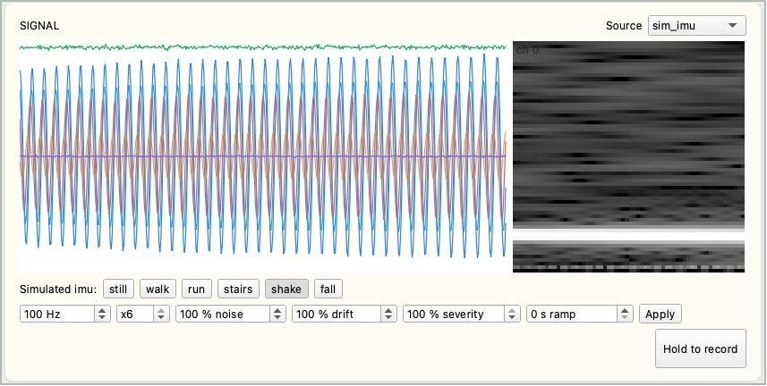
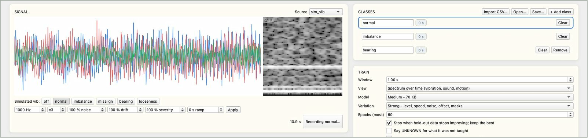
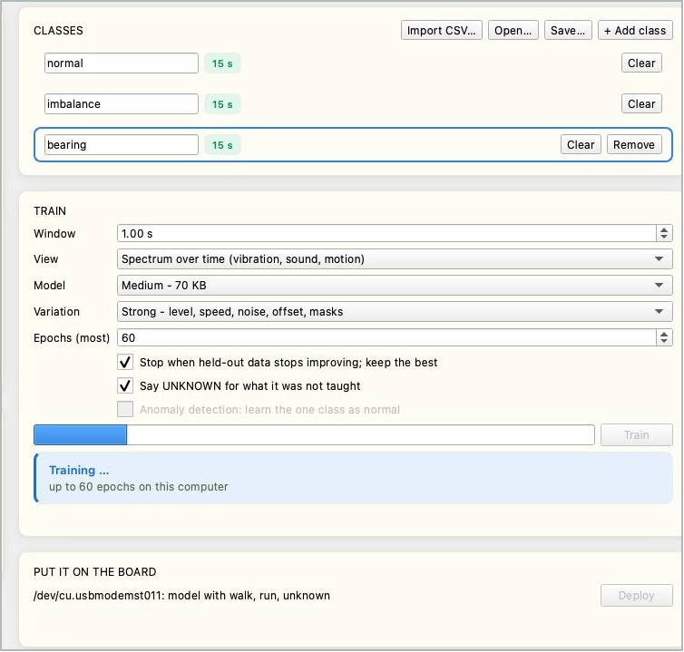
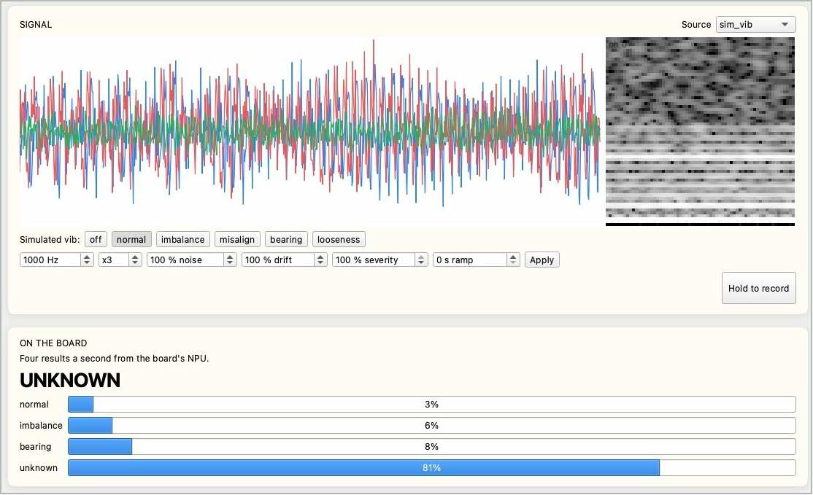

# 传感器识别

让 Reef 根据传感信号判断机器或环境的状态，例如电机是否不平衡、人是在走路还是跌倒。每种状态录制一段、在电脑上训练、部署到开发板，之后由板上的 NPU 每秒判断 4 次。全程在 IPRO AI Studio 的 **Sensor** 页面完成。固件内置 5 种模拟传感器，在接入自己的传感器之前，只需一块 Reef 和一条 USB-C 线就能把整个流程走一遍。

## 前提条件 { #prerequisites }

- IPRO7AI Reef EVK 已烧录 Edge AI 固件，见[烧录 Edge AI 固件](firmware.md)。传感器模型由 Studio 部署，不需要另外烧录。
- 一条支持数据传输的 USB-C 线，连接 Reef 的 USB-C 与电脑。
- 已安装 IPRO AI Studio，见[安装 IPRO AI Studio](install.md)。
- 使用模拟传感器或板载麦克风时不需要其他硬件；自己的传感器需要先在固件中添加数据源，见[接入自己的传感器](#own-sensor)。

## 工作原理 { #how-it-works }

- 数据源（模拟传感器、麦克风或您的传感器）的采样值存入板上 1 MB 的环形缓冲区，并经 USB-C 原样流式传输到 Studio。
- Studio 把每一段信号（一个“窗口”）转换成 64×64×8 的特征图，在电脑上训练整个小型 CNN，再编译成 NPU 模型。
- 部署时，模型连同预处理参数、类别名称与数据源一起写入传感器模型槽位，开发板自动重启。
- 开发板用与 Studio 相同的算法做预处理，交给 NPU 推理，每秒发送 4 个结果到 Studio，并以 RGB LED 的颜色显示当前类别。

## 连接开发板 { #connect }

<div class="ipro-steps" markdown>

1. **切换到 `sensor` 模式**：打开 Sensor 页面后点击页面上方的 **Switch to Sensor**，或在控制台输入 `mode sensor`。启动信息显示当前的模型，例如：

    ```text
    SENM: model 63672 B, 5/5 layers on the NPU, 6 classes, sim_vib 1000 Hz x3, window 1000, spectrogram
    ```

    尚未部署模型时，这里会说明没有模型的原因。

2. **接上 USB-C**：电脑上出现名为 **IPRO Reef Sensor** 的串口。

3. **打开 Sensor 页面**：在 Studio 左侧导航栏点击 **Sensor**（macOS 为 Command＋6，Windows 为 Ctrl＋6）。

4. **确认状态栏**：**Board** 显示 `ready`，**Source** 显示当前的数据源、采样率与通道数，例如 `sim_vib 1000 Hz x3`。找不到开发板时，**Put it on the board** 区域显示 `Connect a Reef running the Edge AI firmware to its own USB-C port.`。

</div>

## Sensor 页面的界面 { #page-layout }

| 区域 | 说明 |
|---|---|
| 状态栏 | **Board**、**Source**、**Held-out accuracy**（留出验证准确率，90% 以上以绿色显示）、**Last deploy**（上次部署的时间） |
| **Signal** | 实时波形（左）与频谱（右）；右上角的 **Source** 选择数据源 |
| 模拟状态与参数 | 使用模拟传感器时出现：上排按钮切换模拟的状态，下排设置采样率、通道数、噪声、漂移、严重度与渐变时间，点击 **Apply** 生效 |
| **Hold to record** | 按住录制当前选中的类别，松开即停止 |
| **Classes** | 类别列表，每行有名称、已录制秒数、**Clear** 与 **Remove**；上方有 **Import CSV…**、**Open…**、**Save…**、**+ Add class** |
| **Train** | 训练选项、进度条、**Train** 按钮、训练结果与混淆矩阵 |
| **Put it on the board** | 开发板的串口与当前模型、**Deploy** 按钮；下方逐步显示部署进度 |
| **On the board** | 开发板每秒 4 次的识别结果：大字为当前的判断，下方为每个类别的概率 |

## 选择数据源 { #source }

在 **Signal** 区域右上角的 **Source** 中选择数据源。切换数据源时，Studio 会带入推荐的窗口长度与查看方式。

| 数据源 | 通道（单位） | 采样率 | 可模拟的状态 | 推荐的窗口与查看方式 |
|---|---|---|---|---|
| `sim_vib` | 三轴加速度 x、y、z（g） | 1 kHz | `off` 停机、`normal` 正常、`imbalance` 不平衡、`misalign` 不对中、`bearing` 轴承故障、`looseness` 松动 | 1 秒，频谱 |
| `sim_imu` | 加速度 ax、ay、az（g），角速度 gx、gy、gz（500 dps） | 100 Hz | `still` 静止、`walk` 走路、`run` 跑步、`stairs` 上下楼梯、`shake` 摇晃、`fall` 跌倒 | 2.56 秒，频谱 |
| `sim_env` | 温度、气压、湿度 | 10 Hz | `normal` 正常、`heating` 加热、`cooling_fail` 冷却故障、`leak` 泄漏、`door_open` 开门、`sensor_fault` 传感器故障 | 60 秒，波形 |
| `sim_motor` | 三相电流 A、B、C（A） | 2 kHz | `off` 停机、`normal` 正常、`overload` 过载、`phase_loss` 缺相、`broken_bar` 转子断条、`bearing` 轴承故障、`unbalanced` 三相不平衡 | 2 秒，频谱 |
| `sim_sound` | 声压（单通道） | 8 kHz | `quiet` 安静、`hum` 嗡嗡声、`alarm` 警报声、`knock` 敲击声、`hiss` 漏气嘶嘶声、`voice` 人声 | 0.5 秒，频谱 |
| `mic` | Reef 的 PDM 麦克风（经 100 Hz 高通滤波） | 16 kHz | （真实声音） | 1 秒，频谱 |

模拟传感器每录制一次都会重新随机抽取转速、幅度与噪声，幅度也每 10 秒缓慢变化一次，所以同一个状态录两次，差异就像同一台机器运行两次。

使用模拟传感器时，波形下方有两排控件：

- **状态按钮**：例如 `Simulated vib: off normal imbalance misalign bearing looseness`，点击即切换模拟的状态。按下 Reef 上的 SW4 也会依次切换状态。
- **参数**：设置好后点击 **Apply** 生效。

| 参数 | 范围 | 含义 |
|---|---|---|
| 采样率（Hz） | 1～16000 | 模拟的采样频率 |
| 通道数（x） | 1～6 | 模拟的通道数 |
| noise（%） | 0～1000 | 噪声的强度 |
| drift（%） | 0～1000 | 漂移的强度 |
| severity（%） | 0～100 | 状态特征的强弱；30% 表示故障刚开始出现 |
| ramp（s） | 0～3600 | 切换到新状态时，从无到达到设定严重度所需的时间，用来模拟逐渐恶化的故障 |



## 录制 { #record }

<div class="ipro-steps" markdown>

1. **命名类别**：列表默认有 `normal` 与 `fault` 两类。点击名称可以重命名，点击 **+ Add class** 新增，最多 8 类。名称可使用英文字母、数字与 `_ - .`，最多 15 个字符，不能有空格（空格会替换为下划线）。

2. **选中类别、设置状态**：点击要录制的类别（边框变蓝），让机器处于那个状态；使用模拟传感器时，点击对应的状态按钮。

3. **按住 Hold to record**：录制中按钮显示 `Recording <类别>…`，松开即停止。类别旁的秒数会累加，累计到 10 秒以上时变为绿色。

4. **依次录完每一类**：录错了点击 **Clear** 清除该类的录音，点击 **Remove** 删除整个类别。

</div>



录制要点：

- 模拟传感器每类录制 10～30 秒就足够。
- **每一次按住的时间要超过窗口长度的 2 倍。** 每段录音的最后四分之一留作验证；录得太短的类别无法评分。短于一个窗口时显示 `too short: hold for at least one window`。
- 数据流中断时显示 `the stream skipped: kept as <N> takes`，录音会分成 N 段保留。
- 慢速信号（例如温度）要录得更长，至少覆盖 15 个窗口。

**导入 CSV**：在其他地方录好的数据，点击 **Import CSV…** 加入当前选中的类别。

- 每列一个通道、每行一个采样点，以逗号分隔；第一行如果是标题行会自动跳过。
- 采样率必须与开发板当前的数据源相同，列数必须等于数据源的通道数；不符合时显示 `<N> columns` 错误。
- 数值要使用开发板流式输出的原始计数，不要换算成伏特或 g：预处理的频谱以一个计数为下限，换算过单位的数据看起来会与实时信号不一样。

## 训练 { #train }

| 选项 | 选择 | 说明 |
|---|---|---|
| **Window** | 0.05～60 秒（默认 1.00 s） | 每次判断看多长的信号；切换数据源时带入推荐值 |
| **View** | Spectrum over time (vibration, sound, motion) | 频谱随时间的变化；适合振动、声音、动作 |
| | Waveform (slow signals: temperature, pressure) | 原始波形；适合温度、气压等慢速信号 |
| **Model** | Small - fastest, 21 KB | 最小、最快 |
| | Medium - 70 KB（默认） | 大多数情况的起点 |
| | Large - most capacity, 200 KB | 容量最大，适合类别多或差异细微的情况 |
| **Variation** | Strong - level, speed, noise, offset, masks（默认） | 训练时加上幅度、速度、噪声、偏移与掩码等变化，适合大多数信号 |
| | Light - level and a little noise | 只加幅度变化与少量噪声；适合非常细微、缓慢、容易被强烈变化掩盖的特征 |
| **Epochs (most)** | 5～300（默认 60） | 训练轮数的上限 |
| Stop when held-out data stops improving; keep the best | 勾选（默认） | 留出验证的分数连续 8 轮没有提升就停止，保留分数最好的那一轮 |
| Say UNKNOWN for what it was not taught | 勾选／不勾选 | 另外学习一个 UNKNOWN 类别，见下文 |
| Anomaly detection: learn the one class as normal | 只录一类时才能勾选 | 异常检测，见下文 |

<div class="ipro-steps" markdown>

1. **设置选项后点击 Train**：进度条显示训练进度，下方显示 `Training… up to <n> epochs on this computer`。至少要有 2 类有录音（异常检测要恰好 1 类），否则显示 `Not ready to train`。

    

2. **查看结果**：完成后显示 `Trained in <秒数> s`，以及训练用的窗口数（training windows）与从每段录音尾部留出验证的窗口数（held out）。留出验证的分数以开发板实际运行的 int8 模型计算。

3. **查看混淆矩阵**（`true \ said`）：每一行是实际类别，每一列是模型的判断，对角线以外的数字就是判错的次数。

</div>

如果显示 `<k> of <n> classes have no held-out data`，表示有类别每次录制的时间太短，请把那几类重新录制，每次都比窗口长度的 2 倍更长。训练时间取决于类别数、录音长度、模型大小以及是否开启 UNKNOWN，INTELPRO 的实测从约 4 秒（2 类、各 15 秒）到约 90 秒（3 类各 15 秒、Medium、开启 UNKNOWN）。

**让模型会说 UNKNOWN**：勾选 **Say UNKNOWN for what it was not taught** 后，Studio 用您录制的数据自动生成各种变形，学成一个额外的 UNKNOWN 类别，并为每个类别确定分数下限。遇到没录过的状态时，开发板回答 `UNKNOWN`，而不是硬把它归到某一个已知类别。开启后最多可以教 7 类（UNKNOWN 占一类）。

**只录正常状态：异常检测**：只有一个类别有录音时（通常是“正常”），可以勾选 **Anomaly detection: learn the one class as normal**。Studio 给正常数据加上各种人工制造的异常（新的音调、撞击、噪声突发、幅度跳变或漂移、读数卡住、转速大幅改变、某个通道失效、信号削波、峰值或谐波变强、通道增益改变、缓慢的拍频），让模型学会“正常”与“其他一切”的区别，所以从未录过的故障也会被判为 `ANOMALY`。Studio 会调整判定阈值，使加上变化的正常数据中约 1% 被判为异常。能录到的故障，用分类模式（每种故障录一类）通常比异常检测更可靠。

## 部署 { #deploy }

<div class="ipro-steps" markdown>

1. **确认开发板**：**Put it on the board** 区域显示开发板的串口与当前的模型，例如 `/dev/cu.usbmodemXXXX: no model yet`。

2. **点击 Deploy**：Studio 依次执行并打勾：**Compile the model**（编译模型，显示模型大小与 NPU 层数）、**Send and write**（发送并写入，开发板回复 `TDEP OK`）、**Restart the board**（开发板重启并加载新模型）。

3. **确认完成**：显示 **On the board** 与 `<类别名称> - results below, four a second.`，状态栏的 **Last deploy** 显示部署的时间。

</div>

部署通常在数秒内完成，模型越大，发送与写入越久。传感器模型只有一个槽位：写入过程中被中断时会没有模型，重新部署即可。

## 查看实时结果 { #run }

部署完成后，**On the board** 区域每秒更新 4 次：

- **大字**：当前的判断，是类别名称、`UNKNOWN`（没教过的状态）或 `ANOMALY`（异常检测模式下的异常）。
- **条形图**：每个类别的概率。
- Reef 的 RGB LED 也以不同颜色显示当前类别，不连接电脑也能看出结果。



用模拟传感器测试时，切换到没有教过的状态，就能检查 UNKNOWN 是否起作用；把 ramp 设为数十秒，可以观察故障逐渐加重时判断在什么时候改变。状态转换的瞬间，一个窗口可能同时包含两种状态，偶尔出现 UNKNOWN 属于正常现象，请根据连续几次的结果判断。

传感器模式的控制台命令：

| 命令 | 作用 |
|---|---|
| `sens status` | 当前的数据源、模型与状态 |
| `sens src <来源>` | 切换数据源：`sim_vib`、`sim_imu`、`sim_env`、`sim_motor`、`sim_sound`、`mic` |
| `sens sim <状态>` | 切换模拟传感器的状态（`sens status` 列出可用的状态） |
| `sens print on`／`sens print off` | 在控制台打印每一条结果 |

## 验证结果 { #verify }

1. 部署后 **On the board** 区域每秒更新 4 次，大字随模拟状态按钮或机器的实际状态改变。
2. 每一个教过的状态，大字显示对应的类别名称，该类的概率最高。
3. 开启 UNKNOWN 时，切换到没有教过的状态，大字显示 `UNKNOWN`。
4. RGB LED 的颜色随类别改变；重启后模型仍在（启动信息出现 `SENM: model …`）。

## 保存与重新训练 { #iterate }

- **Save…**：把所有录音保存到一个文件夹：每类一个 `.npz` 文件，加上记录采样率与类别顺序的 `sensor_teach.json`。
- **Open…**：重新打开由 **Save…** 保存的文件夹，继续补录或重新训练。
- 同一个文件夹也可以不打开窗口，用命令行训练成模型套件再部署（`--source` 必须是录制时的数据源）：

    ```bash
    ipro-ai train sensor rec/ --source sim_vib --out vib.ipkg
    ipro-ai deploy vib.ipkg --switch
    ```

    默认值与 Sensor 页面相同（Medium、Strong、最多 60 轮、8 轮没有提升就停止）；`--size`、`--window`、`--mode spectrogram|wave`、`--unknown`、`--anomaly` 等选项对应页面上的设置。

## 接入自己的传感器 { #own-sensor }

随附的 Edge AI 固件只有 5 种模拟传感器与板载麦克风这些数据源，没有内置任何外接传感器的驱动。接入自己的传感器有两种方式：

**方式一：在固件中添加数据源（推荐）**

由固件工程师在 SDK 的 `apps/ai/ipro_reef_teach/sensor/sensor_src.c` 的数据源表中添加一项：I2C 或 SPI 器件用 `ipro_ai_source_sampled_register()` 注册（平台定时调用您的读取函数），流式数据用 `ipro_ai_source_ring_register()` 注册（可在中断中推入）。两者都声明在 `components/ai/source/include/ipro_ai_source.h` 中。规则如下：

- 采样值为 int16，多通道时交错排列，所有通道使用同一个采样率。
- 最多 8 个通道；采样率不限，只要 1 MB 的环形缓冲区放得下一个窗口。由平台定时调用的轮询式数据源，采样率最高 1 kHz（系统节拍）。
- 数据源要报告名称、采样率、通道数与单位。

Reef 的 40-pin 排针 J_IO 第 3、5 脚是 I2C（SDA GPIO19、SCL GPIO18，板上 4.7 kΩ 上拉），信号为 3.3 V，见 [40-pin 扩展排针 J_IO](../hardware/boards/reef-evk.md#j-io)。构建与烧录方式同[烧录 Edge AI 固件](firmware.md)，只更新固件时省略 `--mfg`。

Studio 不需要任何修改：它从开发板读取数据源的名称、采样率与通道数，新的数据源会出现在 **Source** 菜单中。模型会记录训练时的数据源名称，开发板只在同一个数据源上运行这个模型。

**方式二：导入 CSV**

在其他地方用同样的传感器、采样率与通道数录好的数据，可以用 **Import CSV…** 加入类别。部署后的模型仍需要板上有对应的数据源才能运行，所以这个方式用来补充训练数据，不能取代方式一。

## 规格 { #specs }

| 项目 | 规格 |
|---|---|
| 类别数 | 最多 8 类；开启 UNKNOWN 时最多教 7 类 |
| 通道数 | 最多 8 个（模拟传感器 1～6 个） |
| 采样率 | 1 Hz～16 kHz |
| 窗口长度 | 0.05～60 秒；上限还受 1 MB 环形缓冲区限制，例如 16 kHz 单通道 32 秒、1 kHz 三通道 170 秒 |
| 预处理 | 频谱模式：每通道 64 个时间片段、每段 128 点 FFT，频率分辨率为采样率／128，每个窗口至少 128 个采样点；波形模式：每通道重采样为 4096 点 |
| 模型输入 | 64×64×8，int8 |
| 网络 | 四层 3×3、步长 2 的卷积加 1×1 分类层，每一层都在 NPU 上执行 |
| 部署到板上的模型大小 | Small 约 17 KB、Medium 约 64 KB、Large 约 191 KB |
| 板上时间 | Large 模型：NPU 约 4.6 ms；预处理约 56 ms（1 秒窗口、三通道、频谱） |
| 结果输出 | 每秒 4 次，经 USB-C 发送到 Studio，并以 RGB LED 显示 |
| 模型存放位置 | 传感器模型槽位，可容纳 252 KB |

## 使用建议 { #tips }

- **模拟传感器只用来熟悉流程。** 换成真实传感器后，请重新采集数据、训练，并在现场验证。
- **异常检测只认得您录制的“正常”。** 请在机器的各种正常负载、转速下都录制一段正常数据；否则较重的正常负载可能被判为异常，而真正的过载反而可能被当成正常。
- 频率特征明显的故障（例如轴承、松动、缺相）最容易检测；只有振幅变大的故障（例如过载、三相不平衡）在异常检测模式下较难发现，请改用分类模式。
- 慢速信号（温度、气压）使用波形模式，每段录音至少覆盖 15 个窗口；异常检测的正常数据要录得足够长。
- 频谱模式的每个窗口至少要有 128 个采样点；采样率很低时改用波形模式或加长窗口。
- 特征频率差距小于“采样率／128”的故障，只会表现为随时间缓慢起伏的拍频，需要 2 秒以上的窗口，而且仍是最难识别的情况。
- 模型只在训练时使用的数据源（名称、采样率、通道数）上运行；更换数据源或参数就要重新训练、部署。

## 故障排除 { #troubleshooting }

| 现象 | 原因 | 处理 |
|---|---|---|
| **Put it on the board** 显示 `Connect a Reef running the Edge AI firmware to its own USB-C port.` | 找不到处于 `sensor` 模式的开发板 | 确认固件与 USB-C 线；USB-C 要接在 Reef 自身的接口上；点击 **Switch to Sensor** |
| `Not ready to train` | 开发板未连接，或有录音的类别不足 2 类（异常检测要恰好 1 类） | 连接开发板并补录类别 |
| `too short: hold for at least one window` | 按住的时间短于一个窗口 | 按久一点 |
| `<k> of <n> classes have no held-out data` | 有类别每次录制的时间太短 | 每次按住超过窗口长度的 2 倍 |
| **Import CSV…** 显示 `<N> columns` | CSV 的列数与数据源的通道数不同 | 每列一个通道、每行一个采样点 |
| **Open…** 显示 `Not a Sensor Teach folder` | 文件夹中没有 `sensor_teach.json` | 打开由 **Save…** 保存的文件夹 |
| 部署失败：`the board did not come back with the model within 30 s` | 开发板没有在 30 秒内带着新模型恢复 | 重新插拔 USB-C，确认控制台的启动信息，再部署一次 |
| 部署失败：`the board refused it: …`，信息中含 `size` | 模型超过槽位容量 | 改用较小的 **Model**（Medium 或 Small） |
| 更换数据源后，原来训练好的模型不能用 | 模型只适用于训练时的数据源 | 在新的数据源上重新录制与训练 |
| 实时结果在状态转换时出现 `UNKNOWN` | 窗口同时包含两种状态 | 正常现象；根据连续几次的结果判断 |
| 异常检测在正常的重负载下也报警 | 正常数据没有覆盖这种负载 | 在各种正常负载、转速下补录正常数据，重新训练 |

其他情况见[故障排除](troubleshooting.md)。

## 下一步 { #next-steps }

- [烧录 Edge AI 固件](firmware.md)：添加自己的数据源后只更新固件。
- 《IPRO7AI Edge AI 编程指南》：数据源、预处理与应用框架的完整接口，可向 INTELPRO 索取，见[文档下载](../documents/index.md)。
