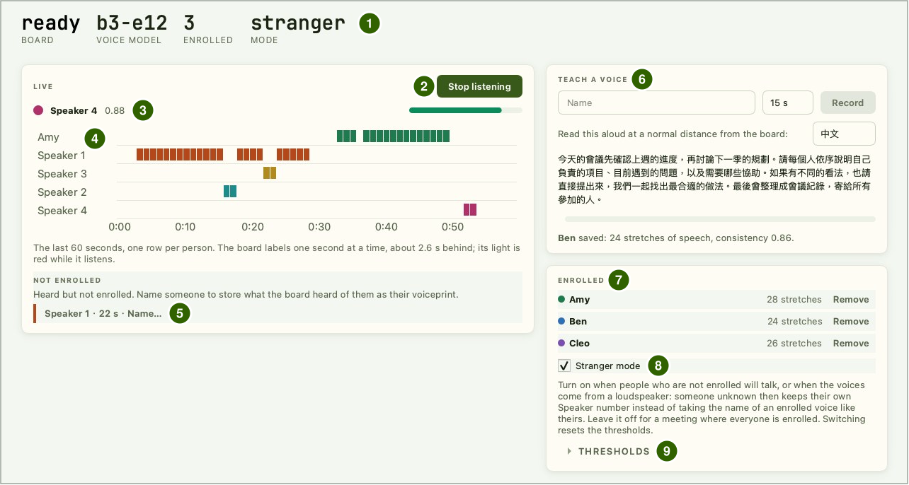
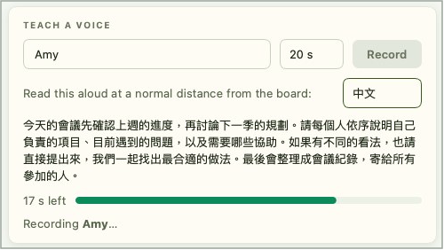
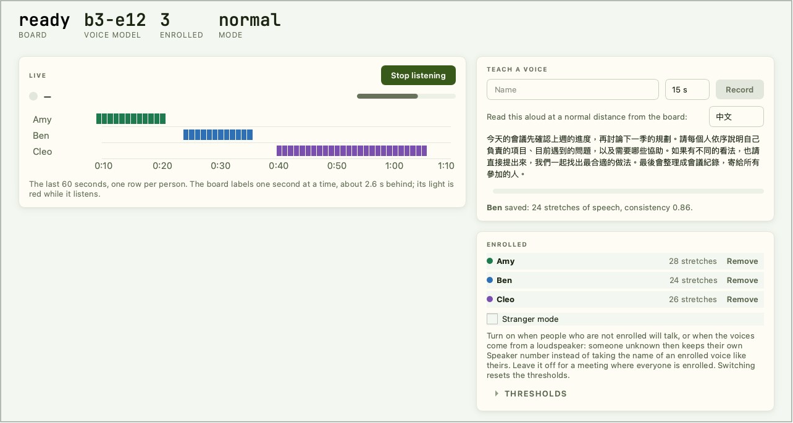

# 声纹识别

让每个人照稿朗读约 20 秒完成注册，之后 Reef 每秒标示一次当前是谁在说话：已注册的人显示名字，未注册的人显示 Speaker 1、Speaker 2…，事后也可以为他们命名。所有运算都在开发板上完成，声纹保存在板上的 Flash 中，声音不会离开开发板。电脑端使用 IPRO AI Studio 的 **Audio** 页面；本页截图中的人名（Amy、Ben、Cleo）均为示例。

!!! note "录音前先征得同意"
    注册或聆听前，请先征得在场每一位的同意。

## 前提条件 { #prerequisites }

- IPRO7AI Reef EVK 已烧录 Edge AI 固件，声纹模型 `model_b.spkb` 随 mfg 载荷一起烧录，见[烧录 Edge AI 固件](firmware.md)。
- 一条支持数据传输的 USB-C 线，连接 Reef 的 USB-C 与电脑。声纹识别使用板载 PDM 麦克风，不需要摄像头。
- 已安装 IPRO AI Studio，见[安装 IPRO AI Studio](install.md)。
- 安静的环境；注册与聆听都使用 Reef 自身的麦克风。

## 工作原理 { #how-it-works }

- 板载 PDM 麦克风采集声音，重采样为 16 kHz，放入保留最近 32 秒的环形缓冲区。
- 每秒取最近 2.6 秒的声音，计算对数梅尔频谱，经过 NPU 上的声纹网络与 CPU 上的池化、全连接层，得到一组 192 维的声纹。
- **注册**时，开发板把朗读期间每一段有声音的 2.6 秒都计算成声纹，取平均后存入 Flash 的 media 分区。
- **聆听**时，开发板把每秒的声纹与已注册的人比对（余弦相似度）。最高分达到名称阈值就显示那个人的名字；没有人达到时，再与当前的匿名说话人比对，低于新说话人阈值就成为一位新的匿名说话人。
- 电脑端只发送指令并显示开发板返回的标签。录音与聆听期间，Reef 的 RGB LED 亮红灯。

## 连接开发板 { #connect }

<div class="ipro-steps" markdown>

1. **切换到 `voice` 模式**：打开 Audio 页面后点击页面上方的 **Switch to Audio**，或在控制台输入 `mode voice`。开发板重启后，控制台出现：

    ```text
    SPKM: model 'b3-e12': 437200 B, trunk 16/16 layers on the NPU, ...
    RTCH: voice ready - shell `spk`, IPRO AI Studio Audio page over USB-C
    ```

    出现 `NO MODEL` 时，说明板上没有有效的声纹模型，见[更换声纹模型](#voice-model)。

2. **接上 USB-C**：电脑上出现名为 **IPRO Reef Voice** 的串口。

3. **打开 Audio 页面**：在 Studio 左侧导航栏点击 **Audio**（macOS 为 Command＋7，Windows 为 Ctrl＋7）。页面会自动找到开发板，不需要选择串口。

4. **确认状态栏**：**BOARD** 显示 `ready`，**VOICE MODEL** 显示 `b3-e12`，**ENROLLED** 是已注册人数，**MODE** 是 `normal` 或 `stranger`。

</div>

开发板的 USB 串口同一时间只能被一个程序使用，使用 Audio 页面时请关闭其他打开了这个串口的程序。离开 Audio 页面时，聆听会自动停止。

## Audio 页面的界面 { #page-layout }



| 编号 | 区域 | 说明 |
|---|---|---|
| 1 | 状态栏 | **BOARD**（开发板状态）、**VOICE MODEL**（声纹模型）、**ENROLLED**（已注册人数）、**MODE**（`normal` 或 `stranger`） |
| 2 | **Start listening** | 开始聆听；聆听中变为 **Stop listening**，再点击一次停止 |
| 3 | 当前说话人 | 名字与相似度分数 |
| 4 | 时间轴（**LIVE**） | 最近 60 秒，每人一行，每一格代表一秒 |
| 5 | **NOT ENROLLED** | 听到但尚未注册的人，每人一个标签，例如 `Speaker 1 · 22 s · Name…`；点击标签可以为他命名 |
| 6 | **TEACH A VOICE** | 输入名字，选择朗读时长（15 s、20 s、30 s），点击 **Record** 注册；右侧选择朗读稿的语言（中文或 English），下方显示注册结果 |
| 7 | **ENROLLED** | 已注册的人，每人一行，显示纳入声纹的语音段数，可点击 **Remove** 删除 |
| 8 | **Stranger mode** | 陌生人模式的开关，见[阈值与陌生人模式](#thresholds) |
| 9 | **THRESHOLDS** | 展开后调整名称阈值与新说话人阈值 |

## 注册说话人 { #enroll }

<div class="ipro-steps" markdown>

1. **输入名字与时长**：在 **TEACH A VOICE** 输入名字（可以包含空格与中文），选择朗读时长，默认 20 s。聆听中不能注册，先点击 **Stop listening**。

2. **就位**：请要注册的人坐在之后实际说话的位置，与开发板保持平常的距离。

3. **点击 Record 并朗读**：请他把出现的朗读稿念出来，一直念到时间结束。进度条旁显示剩余秒数，下方显示 `Recording <名字>…`。

    

4. **查看结果**：时间到后显示 `<名字> saved: <n> stretches of speech, consistency <值>.`，新的名字出现在 **ENROLLED** 列表中。stretches of speech 是纳入声纹的语音段数，consistency 是这些语音段彼此之间的一致程度。

</div>

**一致程度低于 0.8 时请重新注册**：靠近开发板一点，在之后实际说话的位置、用平常的声音再录一次，Studio 会直接提示。用同一个名字再注册一次会替换原来的声纹，页面会先以 **Record again** 对话框询问。

注册失败时显示 `Could not save <名字>:` 与原因：

| 页面信息 | 处理 |
|---|---|
| `Too little speech was heard. …` | 说话大声一点或靠近一点，并持续朗读到时间结束 |
| `The board's voice list is full. Remove someone first.` | 已注册人数已满，先删除一位 |
| `The board has no voice model.` | 板上没有声纹模型，见[更换声纹模型](#voice-model) |
| `The board's microphone did not start.` | 麦克风没有启动；重新插拔 USB-C 后再试 |
| `Recording was cancelled.` | 注册被取消，重新点击 **Record** |
| `The board refused: check the name, or wait for what it is doing to finish.` | 检查名字，或等开发板当前的工作（例如聆听）结束后再试 |

## 实时识别 { #listen }

<div class="ipro-steps" markdown>

1. **保持安静，点击 Start listening**：每次开始聆听时，开发板从当前的声音开始跟踪背景噪声，所以点击的那一刻请尽量保持安静。RGB LED 亮红灯。

2. **开始说话**：开发板每秒发送一个标签，内容是最近 2.6 秒的判断，所以标签比实际说话晚约 2.6 秒。没有人说话的时段不标示。时间轴的颜色与 **ENROLLED** 列表的圆点颜色对应。

3. **点击 Stop listening 停止**。

</div>

## 为匿名说话人命名 { #name-speaker }

未注册的人被开发板听到 3 秒以后，会以 Speaker 1、Speaker 2… 出现在时间轴上，并出现在 **NOT ENROLLED** 区域，例如 `Speaker 2 · 26 s · Name…`（26 s 是开发板听到他的秒数）。

1. 点击该标签的 **Name…**。
2. 在 **Name a speaker** 对话框中输入名字，点击确定。

开发板把刚才听到的这位说话人的声音保存为他的声纹，之后就以名字显示，无需再朗读注册。



## 删除声纹 { #remove }

在 **ENROLLED** 列表中点击某人的 **Remove**，在对话框中确认后即删除他的声纹。全部删除后，状态栏的 **ENROLLED** 回到 0，列表显示 `Nobody enrolled yet.`；时间轴上已显示的记录不受影响。

## 阈值与陌生人模式 { #thresholds }

展开 **THRESHOLDS**，可以调整两个阈值（余弦相似度，范围 0.1～0.95），点击 **Set** 生效。阈值与模式和声纹一起保存在板上，重启后保持不变。

| 阈值 | 普通模式默认值 | 陌生人模式默认值 | 作用 |
|---|---|---|---|
| **Name match**（名称阈值） | 0.60 | 0.50 | 一段声音与某位已注册者的相似度达到这个值，才显示他的名字。调高：被标上名字的人变少、标为匿名的变多；调低则相反 |
| **New speaker**（新说话人阈值） | 0.50 | 0.50 | 未被识别出的声音与现有匿名说话人的相似度都低于这个值时，成为一位新的匿名说话人。同一个人被拆成好几位时调低；不同的人被合并成同一位时调高 |

勾选或取消 **Stranger mode** 切换陌生人模式，状态栏的 **MODE** 随之显示 `stranger` 或 `normal`；切换时两个阈值都会重置为该模式的默认值。也可以在控制台输入 `spk mode stranger` 或 `spk mode normal`。

陌生人模式让未注册的人不容易被标上别人的名字：比对前先扣除房间里所有声音共有的部分（麦克风、房间与扬声器造成的影响），并让已经听到过的未注册者保留自己的 Speaker 编号。

| 情况 | 建议 |
|---|---|
| 会有未注册的人说话；或声音来自扬声器、录音的播放 | 开启陌生人模式 |
| 与会者全部已注册 | 保持关闭。在远距离拾音的场合，陌生人模式会让已注册的人更常被标为匿名说话人 |

陌生人模式需要高质量的注册：一致程度偏低的人更常被标为匿名说话人，两位未注册者也可能被合并成同一个编号。注册后显示的一致程度低于 0.8 时，请重新注册。

## 控制台命令 { #console }

声纹模式的控制台（U6，115200 baud）提供与 Audio 页面相同的操作，适合调试：

| 命令 | 作用 |
|---|---|
| `spk status` | 模型、状态、已注册名单、USB 连接 |
| `spk enroll 20 <名字>` | 朗读 20 秒注册（8～30 秒） |
| `spk live on`／`spk live off`／`spk stop` | 开始聆听／停止聆听／停止当前的工作 |
| `spk del <名字>` | 删除某人的声纹 |
| `spk name <k> <名字>` | 为匿名说话人 k 命名 |
| `spk thresh <名称阈值> <新说话人阈值>` | 设置两个阈值，例如 `spk thresh 0.60 0.50` |
| `spk mode normal`／`spk mode stranger` | 切换普通模式／陌生人模式；两个阈值重置为该模式的默认值 |
| `spk echo on` | 在控制台打印每一行事件，以及每秒对每位已注册者的分数 |

控制台只接受 ASCII 字符；含中文的名字请在 Audio 页面输入。

## 验证结果 { #verify }

1. 注册后，名字出现在 **ENROLLED** 列表中，consistency 为 0.8 以上。
2. 点击 **Start listening** 后 RGB LED 亮红灯；已注册的人开始说话约 2.6 秒后，时间轴上他那一行出现色块，当前说话人显示他的名字与相似度。
3. 未注册的人说话时，时间轴上出现 Speaker k，**NOT ENROLLED** 区域出现他的标签。
4. 重启后回到 Audio 页面，**ENROLLED** 人数不变。

## 更换声纹模型 { #voice-model }

声纹模型 `model_b.spkb`（模型名称 `b3-e12`）随 mfg 载荷烧录。要不经烧录、改用 USB 部署时，先打包成模型套件，再用命令行部署到声纹工具：

```bash
ipro-ai model pack model_b.spkb -o voice.ipkg
ipro-ai deploy voice.ipkg --switch
```

已注册的声纹以模型的 CRC 标记：换成另一个声纹模型后，已注册名单会被清空，需要重新注册。只更新固件、不更换模型时，模型与已注册的人都会保留。IPRO AI Studio 0.4.2 的 Audio 页面没有部署模型的按钮。

## 规格与限制 { #specs }

| 项目 | 规格 |
|---|---|
| 拾音 | Reef 板载 PDM 麦克风，重采样为 16 kHz，经 100 Hz 高通滤波 |
| 标示频率 | 每秒一个标签，依据最近 2.6 秒的声音 |
| 声纹 | 192 维；板上计算一次约 140 ms，其中预处理约 118 ms、NPU 约 9 ms |
| 声纹模型 | `model_b.spkb`（b3-e12），437,200 B；网络主干 16 层全部在 NPU 上执行 |
| 注册时长 | Audio 页面可选 15、20、30 秒；控制台 8～30 秒 |
| 可保存的人数 | 19 人保存在 Flash 的 media 分区（16 KB）；超出的暂存在内存中，重启后消失 |
| 语音检测 | 根据能量判断：比跟踪到的背景噪声高 3 dB 才算语音 |
| 模型存放位置 | 声纹模型槽位，可容纳 444 KB |

- 用其他麦克风录制的声纹，与 Reef 听到的同一个人的相似度会明显偏低。注册与聆听都要使用 Reef 自身的麦克风。
- 经扬声器播放的声音，不同人的声纹会变得比较相似；用扬声器或录音播放测试时，请开启陌生人模式。
- 每个人说话短于 2.6 秒的片段，以及两人同时说话的时段，无法分开标示。
- 语音检测根据音量判断，音乐、电视声等也会被当成语音。请在安静的环境中使用，避开持续的背景声音。
- 匿名说话人是边听边聚类的，结束后不会再合并；同一个人被拆成两位时，为其中一位命名，或调整新说话人阈值。
- 实际场所的口音、混响与说话距离各不相同，正式使用前请先实地试用，必要时调整阈值或模式。

## 故障排除 { #troubleshooting }

| 现象 | 原因 | 处理 |
|---|---|---|
| Audio 页面显示 `The board has no voice model.`，或控制台显示 `NO MODEL` | 板上没有有效的声纹模型 | 用带 `--mfg` 的命令重新烧录，或用 `ipro-ai deploy` 部署声纹模型 |
| Audio 页面显示 `The board did not answer.`，或找不到开发板 | 其他程序占用了开发板的串口，或开发板不在 `voice` 模式 | 关闭其他使用该串口的程序；点击 **Switch to Audio** |
| 未注册的人一直被标上某位已注册者的名字 | 普通模式下名称阈值偏低；扬声器播放的声音尤其如此 | 开启陌生人模式，或调高 **Name match** |
| 已注册的人经常被标为 Speaker k | 注册时的位置、麦克风或音量与实际使用时不同，或名称阈值太高 | 在实际位置用 Reef 的麦克风重新注册；或稍微调低 **Name match** |
| 同一个人被拆成好几位 Speaker | 新说话人阈值太高 | 调低 **New speaker**，或为其中一位命名 |
| 没有人说话时也出现标签 | 音乐、电视等持续声音被当成语音 | 移除背景声源，在安静的环境中使用 |
| 更换声纹模型后，已注册的人都不见了 | 声纹与模型绑定 | 用新模型重新注册 |

其他情况见[故障排除](troubleshooting.md)。

## 下一步 { #next-steps }

- [传感器识别](sensor.md)：用同一块 Reef 判断机器或环境的状态。
- [烧录 Edge AI 固件](firmware.md#modes)：模式切换与 USB 设备一览。
