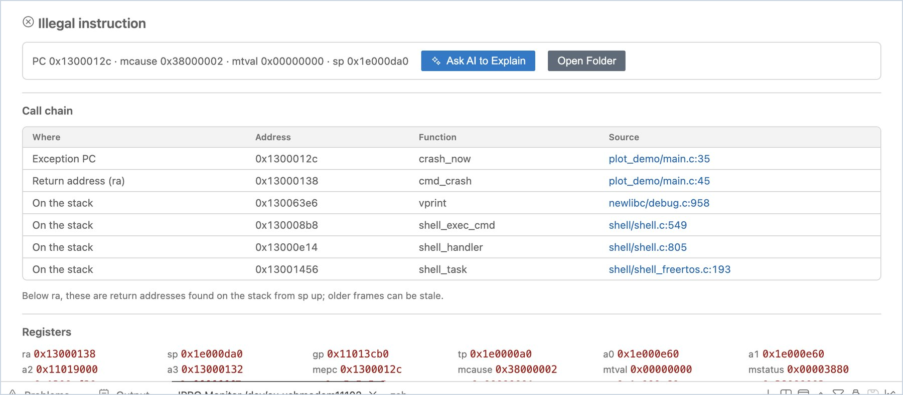
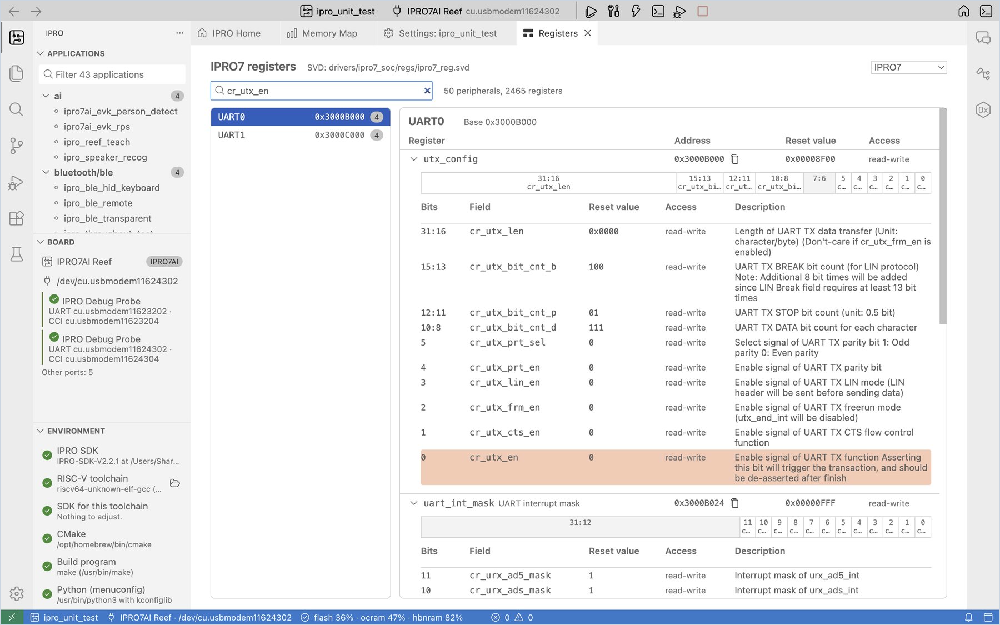

# 调试与分析

开发板崩溃或行为异常时，这些工具可以帮助你找出是哪一行代码导致的、当时寄存器和内存的状态，以及寄存器字段的含义。本版本暂不支持通过 JTAG 调试。

## 崩溃地址自动解码 { #crash-decode }

IPRO7 系列和 IPRO6S 的固件崩溃时，都会通过串口打印同样格式的报告：异常的程序地址（MEPC）、返回地址（ra）和栈回溯（stack backtrace）。IPRO Monitor 会在每个地址下方多打印一行灰色的解码结果（屏幕上以箭头开头；下面的示例用 `->` 表示），例如：

```text
MEPC   : 0x13000146
    -> 0x13000146 crash_now  …/apps/user/plot_demo/main.c:30
```

解码结果是函数名，以及源代码中的文件名和行号。

!!! warning "重要"
    解码使用当前应用程序上一次构建的 ELF 文件，因此开发板上的固件必须与当前构建一致。侧边栏的 **Board** 视图显示“Runs other firmware”时，解码结果不可信；请先重新烧录。

## 崩溃转储 { #crash-dump }

仅凭地址不够时，可以让开发板在崩溃后把寄存器和整个 RAM 发回计算机；IDE 随后会从栈中找出完整的调用链。

<div class="ipro-steps" markdown>

1. **开启崩溃转储。** 在应用程序的 `.config` 中添加 `CONFIG_EXCEPTION_DUMP=y`（可以在 [Settings (Kconfig)](develop.md#kconfig) 中搜索 `EXCEPTION_DUMP`），然后构建并烧录。

2. **让开发板崩溃**，同时保持串口监视器打开。

    **应看到**：通知显示“The board crashed and offers a crash dump of its RAM and registers. Collect it? It takes about a minute; the board waits for 2 minutes.”

3. **收集崩溃转储。** 点击 **Collect Crash Dump**。

    **应看到**：进度显示“Receiving the crash dump from &lt;port&gt;…”。传输完成后（256 KB OCRAM 加 8 MB PSRAM，实测约 64 秒），编辑区中打开 **Crash Dump**。

4. **阅读崩溃转储。** 查看 **Crash Dump** 的内容。

    **应看到**：

    - 顶部是异常类型（例如 `Illegal instruction`）；下一行是摘要：PC、mcause、mtval 和 sp。
    - **Call chain** 表格依次列出异常 PC、返回地址（ra）以及在栈中找到的返回地址。每一行包含地址、函数和源代码位置；点击源代码位置即可打开该行。
    - **Registers** 列出崩溃时的所有寄存器。

5. **请 AI 解释（可选）。** 如有需要，点击 **Ask AI to Explain**：AI 助手会沿调用链阅读代码并解释原因。点击 **Open Folder** 可查看发回的原始文件。

</div>



!!! note
    - 调用链中 ra 以下的条目是从 sp 向上在栈中找到的返回地址；越往下，越有可能是先前残留的陈旧数据。
    - 崩溃转储保存在应用程序的 `build/crash/<date>` 文件夹中。以后要再次查看，请在 IPRO 菜单中选择 **Crash Dumps…**。
    - 传输过程中某个数据块校验失败时，页面会显示“The dump is incomplete”，并列出已收到的部分。

## 寄存器参考 { #registers }

**Register Reference** 根据芯片的 SVD 文件列出所有外设、寄存器和字段，方便你在编写驱动或阅读寄存器转储时直接查阅。

<div class="ipro-steps" markdown>

1. **打开寄存器参考。** 在 IPRO Home 上点击 **Register reference (SVD)**。

    **应看到**：“IPRO7 registers”，旁边是 SVD 文件的位置以及外设和寄存器的总数（IPRO7 有 50 个外设、2465 个寄存器）。可以在右上角切换芯片。

2. **搜索。** 在搜索框中输入外设、寄存器或字段的名称（例如 `cr_utx_en`），或直接输入地址（例如 UART0 的 `0x3000B000`）。

    **应看到**：左侧显示外设及其基地址；右侧显示寄存器及其地址、复位值和访问权限。展开某个寄存器，可查看它的 32 位字段图以及每个字段的说明。

3. **复制地址。** 点击寄存器旁的 **Copy the address**，将其地址复制到剪贴板。

</div>


