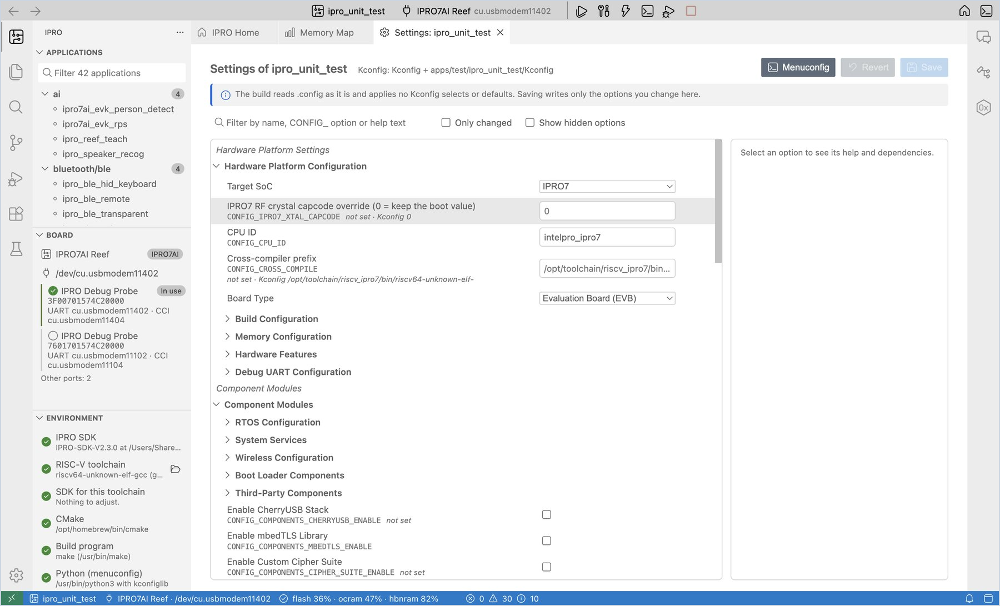
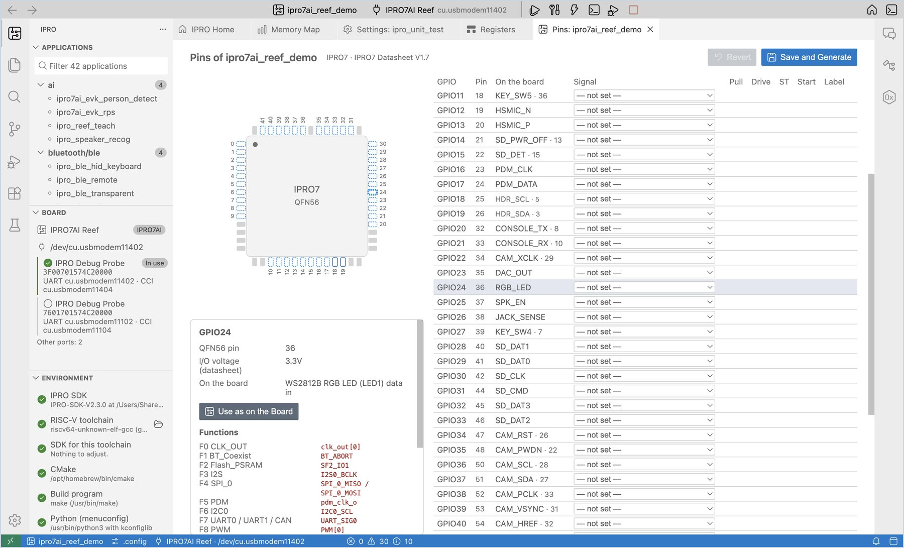
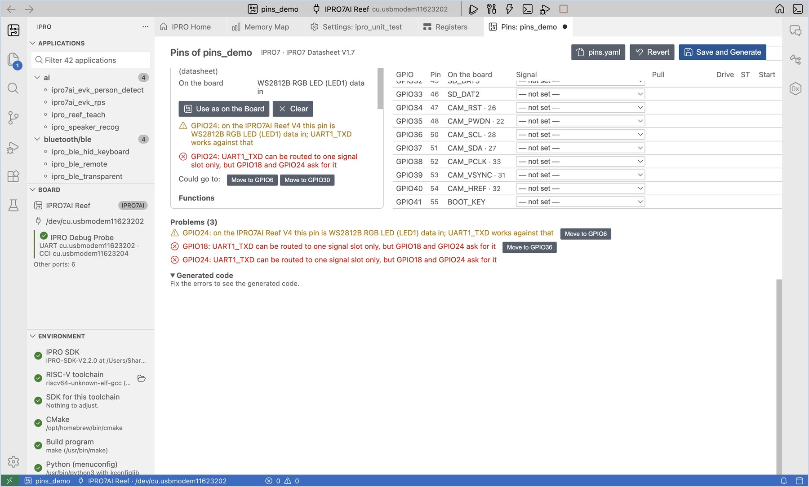
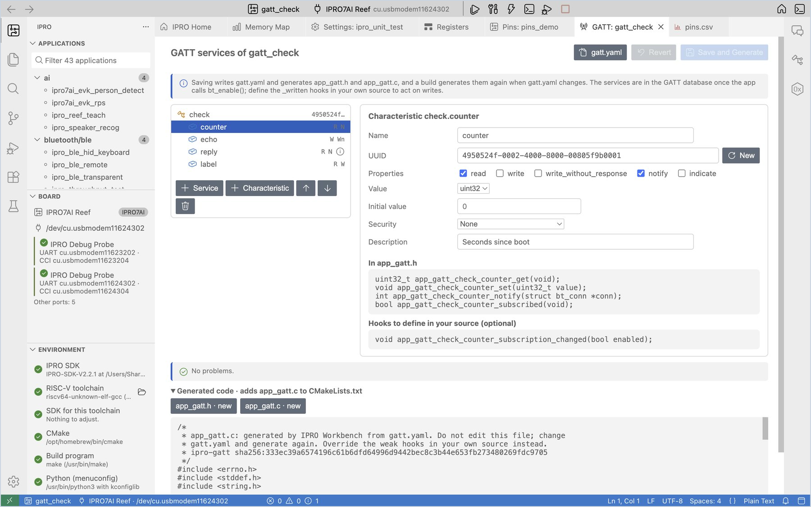
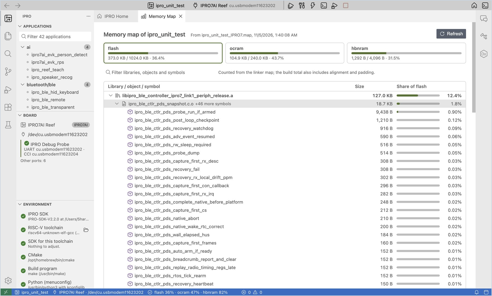

# 开发应用程序

编写代码时最常用的视图：修改配置（Kconfig）、配置引脚、配置 GATT 服务、处理构建错误，以及查看内存用在了哪里。示例使用 IPRO7AI Reef EVK V4.0。

## 修改配置（Kconfig） { #kconfig }

每个应用程序的功能和参数都记录在它的 `.config` 中。**Settings** 视图以表单方式编辑该文件，无需打开终端。

<div class="ipro-steps" markdown>

1. **打开 Settings。** 右键点击应用程序并选择 **Settings (Kconfig)…**（或点击 IPRO Home 上的 **Settings (Kconfig)**）。

    **应看到**：一个 **Settings: &lt;application&gt;** 标签页，左侧按 Kconfig 菜单列出所有选项，右侧显示所选选项的帮助。

2. **修改选项。** 在搜索框中输入要修改的选项，例如 `LOG_BUFFER_SIZE`，并将其值改为 `512`。

    **应看到**：该行左侧出现绿色标记，标签页标题中出现表示未保存的圆点，右上角的按钮变为 **Save 1**。右侧面板显示该选项的类型、范围、依赖关系、它在 `.config` 中的原始值以及 Kconfig 默认值。

3. **保存。** 点击 **Save**（macOS 上为 `Cmd+S`，Windows 上为 `Ctrl+S`）。

    **应看到**：通知“Saved 1 settings to .config of … (the previous file is .config.old). The next build configures again.”

</div>



!!! warning "重要"
    SDK 的构建直接读取 `.config`，不会应用 Kconfig 的 select 或默认值。**Settings** 只写入你修改的行；如果 menuconfig 还会连带修改其他选项，这些选项会列在界面上，由你决定是否 **Take Them Too**。

其他用法：

- 勾选 **Only changed**，只查看尚未保存的修改；点击 **Revert** 放弃所有修改。
- 勾选 **Show hidden options**，查看依赖条件未满足的选项：menuconfig 会隐藏它们，但构建仍会读取。
- 如果更喜欢文本界面，可右键选择 **Menuconfig**，在终端中编辑同样的配置；选择 **Open .config** 可直接编辑该文件。

## 配置引脚 { #pins }

**Pin Configuration** 在封装图和表格中指定每个 GPIO 的功能，检查冲突以及与开发板接线是否一致，并生成初始化代码 `app_pins.h` 和 `app_pins.c`。

<div class="ipro-steps" markdown>

1. **打开 Pin Configuration。** 右键点击应用程序并选择 **Pin Configuration…**（或点击 IPRO Home 上的 **Pins**）。

    **应看到**：左侧是 QFN56 封装图，右侧是 GPIO 表格。**Board** 自动设为 IPRO7AI Reef V4，**On the board** 列显示每个引脚在开发板上连接到什么，引到 40 针排针的引脚还会显示排针的针脚编号。

2. **分配引脚。** 点击 GPIO24 这一行，在 **Signal** 中选择 **GPIO_OUT (as on the board)**，在 **Label** 中输入 `RGB_LED`。

    **应看到**：封装图上的 24 号引脚变为蓝色；右侧面板列出该引脚可用的功能、I/O 电压和开发板接线；底部 **Generated code** 下的 `app_pins.c` 增加了一行 GPIO24，并显示“No problems.”

3. **尝试制造冲突。** 将 GPIO24 的信号改为 `UART1_TXD`。

    **应看到**：24 号引脚变为琥珀色，**Problems** 列出一条警告，说明该引脚在 Reef V4 上连接到 RGB LED，同时列出该信号 **Could go to** 的空闲引脚；点击 **Move to GPIO…** 即可将设置移到那里。查看完后，将 GPIO24 改回 **GPIO_OUT (as on the board)**。

4. **按信号搜索。** 在搜索框中输入 `SDH_0`。

    **应看到**：表格中只显示能够承载 SDH_0 的引脚，封装图上也会勾勒出这些引脚。清除搜索文字后，完整表格重新出现。

5. **保存并生成。** 点击 **Save and Generate**（`Cmd+S` / `Ctrl+S`）。

    **应看到**：通知“Saved pins.yaml and generated app_pins.h and app_pins.c.”应用程序文件夹中出现 `pins.yaml`、`app_pins.h` 和 `app_pins.c`，`CMakeLists.txt` 中新增一行 `app_pins.c`。

6. **调用生成的代码。** 在 `main.c` 中添加 `#include "app_pins.h"`，并在 `ipro_platform_init();` 的下一行调用一次 `app_pins_init();`，然后点击 **Build, Flash and Monitor**。

    **应看到**：应用程序照常运行。此后每当 `pins.yaml` 发生变化，构建时 **IPRO Build** 会先显示 `pins: wrote app_pins.c from pins.yaml`，然后再开始编译。

</div>





| 功能 | 说明 |
|---|---|
| **Only pins in use** | 只列出已设置的引脚，便于检查 |
| **Export CSV** | 为硬件工程师导出引脚列表 `pins.csv` |
| **Export Zephyr pinctrl** | 将同样的引脚配置导出为 Zephyr pinctrl 片段 `app_pins_pinctrl.dtsi` |
| **Use as on the Board** | 将所选引脚设为它在开发板上的用途 |

!!! note
    - `app_pins.h` 和 `app_pins.c` 由 IDE 生成，请勿手动编辑。对于手动编辑过的文件，IDE 不会直接覆盖，而是先询问是否 **Overwrite**。
    - `pins.yaml` 有错误时，构建会停止，错误列在 **Problems** 面板中。
    - 引脚数据来自 IPRO7 数据手册。

## 配置 GATT 服务 { #gatt }

**GATT Configuration** 以树状列表和表单定义 BLE 应用程序的 GATT 服务和特征，将其保存在 `gatt.yaml` 中，并生成 `app_gatt.h` 和 `app_gatt.c`：每个服务对应一个 `BT_GATT_SERVICE_DEFINE`，每个特征则有读取和修改其值以及发送通知的函数。应用程序无需自己编写 GATT 属性表。

应用程序的 `.config` 需要 `CONFIG_BLUETOOTH_LE_ENABLE=y` 和 `CONFIG_BT_PERIPHERAL=y`，`ipro_ble_remote` 就是这样配置的。

<div class="ipro-steps" markdown>

1. **打开 GATT Configuration。** 右键点击应用程序并选择 **GATT Configuration…**（或点击 IPRO Home 上的 **GATT services**）。

    **应看到**：打开一个 **GATT: &lt;application&gt;** 标签页。还没有 `gatt.yaml` 时，顶部有一条说明，提示先添加服务。

2. **添加服务。** 点击 **+ Service**，将名称改为 `sensor`。

    **应看到**：左侧列表中出现 `sensor`；它的 UUID 已经是一个随机的 128 位 UUID，点击 **New** 可以换一个。

3. **添加特征。** 点击 **+ Characteristic**，将名称改为 `counter`，勾选属性 **read** 和 **notify**，值类型选择 `uint32`，描述输入 `Seconds since boot`。

    **应看到**：右侧的 **In app_gatt.h** 列出 `app_gatt_sensor_counter_get`、`_set`、`_notify` 和 `_subscribed`，其下方是你可以自行定义的钩子 `app_gatt_sensor_counter_subscription_changed`；并显示“No problems.”

4. **尝试输入无效的 UUID。** 将 UUID 改为 `2a1`。

    **应看到**：问题列表显示 `sensor.counter: "2a1" is not a 16-bit UUID such as 2a19 or a 128-bit UUID`，生成的代码被替换为“Fix the errors to see the generated code.”点击 **New** 即可恢复为有效的 UUID。

5. **保存并生成。** 点击 **Save and Generate**（`Cmd+S` / `Ctrl+S`）。

    **应看到**：通知“Saved gatt.yaml and generated app_gatt.h and app_gatt.c.”应用程序文件夹中出现 `gatt.yaml`、`app_gatt.h` 和 `app_gatt.c`，`CMakeLists.txt` 中新增一行 `app_gatt.c`。

6. **在代码中使用生成的函数。** 添加 `#include "app_gatt.h"`，在自己的任务中更新数值并通知已订阅的对端设备；将服务 UUID 放入广播数据，以便按该 UUID 扫描的对端设备能够找到开发板：

    ```c
    #include "app_gatt.h"

    static const struct bt_data ad[] = {
        BT_DATA_BYTES(BT_DATA_FLAGS, (BT_LE_AD_GENERAL | BT_LE_AD_NO_BREDR)),
        BT_DATA_BYTES(BT_DATA_UUID128_ALL, APP_GATT_SENSOR_UUID_VAL),
    };

    /* Once a second, in your own task (not in an interrupt) */
    app_gatt_sensor_counter_set(seconds);
    if (app_gatt_sensor_counter_subscribed()) {
        app_gatt_sensor_counter_notify(NULL);   /* NULL: every subscribed peer */
    }
    ```

    点击 **Build, Flash and Monitor**。

    **应看到**：**IPRO Build** 先显示 `gatt: wrote app_gatt.c from gatt.yaml`，然后再编译。用手机或计算机上的 BLE 工具（例如 nRF Connect）连接后，可以看到 `sensor` 服务和 `counter`；订阅通知后，每秒收到一个新的数值。

</div>



| 设置 | 含义 |
|---|---|
| Properties | read、write、write_without_response、notify、indicate；选择 notify 或 indicate 时会添加 CCC，供对端设备订阅 |
| Value type | `uint8` 到 `int32`（固定大小，以小端序发送）、`bytes`、`string`（最大长度 1–512 字节） |
| Initial value | 整数类型填数字（也可以写 `0x1f`）；`string` 填文本；`bytes` 填十六进制，例如 `01 02 ff` |
| Security | 要求加密链路或经过认证（防 MITM）的配对时，`.config` 需要 `CONFIG_BT_SMP=y` |
| Description | 写入 Characteristic User Description，BLE 工具会显示它 |

为每个特征生成的函数（服务 `sensor`，特征 `counter`）：

| 函数 | 用途 |
|---|---|
| `app_gatt_sensor_counter_get` / `_set` | 读取和修改对端设备读到的值 |
| `app_gatt_sensor_counter_notify` / `_indicate` | 将当前值发送给已订阅的对端设备（选择了 notify / indicate 时） |
| `app_gatt_sensor_counter_subscribed` | 是否有对端设备订阅 |
| `app_gatt_sensor_counter_written`（钩子） | 对端设备写入后调用，此时值已经保存；在自己的源文件中定义同名函数即可 |
| `app_gatt_sensor_counter_subscription_changed`（钩子） | 对端设备开启或关闭通知时调用 |

!!! note
    - `app_gatt.h` 和 `app_gatt.c` 由 IDE 生成，请勿手动编辑。钩子是弱函数：自己的源文件中的同名函数会取代它们。对于手动编辑过的文件，IDE 不会直接覆盖，而是先询问是否 **Overwrite**。
    - `gatt.yaml` 有错误时，构建会停止，错误列在 **Problems** 面板中。
    - 长度超过 20 字节的通知，要在对端设备提高 ATT MTU 之后才能完整送达；一条通知最多携带 244 字节。
    - 在服务变更之前已经配对的对端设备，可能仍保留旧的服务列表；请在对端设备的蓝牙设置中忽略该设备，然后重新配对。

## 构建与错误 { #build }

<div class="ipro-steps" markdown>

1. **构建。** 点击 **Build**（`Cmd+Alt+B` / `Ctrl+Alt+B`）。

    **应看到**：成功时显示通知“Built &lt;application&gt; in N s”，随后显示内存用量。

2. **跳转到错误。** 代码有错误时，通知显示“&lt;application&gt; did not compile. First error at &lt;file&gt;:&lt;line&gt;: &lt;message&gt;”。点击 **Go to Error**，编辑器跳转到该行；**Problems** 面板列出所有错误和警告。

3. **修复后重新构建。** 修改代码后重新构建。如有需要，可点击通知上的 **Ask AI to Fix**（请参阅 [AI 助手](ai.md#fix-build)）。

</div>

| 命令 | 使用时机 |
|---|---|
| **Build** | 一般情况。只重新编译有变化的文件。 |
| **Reconfigure and Build** | 修改 `CMakeLists.txt` 或构建类型之后；重新运行 CMake 配置。 |
| **Clean** | 删除应用程序的 `build` 文件夹，下次构建从头开始。 |

构建类型（Debug / Release / MinSizeRel）通过 `ipro.build.profile` 设置项选择；请参阅[设置](reference.md#settings)。

## 查看内存用在了哪里 { #memory }

<div class="ipro-steps" markdown>

1. **打开内存映射。** 构建成功后，点击状态栏中的内存用量，或点击 IPRO Home 上的 **What uses the memory**。

    **应看到**：“Memory map of &lt;application&gt;”，flash、ocram 和 hbnram 各有一个标签页。下方按大小列出库、目标文件和符号，以及各自在该区域中所占的比例。双击符号可在工作区中搜索它。

2. **过滤。** 在过滤框中输入库、目标文件或符号的名称，只查看匹配的项目。

</div>



- **(the application itself)** 是应用程序文件夹中的目标文件。
- **(merged strings and constants)** 是所有目标文件共享的字符串池；日志字符串较多时会变大。
- 这些数字根据链接器 map 文件统计；构建输出中的总计还包含对齐和填充，因此两者可能略有差异。

### 大小变化与内存预算 { #memory-budget }

<div class="ipro-steps" markdown>

1. **查看大小变化。** 修改代码后重新构建，查看 **IPRO Build** 输出的最后几行。

    **应看到**：例如 `Memory since the last build: flash +3,072 B, ocram 0 B, …`，后面是变化最大的符号，例如 `+3,072 B  my_table  (flash, (application) main.c.o)`。构建完成的通知也会在用量后面加上变化量，例如 `flash 8.2% (+3,072 B)`。首次构建或执行 Clean 之后，没有上一次构建可供比较，因此不会出现这些行。

2. **设置内存预算。** 打开设置（macOS 上为 `Cmd+,`，Windows 上为 `Ctrl+,`），搜索 `ipro.build`，在 **Memory Budget** 中输入每个区域的最大百分比，例如 `{ "flash": 90, "ocram": 95 }`。

    **应看到**：超出限制时，通知显示“… is over its memory budget: flash 92.1% > 90%.”点击 **Memory Map** 查看是什么占用了内存。

3. **超出预算时让构建失败（可选）。** 同时勾选 **Fail Over Budget**，超出预算的构建就会失败，**Build, Flash and Monitor** 也会在烧录前停止。

</div>
