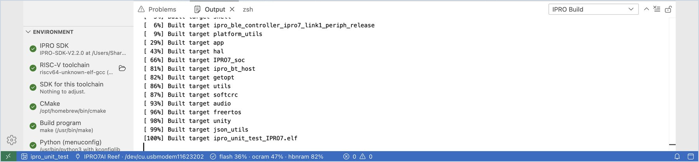
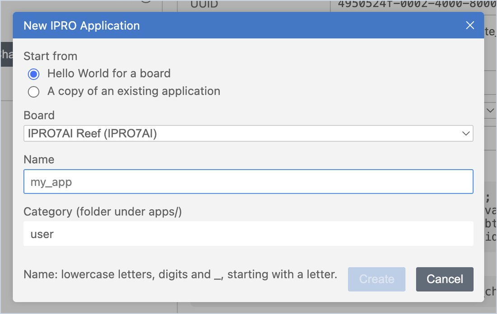
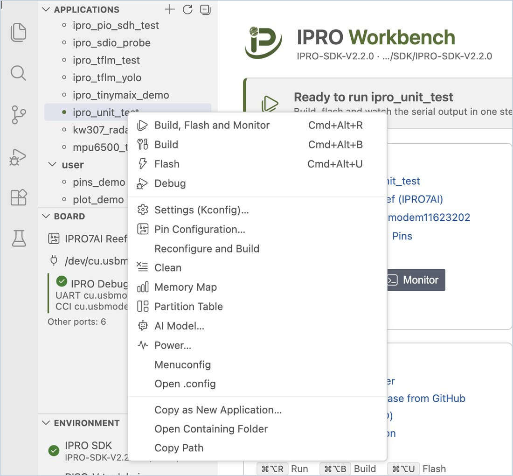

# 首次运行

使用 SDK 自带的单元测试 `ipro_unit_test`，完整走一遍“构建 → 烧录 → 查看开发板输出”的流程，确认计算机、探针和开发板都工作正常；然后创建你自己的第一个应用程序。完成后，IPRO Monitor 中会先后出现 IPRO7AI Reef EVK V4.0 输出的 `ALL TESTS PASSED` 和 `Hello from my_app`。

## 前提条件 { #prerequisites }

- 已安装 IPRO Workbench，**Environment** 下的每一行都已通过检查，并已打开 IPRO SDK：请参阅[安装 IPRO Workbench](install.md)。
- IPRO7AI Reef EVK V4.0 已通过 IPRO Debug Probe 连接，侧边栏的 **Board** 下显示探针及其端口：请参阅[连接开发板](install.md#connect-board)。

## 运行 ipro_unit_test { #unit-test }

1. **选择应用程序。** 在侧边栏的 **Applications** 下点击 **ipro_unit_test**（位于 `test` 类别中；也可以在搜索框中输入 `unit`）。

    **应看到**：工具栏和状态栏都显示 `ipro_unit_test`，IPRO Home 的横幅显示“Ready to run ipro_unit_test”。

2. **构建、烧录并监视。** 在 IPRO Home 上点击 **Build, Flash and Monitor**（macOS 上为 `Cmd+Alt+R`，Windows 上为 `Ctrl+Alt+R`）。也可以在应用程序列表中双击该应用程序。

    **应看到**，依次为：

    1. **Output** 中的 **IPRO Build** 显示编译过程，最后列出 flash、ocram 和 hbnram 的用量。
    2. **IPRO Flash** 显示烧录进度；最后一行为 `[All Success]`。
    3. 下方打开 **IPRO Monitor** 终端，开发板重新启动，测试结束时出现 `ALL TESTS PASSED`。

3. **查看状态栏和 IPRO Home。**

    **应看到**：状态栏显示内存用量，例如 `flash 36% · ocram 47% · hbnram 82%`；IPRO Home 上的 **Application** 卡片也有用量条。侧边栏的 **Board** 多出一行“Runs ipro_unit_test (built …)”，表示开发板正在运行你刚刚构建的固件。

| 输出 | 内容 |
|---|---|
| **IPRO Build** | CMake 配置与编译、内存用量，以及与上一次构建相比的大小变化 |
| **IPRO Flash** | IntelProCube 的烧录过程；成功时最后一行为 `[All Success]` |
| **IPRO Monitor** | 开发板的串口输出（终端）；可以直接向开发板输入命令 |

任何一步失败时，IDE 都会停在该步骤，并显示说明以及用于处理问题的按钮，例如 **Go to Error**、**Retry** 和 **Select Port**。常见消息请参阅[故障排除](troubleshooting.md#messages)。

!!! tip
    如果只想构建、只想烧录或只想打开监视器，请使用工具栏上相应的按钮，或使用快捷键：构建 `Cmd+Alt+B`、烧录 `Cmd+Alt+U`、监视 `Cmd+Alt+M`（Windows 上将 `Cmd` 换成 `Ctrl`）。

## 创建自己的应用程序 { #own-app }

1. **新建应用程序。** 点击 **Applications** 列表上方的 **+**（**New Application…**），或点击 IPRO Home 上的 **New application from a template or an example**。

2. **填写表单。** 在 **Start from** 中选择 **Hello World for a board**；在 **Board** 中选择 **IPRO7AI Reef**（使用 IPRO6S EVK 时选择 **IPRO6S EVK**；请参阅[为 IPRO6S EVK 创建应用程序](flash.md#ipro6s-new-app)）；名称输入 `my_app`，类别保留为 `user`，然后点击 **Create**。

    名称只能包含小写字母、数字和下划线，并且必须以字母开头。

    **应看到**：列表中出现 `user/my_app` 并成为当前应用程序，编辑器打开它的 `main.c`。

3. **运行。** 点击 **Build, Flash and Monitor**。

    **应看到**：IPRO Monitor 中出现 `Hello from my_app`。

要基于现有示例开始，请在列表中右键点击该应用程序并选择 **Copy as New Application…**，或在 **Start from** 中选择 **A copy of an existing application**。新的应用程序位于 SDK 中的 `apps/<category>/<name>`。

## 应用程序的右键菜单 { #app-menu }

在 **Applications** 列表中右键点击应用程序，即可直接执行以下操作：

| 菜单项 | 用途 |
|---|---|
| **Build, Flash and Monitor** / **Build** / **Flash** / **Debug** | 与工具栏上的相同 |
| **Settings (Kconfig)…** / **Menuconfig** / **Open .config** | 修改应用程序的配置；请参阅[开发应用程序](develop.md#kconfig) |
| **Pin Configuration…** | 分配 GPIO 功能并生成代码 |
| **GATT Configuration…** | 定义 BLE 服务和特征并生成代码；请参阅[配置 GATT 服务](develop.md#gatt) |
| **Reconfigure and Build** / **Clean** | 重新运行 CMake 配置并构建；删除构建结果 |
| **Memory Map** | 查看内存用在了哪里 |
| **Partition Table** / **AI Model…** / **Power…** | 请参阅[烧录与开发板](flash.md)和[测试与测量](measure.md#power) |
| **Copy as New Application…** | 以此应用程序为起点创建新的应用程序 |
| **Open Containing Folder** / **Copy Path** | 在文件资源管理器（访达）中打开该文件夹，或复制文件夹路径 |

## 下一步 { #next-steps }

- [开发应用程序](develop.md)：配置（Kconfig）、引脚、GATT 服务、构建错误以及内存用在了哪里。
- [烧录与开发板](flash.md)：IDE 在烧录时检查的内容、分区表、AI 模型和 IPRO6S EVK。
- [串口监视](monitor.md)：过滤、时间戳、日志、串口绘图器和第二个端口。
