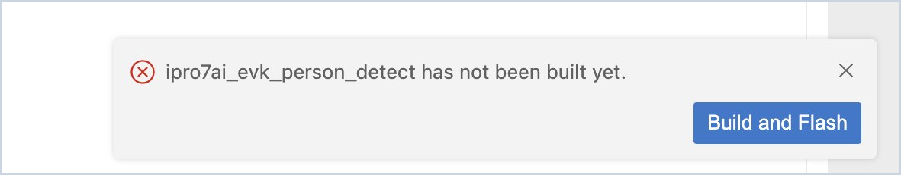
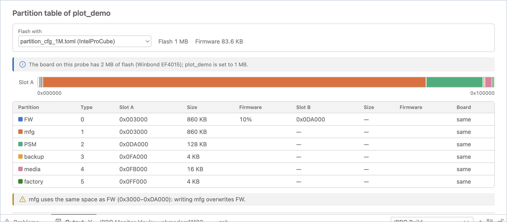
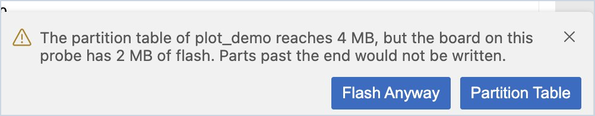
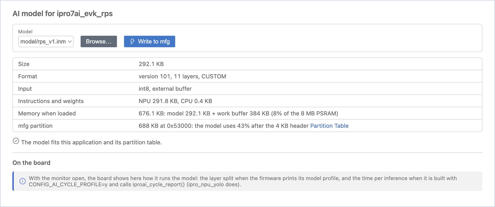

# 烧录与开发板

IDE 在烧录时替你执行的检查、分区表、开发板的 Flash、固件核对以及 AI 模型的写入。开发板为接在 IPRO Debug Probe 上的 IPRO7AI Reef EVK V4.0；烧录使用 IntelProCube。

## 烧录 { #flash }

1. **烧录。** 选择应用程序并完成构建后，点击 **Flash**（`Cmd+Alt+U` / `Ctrl+Alt+U`）。

    **应看到**：**Output** 面板切换到 **IPRO Flash**，显示 IntelProCube 的烧录进度；最后一行为 `[All Success]`。通知显示“Flashed &lt;application&gt; in N s.”

2. **监视器关闭后重新打开。** 烧录前，IDE 会自动关闭所有串口监视器（同一个端口不能同时被两个程序使用）。使用 **Build, Flash and Monitor** 时，烧录成功后监视器会重新打开。

!!! warning "重要"
    IntelProCube 烧录失败时，有时不会报告错误。只有输出中出现 `[All Success]`，IDE 才认为烧录成功；开发板重启后，IDE 还会核对开发板打印的构建时间（请参阅[开发板的 Flash 与固件核对](#board-flash)）。

烧录失败时，IDE 会根据原因提供相应的按钮：

| 情况 | IDE 的处理 |
|---|---|
| 应用程序尚未构建 | 提示“has not been built yet”，并提供 **Build and Flash** |
| 找不到 IntelProCube | 提供 **Install IntelProCube**，或通过 **Browse…** 指向已有的 IntelProCube |
| 开发板没有响应 | 提示检查探针线缆和电源，并提供 **Select Port** 和 **Retry** |
| 端口被其他程序占用 | 提示关闭该程序，然后点击 **Retry** |
| 分区表大于开发板的 Flash | 烧录前询问；可以选择 **Flash Anyway**，或改为打开 **Partition Table** |

## 分区表 { #partitions }

分区表决定固件、OTA 的 B 槽、AI 模型（mfg）及其他数据在 Flash 中的位置。

1. **打开分区表。** 右键点击应用程序并选择 **Partition Table**。

    **应看到**：“Partition table of &lt;application&gt;”。**Flash with** 显示本次烧录使用的分区表（默认为 IntelProCube 根据 `.config` 中的 Flash 大小选择的分区表）；旁边是 `.config` 中设置的 Flash 大小和固件大小。IDE 已知开发板的 Flash 时，会增加一行比较，例如“The board on this probe has 2 MB of flash (Winbond EF4015); ipro_unit_test is set to 1 MB.”下方是 Flash 映射图（A 槽和 B 槽各一行）、每个分区的地址和大小，以及固件占 FW 分区的比例。

2. **查看表格下方的检查结果。**

    **应看到**：没有问题时不列出任何内容。有问题时会加以说明，例如：1M 分区表的 mfg 与 FW 共用同一块空间（写入 AI 模型会覆盖固件）、2M 分区表的 FW B 槽与 mfg 重叠（OTA 更新会覆盖 AI 模型），或者固件大于 A 槽。

3. **使用应用程序自带的分区表。** 应用程序自带分区表时，页面会显示“This application ships …”。在 **Flash with** 中选择它，之后该应用程序的每次烧录都会使用它。

4. **与开发板比对。** 在串口监视器打开的情况下，点击 **Reset Board**。

    **应看到**：**On the board** 与开发板启动时打印的分区表进行比对，并将每个分区标记为“same”、“differs”或“not on the board”。全部一致时显示“The board printed the same table at its last boot.”

!!! warning
    烧录会写入 **Flash with** 中选择的分区表。它与开发板上的分区表不同时，位置发生变化的分区（例如 mfg 中的 AI 模型）会丢失数据。

## 开发板的 Flash 与固件核对 { #board-flash }

开发板启动时会打印其 Flash 的 ID 和固件的构建时间。在串口监视器打开的情况下，IDE 会读取这些信息，并显示在侧边栏的 **Board** 视图中：

| 显示内容 | 含义 |
|---|---|
| Flash Winbond 2 MB (EF4015) | 此探针所连开发板上的 Flash 及其大小 |
| Chip ID … | IntelProCube 在烧录时读取的芯片 ID |
| Runs ipro_unit_test (built …) | 开发板启动时打印的构建时间与该应用程序上一次构建的固件一致 |
| Runs other firmware (built …) | 开发板运行的不是上一次构建的固件；该构建要烧录后才会运行 |

如果刚烧录完就出现“other firmware”，说明烧录可能并未真正写入开发板。IDE 会发出警告，并提供 **Flash Again**。

当分区表占用的空间超过开发板的 Flash 时（例如为 2 MB 的开发板选择了 4 MB 的分区表），IDE 会在烧录前询问你，以免超出末尾的部分没有写入。点击 **Partition Table** 选择其他分区表，或在确认无误后点击 **Flash Anyway**。

## AI 模型 { #ai-model }

IPRO7AI 的 NPU 模型（`.inm`）存放在 Flash 的 mfg 分区中，不与固件链接在一起。更新模型时只需写入 mfg，无需重新烧录固件。

1. **选择模型。** 右键点击应用程序并选择 **AI Model…**。在 **Model** 中选择应用程序文件夹中的 `.inm`，或点击 **Browse…** 选择其他文件。

    **应看到**：模型的大小、格式版本和层数，输入、NPU 与 CPU 指令以及权重的大小，加载后占用的内存（模型加工作缓冲区，对照 8 MB PSRAM），以及模型要写入的 mfg 分区。最后一行显示“The model fits this application and its partition table.”，或说明不适合的原因。

2. **写入。** 如果适合，点击 **Write to mfg**。

    **应看到**：通知显示“Wrote … to the mfg partition in N s.”只写入模型，固件不受影响。

3. **在开发板上观察。** 开发板运行模型时（串口监视器保持打开），**On the board** 显示每一层是在 NPU 还是 CPU 上运行。如果固件以 `CONFIG_AI_CYCLE_PROFILE=y` 构建并调用 `iproai_cycle_report()`，还会显示每次推理的时间以及 NPU 和 CPU 的繁忙程度。

!!! note
    IntelProCube 的 1M 分区表没有单独的模型空间（mfg 与 FW 重叠），因此 IDE 会拒绝写入。请在 **Partition Table** 中选择应用程序自带的分区表（例如带有独立 mfg 的分区表），然后再写入模型。
