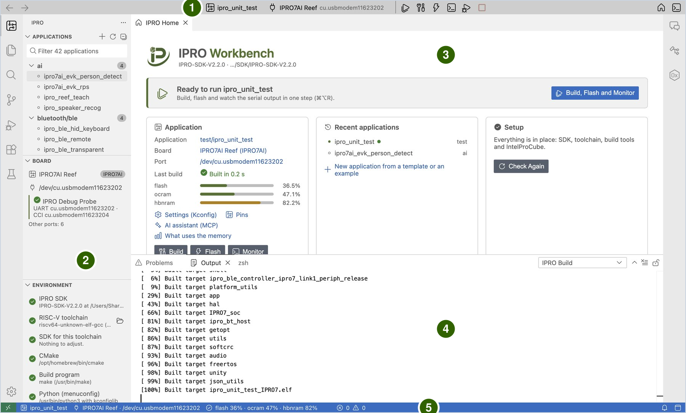

# IPRO Workbench

IPRO Workbench 是 INTELPRO 为 IPRO 系列芯片提供的集成开发环境（IDE）。在同一个窗口中即可构建 IPRO SDK 应用程序、将其烧录到开发板，并查看开发板的串口输出。它还提供 C/C++ 代码导航、引脚配置、内存分析、崩溃分析、板上测试、射频与功耗测量，以及能够自行构建和烧录的 AI 助手。

本节各页面以 [IPRO7AI Reef EVK V4.0](../hardware/boards/reef-evk.md) 搭配 IPRO Debug Probe 为例。每一步都写明要做什么、应看到什么；界面与本节不一致时，请参阅[故障排除](troubleshooting.md)。如果习惯使用 VS Code 开发，请参阅 [VS Code Extension](../guides/vscode.md)。

!!! info "获取方式"
    IPRO Workbench 0.1.0（预览版）的 macOS 与 Windows 版本发布在 [GitHub 上的 IPRO Workbench 发布页](https://github.com/INTELPRO-INC/ipro-workbench/releases/tag/v0.1.0)，无需 GitHub 账号。暂无 Linux 版本。请参阅[安装 IPRO Workbench](install.md)。

## 功能 { #features }

| 功能 | 说明 |
|---|---|
| 补全开发环境 | 自动检查 SDK、RISC-V 工具链、CMake、Python、IntelProCube 和开发板，缺少的项目一键从 GitHub 安装。 |
| 构建、烧录与监视 | 一个按钮即可完成构建、烧录并打开串口监视器。每一步的输出分开显示；任何一步失败都会停下并说明原因。 |
| 应用程序管理 | 按类别列出 SDK 中的应用程序；可基于开发板的 Hello World 或现有示例创建新的应用程序。 |
| 配置（Kconfig） | 以表单方式编辑应用程序的 `.config`，只写入你修改的选项，并显示每个选项的帮助文本和依赖关系。 |
| 引脚配置 | 在封装图和表格中指定每个 GPIO 的功能，检查冲突以及与开发板接线是否一致，并生成初始化代码。 |
| 内存分析 | 显示 flash、ocram 和 hbnram 分别被哪些库、目标文件和符号占用；比较每次构建之间的大小变化，并可设置内存预算。 |
| 烧录与开发板 | 分区表查看与检查、识别开发板的 Flash、核对开发板上运行的固件，以及将 AI 模型写入 mfg 分区。 |
| 串口监视器 | 过滤、时间戳、保存与完整日志、串口绘图器，以及同时监视第二个端口。 |
| 调试与分析 | 自动将崩溃地址解码为源代码行，收集并分析崩溃转储，查阅寄存器及其字段。 |
| 测试与测量 | 板上测试结果显示在 **Testing** 视图中、射频测试（BLE DTM）、功耗曲线与电池续航估算。 |
| AI 助手 | 内置的 IPRO AI 助手会自行构建、读取输出、修改配置和引脚；IDE 之外的 AI 助手（例如 Claude Code）也可通过 MCP 使用同一组工具。 |

## 窗口各区域 { #window }

| 编号 | 区域 | 用途 |
|---|---|---|
| 1 | 工具栏 | 当前的应用程序、开发板和端口，以及构建、烧录、监视等按钮。点击应用程序或开发板名称即可更换。 |
| 2 | IPRO 侧边栏 | **Applications** 列出 SDK 中的应用程序；**Board** 显示探针、探针的端口以及开发板上运行的固件；**Environment** 逐项列出检查结果。 |
| 3 | 编辑区 | IPRO Home、源代码，以及配置、引脚、内存映射、分区表等视图都在这里打开。 |
| 4 | 底部面板 | **Output** 中的 **IPRO Build**、**IPRO Flash** 和 **IPRO Setup** 分别显示构建、烧录和安装过程；**Terminal** 中的 **IPRO Monitor** 是串口监视器。 |
| 5 | 状态栏 | 当前的应用程序、开发板和内存用量；开发环境缺少项目时也会在这里提醒。 |

IPRO Home 顶部的横幅始终提示下一步：尚未打开 SDK 时提示打开 SDK，开发环境缺少项目时提示补全开发环境，一切就绪后提示可以运行。

## 支持的环境 { #requirements }

| 项目 | 说明 |
|---|---|
| 计算机 | macOS 12 或更高版本（Apple 芯片）；Windows 11（x64） |
| IPRO SDK | IPRO SDK 2.2.0 |
| 芯片 | IPRO7、IPRO7AI |
| 开发板 | [IPRO7AI Reef EVK V4.0](../hardware/boards/reef-evk.md) |
| 烧录与连接 | IPRO Debug Probe（USB）；烧录使用 IntelProCube |
| 界面语言 | 繁体中文、英文 |

## 工作流程 { #workflow }

1. **安装并补全开发环境。** 安装 IPRO Workbench，用 **Fix Environment** 安装 SDK 和工具，打开 SDK，并通过 IPRO Debug Probe 连接开发板；请参阅[安装 IPRO Workbench](install.md)。

2. **运行第一个应用程序。** 选择 `ipro_unit_test`，点击 **Build, Flash and Monitor** 并等待出现 `ALL TESTS PASSED`，然后创建自己的应用程序；请参阅[首次运行](first-run.md)。

3. **开发。** 以表单修改配置（Kconfig），分配引脚并生成相应代码，修复构建错误并查看内存用在了哪里；请参阅[开发应用程序](develop.md)。

4. **烧录。** 在 IDE 的检查下烧录，将分区表与开发板进行比对，并将 AI 模型写入 mfg 分区；请参阅[烧录与开发板](flash.md)。

5. **监视。** 查看、过滤、添加时间戳并保存开发板的串口输出，并将其打印的数值绘制成曲线；请参阅[串口监视](monitor.md)。

6. **调试与测量。** 解码崩溃地址、收集崩溃转储并查阅寄存器，然后运行板上测试、射频测试和功耗分析；请参阅[调试与分析](debug.md)和[测试与测量](measure.md)。

## 完整操作手册 { #manual }

《IPRO Workbench 操作手册》V1.1 以 PDF 形式涵盖 IPRO Workbench 0.1.0：[英文版](https://github.com/INTELPRO-INC/ipro-workbench/releases/download/v0.1.0/IPRO-Workbench-Operation-Manual-V1.1-en.pdf)（53 页）或[繁体中文版](https://github.com/INTELPRO-INC/ipro-workbench/releases/download/v0.1.0/IPRO-Workbench-Operation-Manual-V1.1-zh-TW.pdf)（52 页）。它也列在[文档下载](../documents/index.md)中。

## 本节页面 { #pages }

-   **[安装 IPRO Workbench](install.md)**

    ---

    下载并校验安装程序，在 macOS 和 Windows 上安装，界面语言，补全开发环境，打开 SDK 并连接开发板。

-   **[首次运行](first-run.md)**

    ---

    构建、烧录并监视 `ipro_unit_test`，创建自己的应用程序，以及应用程序的右键菜单。

-   **[开发应用程序](develop.md)**

    ---

    配置（Kconfig），引脚配置与生成的代码，构建与错误，内存映射、大小变化与内存预算。

-   **[烧录与开发板](flash.md)**

    ---

    烧录及其检查，分区表，开发板的 Flash 与固件核对，以及将 AI 模型写入 mfg。

-   **[串口监视](monitor.md)**

    ---

    打开监视器并输入命令，过滤、时间戳、保存与完整日志、串口绘图器以及第二个端口。

-   **[调试与分析](debug.md)**

    ---

    自动解码崩溃地址、包含完整调用链的崩溃转储，以及寄存器参考。

-   **[测试与测量](measure.md)**

    ---

    Testing 视图中的板上测试、以 BLE Direct Test Mode 进行的射频测试，以及功耗曲线与电池续航估算。

-   **[AI 助手](ai.md)**

    ---

    开启 AI 功能，让 AI 修复构建错误或分析崩溃，并让 IDE 之外的 AI 助手通过 MCP 使用它。

-   **[故障排除](troubleshooting.md)**

    ---

    界面上的消息、工具栏和侧边栏的状态、macOS 与 Windows 上的问题，以及报告问题时需要提供的信息。

-   **[快捷键、命令与设置](reference.md)**

    ---

    键盘快捷键、IPRO 命令、`ipro.*` 设置、MCP 工具以及 IDE 使用的文件和文件夹。

## 本版本的范围 { #limitations }

本节各页面对应 IPRO Workbench 0.1.0 预览版。本版本有以下限制：

- 安装程序没有 Apple 或 Microsoft 的签名，因此首次打开或安装 IPRO Workbench 时，操作系统会显示提示（处理方法见[安装](install.md#install)）。
- 暂不支持通过 JTAG 调试。开发板崩溃时，请改用[调试与分析](debug.md)中介绍的崩溃解码和崩溃转储。
- 自动更新默认关闭。要获取新版本，请从发布页下载并重新安装。
- 串口监视器的过滤也会隐藏 IDE 自行读取的内容（构建戳记、分区表、测试结果）。执行这些步骤前，请先清除过滤。
- 暂无 Linux 版本。
