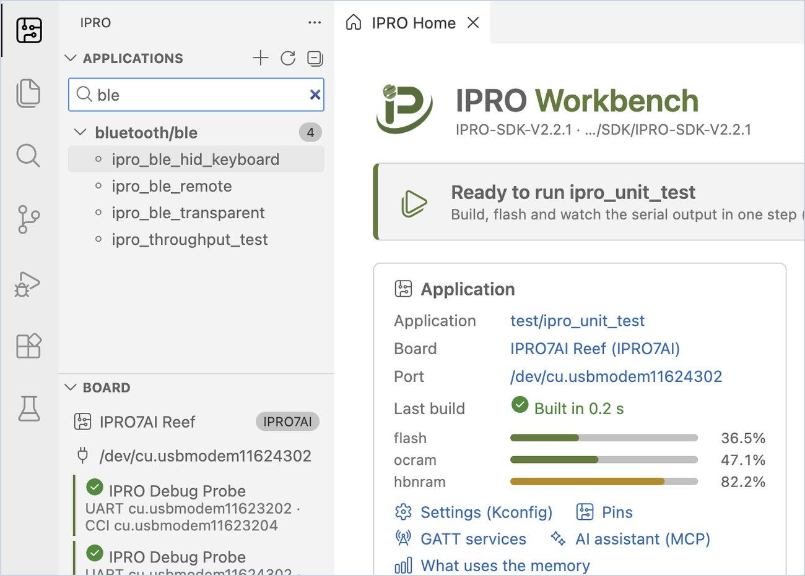

# 安装 IPRO Workbench

本页从安装 IPRO Workbench 开始，直到 IDE 找到你的开发板为止。完成后，IPRO Home 的横幅显示“Ready to run”。本页对应 IPRO Workbench 0.1.1；按钮等界面文字按英文界面中的原样以粗体标出。

## 前提条件 { #prerequisites }

| 项目 | 说明 |
|---|---|
| 计算机 | macOS 12 或更高版本（Apple 芯片）或 Windows 11（x64），能够访问 GitHub。IDE、工具和 SDK 总共需要约 4 GB 磁盘空间。 |
| 安装程序 | macOS：`IPRO-Workbench-0.1.1-mac-arm64.dmg`；Windows：`IPRO-Workbench-0.1.1-win-x64.exe`。从 GitHub 上的 IPRO Workbench 发布页下载（见[下载与校验](#download)），无需 GitHub 账号。 |
| 开发板 | [IPRO7AI Reef EVK V4.0](../hardware/boards/reef-evk.md)，或 IPRO6S EVK |
| 探针与线缆 | IPRO Debug Probe，以及将其连接到计算机的 USB 线 |
| macOS 上另需 | Xcode 命令行工具，以及通过 Homebrew 安装的 CMake 和 Ninja（见[补全开发环境](#environment)） |

## 下载与校验 { #download }

| 文件 | 系统 | 大小 |
|---|---|---|
| [`IPRO-Workbench-0.1.1-mac-arm64.dmg`](https://github.com/INTELPRO-INC/ipro-workbench/releases/download/v0.1.1/IPRO-Workbench-0.1.1-mac-arm64.dmg) | macOS 12 或更高版本，Apple 芯片 | 199 MB |
| [`IPRO-Workbench-0.1.1-win-x64.exe`](https://github.com/INTELPRO-INC/ipro-workbench/releases/download/v0.1.1/IPRO-Workbench-0.1.1-win-x64.exe) | Windows 11，x64 | 160 MB |

<div class="ipro-steps" markdown>

1. **下载安装程序。** 打开 IPRO Workbench 发布页 <https://github.com/INTELPRO-INC/ipro-workbench/releases/latest>，在 **Assets** 下下载适用于你系统的安装程序。

2. **校验下载的文件**，确保文件没有损坏或被替换：

    === "macOS"

        ```bash
        shasum -a 256 IPRO-Workbench-0.1.1-mac-arm64.dmg
        ```

    === "Windows"

        ```powershell
        (Get-FileHash .\IPRO-Workbench-0.1.1-win-x64.exe -Algorithm SHA256).Hash
        ```

    **应看到**：输出的值与下方同一文件的值相同（Windows 以大写显示）。发布页上的 `SHA256SUMS.txt` 也列出了这些值。

    ```text title="IPRO Workbench 0.1.1 安装程序的 SHA-256"
    # IPRO-Workbench-0.1.1-mac-arm64.dmg
    fb6980af59e4021ebd7357d3da1721a1490e2cec7446a98425b6c9ba0e25959e
    # IPRO-Workbench-0.1.1-win-x64.exe
    e057fb56c15cb68cdfeb8c60b0cfecd7f5bd82860573003ad2d94788a34aa74c
    ```

</div>

发布页上的 ZIP、`latest-mac.yml`、`latest.yml` 和 blockmap 文件供内置更新功能使用，无需下载。

## 安装 { #install }

<div class="ipro-steps" markdown>

1. **安装软件**

    === "macOS"

        打开 `IPRO-Workbench-0.1.1-mac-arm64.dmg`，将 **IPRO Workbench** 拖到“应用程序”文件夹中。

    === "Windows"

        1. 双击 `IPRO-Workbench-0.1.1-win-x64.exe`。
        2. Windows 可能会显示“Windows 已保护你的电脑”。点击 **更多信息**，确认应用名称，然后点击 **仍要运行**。
        3. 安装向导询问为谁安装时，选择仅为当前用户安装（无需管理员权限）。之后可以更改安装文件夹；点击 **安装**，完成后点击 **完成**。

        **应看到**：“开始”菜单和桌面上出现 IPRO Workbench。

2. **打开 IPRO Workbench**

    === "macOS"

        从“应用程序”中打开 IPRO Workbench。

        首次打开时，如果 macOS 提示无法验证开发者，请前往“系统设置 → 隐私与安全性”，向下滚动到 IPRO Workbench 的条目，点击 **仍要打开**（部分 macOS 版本的措辞不同），然后再次打开 IPRO Workbench。

    === "Windows"

        从“开始”菜单打开 IPRO Workbench。

    **应看到**：IPRO Workbench 窗口，中间是 IPRO Home，左侧是 IPRO 侧边栏（**Applications**、**Board**、**Environment**）。macOS 与 Windows 上的界面相同。

</div>

!!! tip
    IT 人员批量部署时，可使用静默安装：`IPRO-Workbench-0.1.1-win-x64.exe /S`，或用 `/D=<folder>` 指定安装位置（`/D` 必须是最后一个参数）。

## 界面语言 { #language }

系统语言为繁体中文时，IPRO Workbench 首次启动即显示繁体中文界面。要更改语言，请按 `Cmd+Shift+P`（Windows 上为 `Ctrl+Shift+P`）打开命令面板，输入 `Configure Display Language`，选择语言，并按提示重新启动。

## 补全开发环境 { #environment }

IPRO Workbench 会自行检查开发所需的每一项工具，并将结果列在侧边栏的 **Environment** 下。

| 项目 | 用途 | **Fix Environment** 能否安装 |
|---|---|---|
| IPRO SDK | 应用程序、驱动和示例的来源 | 可以，从 GitHub 安装最新发布版 |
| RISC-V toolchain | 编译固件 | 可以 |
| CMake, Build program | 生成并运行构建 | Windows 上可以（与 Ninja 和 Python 在同一个包中）；macOS 上请用 Homebrew 安装 |
| Python (menuconfig) | 配置（Kconfig）与 Menuconfig | 需要另外安装 kconfiglib 包（见下文） |
| IntelProCube | 烧录 | 可以（安装的是 0.7.0.1 或更高版本，IPRO6S EVK 需要该版本） |
| clangd (code navigation) | 跳转到定义、输入时提示错误 | 可以，由 clangd 扩展下载（执行 Fix 之后，该扩展会再询问一次是否安装） |
| OpenOCD (debugging) | JTAG 调试（本版本暂不支持） | Windows 上可以；未安装也不影响构建和烧录 |
| Board | 查找 IPRO Debug Probe | 插上探针即可 |
| SDK for this toolchain | 仅限 Windows：使 IPRO SDK 2.2 能够在 Windows 上构建 | 可以 |
| macOS quarantine | 仅限 macOS：用浏览器下载的工具会被系统拦截 | 可以，确认后移除该标记 |

<div class="ipro-steps" markdown>

1. **查看 IPRO Home 顶部的横幅。** 缺少项目时，横幅显示“Finish the setup”，并说明还缺几项。

2. **在 macOS 上，先安装 Xcode 命令行工具和构建工具**，在“终端”中执行（已安装可跳过）：

    ```bash
    xcode-select --install
    brew install cmake ninja
    ```

3. **点击 Fix Environment。**

    **应看到**：底部的 **Output** 面板切换到 **IPRO Setup**，逐项显示从 GitHub 下载并安装的过程。工具安装在主目录下的 `IPRO/tools/<tool>/<version>`（Windows 上为 `%USERPROFILE%\IPRO\tools`）。完成后，**Environment** 下的每一行都显示绿色对勾，IPRO Home 的横幅进入下一步。在一般网络环境下大约需要两分钟。

4. **缺少 kconfiglib 时安装它。** 当 **Python (menuconfig)** 一行报告缺少 kconfiglib 时，在终端中运行该行显示的命令，然后点击 **Environment** 顶部的 **Check Again**：

    === "macOS"

        ```bash
        python3 -m pip install kconfiglib
        ```

    === "Windows"

        ```powershell
        python -m pip install kconfiglib windows-curses
        ```

5. **使用已有的工具（可选）。** 如果计算机上已有工具链或 IntelProCube，无需重新安装：在 **Environment** 中该工具所在的行，点击文件夹图标（**Use one already on this computer…**），选择工具所在的文件夹。要烧录 IPRO6S EVK，IntelProCube 必须是 0.7.0.1 或更高版本；IntelProCube 文件夹中的 `RELEASE_INFO.txt` 写有它的版本。

6. **（macOS）清除隔离标记。** 出现 **macOS quarantine** 一行，表示有工具是用浏览器或聊天应用下载的，运行时会被系统拦截。点击该行的锁形图标；确认后，IDE 会移除该标记。

</div>

## 打开 SDK { #open-sdk }

IPRO Workbench 以 IPRO SDK 文件夹作为工作区。

<div class="ipro-steps" markdown>

1. **打开 SDK 文件夹。** 在 IPRO Home 上点击 **Open SDK…**，选择 IPRO SDK 文件夹（例如主目录下的 `IPRO/SDK/IPRO-SDK-V2.2.1`）。如果还没有 SDK，请点击 **Install SDK from GitHub…**。

    **应看到**：侧边栏的 **Applications** 按类别列出 SDK 中的应用程序，搜索框中显示“Filter N applications”。

2. **过滤列表。** 在搜索框中输入关键字（例如 `ble`），列表中只保留匹配的应用程序。清除文字即可重新显示全部应用程序。

</div>



关于 SDK 本身，以及不使用 IDE 时如何获取 SDK，请参阅[开始使用](../get-started/index.md)。

## 连接开发板 { #connect-board }

<div class="ipro-steps" markdown>

1. **连接探针和开发板。** 用 USB 线将 IPRO Debug Probe 连接到计算机，再将探针连接到 Reef V4（探针接在开发板的[调试接口 U6](../hardware/boards/reef-evk.md#debug-connector) 上；IPRO6S EVK 的连接方式相同）。

    **应看到**：侧边栏的 **Board** 下出现 **IPRO Debug Probe** 及其两个端口，例如 macOS 上的 `UART cu.usbmodemXXXX · CCI cu.usbmodemYYYY`，或 Windows 上的 `UART COM5 · CCI COM6`。工具栏上开发板旁边也显示同一个 UART 端口。

2. **如果工具栏以琥珀色显示“no probe”**，说明 IDE 找不到探针：检查 USB 线，并尽量将其直接连接到计算机，而不要经过集线器。

</div>

!!! note
    探针有两个端口：UART 是开发板的控制台（串口监视器和烧录都使用它），CCI 是另一个独立的接口。IDE 会自动选择 UART；如需手动更换，请点击工具栏上的开发板名称，然后选择 **Select Port…**。

## 故障排除 { #troubleshooting }

| 现象 | 解决方法 |
|---|---|
| macOS 首次启动时提示无法验证开发者 | 前往“系统设置 → 隐私与安全性”，点击 **仍要打开**（见[安装](#install)）。 |
| 安装时显示“Windows 已保护你的电脑” | 点击 **更多信息**，确认应用名称为 IPRO-Workbench，然后点击 **仍要运行**。 |
| 提示缺少 CMake 或构建程序（macOS） | macOS 上 IDE 不会安装构建工具。在终端中运行 `xcode-select --install` 和 `brew install cmake ninja`，然后点击 **Check Again**。 |
| Python 一行提示缺少 kconfiglib | 运行该行显示的 `pip install` 命令（见上文[第 4 步](#environment)），然后点击 **Check Again**。 |
| 工具栏以琥珀色显示“no probe” | IDE 找不到 IPRO Debug Probe。检查 USB 线，并尽量将探针直接连接到计算机；插好后，探针会在几秒内自动出现。 |

其他问题请参阅[故障排除](troubleshooting.md)。

## 下一步 { #next-steps }

- [首次运行](first-run.md)：构建、烧录并监视 `ipro_unit_test`，然后创建自己的应用程序。
- [快捷键、命令与设置](reference.md)：所有快捷键、IPRO 命令和 `ipro.*` 设置汇总于一处。
