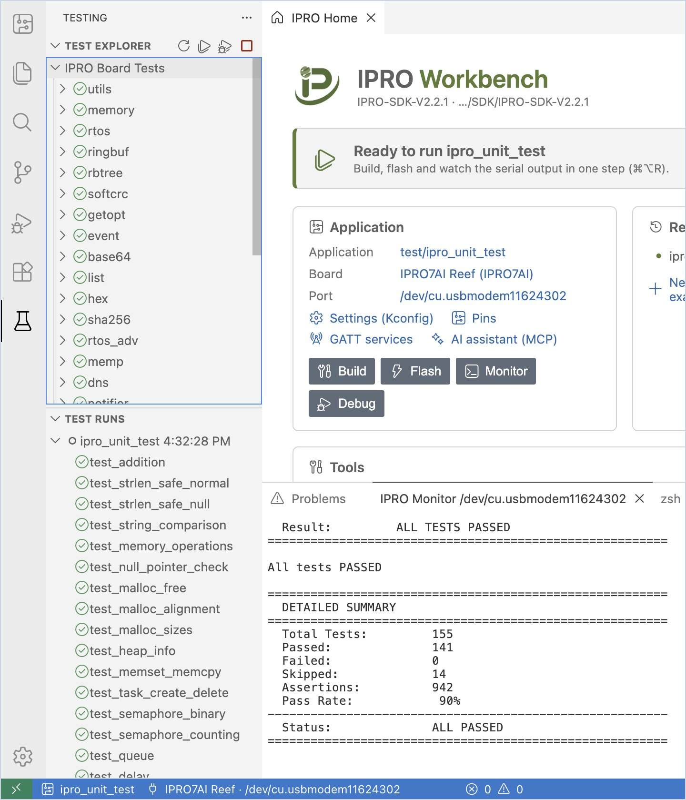
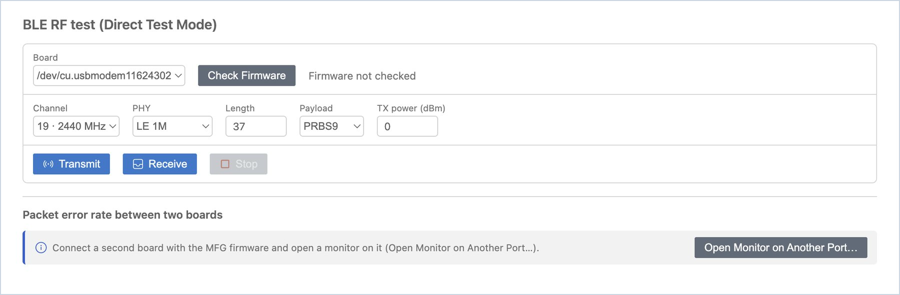
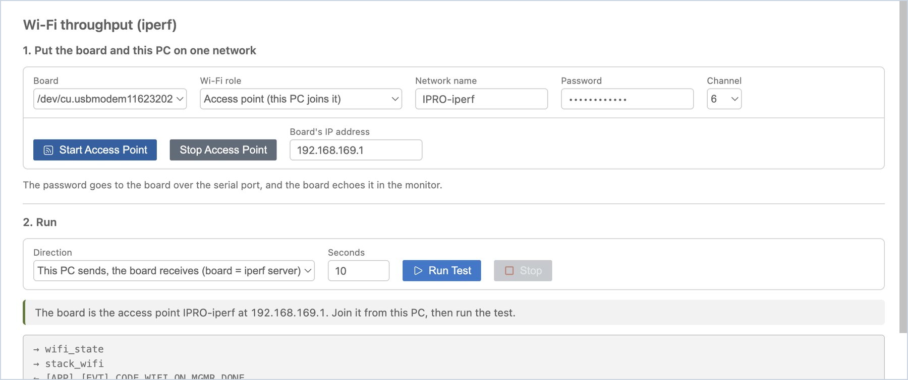
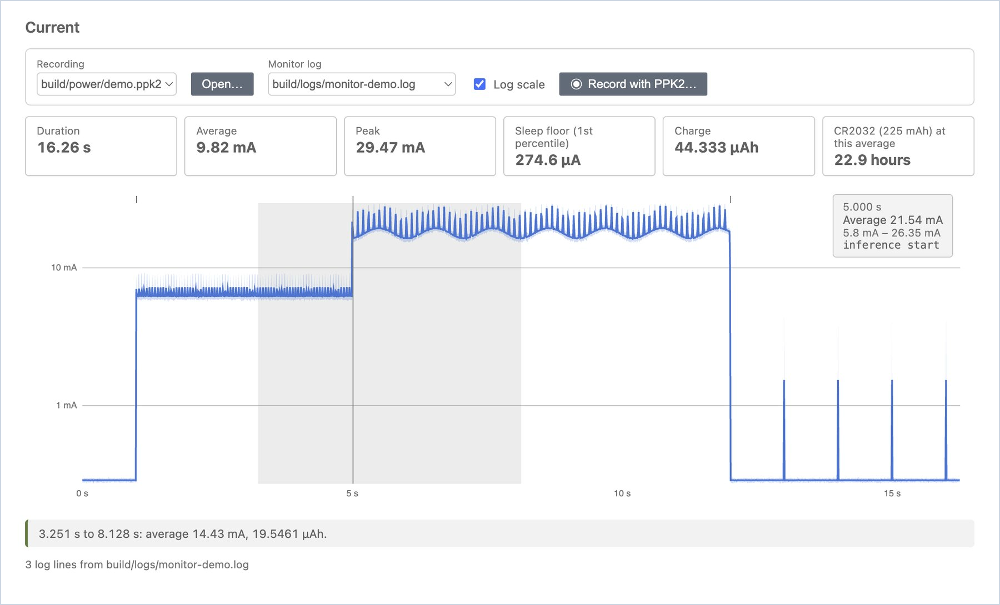

# 测试与测量

在开发板上运行测试、测量 BLE 射频、测量 Wi-Fi 吞吐量，以及查看功耗曲线。这些工具页面都可以从 [IPRO Home](index.md#home) 的 **Tools** 卡片或 IPRO 菜单打开。

## 板上测试 { #board-tests }

当应用程序使用 SDK 的 Unity 测试框架时（例如 `ipro_unit_test`），开发板打印的测试结果会汇总到 IDE 的 **Testing** 视图中。

1. **运行测试。** 选择应用程序并烧录一次后，点击侧边栏 **Board** 视图顶部的烧杯图标（**Run Tests on Board**）。

    **应看到**：通知显示“Resetting the board with the monitor open…”，开发板通过探针重新启动。左侧切换到 **Testing** 视图：**Test Runs** 列出本次运行（例如“ipro_unit_test 2:10:16 PM”），每个测试前面有通过、失败或跳过的符号；**Test Explorer** 中的 **IPRO Board Tests** 列出每个测试组（utils、memory、rtos…）。

2. **打开失败的测试。** 双击失败的测试，即可打开该测试的源代码并定位到失败的那一行。

3. **每次运行后的结果。** 运行 **Build, Flash and Monitor** 时，结果也会自动进入 **Testing** 视图。

!!! note
    - **Testing** 视图读取的是开发板启动后打印的测试行，因此监视器必须接在探针的 UART（控制台）端口上。监视器的过滤不影响结果。
    - 开发板没有重启时，IDE 会提示“The board did not restart. Is the monitor on the console port of an IPRO Debug Probe?”

## 射频测试（BLE DTM） { #rf-test }

**RF Test** 使用 INTELPRO 提供的 MFG 固件，让开发板以 BLE Direct Test Mode 发射或接收，用于频谱分析仪或无线综测仪的测量，或测量两块开发板之间的误包率（PER）。

1. **检查固件。** 将 MFG 固件烧录到开发板并打开串口监视器。点击 IPRO Home 上 **Tools** 下的 **RF test (DTM)**（或在 IPRO 菜单中选择 **RF Test (DTM)…**），然后点击 **Check Firmware**。MFG 固件不包含在 IPRO SDK 中，请向 INTELPRO 销售代表索取。

    **应看到**：“MFG firmware 1.01”。开发板没有响应时，显示“The board did not answer. Is it running the MFG firmware?”

2. **发射或接收。** 选择信道、PHY、长度、载荷和发射功率，点击 **Transmit** 或 **Receive**，点击 **Stop** 结束。

    **应看到**：发射时显示类似“Transmitting on 2402 MHz (1M, 37 bytes, every 625 µs).”的消息。停止接收后显示“Received M packets in N s; against a DTM transmitter at the standard rate that is a PER of X%.”

    只点击 **Receive** 时，PER 从开发板报告开始接收的那一刻算起，预期的数据包数量按标准 DTM 速率估算；发射端全程都在发送时，这个估算才成立。要让 IDE 同时控制两端，请按下一步用两块开发板测量。

3. **用两块开发板测量 PER。** 将两块开发板连接到同一台计算机，第二块开发板也烧录 MFG 固件，并点击 **Open Monitor on Another Port…** 打开它的监视器。在 **Packet error rate between two boards** 中选择接收端和秒数，然后点击 **Measure PER**。

    **应看到**：结果表格新增一行：时间、信道、PHY、发送数（预期）、接收数和 PER。

    两块开发板连接在不同计算机上时，在每台计算机上各打开 IPRO Workbench：先在一台上选择信道并点击 **Transmit**，再在另一台上选择同一信道并点击 **Receive**，几秒后点击 **Stop**。接收端会显示收到的数据包数量和估算的 PER。

!!! tip
    附近有 Wi-Fi 时，与 Wi-Fi 信道重叠的 BLE 信道会大量丢包（例如 2440 MHz 附近）。测量 PER 时，请选择避开附近 Wi-Fi 的信道，例如 2478 MHz。

!!! note
    每次开始测试时，MFG 固件都要先启动 BLE 控制器（约 2.5 秒）；IDE 会等它回复后才开始。

## Wi-Fi 吞吐量（iperf） { #iperf }

**Wi-Fi throughput** 在这台计算机与开发板之间运行 TCP iperf 测试，测量 Wi-Fi 吞吐量。计算机一端由 IPRO Workbench 自己运行，因此无需安装 iperf；开发板一端则由 IDE 通过串口监视器输入命令。

开发板上的应用程序必须带有 SDK 的 Wi-Fi shell 命令和 `iperf` 命令。在 IPRO6S EVK 上请使用 IPRO SDK 2.2.1 的 `platform/ipro6_demo`（烧录方法请参阅 [IPRO6S EVK](flash.md#ipro6s)，位于[烧录与开发板](flash.md)）。

| Wi-Fi 角色 | 使用时机 |
|---|---|
| **Station (joins the network this PC is on)** | 推荐的方式。开发板加入计算机已经连接的 Wi-Fi 网络（2.4 GHz）；计算机的网络保持不变。 |
| **Access point (this PC joins it)** | 手边没有 Wi-Fi 网络时使用。开发板作为接入点，计算机的 Wi-Fi 要加入开发板的网络；在此期间，计算机通常无法上网。 |

### 让开发板加入网络 { #iperf-network }

1. **烧录应用程序。** 选择 `ipro6_demo`，将其烧录到 IPRO6S EVK，并保持串口监视器打开。

2. **打开页面。** 点击 IPRO Home 上 **Tools** 下的 **Wi-Fi throughput**（或在 IPRO 菜单中选择 **Wi-Fi Throughput (iperf)…**）。

    **应看到**：**Wi-Fi Throughput (iperf)** 标签页，分为两部分：“1. Put the board and this PC on one network”和“2. Run”。没有打开监视器时，顶部有一条提示请你打开监视器，并提供 **Open Monitor** 按钮。

3. **加入网络。** 在 **Wi-Fi role** 中选择 **Station (joins the network this PC is on)**；在 **Network name** 中输入计算机所连 Wi-Fi 网络的名称；在 **Password** 中输入它的密码；然后点击 **Join Network**。

    **应看到**：状态消息先显示“The board is joining &lt;network name&gt;…”，然后显示“The board joined &lt;network name&gt;; its address is &lt;board's IP&gt;.”；**Board's IP address** 会自动填好。下方的日志列出 IDE 发给开发板的命令（以 → 开头）和开发板的回复（以 ← 开头）：`wifi_state`、`stack_wifi`、`wifi_sta_connect`；密码在这份日志中显示为 `********`。如果开发板在大约 40 秒内没有加入网络，消息为“The board did not join &lt;network name&gt;. Check the name and password.”

    要改用接入点模式，请在 **Wi-Fi role** 中选择 **Access point (this PC joins it)**，输入要创建的网络的名称、8 到 63 个字符的密码和信道，然后点击 **Start Access Point**。

    **应看到**：“The board is the access point &lt;network name&gt; at 192.168.169.1. Join it from this PC, then run the test.”然后在计算机的 Wi-Fi 设置中加入该网络。

!!! warning "重要"
    - 网络名称和密码不能包含空格：开发板的 shell 无法接受空格。任何一项含有空格时，IDE 不会发送任何内容，并显示“The network name must be 1 to 32 characters without spaces”或“The password must be 8 to 63 characters without spaces.”
    - 密码通过串口发送给开发板，开发板会在串口监视器中回显它（工具页面自己的日志不显示密码）。开启 **Log To File** 时，密码还会留在监视器的日志文件中；把监视器输出或日志文件交给他人之前，请先删除那一行。

### 运行测试 { #iperf-run }

1. **运行测试。** **Direction** 保持为 **This PC sends, the board receives (board = iperf server)**，在 **Seconds** 中输入测试时间（默认为 10），然后点击 **Run Test**。

    **应看到**：状态消息显示“This PC (&lt;PC's IP&gt;) sends to the board (&lt;board's IP&gt;) for 10 s…”，下面一行列出开发板和计算机每秒各自统计的 Mbit/s。结束时状态消息显示“Done: … Mbit/s by the board's count, … Mbit/s by this PC's.”，结果表格新增一行：方向、时间、传输量、开发板的统计值、这台计算机的统计值，以及开发板每秒的数值。

2. **测量另一个方向。** 将 **Direction** 改为 **The board sends, this PC receives (board = iperf client)**，再次点击 **Run Test**。

    **应看到**：结果表格顶部新增一行“Board → PC”。

3. **停止并离开网络。** 要提前结束测试，请点击 **Stop**。完成后点击 **Leave Network**（接入点模式下为 **Stop Access Point**），让开发板离开 Wi-Fi 网络。

| 方向 | 谁等待连接 | 备注 |
|---|---|---|
| This PC sends, the board receives（默认） | 开发板（iperf 服务器，TCP 端口 5001） | 计算机的防火墙无需任何改动 |
| The board sends, this PC receives | 这台计算机（TCP 端口 5001） | 计算机的防火墙必须允许传入的 TCP 5001。Windows 默认会拦截；见下文 |

!!! note
    - **Windows 防火墙**：开发板发送、计算机接收时，如果状态消息为“The board did not connect to this PC on TCP port 5001. A firewall on this PC may block incoming connections…”，请在“高级安全 Windows Defender 防火墙”中添加一条允许 TCP 端口 5001 的入站规则（针对计算机所在网络的配置文件，公用或专用）；测试结束后可以禁用或删除该规则。添加规则需要管理员权限。从计算机向开发板发送则不需要规则。
    - **开发板的服务器一直在等待**：开发板的 iperf 服务器一旦开始等待连接，只有来自计算机的连接或重启开发板才能结束它。因此 IDE 会先确认这台计算机在开发板所在的网络上有地址，然后才让开发板启动服务器；如果没有地址，消息为“This PC has no address on the board's network (…). Join the same Wi-Fi network, then run again.”已经有服务器在等待时（状态消息为“This PC could not reach the board's iperf server…”或“An earlier iperf is still running on the board…”），请点击出现的 **Reset Board** 按钮；开发板重启后，从 **Join Network** 重新开始。
    - 开发板和计算机各自统计：开发板根据它收到（或发出）的数据，计算机根据它发出（或收到）的数据。两个数值略有差异是正常的。
    - 在两种 Wi-Fi 角色下测得的数值不能相互比较。要评估连接到接入点的开发板的吞吐量，请使用 Station 模式。

## 功耗 { #power }

**Power** 读取 Nordic Power Profiler Kit II（PPK2）的电流记录，计算平均电流、峰值电流、睡眠电流和电荷量，并估算开发板使用一颗 CR2032 能运行多久。

1. **打开记录。** 右键点击应用程序并选择 **Power…**（或点击 IPRO Home 上 **Tools** 下的 **Power**），点击 **Open…**，然后选择 Power Profiler 保存的 `.ppk2` 或 CSV 文件。

    **应看到**：时长、平均值、峰值、睡眠底电流（第 1 百分位）和电荷量，以及在“CR2032 (225 mAh) at this average”下能持续多久；下方是电流曲线，可以切换为 **Log scale**。

2. **将鼠标悬停在曲线上。**

    **应看到**：该时刻的时间、平均电流和范围，例如“8.128 s, Average 282.3 µA, 271.4 µA – 292.5 µA”。

3. **测量一段区间。** 在曲线上按住并拖过一段区间。

    **应看到**：下方显示该区间的平均电流和电荷量，例如“3.251 s to 8.128 s: average 11.91 mA, 16.1279 µAh.”

4. **对齐监视器日志。** 如果记录期间串口监视器开启了 **Log To File** 和时间戳，请在 **Monitor log** 中选择该日志。

    **应看到**：每一行日志都在曲线上方以一条短刻度线标出；将鼠标悬停在刻度线上，会显示该时刻的电流和日志文字，由此可以看出“哪一段代码耗了多少电”。

