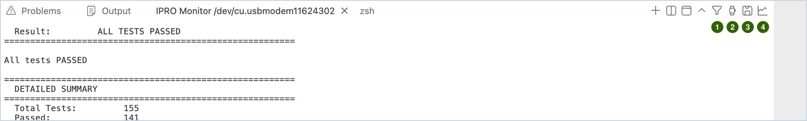
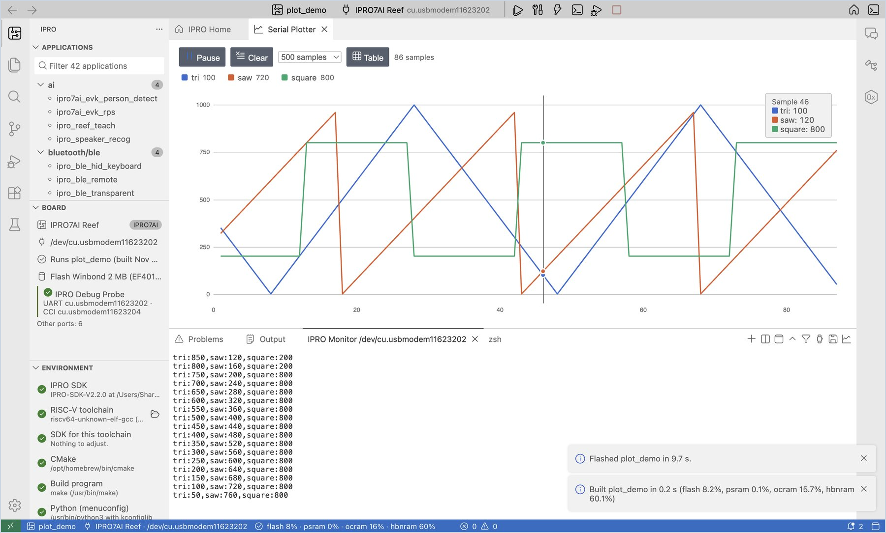

# 串口监视

**IPRO Monitor** 是底部面板 **Terminal** 中的串口监视器。它显示开发板通过 UART 打印的内容，你也可以直接向开发板输入命令。

## 打开监视器并输入命令 { #open }

<div class="ipro-steps" markdown>

1. **打开监视器。** 点击 **Serial Monitor**（`Cmd+Alt+M` / `Ctrl+Alt+M`）。使用 **Build, Flash and Monitor** 时，监视器会在烧录完成后自动打开。

    **应看到**：底部打开一个 **IPRO Monitor &lt;port&gt;** 终端，默认波特率为 115200。

2. **输入命令。** 在监视器中输入命令并按 Enter 发送，例如 `help`。

    **应看到**：开发板的 shell 回复它支持的命令。

3. **重启开发板。** 点击 **Reset Board**：IDE 通过探针复位开发板，监视器保持打开，并从第一行启动信息开始显示全部内容。

</div>

!!! note
    - 烧录或复位前，IDE 会关闭所有监视器，完成后再重新打开。
    - 在 `ipro.monitor.baudRate` 设置项中修改波特率；修改后监视器会自动重新打开。
    - 监视器会自动将开发板打印的地址解码为源代码位置；请参阅[调试与分析](debug.md#crash-decode)。

## 监视器标签页上的工具 { #tools }

**IPRO Monitor** 标签页所在面板的右上角有几个按钮；命令面板和 IPRO 菜单中也有相同的命令。



| 编号 | 图标 | 命令 | 用途 |
|---|---|---|---|
| 1 | 漏斗 | **Filter Monitor Output…** | 只显示匹配的行 |
| 2 | 秒表 | **Show Monitor Timestamps** | 在每行前面加上接收该行的时间 |
| 3 | 磁盘 | **Save Monitor Output…** | 将当前内容保存为文本文件 |
| 4 | 折线图 | **Serial Plotter** | 将开发板打印的数值绘制成曲线 |

### 过滤 { #filter }

<div class="ipro-steps" markdown>

1. **设置过滤条件。** 点击漏斗图标（**Filter Monitor Output…**），输入要保留的内容，例如 `ERROR|WARN` 或 `PASS|FAIL`（正则表达式，不区分大小写），然后按 Enter。

    **应看到**：监视器重新打开，标签页标题末尾加上 `/ERROR|WARN/`，只显示匹配的行。崩溃信息（MEPC、ra、stack backtrace）始终显示。

2. **清除过滤。** 再次点击漏斗图标，清空输入框后按 Enter。

</div>

过滤要等整行到达后才对该行进行判断，因此 shell 提示符要在你按下 Enter 之后才会显示。

过滤只改变显示的内容：固件核对、分区表比对和板上测试仍会读取开发板打印的每一行，因此开启过滤时它们照常工作。

### 时间戳 { #timestamps }

点击秒表图标（**Show Monitor Timestamps**）。

**应看到**：每行开头显示接收该行的时间，例如 `[23:33:13.227]`（以本机时钟为准）。再次点击即可关闭。

### 保存与完整日志 { #save-log }

<div class="ipro-steps" markdown>

1. **保存屏幕上的内容。** 点击磁盘图标（**Save Monitor Output…**），选择保存位置并点击 **Save**。

    **应看到**：通知显示“Saved the monitor output to monitor-….txt.”保存的是终端当前保留的内容（默认为最后 1000 行）。

2. **保留每次会话的完整日志。** 打开设置，搜索 `ipro.monitor`，勾选 **Log To File**。

    **应看到**：监视器的第一行显示 `logging to …/build/logs/monitor-<date>-<time>.log`。该文件包含开发板打印的全部内容，不经过滤，也不带颜色。测量功耗时，可以将此日志与电流曲线对齐（请参阅[测试与测量](measure.md#power)）。

</div>

## 串口绘图器 { #plotter }

<div class="ipro-steps" markdown>

1. **打印数值。** 让固件在每一行打印数值，例如 `temp:23.5,hum:40`（名称:数值）或 `1.2 3.4`（以空格或逗号分隔）。同样的 `名称:数值` 也可以用[传感器仪表板](#dashboard)显示。

2. **打开绘图器。** 在监视器打开的情况下，点击监视器标签页上的折线图图标（**Serial Plotter**）。

    **应看到**：编辑区中打开 **Serial Plotter**，每个名称一条曲线（最多 8 条），顶部的图例显示最新的数值。将鼠标悬停在图表上，可列出该采样点的所有数值。

3. **控制显示。** 点击 **Pause** / **Resume** 冻结或恢复显示，点击 **Clear** 重新开始；点击图例中的名称可隐藏或显示该曲线；点击 **Table** 改为查看数值。

</div>



## 同时监视另一个端口 { #second-port }

要同时查看两块开发板，或查看探针的 CCI 端口：

<div class="ipro-steps" markdown>

1. **打开第二个监视器。** 在 IPRO 菜单中选择 **Open Monitor on Another Port…**，然后选择端口。

    **应看到**：探针的端口（UART、CCI）位于列表顶部；已经打开监视器的端口不会列出。选择端口后，会出现另一个 **IPRO Monitor** 标签页。

2. **同时使用。** 两个监视器中都可以输入。烧录或复位时，所有监视器都会先关闭。

</div>

!!! note
    在 Windows 上，一个 COM 端口同一时间只能被一个程序使用。要使用其他串口工具，请先关闭 IPRO Monitor。

## 传感器仪表板 { #dashboard }

**Sensor Dashboard** 读取开发板在串口上打印的 `名称:数值` 行（与[串口绘图器](#plotter)的格式相同），为每个数值显示一张带单位的卡片；此外还有仪表、指示灯、倾斜视图、每组一张曲线图，以及在开发板控制台上输入命令的按钮。布局写在应用程序文件夹的 `dashboard.yaml` 中；没有这个文件时，每个数值各有一张卡片和一张曲线图。

下面以 IPRO SDK V2.3.0 的 [`ipro7ai_sensor_tag_demo`](https://github.com/INTELPRO-INC/IPRO-SDK/tree/IPRO-SDK-V2.3.0/apps/platform/ipro7ai_sensor_tag_demo) 在 IPRO7AI Sensor Tag 上为例，它的控制台在开发板自身的 USB 端口上。

<div class="ipro-steps" markdown>

1. **烧录并打开监视器。** 按照[通过开发板自身的 USB 烧录](flash.md#usb-flash)将 `ipro7ai_sensor_tag_demo` 烧录到 IPRO7AI Sensor Tag，端口选择开发板的 USB 端口，然后点击 **Serial Monitor**。

    **应看到**：IPRO Monitor 每秒出现 20 行，例如：

    ```text
    ax:0.012 ay:-0.004 az:1.003 gx:0.3 gy:-0.1 gz:0.0 temp:27.4 batt:87 vbat:4.012 btn:0
    ```

2. **打开 Sensor Dashboard。** 在 IPRO 菜单中选择 **Sensor Dashboard**（或命令面板中的 `IPRO: Sensor Dashboard`）。监视器尚未打开时，IDE 会在当前端口上打开它。

    **应看到**：编辑区打开 **Sensor Dashboard**，标题是 `dashboard.yaml` 中写的 `IPRO7AI Sensor Tag`，下面一行为“… lines a second from /dev/cu.usbmodemXXXX”和“Laid out by dashboard.yaml of this application”。接着是 Acceleration 和 Rotation 两组（各有三个数值和一张曲线图；Acceleration 另有 **Tilt** 视图，显示“pitch …° · roll …°”），以及 Board 一组（Temperature、以仪表显示的 Battery、Battery voltage，以及指示灯 Button）。

3. **移动开发板。** 倾斜开发板，再按下开发板上的按键。

    **应看到**：倾斜视图随开发板转动，加速度曲线随之变化；按住按键时 Button 指示灯显示“On”，松开后显示“Off”。鼠标悬停在数值卡片上时，显示“&lt;name&gt;: lowest …, highest … since the page was cleared”。

4. **点击命令按钮。** 点击上方的 **Beep**。

    **应看到**：开发板的蜂鸣器响一声。每个按钮在控制台上输入一行命令，**Beep** 输入的是 `beep 200`；鼠标悬停在按钮上会显示它的命令。

5. **暂停、清除和重新读取。** 点击 **Pause** 冻结画面（按钮变为 **Resume**），点击 **Clear** 重新开始统计。修改 `dashboard.yaml` 之后，点击 **Read dashboard.yaml Again**。

</div>

`dashboard.yaml` 的写法（节选自 `ipro7ai_sensor_tag_demo`）：

```yaml title="dashboard.yaml"
title: IPRO7AI Sensor Tag
groups:
  - title: Acceleration
    unit: g
    range: [-2, 2]
    decimals: 3
    chart: true
    tilt: { x: ax, y: ay, z: az }
    values:
      - { name: ax, label: X }
      - { name: ay, label: Y }
      - { name: az, label: Z }
  - title: Board
    values:
      - { name: temp, label: Temperature, unit: "°C", decimals: 1 }
      - { name: batt, label: Battery, unit: "%", range: [0, 100], show: bar }
      - { name: btn, label: Button, show: lamp }
controls:
  - { label: Beep, send: beep 200 }
```

| 字段 | 说明 |
|---|---|
| `title` | 仪表板的标题；不写时为“Sensors of &lt;application&gt;” |
| `groups` | 分组。每组有 `title` 和 `values`，可以为整组指定 `unit`、`range` 和 `decimals` |
| `chart: true` | 为该组绘制一张随时间变化的曲线图 |
| `tilt` | 用三轴加速度（`x`、`y`、`z` 写数值名称）绘制俯仰与横滚 |
| `values` | 每个数值：`name`（开发板打印的名称）、`label`、`unit`、`decimals`、`range`、`show` |
| `show` | `value`：只显示数字（默认）；`bar`：数字加上它在 `range` 中的位置；`lamp`：不为 0 时点亮 |
| `controls` | 按钮：`label` 是按钮上的文字，`send` 是要在控制台上输入的命令 |

!!! note
    - 应用程序没有 `dashboard.yaml` 时，页面显示“This application has no dashboard.yaml: every value the board prints is shown. The file names groups, units, ranges and buttons.”
    - `dashboard.yaml` 有错误时，错误以“dashboard.yaml line N: …”列出，写错的部分会被跳过，其余照常显示。
    - 监视器没有打开时，页面显示“The serial monitor is not open”并提供 **Open Monitor** 按钮；开发板一段时间没有打印数值时，显示“Nothing from … for a while”。
