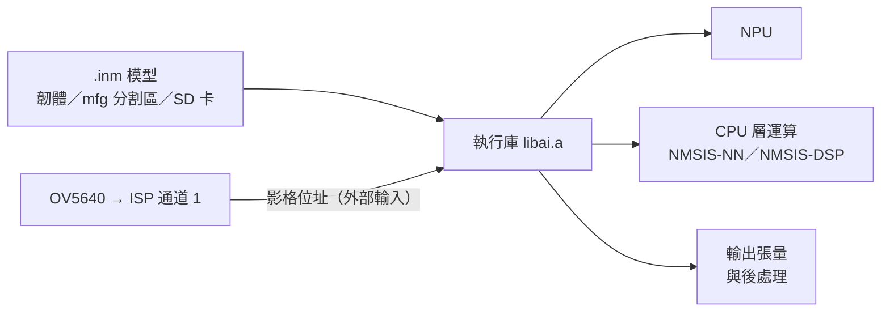

# AI 與 NPU

IPRO7AI 的 NPU 透過預編譯執行庫 `components/ai/lib/libai.a` 與公開標頭執行 `.inm` 模型（晶片與 IPRO7 的差異見 [IPRO7AI](../hardware/chips/ipro7ai.md)）。IPRO7AI Reef EVK 上有三個應用使用它：`ipro7_uvc_cam` 的 `defconfig_reef_rps`（和 NPU 對戰的攝影機遊戲）、`ipro_ai_link`（依指令從 SD 卡執行任意模型），以及 `ipro_reef_teach`（[IPRO AI Teach](../teach/index.md) 背後的 Edge AI 韌體）。先用其中一個應用與它自己的模型跑出結果，再換成自己的模型。

!!! abstract "重點"
    - 隨附：預編譯執行庫與標頭（單一模型用 `iproai_core.h`，多模型用 `ipro_ai.h` 與其他 Edge AI 層）、範例 `.inm` 模型，以及上述 Reef 應用。
    - 以 `CONFIG_AI_SUPPORT=y` 啟用，並自行在 `.config` 寫入 `CONFIG_USE_PSRAM=y`：模型與張量都放在 PSRAM。
    - 模型可以連結進韌體、存在 `mfg` Flash 分割區，或從 SD 卡讀取。
    - 不在 SDK 套件內：執行庫原始碼與模型轉換工具（請洽 INTELPRO）；IPRO AI Studio 另行提供（見[安裝 IPRO AI Studio](../teach/install.md)）。

## 架構 { #architecture }



模型的每一層在 NPU 或 CPU 上執行，由模型本身決定；`iproai_getNetInfo()` 會回報總層數與 NPU 層數。不要假設任何模型都能整個在 NPU 上執行。

| 路徑 | 模型格式 | 執行方式 | Reef 範例 |
|---|---|---|---|
| NPU | `.inm` | `libai.a` 載入模型，逐層分派到 NPU 或 CPU | `ipro7_uvc_cam`（`defconfig_reef_rps`）、`ipro_ai_link`、`ipro_reef_teach` |
| CPU | `.tflite` | TensorFlow Lite Micro 搭配 NMSIS-NN（`components/3rdparty`） | —（IPRO7 EVB 範例 `ipro_tflm_test`、`ipro_tflm_yolo`） |

兩種格式不能互換，改副檔名不等於轉換。

## 執行庫與 API { #iproai-framework }

```text title="components/ai/"
components/ai/
├── CMakeLists.txt        # 連結 lib/libai.a 並加入下列標頭路徑
├── iproai_def.h
├── lib/libai.a           # 預編譯執行庫
├── src/core/include/     # iproai_core.h：單一模型，直接呼叫
├── src/inst/include/     # NPU、CPU 運算、後處理；detect/、audio/
├── runtime/include/      # ipro_ai.h：多模型，共用 NPU
├── store/include/        # ipro_ai_store.h：Flash 中的模型槽
├── source/include/       # ipro_ai_source.h：資料來源
├── preproc/include/      # ipro_ai_preproc.h、sensor_front.h
└── app/include/          # ipro_ai_app.h：來源 → 模型 → 結果
```

套件不含執行庫原始碼，`.config` 無法改變 `libai.a` 的編譯方式。

**直接 API（`iproai_core.h`）**，`ipro_ai_link` 與剪刀石頭布版本使用：

| 函式 | 用途 |
|---|---|
| `iproai_create()` | 建立模型實例 |
| `iproai_load_model_from_buffer(hdl, buf)` | 從記憶體載入：連結進韌體的模型，或經 XIP 讀取的 `mfg` 分割區 |
| `iproai_load_model_from_file(hdl, "sd:/…")` | 經 FatFS 把整個 `.inm` 讀進 PSRAM 後載入 |
| `iproai_getNetInfo(hdl)` | 輸入尺寸、層數、NPU 層數 |
| `iproai_getInputBuffer(hdl)`、`iproai_getOutputBuffer(hdl, &size)` | 輸入與輸出緩衝 |
| `iproai_startCompute(hdl)` | 執行推論（同步） |
| `iproai_setResultCB()`、`iproai_setCustom_Postproc_CB()` | 結果回呼、自訂後處理 |
| `iproai_free(hdl)` | 釋放模型 |

成功時回傳 `IPROAI_STATUS_NO_ERROR`。第一次載入前，比照 `ipro_ai_link`，先開啟多媒體時脈（`GLB_PER_Clock_UnGate(GLB_AHB_CLOCK_MM)`）並呼叫 `iproai_npu_init()`（`iproai_inst_npu.h`）。

- **輸入**：吃相機影格的模型使用外部輸入。執行庫從 `imgBuffer + 4` 讀取（前 4 個位元組是大小表頭），每次執行前以 `NPU_Img_Ext_Addr_Cfg()`（`hal_npu.h`）設定影格位址。Reef 相機路徑每個像素 4 個位元組（ARGB）。
- **輸出**：`iproai_getOutputBuffer()` 回傳的大小是 patch 大小，不是整個張量。NPU 會把通道數補齊到 4 的倍數（`BALI_CHN_ALIGN`，`iproai_inst_util.h`），讀取輸出時要依補齊後的間距計算。
- NPU 的基底位址與外部輸入暫存器只在載入模型時寫入。一個映像檔只用一個模型時沒有影響；要同時用多個模型，請用下面的執行庫層。

**Edge AI 層**，`ipro_reef_teach` 使用（都在 `libai.a` 內）：

| 標頭 | 用途 |
|---|---|
| `ipro_ai.h` | `ipro_ai_init()`、`ipro_ai_model_open()`、`ipro_ai_invoke()`、`ipro_ai_model_close()`：可同時開啟任意數量的模型；共用一把 NPU 鎖，每次執行前把 NPU 指回正在執行的模型。同一映像檔中仍直接呼叫 `iproai_*` 的程式碼，要用 `ipro_ai_npu_lock()` 包住 |
| `ipro_ai_store.h` | Flash 分割區中的模型槽：安裝時使用紀錄磁區與提交字，斷電後只會留下舊模型、新模型或空槽，不會有半個模型 |
| `ipro_ai_source.h` | 資料來源（PDM 麥克風、感測器等樣本串流，或相機影格），共用同一套生命週期 |
| `ipro_ai_preproc.h`、`sensor_front.h` | 共用前處理：量化、語音 log-mel 特徵、感測器視窗轉 64×64×8 輸入、影像裁切與縮放 |
| `ipro_ai_app.h` | 來源 → 前處理 → 模型 → 任務轉接（分類、嵌入向量、異常分數）→ 回呼 |

## 設定 { #configuration }

```ini title=".config（Reef 上的 AI）"
CONFIG_IPRO7AI_REEF=y
CONFIG_BOARD="IPRO7AI_REEF"
CONFIG_USE_PSRAM=y           # 必要：模型與張量放在 PSRAM
CONFIG_AI_SUPPORT=y          # 加入 components/ai 並連結 libai.a
CONFIG_MM_SUPPORT=y          # 要把相機畫面送進 NPU 的應用
```

| 設定 | 說明 |
|---|---|
| `CONFIG_AI_SUPPORT` | 加入 AI 元件。與 `CONFIG_MM_SUPPORT` 同時開啟時也會縮小 OCRAM 區域；見[記憶體規劃](#dev-guide) |
| `CONFIG_USE_PSRAM` | 每個 AI 應用都有設。建置系統不套用 Kconfig 的 `select`，必須寫在 `.config` |
| `CONFIG_AI_MODEL_FROM_FILE` | `ipro_ai_link` 有設，從 SD 卡載入模型（搭配 FatFS：`CONFIG_EVFS=y`、`CONFIG_EVFS_USE_FATFS=y`、`CONFIG_COMPONENTS_FATFS_ENABLE=y`） |
| `CONFIG_AI_CPU_NN_OPS` | `ipro_ai_link` 與 `ipro_reef_teach` 有設，供含 CPU 層的模型使用；`ipro_ai_link` 另設 `CONFIG_COMPONENTS_NMSIS_NN_ENABLE` |
| `CONFIG_AI_CYCLE_PROFILE` | `ipro_ai_link` 有設：提供 `ai_prof` 的逐層週期數 |
| `CONFIG_UVC_RPS`、`CONFIG_RPS_EMBED_MODEL` | `ipro7_uvc_cam` 的 `defconfig_reef_rps` 應用設定：編入遊戲，並把 `rps_v3.inm` 連結進韌體 |

## 在 Reef 上動手做 { #hands-on }

建置一台和您玩剪刀石頭布的攝影機：ISP 通道 1 把 OV5640 畫面正中央裁成 128×128，送進 NPU 上的 4 類 CNN，結果畫進 USB 視訊畫面。

<div class="ipro-steps" markdown>

1. **設定**

    `defconfig_reef_rps` 就是 Reef 一般攝影機設定（`defconfig_reef_ov5640`）多三行：

    ```ini title="apps/multimedia/ipro7_uvc_cam/defconfig_reef_rps（摘錄）"
    #
    # Rock-paper-scissors on the stream (uvc_rps.c): the EVK app's classifier and
    # game, model linked into the image.
    #
    CONFIG_AI_SUPPORT=y
    CONFIG_UVC_RPS=y
    CONFIG_RPS_EMBED_MODEL=y
    ```

    攝影機設定本身已有 `CONFIG_USE_PSRAM=y`、`CONFIG_MM_SUPPORT=y` 與 `CONFIG_SENSOR_OV5640=y`。

2. **程式碼**

    模型由一個組合語言檔拉進映像檔：

    ```text title="apps/ai/ipro7ai_evk_rps/src/model_blob.S（摘錄）"
        .section .rodata.rps_model, "a", @progbits
        .balign 16

        .global g_rps_model
        .type   g_rps_model, @object
    g_rps_model:
        .incbin "rps_v3.inm"
        .global g_rps_model_end
    g_rps_model_end:
        .size   g_rps_model, g_rps_model_end - g_rps_model
    ```

    開機時從這塊緩衝載入。Reef 版本直接編譯 IPRO7AI EVK 應用的分類器原始碼，不做修改：

    ```c title="apps/ai/ipro7ai_evk_rps/src/rps_model.c（摘錄自 load_model）"
    s_hdl = iproai_create();
    if (!s_hdl) {
        s_fail = "NPU CREATE FAILED";
        return -1;
    }
    t0 = xTaskGetTickCount();
    st = iproai_load_model_from_buffer(s_hdl, xip);
    s_stats.load_ms = (uint32_t)((xTaskGetTickCount() - t0) * portTICK_PERIOD_MS);
    if (st != IPROAI_STATUS_NO_ERROR) {
        IPRO_LOGE(LOG_TAG, "NPU load failed (status %d)", (int)st);
        s_fail = "NPU LOAD FAILED";
        return -1;
    }
    s_net = iproai_getNetInfo(s_hdl);
    ```

    之後模型任務把每張影格送進 NPU：

    ```c title="apps/ai/ipro7ai_evk_rps/src/rps_model.c（摘錄自模型任務）"
    feed(addr);
    IPROAI_Status_e st = iproai_startCompute(s_hdl);
    TickType_t t1 = xTaskGetTickCount();

    if (st != IPROAI_STATUS_NO_ERROR) {
        s_stats.errors++;
        IPRO_LOGE(LOG_TAG, "NPU compute failed (status %d)", (int)st);
    } else {
        uint32_t osz = 0;
        const uint8_t *out = iproai_getOutputBuffer(s_hdl, &osz);
        /* ... */
    }
    ```

    這個模型的 `feed()` 只呼叫 `NPU_Img_Ext_Addr_Cfg(addr)`：NPU 直接讀 ISP 通道 1 寫入的 128×128 ARGB 影格。四個輸出在 CPU 上換算成機率。

    `CONFIG_UVC_RPS` 開啟時，`apps/multimedia/ipro7_uvc_cam/CMakeLists.txt` 會加入 `rps_model.c`、`rps_game.c` 與 `model_blob.S`。在您自己的應用程式中放自己的模型也是同樣作法；見[建立第一個應用程式](../tutorials/first-own-app.md)。

3. **建置**

    ```bash
    make -C apps/multimedia/ipro7_uvc_cam DEFCONFIG=defconfig_reef_rps
    ```

    產出：`apps/multimedia/ipro7_uvc_cam/build_reef_rps/build_out/ipro7_uvc_cam_IPRO7.bin`

4. **燒錄**

    SW7 撥到 **CAM**，進入下載模式（按住 SW1、按一下 SW2、放開 SW1），再到 IntelProCube 目錄執行：

    ```bash
    cd <ICUBE>
    ./ipro_iot_tool_macos --chipname ipro7 --chip-variant IPRO7AI \
        --port /dev/cu.usbserial-XXXX --baudrate 921600 \
        --pt chips/ipro7/partition/partition_cfg_2M.toml \
        --firmware <SDK>/apps/multimedia/ipro7_uvc_cam/build_reef_rps/build_out/ipro7_uvc_cam_IPRO7.bin
    ```

    模型已在韌體內，不必另外燒錄。確認輸出有 `[All Success]` 後按 SW2；其他作業系統見[燒錄與序列埠主控台](../get-started/flash-and-monitor.md)。

5. **執行並確認**

    U6 主控台（115200 baud）的開機訊息包含：

    ```text
    [UVC] Bringing up USB UVC webcam (720p MJPEG)...
    I (…) RPS_MODEL: model: … B linked into the firmware at 0x…
    I (…) RPS_MODEL: loaded in … ms: input 128x128x…, 1 outputs, ext_input …, unsigned …, … layers (… NPU), out scale … zp …
    I (…) RPS_MODEL: PSRAM heap left after the model: … KB
    [UVC] Streaming pipeline started
    ```

    把 Reef 的 USB-C 接到電腦，用任何相機程式開啟。把手放進畫面中央的框內；倒數結束後每一局都會記錄下來，`rps` 顯示模型與 NPU 狀態：

    ```text
    [GAME] round 1: you ROCK, me PAPER -> I WIN  (you 0 me 1 draw 0)
    ipro /> rps
    model   : ready, … B from firmware, loaded in … ms, … KB heap left
    npu     : … frames, 0 errors, … fps, last … ms
    now     : … …%  (r … p … s … n …)
    game    : round 1, you 0 me 1 draw 0, conf >= …%, mirror on
    ```

    模型沒載入時，主控台會印出 `[RPS] model not loaded: … - streaming without the game`，串流畫面上也會顯示原因。

</div>

把這類檢查寫成可重複執行的測試，見[測試您的應用程式](../tutorials/testing.md)。

## 隨附模型 { #supported-models }

| 檔案 | 使用者 |
|---|---|
| `apps/ai/ipro7ai_evk_rps/model/rps_v3.inm`（預設）、`rps_v1.inm` | 4 類 int8 剪刀石頭布分類器，輸入 128×128；連結進 `ipro7_uvc_cam` 的 `defconfig_reef_rps` |
| `apps/ai/ipro_reef_teach/model/model_b.spkb` | `ipro_reef_teach` `voice` 模式的聲紋模型，以 `mfg_payload.py` 燒進 `mfg` 分割區 |
| `tools/teach_web/assets/mnv1_025.inm`、`mnv2_035.inm` | 瀏覽器版影像 Teach（`tools/teach_web/`）使用的影像特徵模型 |
| `apps/platform/ipro7_demo/demo/ai/ai_model/*.inm`、`apps/test/ipro_npu_yolo/src/person_pet_detect.inm` | IPRO7 EVB 與 IPRO7AI EVK 範例的人形與人／寵物偵測模型 |
| `apps/test/ipro_tflm_test/src/*.tflite`、`apps/test/ipro_tflm_yolo/src/*.tflite` | IPRO7 EVB 的 TensorFlow Lite Micro（CPU）範例 |

## 模型部署 { #model-pipeline }

| 模型放在哪裡 | 方式 | Reef 範例 |
|---|---|---|
| 連結進韌體 | 以組合語言檔的 `.incbin` 把 `.inm` 拉進映像檔，用 `iproai_load_model_from_buffer()` 載入；換模型就要重新建置 | `ipro7_uvc_cam` `defconfig_reef_rps` |
| `mfg` Flash 分割區 | 以 IntelProCube 的 `--mfg` 選項燒錄，經 XIP 讀取。標準的 `partition_cfg_2M.toml` 在 1,180 KB 韌體分割區之後，`mfg` 位於 0x12A000（824 KB） | `ipro_reef_teach`：自己的 `partition_reef_teach.toml`（韌體 640 KB、`mfg` 1,364 KB），每個模式一個槽，由 `ipro_ai_store.h` 管理 |
| SD 卡 | `iproai_load_model_from_file()` 經 FatFS 讀取；路徑用 `sd:/`，不是 `/sdcard/` | `ipro_ai_link` |

`ipro_reef_teach` 第一次的 `mfg` 內容由 `mfg_payload.py` 產生；之後教出來的模型由 IPRO AI Studio 部署到各自的槽，不必重新燒錄。完整燒錄指令與槽位配置見[燒錄 Edge AI 韌體](../teach/firmware.md)與應用程式 README。

**自己的模型**：模型轉換工具不在 SDK 套件內，請洽 INTELPRO。部署前請確認運算子支援、張量形狀、量化參數與記憶體需求；下方的 `ipro_ai_link` 可顯示任何 `.inm` 的層分配與輸入輸出形狀。

## 範例應用 { #reference-apps }

| 應用 | Reef 設定 | 內容 |
|---|---|---|
| `apps/multimedia/ipro7_uvc_cam` | `defconfig_reef_rps` | USB 攝影機，串流畫面上疊加 NPU 剪刀石頭布遊戲 |
| `apps/test/ipro_ai_link` | `defconfig_reef` | IPRO AI Studio「Run on board」的板端韌體：模型與輸入來自 SD 卡 |
| `apps/ai/ipro_reef_teach` | `.config` | Edge AI 韌體：`image`、`voice`、`sensor` 三種 Teach，一次執行一種；見 [IPRO AI Teach](../teach/index.md) |
| `apps/multimedia/ipro_agora_sentino` | `.config` | 雲端語音助理；見[雲端 AI](#cloud-llm) |

IPRO7AI EVK（`ipro7ai_evk_person_detect`、`ipro7ai_evk_rps`、`ipro7ai_evk_launcher`）與 IPRO7 EVB（`ipro_npu_yolo`、`ipro_ai_bench`、`ipro_tflm_*`、`ipro_nmsis_nn_test`、`ipro_tinymaix_demo`）的 NPU 範例列在[範例](../examples/index.md)。

### IPRO AI Studio 板端韌體（ipro_ai_link） { #ai-link }

`ipro_ai_link` 燒錄一次即可；之後由主機以指令替換模型與輸入、執行推論、取回結果，不必重新燒錄。模型與輸入從 SD 卡讀取，輸出行帶有機器可讀的前綴（`AIINFO`、`AIRUN`、`AIOUT`、`AIERR`）。Reef 版本另在 USB-C 上列舉一個 USB CDC 裝置（VID 0x3896、PID 0x0704），用來快速傳檔。

```bash
make -C apps/test/ipro_ai_link DEFCONFIG=defconfig_reef   # 產出在 build_reef/build_out/
```

也可以手動操作。把模型複製到 FAT 格式的 microSD 卡（例如 `apps/ai/ipro7ai_evk_rps/model/` 的 `rps_v3.inm`），插入卡片，以 `--chip-variant IPRO7AI` 燒錄這個版本，然後在 U6 主控台（115200 baud）：

```text
ipro /> ai_mount
AIMOUNT ok
ipro /> ai_load sd:/rps_v3.inm
AILOAD ok sd:/rps_v3.inm
ipro /> ai_info
AIINFO path=sd:/rps_v3.inm layers=… npu=… in=…x…x… out=…x…x… patch_size=… patch_count=… app_type=… feed=0
```

| 指令 | 用途 |
|---|---|
| `ai_mount`／`ai_unmount` | 掛載／釋放 SD 卡 |
| `ai_ls [dir]` | 列出檔案 |
| `ai_load sd:/model.inm` | 載入模型 |
| `ai_input sd:/input.bin` | 載入符合模型輸入格式的原始位元組 |
| `ai_run [reps]` | 執行推論（1–100 次）；印出 `AIRUN rep=… total=… npu=… dispatches=…` 週期數 |
| `ai_out [max_bytes]` | 傾印輸出 |
| `ai_info` | 模型資訊（層數、NPU 層數、輸入與輸出形狀） |
| `ai_prof` | 上一次執行的逐層週期數 |

## 整合與記憶體規劃 { #dev-guide }

**OCRAM**：同時開啟 `CONFIG_AI_SUPPORT` 與 `CONFIG_MM_SUPPORT` 時，連結器把 OCRAM 區域縮為 64 KB（沒有 BLE，`CONFIG_EM_SIZE` 為 0 或未設）或 48 KB（有 BLE）；所有組合見[建置系統與設定](build-system.md#memory-layout)。請看建置結束時連結器印出的記憶體用量。

**PSRAM**：模型、中間張量與相機影格都從 PSRAM 配置。在載入前後與連續推論期間量測剩餘 heap（`xPortGetFreeHeapSize()`）；剪刀石頭布版本在載入後會記錄這個數值。

**相機到 NPU**：一次只交一張影格給 NPU，避免 ISP 覆寫正在推論的緩衝，並維持快取一致（NPU 是匯流排主控端，看不到 CPU 的 D-cache）。

**多個模型**：以 `ipro_ai.h` 開啟，不要對兩個 handle 各自呼叫 `iproai_startCompute()`；否則第二次載入會讓 NPU 一直指向最後載入的模型。

**錯誤處理**：檢查 `iproai_create()`、載入函式與 `iproai_startCompute()` 的回傳值；失敗時以 `iproai_free()` 釋放模型，並釋放自己配置的緩衝。`ipro_reef_teach` 另外啟用 AON 看門狗，SoC 停住時會自動重新啟動。

**浮點運算**：IPRO7 的 FreeRTOS port 在工作切換與中斷時會保存浮點暫存器，因此與 NPU 任務並行的工作可以使用浮點運算。

## 效能量測 { #performance }

| 工具 | 指令 | 量測內容 |
|---|---|---|
| `ipro_ai_link` | `ai_run [reps]`、`ai_prof` | 每次執行的總週期、NPU 週期與 NPU 分派次數；自己模型的逐層週期數 |
| `ipro7_uvc_cam` `defconfig_reef_rps` | `rps` | 遊戲執行中的 NPU 影格數、錯誤數、影格率與最近一次推論時間 |

請記錄模型檔、輸入尺寸、建置設定、heap 用量與多次推論時間，並把前處理、推論、後處理分開量測。第一次執行包含 PSRAM 與快取的冷啟動成本，請取之後的結果。參考數據：`ipro7ai_evk_rps` README 記載 `rps_v3.inm`（11 層，全部在 NPU）每次推論 7 ms，是在 IPRO7AI EVK 上以同一顆 IPRO7AI 量測。

## 雲端 AI { #cloud-llm }

SDK 沒有通用的雲端 AI 用戶端元件。`apps/multimedia/ipro_agora_sentino` 是 Reef 上的雲端語音助理：經 BLE 配網，透過 IPRO6S FIN 卡連上 Wi-Fi（見[網路](networking.md)），再經 Sentino 平台與 Agora RTC 對話。直接 `make` 就是 Reef 版本（預設 `BOARD=reef`）。

- 需要 AOSL 核心，它不在 SDK 內。請一次取得，並切到 Agora RTC 函式庫建置時使用的 commit；目錄為空時建置會停下並印出這些步驟：

    ```bash
    git clone https://github.com/AgoraIO-Community/aosl components/3rdparty/agora/aosl
    git -C components/3rdparty/agora/aosl checkout d825607
    ```

- 另需 Sentino 裝置三元組，未包含於 V2.2.0，請洽 INTELPRO。

## 本版限制 { #limitations }

- 執行庫只以預編譯的 `libai.a` 提供，內部選項無法從 `.config` 變更。
- 模型轉換工具不在 SDK 套件內，請洽 INTELPRO。
- Zephyr 下沒有 NPU 驅動；所有 AI 應用都是 FreeRTOS 應用。
- AI、相機與 BLE 同時開啟時，OCRAM 區域只有 48 KB；見[記憶體規劃](#dev-guide)。

## 相關文件 { #related }

- [IPRO AI Teach](../teach/index.md)：在 Reef 上從 IPRO AI Studio 教會影像、聲紋與感測器模型
- [相機與影像](camera.md)：ISP 與相機管線
- [建置系統與設定](build-system.md)：`.config`、`DEFCONFIG=` 與記憶體配置
- [AI API](../reference/api/ai.md)
- [IPRO7AI Reef EVK](../hardware/boards/reef-evk.md)
