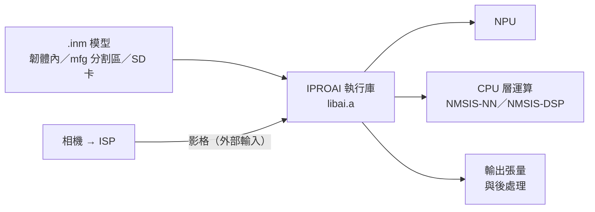

# AI 與 NPU

IPRO7AI 的 NPU 透過 IPROAI 執行庫推論 `.inm` 模型（晶片差異見 [IPRO7AI](../hardware/chips/ipro7ai.md)）。SDK 以預編譯函式庫加公開標頭的形式提供執行庫，並附可直接燒錄的範例模型與應用；另有在 CPU 上以 TensorFlow Lite Micro 執行 `.tflite` 的範例。先用隨附模型與配套範例建立可重現的結果，再換成自己的模型。

!!! abstract "重點"
    - 隨附：預編譯執行庫 `components/ai/lib/libai.a` 與標頭、範例 `.inm`／`.tflite` 模型、`ipro7ai_evk_rps` 的訓練腳本。
    - 啟用：`CONFIG_AI_SUPPORT=y`，並自行加上 `CONFIG_USE_PSRAM=y`（不會自動開啟）。
    - 快速試用：IPRO7AI Reef EVK 上的 `ipro7_uvc_cam`（`defconfig_reef_rps`）；IPRO7AI EVK 上有三個 NPU 應用。
    - 未包含：執行庫原始碼、模型轉換工具、IPRO AI Studio。請洽 INTELPRO。

## 架構 { #architecture }



模型的每一層在 NPU 或 CPU 上執行，由模型本身決定；`iproai_getNetInfo()` 可讀出總層數與 NPU 層數。不要假設任意模型都能整個放上 NPU。

SDK 的推論路徑如下。各路徑的模型格式不能互換，改副檔名不等於轉換格式：

| 路徑 | 模型格式 | 執行方式 | 範例 |
|---|---|---|---|
| NPU（IPROAI） | `.inm` | `libai.a` 載入模型，逐層交給 NPU 或 CPU 執行 | `ipro_npu_yolo`、IPRO7AI EVK 應用、`ipro_ai_link` |
| CPU | `.tflite` | TensorFlow Lite Micro 搭配 NMSIS-NN 核心 | `ipro_tflm_test`、`ipro_tflm_yolo` |
| CPU | TinyMaix | TinyMaix INT8 | `ipro_tinymaix_demo` |

## 執行庫與 API { #iproai-framework }

```text title="components/ai/"
components/ai/
├── CMakeLists.txt        # 直接連結 lib/libai.a
├── iproai_def.h
├── lib/libai.a           # 預編譯執行庫
└── src/
    ├── core/include/iproai_core.h
    └── inst/include/     # NPU、CPU 運算、後處理；detect/、audio/
```

套件不含執行庫原始碼，應用的 `.config` 無法改變 `libai.a` 內部的編譯選項；需要不同組態的函式庫請洽 INTELPRO。

| 函式（`iproai_core.h`） | 用途 |
|---|---|
| `iproai_create()` | 建立模型實例 |
| `iproai_load_model_from_buffer(hdl, buf)` | 從記憶體載入（韌體內的模型，或經 XIP 讀取的 mfg 分割區） |
| `iproai_load_model_from_file(hdl, "sd:/…")` | 以 FatFS 把整個 `.inm` 讀進 PSRAM 後載入 |
| `iproai_getNetInfo(hdl)` | 輸入尺寸、層數、NPU 層數 |
| `iproai_getInputBuffer(hdl)`、`iproai_getOutputBuffer(hdl, &size)` | 輸入／輸出緩衝區 |
| `iproai_getInputResolution()`、`iproai_setSourceResolution()` | 模型輸入尺寸；來源影像尺寸（座標換算） |
| `iproai_startCompute(hdl)` | 執行推論（同步，完成後返回） |
| `iproai_setResultCB()`、`iproai_setCustom_Postproc_CB()` | 結果回呼、自訂後處理回呼 |
| `iproai_free(hdl)` | 釋放模型 |

成功時回傳 `IPROAI_STATUS_NO_ERROR`。第一次使用前呼叫 `iproai_npu_init()`（`iproai_inst_npu.h`）。後處理標頭位於 `src/inst/include/detect/`（YOLOv8、YOLOv8 人物／寵物、手勢等）與 `src/inst/include/audio/`（語者特徵、語者辨識、fbank）。

下列流程取自 `apps/test/ipro_ai_link/main.c`：

```c title="從 SD 卡載入模型並執行一次"
#include <stdio.h>
#include "iproai_core.h"
#include "iproai_def.h"
#include "iproai_inst_npu.h"
#include "drv_glb.h"

static iproai_model_hdl_t s_hdl;

int model_run_once(void)
{
    /* 先以 FatFS 掛載 sd:（見 ipro_ai_link 的 ai_mount） */
    GLB_PER_Clock_UnGate(GLB_AHB_CLOCK_MM);
    iproai_npu_init();

    s_hdl = iproai_create();
    if (s_hdl == NULL) {
        return -1;
    }
    if (iproai_load_model_from_file(s_hdl, "sd:/model.inm") != IPROAI_STATUS_NO_ERROR) {
        iproai_free(s_hdl);
        return -1;
    }

    struct iproai_net_info_t *net = iproai_getNetInfo(s_hdl);
    printf("layers %d, on NPU %d\r\n", net->layer_cnt, net->npu_layer_cnt);

    /* 依模型準備輸入（見下方說明）後執行 */
    if (iproai_startCompute(s_hdl) != IPROAI_STATUS_NO_ERROR) {
        iproai_free(s_hdl);
        return -1;
    }

    uint32_t patch = 0;
    const uint8_t *out = iproai_getOutputBuffer(s_hdl, &patch);
    (void)out;
    return 0;
}
```

- **輸入**：以相機影格為輸入的隨附模型（`person_pet_detect`、`rps_v3`）使用外部輸入：執行庫從 `imgBuffer + 4` 讀取（前 4 位元組是大小表頭），影格位址以 `NPU_Img_Ext_Addr_Cfg()`（`hal_npu.h`）設定。做法見 `apps/test/ipro_npu_yolo/main.c`。
- **輸出**：`iproai_getOutputBuffer()` 回傳的大小是 patch 大小，不是整個張量；NPU 會把通道數補齊為 4 的倍數（`BALI_CHN_ALIGN`，`iproai_inst_util.h`），解讀輸出時以補齊後的間距計算。

## 設定 { #configuration }

```ini title=".config（AI 應用）"
CONFIG_AI_SUPPORT=y          # 加入 components/ai，連結 libai.a
CONFIG_USE_PSRAM=y           # 必須自行設定：模型與中間張量放在 PSRAM
CONFIG_MM_SUPPORT=y          # 使用相機／ISP 的應用
CONFIG_AI_MODEL_FROM_FILE=y  # 從 SD 卡載入模型的應用（另需 FatFS 與 SD 卡驅動）
```

| 設定 | 說明 |
|---|---|
| `CONFIG_AI_SUPPORT` | 加入 AI 元件。也會改變連結器的 OCRAM 配置，見[記憶體規劃](#dev-guide) |
| `CONFIG_USE_PSRAM` | 每個 AI 範例都有設定。建置系統不會依相依關係自動開啟，必須寫在 `.config` |
| `CONFIG_MM_SUPPORT` | 多媒體（相機、ISP）。與 `CONFIG_AI_SUPPORT` 同時開啟時 OCRAM 區域縮小 |
| `CONFIG_AI_MODEL_FROM_FILE` | `ipro_ai_link`、`ipro_ai_bench`、`ipro7ai_evk_launcher` 從 SD 卡載入模型時設定 |
| `CONFIG_RPS_EMBED_MODEL` | 應用自訂：`ipro7ai_evk_rps` 與 `ipro7_uvc_cam` 的 `defconfig_reef_rps` 把 `rps_v3.inm` 連結進韌體 |

V2.1.0 一律連結預編譯的 `libai.a`，沒有從原始碼建置執行庫的選項；部分 `.config` 裡殘留的 `CONFIG_AI_PREBUILT` 等行不影響函式庫。

## 隨附模型 { #supported-models }

| 目錄 | 檔案 | 使用的範例 |
|---|---|---|
| `apps/platform/ipro7_demo/demo/ai/ai_model/` | `person_detect.inm`、`person_pet_detect.inm`、`res2dnet.inm`、`mbv2.inm` | `ipro7_demo` 的 AI 示範（`defconfig_boot2`）；`person_pet_detect.inm` 也供 `ipro7ai_evk_person_detect` 與 launcher 的偵測頁使用 |
| `apps/test/ipro_npu_yolo/src/` | `person_pet_detect.inm` | 連結進韌體的 NPU 計時 |
| `apps/ai/ipro7ai_evk_rps/model/` | `rps_v3.inm`（預設）、`rps_v1.inm`，以及轉換前的 `*_int8.tflite` 與 `*_numbers.json` | 剪刀石頭布 4 類 int8 分類；launcher 的手勢、`ipro7_uvc_cam` 的 `defconfig_reef_rps` |
| `apps/test/ipro_tflm_test/src/` | `hello_world.tflite`、`person_detect.tflite`、`micro_speech.tflite`、`keyword_scrambled.tflite` | TensorFlow Lite Micro（CPU） |
| `apps/test/ipro_tflm_yolo/src/` | `yolov8_person_pet.tflite` | 與 `ipro_npu_yolo` 相同的 YOLOv8，在 CPU 上執行 |
| `apps/test/ipro_ai_bench/src/bench_models.S` | 8 個內建模型（例如 `movenet_192`、`nanodet_320`、`retinaface_320`） | 整模型計時 |

## 模型部署 { #model-pipeline }

| 放置方式 | 做法 | 範例 |
|---|---|---|
| 連結進韌體 | 組語檔以 `.incbin` 把 `.inm` 放進映像，再以 `iproai_load_model_from_buffer()` 載入 | `ipro_npu_yolo`（`src/model_inm.S`）、`ipro7ai_evk_rps`（`src/model_blob.S`） |
| mfg 分割區 | 模型寫在 `mfg` 分割區（分割區起點 +0x1000），開機時經 XIP 讀取；以 IntelProCube 的 `--mfg` 燒錄 | `ipro7ai_evk_person_detect`、`ipro7ai_evk_launcher`（手勢模型） |
| SD 卡 | `iproai_load_model_from_file()` 以 FatFS 讀取，路徑用 `sd:/`，不是 `/sdcard/` | `ipro_ai_link`、`ipro_ai_bench`、`ipro7ai_evk_launcher`（偵測頁需要 `sd:/models/person.inm`） |

IPRO7AI EVK 的 Flash 只有 1 MB，模型無法和韌體放在同一個分割區，因此 EVK 應用附自己的分割表（例如 `partition_cfg_1M_person_lcd.toml`：FW 0x3000 起 320 KB、`mfg` 0x53000 起 688 KB）與 `flash.sh`：

```bash
cd apps/ai/ipro7ai_evk_person_detect
PORT=/dev/cu.usbserial-XXXX ./flash.sh --full    # 第一次：分割表＋韌體＋模型
PORT=/dev/cu.usbserial-XXXX ./flash.sh --model   # 只換模型
```

`flash.sh` 呼叫 IntelProCube 命令列工具（`IPRO_FLASH_TOOL` 或 `PATH`），每次都會帶分割表；少了分割表，工具會寫入沒有 `mfg` 的預設表。EVK 的燒錄設定見 [IPRO7AI EVK](../hardware/boards/ipro7ai-evk.md) 與[燒錄與序列埠](../get-started/flash-and-monitor.md)。

**自訂模型**：模型轉換工具未包含於 V2.1.0，請洽 INTELPRO。套件只有 `ipro7ai_evk_rps/train/` 的訓練腳本（Keras，匯出 int8 `.tflite`）。部署前確認算子、張量尺寸、量化參數與記憶體需求。

## 範例應用 { #reference-apps }

| 應用 | 板子 | 內容 |
|---|---|---|
| `apps/multimedia/ipro7_uvc_cam`（`defconfig_reef_rps`） | IPRO7AI Reef EVK | USB 攝影機，NPU 剪刀石頭布畫在串流畫面上 |
| `apps/test/ipro_ai_link`（`defconfig_reef`） | Reef；預設 `.config` 為 IPRO7 EVB | IPRO AI Studio「Run on board」板端韌體 |
| `apps/ai/ipro7ai_evk_person_detect` | IPRO7AI EVK | LCD 相機預覽，疊加 YOLOv8 人物／寵物框 |
| `apps/ai/ipro7ai_evk_rps` | IPRO7AI EVK | 與 NPU 上的 4 類 CNN 玩剪刀石頭布；附模型與訓練腳本 |
| `apps/platform/ipro7ai_evk_launcher` | IPRO7AI EVK | 相機、LCD、麥克風、喇叭整合在同一映像，以手勢切換頁面；第二個模型偵測人物／寵物 |
| `apps/test/ipro_npu_yolo` | IPRO7 EVB | YOLOv8 NPU 計時（`npu_run [iters]`） |
| `apps/test/ipro_ai_bench` | IPRO7 EVB | 內建模型的整模型計時 |
| `apps/test/ipro_tflm_test`、`ipro_tflm_yolo` | IPRO7 EVB | TensorFlow Lite Micro（CPU） |
| `apps/test/ipro_nmsis_nn_test` | IPRO7 EVB | NMSIS-NN 算子測試 |
| `apps/test/ipro_tinymaix_demo` | IPRO7 EVB | TinyMaix INT8 MNIST |
| `apps/platform/ipro7_demo`（`defconfig_boot2`） | IPRO7 EVB | AI 示範只在這個設定中啟用 |

### 在 IPRO7AI Reef EVK 上試用

<div class="ipro-steps" markdown>

1. **建置**

    ```bash
    make -C apps/multimedia/ipro7_uvc_cam DEFCONFIG=defconfig_reef_rps
    ```

    產出：`apps/multimedia/ipro7_uvc_cam/build_reef_rps/build_out/ipro7_uvc_cam_IPRO7.bin`

2. **燒錄**：依[燒錄與序列埠](../get-started/flash-and-monitor.md#flashing)中 Reef 的步驟（`--chip-variant IPRO7AI`）燒錄上述檔案。

3. **執行**：把 Reef 的 USB-C（USB1）接到電腦，用任何支援 UVC 的相機程式開啟。手放進畫面中央的框，倒數後出拳；主控台在 U6，115200 baud。

</div>

### IPRO AI Studio 板端韌體（ipro_ai_link） { #ai-link }

`ipro_ai_link` 燒錄一次後，換模型、換輸入、執行推論與取回結果都由主機下指令，不需重新燒錄。模型與輸入從 SD 卡（`sd:/`）讀取，原始輸出經 USB 傳回主機；輸出行以 `AIINFO`、`AIRUN`、`AIOUT` 等前綴標示，方便主機剖析。IPRO AI Studio 本身未包含於 V2.1.0，請洽 INTELPRO。

```bash
make -C apps/test/ipro_ai_link DEFCONFIG=defconfig_reef   # 輸出於 build_reef/build_out/
```

| 指令 | 用途 |
|---|---|
| `ai_mount`／`ai_unmount` | 掛載／釋放 SD 卡 |
| `ai_ls [dir]` | 列出檔案 |
| `ai_load sd:/model.inm` | 載入模型 |
| `ai_input sd:/input.bin` | 載入輸入資料 |
| `ai_run [reps]` | 執行推論 |
| `ai_out [max_bytes]` | 輸出推論結果 |
| `ai_info` | 模型資訊（層數、NPU 層數、輸入輸出尺寸） |
| `ai_prof` | 上一次推論的逐層週期數 |

## 整合與記憶體規劃 { #dev-guide }

**OCRAM**：同時啟用 `CONFIG_AI_SUPPORT` 與 `CONFIG_MM_SUPPORT` 時，連結器把 OCRAM 區域縮為 64 KB（`CONFIG_EM_SIZE` 為 0）或 48 KB（使用 BLE），各組合見[建置系統與設定](build-system.md#memory-layout)。`ipro7ai_evk_demo` 的 README 指出 BLE 控制器與 Host 約需 67 KB OCRAM，因此 IPRO7AI EVK 的範例把 AI 與 BLE 分成不同設定。需要兩者並存時，請先以實際建置的連結器輸出確認。

**PSRAM**：模型、中間張量與相機影格都從 PSRAM 配置。預算要包含權重、中間張量、輸入影像、後處理與其他工作；在載入前後與連續推論時量測剩餘 heap（`xPortGetFreeHeapSize()`）。不同模型的用量差異很大，不能用固定比例推算。

**相機 → NPU**：同一時間只交一張影格給 NPU，避免 ISP 覆寫推論中的緩衝區。IPRO7AI EVK 的做法在 `components/board/ipro7ai_evk`（`evk_cam`）與 `ipro7ai_evk_person_detect`。外部影像緩衝區必須在推論結束前保持有效，並做好快取同步。

**錯誤處理**：檢查 `iproai_create()`、載入與 `iproai_startCompute()` 的回傳值，失敗時以 `iproai_free()` 釋放模型，並釋放應用自己配置的緩衝區。

**浮點運算**：V2.1.0 的 IPRO7 FreeRTOS 移植在任務切換與中斷時保存浮點暫存器，NPU 任務以外的其他任務也可以使用浮點。部分範例原始碼註解仍要求只用整數，那是舊版移植的限制。

## 效能量測 { #performance }

| 工具 | 指令 | 量測內容 |
|---|---|---|
| `ipro_ai_bench` | `bench_list`、`bench_run <name>`、`bench_all`；`bench_file <path> <w> <h> <c>`（模型在已掛載的 SD 卡上） | 內建模型的整模型時間（重複 5 次取中位數），分列 NPU 與 CPU 週期及 NPU 派送次數；輸入由板上亂數產生 |
| `ipro_npu_yolo` | `npu_run [iters]` | YOLOv8 在 NPU 上的推論週期 |
| `ipro_tflm_yolo` | `yolo_run [iters]` | 同一個 YOLOv8 在 CPU（TFLM）上的推論週期 |
| `ipro_ai_link` | `ai_run [reps]`、`ai_prof` | 自訂模型的推論時間與逐層週期 |

記錄模型檔、輸入尺寸、建置設定、heap 用量與重複推論時間；分開量測前處理、推論與後處理。第一次推論包含 PSRAM 與快取的冷啟動成本，取後續幾次的結果。

套件 README 中的實測值（IPRO7AI EVK，2026-09-18）：

| 模型 | 輸入 | NPU 推論 | 其他 | 來源 |
|---|---|---|---|---|
| `person_pet_detect.inm`（YOLOv8 人物／寵物，700,088 位元組） | 640×360 ARGB | 103 ms | 框解碼＋NMS 16 ms；偵測 5.9 fps | `ipro7ai_evk_person_detect` README |
| `rps_v3.inm`（4 類 CNN，11 層全在 NPU） | 128×128×3 int8 | 7 ms | 一次一張影格時 14.9 fps | `ipro7ai_evk_rps` README |

偵測門檻、NMS 上限與輸入格式是範例的設定，不是 NPU 的規格。更換模型或解析度後，重新確認輸出正確性、記憶體峰值與長時間穩定性。

## 雲端 AI { #cloud-llm }

V2.1.0 沒有通用的雲端 AI 用戶端元件。隨附的雲端語音範例是 `apps/multimedia/ipro_agora_sentino`：IPRO7AI Reef EVK 經 IPRO6S FIN 卡連上 Wi-Fi，以 BLE 配網，透過 Sentino 平台（MQTT）與 Agora RTC 進行語音對話。執行它需要 Sentino 裝置憑證三元組與 FIN 卡韌體，兩者都未包含於 V2.1.0，請洽 INTELPRO；建置前另需取得 AOSL 子模組（見該應用 README）。網路設定見[網路](networking.md)。

## 本版限制 { #limitations }

- 執行庫只有預編譯的 `libai.a`，沒有原始碼，也不能以 `.config` 調整其內部選項。
- 模型轉換工具與 IPRO AI Studio 未包含於 V2.1.0，請洽 INTELPRO。
- Zephyr RTOS 下沒有 NPU 驅動，AI 範例都是 FreeRTOS 應用，見 [Zephyr RTOS](zephyr.md)。
- AI、多媒體與 BLE 同時啟用時，OCRAM 區域只有 48 KB，見[記憶體規劃](#dev-guide)。

## 相關文件 { #related }

- [相機與影像](camera.md)：ISP 與相機管線。
- [建置系統與設定](build-system.md)：`.config` 與 `DEFCONFIG=`。
- [IPRO7AI EVK](../hardware/boards/ipro7ai-evk.md)、[IPRO7AI Reef EVK](../hardware/boards/reef-evk.md)：板子與燒錄設定。
