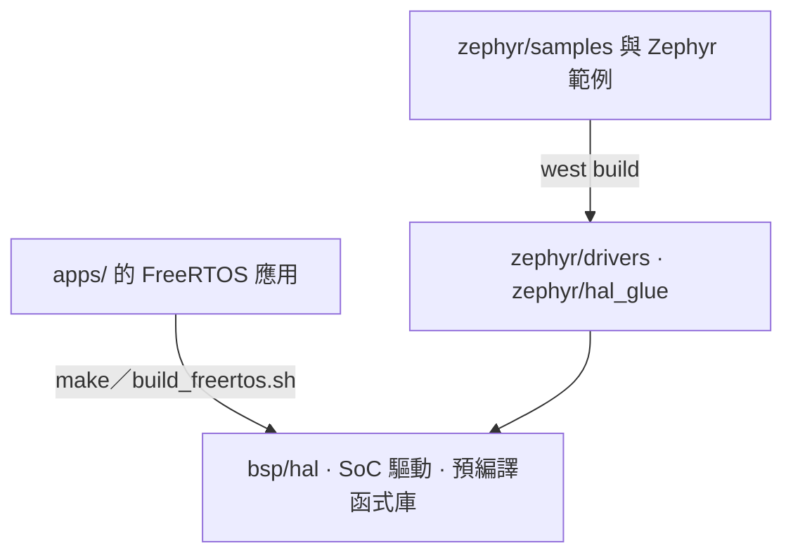

# 系統架構

IPRO SDK 用同一份原始碼樹提供兩條開發路徑：`apps/` 下 35 個 FreeRTOS 應用，以及 Zephyr v4.4.0 模組。兩者共用 HAL、SoC 驅動與預編譯函式庫。建置流程與記憶體配置見[建置系統與設定](build-system.md)。

!!! abstract "重點"
    - 分層：應用（`apps/`）→ 元件（`components/`）→ RTOS（FreeRTOS V11.1.0 或 Zephyr v4.4.0）→ BSP（`bsp/`）→ 晶片。
    - 核心為 RISC-V RV32IMAFC（含 DSP 擴充）。連網時用乙太網路，或經 SDIO 接 IPRO6S。
    - BLE 控制器、RF 驅動、低功耗框架、AI 推論執行庫、ISP 演算法與 LC3 編解碼器以預編譯函式庫提供，其餘為原始碼。
    - V2.1.0 的 FreeRTOS 應用全部以 IPRO7 為目標（`CONFIG_IPRO7=y`）。

## 系統總覽 { #overview }

<div class="ipro-stack">
  <div class="l-app"><strong>應用 apps/</strong><span>ai · bluetooth · multimedia · platform · test</span></div>
  <div class="l-host"><strong>元件 components/</strong><span>BLE Host · lwIP · mbedTLS · CherryUSB · audio · ai · fs · shell</span></div>
  <div class="l-hci"><strong>RTOS</strong><span>FreeRTOS V11.1.0 · Zephyr v4.4.0（模組）</span></div>
  <div class="l-ctlr"><strong>BSP bsp/</strong><span>HAL · SoC 驅動 · 板級設定 · 連結腳本</span></div>
  <div style="--layer: #64748b"><strong>晶片</strong><span>IPRO7 系列：RISC-V RV32IMAFC · BLE 5.4 · ISP · NPU</span></div>
</div>

| 層 | 位置 | 職責 |
|---|---|---|
| 應用 | `apps/<分類>/<應用>/` | 每個應用自帶 `.config`、`CMakeLists.txt` 與 `Makefile`，可單獨建置 |
| 元件 | `components/` | 中介軟體與函式庫；依應用 `.config` 中的 `CONFIG_*` 加入建置 |
| RTOS | `components/os/`、`zephyr/` | FreeRTOS 排程、佇列與計時器，加上共用的 `freertos_app_hooks`；或 Zephyr kernel |
| BSP | `bsp/` | HAL API、暫存器與 SoC 驅動、板級標頭、連結腳本產生器 |

預編譯函式庫連同公開標頭一起提供，建置時自動連結，不需額外設定。函式庫已移除除錯資訊，但保留符號名稱，map 檔與 `nm` 仍可使用。

## FreeRTOS 與 Zephyr { #rtos-paths }



| 項目 | FreeRTOS | Zephyr |
|---|---|---|
| 應用與範例 | `apps/` 下 35 個應用 | `zephyr/samples/` 的 SDK 範例與 Zephyr 上游範例；驅動測試在 `zephyr/tests/` |
| 建置 | `make -C apps/<分類>/<應用>` 或 `./build_freertos.sh` | `tools/zephyr/bootstrap.sh` 建立工作區後以 `west build` 建置 |
| 板卡 | IPRO7 EVB、IPRO7AI EVK、IPRO7AI Reef EVK | `ipro7_evb`、`ipro7ai_evk` |
| BLE | Zephyr v4.4 Host 經移植層執行於 FreeRTOS，搭配 IPRO BLE 控制器（預編譯函式庫） | Zephyr Host 搭配同一組控制器函式庫 |
| IEEE 802.15.4／Thread | 未提供 | Zephyr IEEE 802.15.4 驅動與 OpenThread |
| 低功耗、顯示、相機、音訊 codec、USB、SD Host、乙太網路、NPU | 提供 | 尚未提供；IPRO7AI EVK 的 LCD 可用 Zephyr 的 ST7789V 驅動 |
| 主控台 | 依應用 `CONFIG_PLATFORM_UART_BAUDRATE`，未設定時 115200 | UART0，2000000 baud |

需要低功耗、相機、音訊或 NPU 的產品請走 FreeRTOS 路徑。Zephyr 的板卡、範例與燒錄方式見 [Zephyr RTOS](zephyr.md)。

## 元件 { #components }

以下路徑皆位於 `components/` 之下。

| 類別 | 路徑 | 內容 |
|---|---|---|
| 藍牙 | `wireless/bluetooth/ipro_bt_host/` | BLE Host，Zephyr v4.4.0 移植（原始碼） |
| | `wireless/bluetooth/ipro_ble_controller/` | IPRO BLE 控制器（預編譯函式庫） |
| 射頻 | `wireless/rf/ipro7_rf/` | IPRO7 RF 驅動（預編譯函式庫） |
| | `wireless/ieee802154/` | IEEE 802.15.4 MAC，供 Zephyr 使用（預編譯函式庫） |
| 網路 | `network/lwip/` | lwIP 2.1.2 |
| | `network/ipronet_host/` | IPRO7 端經 SDIO 使用 IPRO6S Wi-Fi 的主機元件（netif `iproeth0`） |
| | `network/rtsp_server/` | RTSP MJPEG 影像串流 |
| 安全 | `crypto/mbedtls/` | mbedTLS 2.28.2 |
| 作業系統 | `os/freertos/` | FreeRTOS V11.1.0 kernel 與共用 hook（`freertos_app_hooks`） |
| | `os/freertos_posix/`、`os/ipro_osal/` | POSIX 相容層、OS 抽象層 |
| 系統服務 | `sys/shell/`、`sys/ipro_event/`、`sys/ipro_pm/` | Shell、事件框架、電源管理 |
| | `utils/` | 記錄系統（`ipro_log.h`）與共用工具 |
| 音訊 | `audio/` | 音訊擷取與輸出（DAC、I2S、UAC）、重取樣、喇叭 EQ、MP3 解碼 |
| AI | `ai/` | NPU 推論執行庫（`lib/libai.a` 與標頭） |
| 影像 | `isp_firmware/`、`isp_algorithm/`、`isp_iq_param/`、`isp_iq_cmd/` | ISP 控制、ISP 演算法（預編譯）、IQ 參數 |
| | `sensor/` | 相機感測器驅動 |
| 板級函式庫 | `board/ipro7ai_evk/` | IPRO7AI EVK 的 LCD、相機、麥克風、喇叭與 SD 卡（`evk.h`） |
| USB | `cherryusb/` | USB device class：CDC、CDC-ECM、HID、MSC、UAC、UVC |
| 檔案系統 | `fs/` | FatFS、LittleFS、EasyFlash4、EVFS、ROMFS |
| 第三方 | `3rdparty/` | LC3（預編譯）、SBC、Opus、minimp3、TensorFlow Lite Micro、NMSIS-NN、TinyMaix、cJSON、xz、zmodem、Agora RTC SDK（預編譯）等 |

外接 Wi-Fi 模組與 IPRO6S 主機端元件的用法見[網路](networking.md)。

## 目錄結構 { #directory }

```text
IPRO-SDK-V2.1.0/
├── apps/                    FreeRTOS 應用（35 個）
│   ├── ai/                  NPU 範例
│   ├── bluetooth/ble/       BLE 範例
│   ├── bluetooth/le_audio/  LE Audio 耳機
│   ├── multimedia/          USB 攝影機、PDM 錄音、雲端語音
│   ├── platform/            晶片與板卡參考；common/ 為共用 OTA 程式
│   └── test/                驅動測試、硬體驗證與效能測試（19 個）
├── bsp/                     HAL、SoC 驅動、板級設定、連結腳本
├── components/              中介軟體與函式庫
├── cmake/                   工具鏈偵測、建置巨集、autoconf.h 產生器
├── tools/                   serial_monitor.py、create_ota.py、zephyr/ 腳本、Android 範例 App 原始碼
├── zephyr/                  Zephyr 模組：boards、soc、dts、drivers、samples、tests
├── build_freertos.sh        FreeRTOS 建置、燒錄與監看的前端腳本
├── project.build            各應用 Makefile 呼叫的建置驅動
├── west.yml                 Zephyr west manifest
├── CMakeLists.txt
├── Kconfig
└── VERSION.txt
```

完整應用清單可執行 `./build_freertos.sh -l`，或見[範例](../examples/index.md)。

## BLE 協定堆疊 { #ble-stack }

<div class="ipro-stack">
  <div class="l-app"><strong>應用</strong><span>Zephyr bt_* API</span></div>
  <div class="l-host"><strong>BLE Host（Zephyr v4.4.0）</strong><span>ipro_bt_host：GAP · GATT · L2CAP · SMP · ISO · LE Audio</span></div>
  <div class="l-hci"><strong>晶片內 HCI</strong><span>記憶體內位元組串流（ipro_ble_ctlr_hcitl）</span></div>
  <div class="l-ctlr"><strong>IPRO BLE 控制器（預編譯函式庫）</strong><span>ipro_ble_controller/lib/ · RF 驅動 ipro7_rf</span></div>
</div>

Host 以原始碼提供，經 `ipro_bt_host/port/` 移植層執行於 FreeRTOS；Host 與控制器之間沒有 UART HCI。控制器依 `.config` 的三個設定值從 16 個封存檔中選一個連結。控制器選擇、初始化順序與 API 用法見 [BLE 開發](ble.md)。

## BSP 與驅動 { #bsp }

| 路徑 | 內容 |
|---|---|
| `bsp/hal/` | HAL API（`inc/hal_*.h`、`src/hal_*.c`） |
| `bsp/hal/lp_framework/ipro7/` | 低功耗（PDS）框架，預編譯 `liblp_framework.a` |
| `bsp/drivers/ipro7_soc/` | 暫存器定義、啟動碼（`startup/`）、標準驅動（`std_drv/`）、NMSIS-DSP 預編譯函式庫（`DSP/`） |
| `bsp/drivers/soc_common/` | 跨晶片共用的驅動 |
| `bsp/board/ipro7/` | 板級標頭與 `board.c`；`board_config.h` 依 `CONFIG_EVB`、`CONFIG_IPRO7AI_EVK` 或 `CONFIG_IPRO7AI_REEF` 選用板級標頭 |
| `bsp/board/linker/` | 連結腳本產生器（範本與 `configs/ipro7_flash.cmake`） |
| `bsp/common/platform_utils/` | 平台初始化、主控台 UART 鮑率 |

HAL 涵蓋的周邊：

| 類別 | HAL |
|---|---|
| 通訊 | UART、SPI、I2C、I2S、SDIO |
| 儲存 | SPI Flash、PSRAM、SD Host（SDH）、PIO 軟體 SD Host |
| 類比與計時 | ADC、DAC、AUADC（音訊 ADC）、類比比較器、PWM、Timer、RTC、看門狗 |
| 輸入 | GPIO、QDEC、Keyscan |
| 影像與 AI | DVP 相機、ISP、MJPEG 編碼與解碼、NPU |
| 網路 | EMAC 乙太網路、lwIP netif、乙太網路 PHY |
| 安全 | AES、SHA、ECDSA、P-256、GMAC、TRNG |
| 系統 | DMA、時脈、電源管理、boot2 分割表 |

板級腳位、喇叭致能等定義在 `bsp/board/ipro7/*_board_config.h`；完整腳位對照見[腳位與周邊對照](../hardware/pinmux.md)。

## 相關文件 { #related }

- [建置系統與設定](build-system.md)：建置流程、`.config`、記憶體配置、建立新應用
- [BLE 開發](ble.md)：控制器選擇、初始化順序、GATT 範例
- [Zephyr RTOS](zephyr.md)：Zephyr 板卡、範例與燒錄
- [網路](networking.md)：乙太網路、lwIP，經 IPRO6S（SDIO）擴充 Wi-Fi
- [IPRO7](../hardware/chips/ipro7.md)、[IPRO7AI](../hardware/chips/ipro7ai.md)：晶片規格
