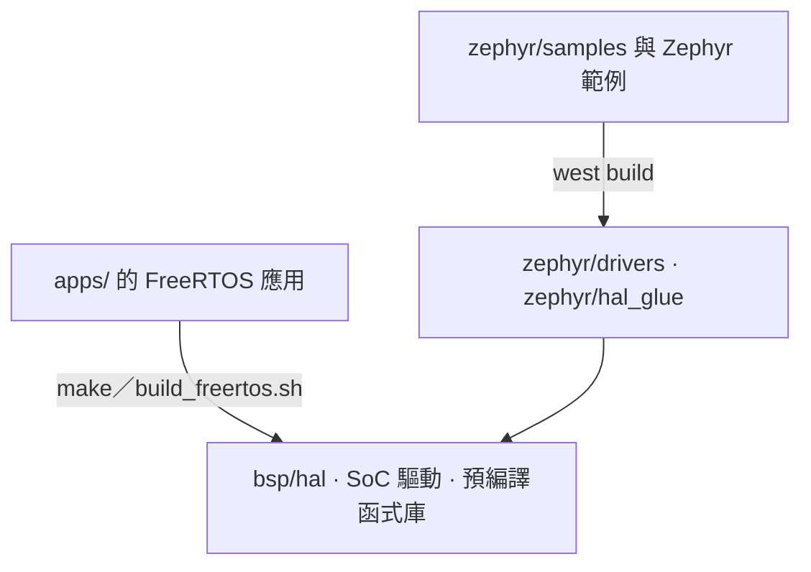

# 系統架構

同一份原始碼樹涵蓋兩款晶片與兩種 RTOS：`apps/` 下 40 個 FreeRTOS 應用（IPRO7 與 IPRO7AI 37 個、IPRO6S 3 個），以及給 IPRO7 用的 Zephyr v4.4.0 模組。兩條路徑共用 HAL、SoC 驅動與預編譯函式庫。建置流程與記憶體配置見[建置系統與設定](build-system.md)。

!!! abstract "重點"
    - 分層：應用（`apps/`）→ 元件（`components/`）→ RTOS（FreeRTOS V11.1.0 或 Zephyr v4.4.0）→ BSP（`bsp/`）→ 晶片。
    - IPRO7 與 IPRO7AI：RISC-V RV32IMAFC（含 DSP 擴充）、BLE 5.4 與 LE Audio、IEEE 802.15.4；IPRO7AI 另有 NPU 與 ISP。連網方式為乙太網路（RMII），或經 SDIO 接 IPRO6S 使用 Wi-Fi；在 IPRO7AI Reef EVK 上，這顆 IPRO6S 就是插在 microSD 插槽的 FIN 卡。
    - IPRO6S：相同核心、晶片內建 Wi-Fi 6，僅支援 FreeRTOS。
    - BLE 控制器、RF 驅動、Wi-Fi 6 MAC、低功耗框架、AI 推論執行庫、ISP 演算法與 LC3 編解碼器以預編譯函式庫提供，其餘為原始碼。
    - 本站所有範例都在 IPRO7AI Reef EVK 上執行；需要其他 INTELPRO 板卡的應用會另外註明。

## 系統總覽 { #overview }

<div class="ipro-stack">
  <div class="l-app"><strong>應用 apps/</strong><span>ai · bluetooth · multimedia · platform · test</span></div>
  <div class="l-host"><strong>元件 components/</strong><span>BLE Host · lwIP · mbedTLS · CherryUSB · audio · ai · fs · shell</span></div>
  <div class="l-hci"><strong>RTOS</strong><span>FreeRTOS V11.1.0 · Zephyr v4.4.0（模組，IPRO7）</span></div>
  <div class="l-ctlr"><strong>BSP bsp/</strong><span>HAL · SoC 驅動 · 板級設定 · 連結腳本</span></div>
  <div style="--layer: #64748b"><strong>晶片</strong><span>IPRO7／IPRO7AI：BLE 5.4 · 802.15.4 · ISP · NPU；IPRO6S：Wi-Fi 6</span></div>
</div>

| 層 | 位置 | 職責 |
|---|---|---|
| 應用 | `apps/<分類>/<應用>/` | 每個應用自帶 `.config`、`CMakeLists.txt` 與 `Makefile`，可單獨建置 |
| 元件 | `components/` | 中介軟體與函式庫；依應用 `.config` 中的 `CONFIG_*` 加入建置 |
| RTOS | `components/os/`、`zephyr/` | FreeRTOS 排程、佇列與計時器，加上共用的 `freertos_app_hooks`；或 Zephyr kernel |
| BSP | `bsp/` | HAL API、暫存器與 SoC 驅動、板級標頭、連結腳本產生器 |

預編譯函式庫連同公開標頭一起提供，建置時自動連結，不需額外設定。函式庫已移除除錯資訊，但保留符號名稱，map 檔與 `nm` 仍可使用。

## FreeRTOS 與 Zephyr { #rtos-paths }



| 項目 | FreeRTOS | Zephyr |
|---|---|---|
| 應用與範例 | `apps/` 下 40 個應用 | `zephyr/samples/` 的 SDK 範例與 Zephyr 上游範例；驅動測試在 `zephyr/tests/` |
| 建置 | `make -C apps/<分類>/<應用>` 或 `./build_freertos.sh` | `tools/zephyr/bootstrap.sh` 建立工作區後以 `west build` 建置 |
| 晶片 | IPRO7、IPRO7AI、IPRO6S | IPRO7、IPRO7AI |
| 板卡 | IPRO7AI Reef EVK（9 個應用、11 組設定）與其他 INTELPRO 板卡 | `ipro7_evb`、`ipro7ai_evk`；本版沒有 Reef 板卡定義 |
| BLE | Zephyr v4.4 Host 經移植層執行於 FreeRTOS，搭配 IPRO BLE 控制器（預編譯函式庫） | Zephyr Host 搭配同一組控制器函式庫 |
| IEEE 802.15.4／Thread | 未提供 | Zephyr IEEE 802.15.4 驅動與 OpenThread |
| 低功耗、相機、音訊 codec、USB、SD Host、乙太網路、NPU | 提供 | 尚未提供 |
| 主控台 | 依應用 `CONFIG_PLATFORM_UART_BAUDRATE`，未設定時 115200 | UART0，2,000,000 baud |

在 Reef 上，以及需要低功耗、相機、音訊或 NPU 的產品，請走 FreeRTOS 路徑。Zephyr 的板卡、範例與燒錄見 [Zephyr RTOS](zephyr.md)。

## 元件 { #components }

以下路徑都在 `components/` 之下。

| 類別 | 路徑 | 內容 |
|---|---|---|
| 藍牙 | `wireless/bluetooth/ipro_bt_host/` | BLE Host，移植自 Zephyr v4.4.0（原始碼） |
| | `wireless/bluetooth/ipro_ble_controller/` | IPRO7 BLE 控制器（預編譯函式庫） |
| 射頻 | `wireless/rf/ipro7_rf/`、`wireless/rf/ipro6_rf/` | IPRO7 與 IPRO6S 的 RF 驅動（預編譯函式庫） |
| | `wireless/ieee802154/` | Zephyr 用的 IEEE 802.15.4 MAC（預編譯函式庫） |
| Wi-Fi 6（IPRO6S） | `wireless/macsw/`、`wireless/wifi6/` | MAC、fhost API、wpa_supplicant 與 lwIP 轉接層（預編譯函式庫） |
| 網路 | `network/lwip/` | lwIP 2.1.2 |
| | `network/ipronet_host/` | 經 SDIO 透過 IPRO6S 使用 Wi-Fi 的 IPRO7 端（netif `iproeth0`）；Reef 的 FIN 卡就是用它 |
| | `network/rtsp_server/` | RTSP MJPEG 影像串流 |
| 安全 | `crypto/mbedtls/` | mbedTLS 2.28.2 |
| 作業系統 | `os/freertos/` | FreeRTOS V11.1.0 核心與共用 hook（`freertos_app_hooks`） |
| | `os/freertos_posix/`、`os/ipro_osal/` | POSIX 層、OS 抽象層 |
| 系統服務 | `sys/shell/`、`sys/ipro_event/`、`sys/ipro_pm/`、`sys/usb_console/` | Shell、事件框架、電源管理、USB 主控台 |
| | `utils/` | 日誌（`ipro_log.h`）與共用工具 |
| 音訊 | `audio/` | 音訊擷取與輸出（DAC、I2S、UAC）、重取樣、喇叭等化、MP3 解碼 |
| AI | `ai/` | NPU 推論執行庫（`lib/libai.a` 與標頭） |
| 影像 | `isp_firmware/`、`isp_algorithm/`、`isp_iq_param/`、`isp_iq_cmd/` | ISP 控制、ISP 演算法（預編譯）、IQ 參數 |
| | `sensor/` | 相機感測器驅動 |
| 板卡函式庫 | `board/ipro7ai_evk/` | IPRO7AI EVK（另一款 INTELPRO 板卡）的函式庫，Reef 不使用 |
| USB | `cherryusb/` | USB 裝置類別：CDC、CDC-ECM、HID、MSC、UAC、UVC |
| 檔案系統 | `fs/` | FatFS、LittleFS、EasyFlash4、EVFS、ROMFS |
| 第三方 | `3rdparty/` | LC3（預編譯）、SBC、Opus、minimp3、TensorFlow Lite Micro、NMSIS-NN、TinyMaix、cJSON、xz、zmodem、Agora RTC SDK（預編譯）等 |

IPRO7 如何連上網路，以及 SDIO 另一端的 IPRO6S 應用，見[網路](networking.md)。

## 目錄結構 { #directory }

```text
IPRO-SDK-V2.2.1/
├── apps/                    FreeRTOS 應用（40 個）
│   ├── ai/                  NPU 與 Edge AI 應用
│   ├── bluetooth/ble/       BLE 範例
│   ├── bluetooth/le_audio/  LE Audio 耳機
│   ├── multimedia/          USB 攝影機、JPEG 解碼、PDM 錄音、雲端語音
│   ├── platform/            晶片與板卡參考、IPRO6S Wi-Fi；common/ 為共用 OTA 程式碼
│   ├── test/                驅動測試、硬體驗證與效能量測（19 個）
│   └── turnkey/common/      共用 USB 主控台程式碼
├── bsp/                     HAL、SoC 驅動（ipro7_soc、ipro6_soc）、板級設定、連結腳本
├── components/              中介軟體與函式庫
├── cmake/                   工具鏈偵測、建置巨集、autoconf.h 產生器
├── tools/                   serial_monitor.py、create_ota.py、teach_web/、zephyr/ 腳本、隨附 CMake、Android 範例 App 原始碼
├── zephyr/                  Zephyr 模組：boards、soc、dts、drivers、samples、tests
├── build_freertos.sh        FreeRTOS 建置、燒錄、監看的前端腳本
├── project.build            各應用 Makefile 呼叫的建置驅動
├── west.yml                 Zephyr west manifest
├── CMakeLists.txt
├── Kconfig
└── VERSION.txt
```

完整應用清單可執行 `./build_freertos.sh -l`，或見[範例](../examples/index.md)。

## BLE 協定堆疊 { #ble-stack }

<div class="ipro-stack">
  <div class="l-app"><strong>應用</strong><span>Zephyr bt_* API</span></div>
  <div class="l-host"><strong>BLE Host（Zephyr v4.4.0）</strong><span>ipro_bt_host：GAP · GATT · L2CAP · SMP · ISO · LE Audio</span></div>
  <div class="l-hci"><strong>晶片內 HCI</strong><span>記憶體內位元組串流（ipro_ble_ctlr_hcitl）</span></div>
  <div class="l-ctlr"><strong>IPRO BLE 控制器（預編譯函式庫）</strong><span>ipro_ble_controller/lib/ · RF 驅動 ipro7_rf</span></div>
</div>

Host 以原始碼提供，經 `ipro_bt_host/port/` 移植層執行於 FreeRTOS；Host 與控制器之間沒有 UART HCI。控制器依 `.config` 的三個設定值，從 16 個 IPRO7 控制器封存檔中選一個連結。本版不含 IPRO6S 的藍牙控制器，IPRO6S 應用只有 Wi-Fi。控制器選擇、初始化順序與 API 用法見 [BLE 開發](ble.md)。

## BSP 與驅動 { #bsp }

| 路徑 | 內容 |
|---|---|
| `bsp/hal/` | HAL API（`inc/hal_*.h`、`src/hal_*.c`） |
| `bsp/hal/lp_framework/` | 低功耗框架：IPRO7 PDS（預編譯 `liblp_framework.a`）、IPRO6S 低功耗韌體映像 |
| `bsp/drivers/ipro7_soc/` | 暫存器定義、啟動碼（`startup/`）、標準驅動（`std_drv/`）、NMSIS-DSP 預編譯函式庫（`DSP/`） |
| `bsp/drivers/ipro6_soc/` | IPRO6S SoC 驅動 |
| `bsp/drivers/soc_common/` | 跨晶片共用的驅動 |
| `bsp/board/ipro7/` | 板級標頭與 `board.c`；`board_config.h` 依板型設定選用標頭，`CONFIG_IPRO7AI_REEF` 對應 `ipro7ai_reef_board_config.h`（見[板型設定](build-system.md#board-keys)） |
| `bsp/board/ipro6/` | IPRO6S 板級檔案 |
| `bsp/board/linker/` | 連結腳本產生器（範本與 `configs/ipro7_flash.cmake`） |
| `bsp/common/platform_utils/` | 平台初始化、主控台 UART 鮑率 |

HAL 涵蓋的周邊：

| 類別 | HAL |
|---|---|
| 通訊 | UART、SPI、I2C、I2S、SDIO |
| 儲存 | SPI Flash、PSRAM、SD Host（SDH）、PIO 軟體 SD Host |
| 類比與計時 | ADC、DAC、AUADC（音訊 ADC）、類比比較器、PWM、計時器、RTC、看門狗 |
| 輸入 | GPIO、QDEC、Keyscan |
| 影像與 AI | DVP 相機、ISP、MJPEG 編碼、NPU |
| 網路 | EMAC 乙太網路、lwIP netif、乙太網路 PHY |
| 安全 | AES、SHA、ECDSA、P-256、GMAC、TRNG |
| 系統 | DMA、時脈、電源管理、boot2 分割表 |

Reef 的腳位、喇叭致能等定義，以 `BOARD_*` 巨集寫在 `bsp/board/ipro7/ipro7ai_reef_board_config.h`；板卡腳位見 [IPRO7AI Reef EVK](../hardware/boards/reef-evk.md#pinout)，晶片腳位功能見[腳位與周邊對照](../hardware/pinmux.md)。

## 在 Reef 上動手做 { #hands-on }

從出廠韌體 `ipro7ai_reef_demo` 看各層如何銜接：`.config` 選定 RTOS 與元件，`main.c` 呼叫共用的平台初始化並使用板級標頭，執行時再由 FreeRTOS shell 看結果。

<div class="ipro-steps" markdown>

1. **設定檔決定用哪些層。** 隨附 `.config` 的這幾行選定晶片、板級標頭、FreeRTOS 與 shell：

    ```ini title="apps/platform/ipro7ai_reef_demo/.config（節錄）"
    CONFIG_IPRO7=y
    CONFIG_CHIP="IPRO7"
    CONFIG_IPRO7AI_REEF=y
    CONFIG_BOARD="IPRO7AI_REEF"
    CONFIG_USE_PSRAM=y
    CONFIG_PLATFORM_UART_BAUDRATE=115200
    CONFIG_FREERTOS_SUPPORT=y
    CONFIG_COMPONENTS_FREERTOS_ENABLE=y
    CONFIG_SHELL=y
    CONFIG_IPRO_LOG_ENABLE=y
    ```

2. **`main()` 各層各碰一次。** `ipro_platform_init()` 來自 `components/os/freertos/freertos_app_hooks`，`BOARD_*` 腳位來自 `bsp/board/ipro7/` 的 Reef 板級標頭，任務則交給 FreeRTOS：

    ```c title="apps/platform/ipro7ai_reef_demo/main.c（節錄）"
    int main(void)
    {
        static StackType_t  s_app_stack[2048];
        static StaticTask_t s_app_tcb;

        ipro_platform_init();   /* heap + boot2 + log + shell */
        ...
        IPRO_LOGI(LOG_TAG, "  IPRO7AI Reef carrier demo");
        IPRO_LOGI(LOG_TAG, "  UART0 TX=%d RX=%d  RGB=G%d  SPK_EN=G%d(hi)",
                  BOARD_UART_TX_PIN, BOARD_UART_RX_PIN, BOARD_RGB_LED_PIN, BOARD_SPK_EN_PIN);
        ...
        xTaskCreateStatic(app_task, "evk_app",
                          sizeof(s_app_stack) / sizeof(StackType_t), NULL,
                          configMAX_PRIORITIES - 2,
                          s_app_stack, &s_app_tcb);
        vTaskStartScheduler();
        ...
    }
    ```

3. **建置。**

    ```bash
    make -C apps/platform/ipro7ai_reef_demo
    ```

    連結 map `apps/platform/ipro7ai_reef_demo/build/build_out/ipro7ai_reef_demo_IPRO7.map` 列出映像用到的每個元件封存檔。

4. **燒錄**，再以 115200 baud 開啟主控台，步驟見[燒錄與序列埠](../get-started/flash-and-monitor.md)。

5. **看執行中的系統。** 開機標語印出來自板級標頭的腳位（略去日誌前綴）：

    ```text
      IPRO7AI Reef carrier demo
      UART0 TX=20 RX=21  RGB=G24  SPK_EN=G25(hi)
    ```

    接著輸入 `free` 與 `ps`，這兩個是 `components/sys/shell` 提供的 FreeRTOS 指令：

    ```text
    Heap: total <bytes>, free <bytes>, min free <bytes>

    Task             State  Prio  Stack   #   CPU%
    ---------------------------------------------------
    ```

    任務清單中有 `evk_app`，也就是 `main()` 建立的應用任務。`help` 會列出映像註冊的所有指令。

</div>

接下來：依[建立第一個自己的應用](../tutorials/first-own-app.md)自己搭出同樣的結構，再用[測試你的應用](../tutorials/testing.md)驗證。

## 相關文件 { #related }

- [建置系統與設定](build-system.md)：建置流程、`.config`、記憶體配置、建立新應用
- [BLE 開發](ble.md)：控制器選擇、初始化順序、GATT 範例
- [網路](networking.md)：乙太網路、lwIP，經 SDIO 透過 IPRO6S 使用 Wi-Fi
- [Zephyr RTOS](zephyr.md)：Zephyr 板卡、範例與燒錄
- [IPRO7AI Reef EVK](../hardware/boards/reef-evk.md)：所有範例使用的板卡
- [IPRO7](../hardware/chips/ipro7.md)、[IPRO7AI](../hardware/chips/ipro7ai.md)、[IPRO6S](../hardware/chips/ipro6s.md)：晶片規格
