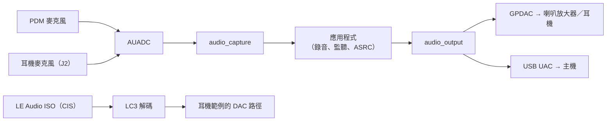
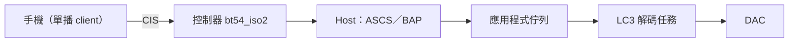

# 音訊與 LE Audio

IPRO7 有接類比與 PDM 麥克風的音訊 ADC（AUADC）、10 位元 DAC（GPDAC）與 I2S。SDK 在其上提供 `components/audio` 的擷取與輸出架構，加上 LC3 等編解碼器、CherryUSB 的 USB 音訊，以及 BLE Host 的 LE Audio 協定。IPRO7AI Reef EVK 的出廠韌體 `ipro7ai_reef_demo` 可從 shell 操作板上每個音訊區塊，它的 `src/audio.c` 就是本頁的參考程式碼。

!!! abstract "重點"
    - Reef 音訊：PDM 麥克風、耳機孔 J2 的耳機麥克風、GPDAC 驅動的喇叭放大器與耳機輸出。`ipro7ai_reef_demo` 可錄音、播放、即時監聽、錄 WAV 檔到 SD 卡（`mic sdrec`），也能把板子變成 USB 麥克風（`mic usb`）。
    - 設定：`CONFIG_AUDIO_CAPTURE=y`、`CONFIG_AUDIO_OUTPUT=y`、`CONFIG_DMA_CHANNEL_ALLOCATOR=y`；USB 音訊再加 `CONFIG_CHERRYUSB_DEVICE_AUDIO=y`。
    - LE Audio：單播耳機 `ipro_le_audio_headset`（`defconfig_reef`），控制器 `bt54_iso2` 搭配 `CONFIG_EM_SIZE=32`，LC3 為預編譯函式庫。其 README 註明從手機播放音訊尚未驗證。
    - 未包含於 V2.2.0：FreeRTOS 的 LE Audio 廣播範例、USB 轉 BLE 的音訊橋接範例。

## 架構 { #overview }



| 部分 | 位置 | 說明 |
|---|---|---|
| 音訊 HAL | `bsp/hal/inc/hal_auadc.h`、`hal_dac.h`、`hal_i2s.h` | 音訊 ADC、DAC、I2S |
| 擷取 | `components/audio/include/audio_capture.h` | 類比麥克風（`AUDIO_SRC_AMIC`）、PDM 麥克風（`AUDIO_SRC_DMIC`）或 I2S（`AUDIO_SRC_I2S`）轉成 16 位元單聲道 PCM；多個使用者各讀一份 |
| 輸出 | `components/audio/include/audio_output.h` | 以同一組 API 輸出到 `AUDIO_OUTPUT_DAC`、`AUDIO_OUTPUT_UAC`、`AUDIO_OUTPUT_I2S`、`AUDIO_OUTPUT_DUMP` |
| 處理 | `audio_resampler.h`、`audio_asrc.h`、`audio_speaker_eq.h`、`audio_bass_boost.h`、`mp3_decoder.h` | 取樣率轉換、含水位控制的時脈漂移重取樣、喇叭等化、低音增強、MP3 解碼 |
| 編解碼器 | `components/3rdparty/liblc3`（預編譯）、`libsbc`、`opus`、`minimp3` | LC3 用於 LE Audio |
| LE Audio | `components/wireless/bluetooth/ipro_bt_host/upstream/zephyr/subsys/bluetooth/audio/` | Zephyr v4.4.0 的 LE Audio 協定原始碼 |
| USB 音訊 | `components/cherryusb/class/audio/` | USB Audio Class 裝置 |

## 音訊硬體 { #audio-hardware }

IPRO7AI Reef EVK V4.0 的音訊區塊，以及程式碼使用的板級標頭名稱（`bsp/board/ipro7/ipro7ai_reef_board_config.h`）：

| 區塊 | 腳位 | 板級標頭 |
|---|---|---|
| PDM 麥克風 MK1 | CLK GPIO16、DATA GPIO17，左聲道 | `BOARD_MIC_CLK_PIN`、`BOARD_MIC_DAT_PIN`、`BOARD_MIC_PDM_CHANNEL` |
| 耳機麥克風（耳機孔 J2） | AIN7（GPIO13）+、AIN6（GPIO12）−，差動輸入 | `BOARD_HSMIC_POS_CH`、`BOARD_HSMIC_NEG_CH` |
| GPDAC 輸出 | DAC 通道 A，GPIO23；同時接耳機級（J2）與喇叭放大器 | `BOARD_SPK_DAC_PIN` |
| 喇叭放大器 PAM8302A（J_SPK） | 致能 GPIO25，高電位開啟 | `BOARD_SPK_EN_PIN`、`BOARD_SPK_EN_ACTIVE`（1） |
| 耳機插入偵測 | GPIO26，低電位表示已插入 | `BOARD_HP_DET_PIN`、`BOARD_HP_DET_ACTIVE`（0） |

- 耳機孔一定收得到 DAC 訊號。「只用耳機」就是讓喇叭放大器保持關閉，沒有其他切換開關。
- PDM 路徑不是剛好 16,000 Hz：標稱 15,875 Hz（2.032 MHz ÷ 128），Reef 實測約 15,872 Hz。`mic sdrec` 會把量到的取樣率寫進 WAV 標頭，`mic usb` 則以 `audio_asrc` 轉成主機的 16,000 Hz。
- `audio_output` 的 DAC 後端固定以 32 kHz 執行（`audio_capture.h` 的 `DAC_RATE`），其他取樣率會先轉換。
- 放大器增益很高（demo README 寫 30 V/V），demo 預設以 20% 振幅播放測試音。
- 設 `CONFIG_DMA_CHANNEL_ALLOCATOR=y`，讓擷取、播放與 USB 等時端點在執行時取得 DMA 通道，不會互相衝突。

耳機孔類型、接頭與完整腳位見 [IPRO7AI Reef EVK](../hardware/boards/reef-evk.md)。IPRO7 EVB 與 IPRO7AI EVK 另有各自的音訊範例（`ipro_pdm_mic_demo`、`ipro7ai_evk_demo`），見各自的板卡頁面。

## 音訊元件 { #audio-framework }

```ini title=".config（音訊，取自 apps/platform/ipro7ai_reef_demo/.config）"
CONFIG_AUDIO_OUTPUT=y
CONFIG_AUDIO_CAPTURE=y
CONFIG_DMA_CHANNEL_ALLOCATOR=y
# 經 audio_output 的 UAC 後端當 USB 麥克風
CONFIG_COMPONENTS_CHERRYUSB_ENABLE=y
CONFIG_CHERRYUSB_DEVICE=y
CONFIG_CHERRYUSB_DEVICE_AUDIO=y
```

| 設定 | 作用 |
|---|---|
| `CONFIG_AUDIO_CAPTURE` | 編入 `audio_capture.c` 與 PDM 麥克風處理鏈 `audio_pdm_mic.c` |
| `CONFIG_AUDIO_OUTPUT` | 編入 `audio_output.c` 與 DAC、dump 後端 |
| `CONFIG_CHERRYUSB_DEVICE_AUDIO` | 與 `CONFIG_AUDIO_OUTPUT` 同時開啟時，也編入 UAC 後端 `audio_output_uac.c` |
| `CONFIG_AUDIO_OUTPUT_UAC_EXCLUDE` | 不編 UAC 後端；應用程式自己實作 USB 音訊裝置時使用（否則兩邊會定義相同的 `usbd_audio_*` 回呼） |
| `CONFIG_BSP_USING_I2S0` | 與 `CONFIG_AUDIO_OUTPUT` 同時開啟時編入 I2S 後端 |

取樣率轉換、時脈漂移重取樣（`audio_asrc`）、喇叭等化與低音增強一律編入。

使用方式：

- `audio_capture_init()` 接收 `audio_capture_cfg_t`（來源類型、取樣率、每框樣本數，以及 PDM 或類比的設定）；`audio_capture_add_consumer()` 回傳一個有獨立緩衝的使用者編號；`audio_capture_start()` 啟動 DMA；`audio_capture_read(id, buf, bytes, timeout_ms)` 取得 PCM。
- `audio_output_create()` 接收 `audio_output_cfg_t`。`AUDIO_OUTPUT_MODE_STREAMING` 以循環 DMA 環形緩衝連續播放，環滿時 `audio_output_write(out, pcm, samples)` 只短暫阻塞；`AUDIO_OUTPUT_MODE_ONESHOT` 會阻塞到整段播完。`audio_output_write()` 的第三個參數是每聲道的樣本數，不是位元組數。
- DAC 後端要給放大器致能腳位與有效電位（`dac_spk_gpio`、`dac_spk_en_active`）；`audio_output_start()` 會打開放大器。

## 在 Reef 上動手做 { #hands-on }

從 PDM 麥克風錄 3 秒、用耳機播放，再錄一個 WAV 檔到 SD 卡，最後把板子當 USB 麥克風。全部在 `ipro7ai_reef_demo` 裡完成；摘錄的程式碼就是您在自己的應用程式中要重用的部分。

<div class="ipro-steps" markdown>

1. **設定**

    應用程式需要的就是 demo `.config` 的音訊設定（見[音訊元件](#audio-framework)），加上 Reef 板卡設定：

    ```ini title="apps/platform/ipro7ai_reef_demo/.config（摘錄）"
    CONFIG_IPRO7AI_REEF=y
    CONFIG_BOARD="IPRO7AI_REEF"
    CONFIG_USE_PSRAM=y
    CONFIG_AUDIO_OUTPUT=y
    CONFIG_AUDIO_CAPTURE=y
    CONFIG_DMA_CHANNEL_ALLOCATOR=y
    ```

2. **程式碼**

    開啟 PDM 麥克風與 DAC 輸出。腳位與電位巨集來自 Reef 板級標頭：

    ```c title="apps/platform/ipro7ai_reef_demo/src/audio.c（摘錄）"
    static audio_output_t *sink_open(uint32_t rate, audio_route_t route)
    {
        audio_output_cfg_t cfg = {
            .type             = AUDIO_OUTPUT_DAC,
            .mode             = AUDIO_OUTPUT_MODE_STREAMING,
            .sample_rate      = rate,
            .channels         = 1,
            .dac_spk_gpio     = BOARD_SPK_EN_PIN,
            .dac_spk_en_active = BOARD_SPK_EN_ACTIVE ? 1 : -1,
        };
        audio_output_t *out = audio_output_create(&cfg);

        if (!out) {
            IPRO_LOGE(LOG_TAG, "audio_output_create failed");
            return NULL;
        }
        if (audio_output_start(out) != 0) {
            IPRO_LOGE(LOG_TAG, "audio_output_start failed");
            audio_output_destroy(out);
            return NULL;
        }
        /* start() switched the amplifier on; the route decides whether it stays. */
        route_apply(route);
        return out;
    }

    static int capture_open(audio_in_t src, uint32_t consumer_bytes, int *consumer)
    {
        audio_capture_cfg_t cfg = {
            .sample_rate   = AUDIO_RATE_HZ,          /* 16000 */
            .frame_samples = AUDIO_FRAME_SAMPLES,    /* 320 = 20 ms */
        };

        switch (src) {
        case AUDIO_IN_PDM:
            cfg.type = AUDIO_SRC_DMIC;
            cfg.dmic.clk_pin         = BOARD_MIC_CLK_PIN;
            cfg.dmic.data_pin        = BOARD_MIC_DAT_PIN;
            cfg.dmic.channel         = (uint8_t)s_pdm_ch;
            cfg.dmic.digital_gain_db = MIC_DIGITAL_GAIN_DB;   /* 18.0f */
            break;
        case AUDIO_IN_HSMIC:
            cfg.type = AUDIO_SRC_AMIC;
            cfg.amic.single_ended = 0;
            cfg.amic.pos_ch       = BOARD_HSMIC_POS_CH;
            cfg.amic.neg_ch       = BOARD_HSMIC_NEG_CH;
            cfg.amic.gain_db      = HSMIC_ANALOG_GAIN_DB; /* 24 */
            break;
        /* ... */
        }

        if (audio_capture_init(&cfg) != 0) {
            return -1;
        }
        *consumer = audio_capture_add_consumer(consumer_bytes);
        if (*consumer < 0) {
            audio_capture_deinit();
            return -1;
        }
        if (audio_capture_start() != 0) {
            audio_capture_deinit();
            return -1;
        }
        return 0;
    }
    ```

    即時監聽（`mic loop`）就是把音框從一端搬到另一端：

    ```c title="apps/platform/ipro7ai_reef_demo/src/audio.c（摘錄自 do_loop）"
    while (!s_stop_req && (frames == 0 || done < frames)) {
        size_t got = audio_capture_read(consumer, chunk, sizeof(chunk), 200);
        if (got == 0) {
            IPRO_LOGW(LOG_TAG, "capture stalled");
            break;
        }
        gain_apply(chunk, got / sizeof(int16_t));
        audio_output_write(out, chunk, got / sizeof(int16_t));
        done++;
    }
    ```

    要在自己的應用程式中使用同一份程式碼，照 `ipro_ble_remote` 的 Reef 建置方式，在 `CMakeLists.txt` 加入 demo 的 `src/audio.c`（它也列出 `audio.c` 會呼叫的 `rgb_led.c`、`keys.c`、`sdcard.c`）。建立應用程式的步驟見[建立第一個應用程式](../tutorials/first-own-app.md)。

3. **建置**

    ```bash
    make -C apps/platform/ipro7ai_reef_demo
    ```

    產出：`apps/platform/ipro7ai_reef_demo/build/build_out/ipro7ai_reef_demo_IPRO7.bin`

4. **燒錄**

    讓 Reef 進入下載模式（按住 SW1、按一下 SW2、放開 SW1），在 IntelProCube 目錄執行燒錄工具：

    ```bash
    cd <ICUBE>
    ./ipro_iot_tool_macos --chipname ipro7 --chip-variant IPRO7AI \
        --port /dev/cu.usbserial-XXXX --baudrate 921600 \
        --pt chips/ipro7/partition/partition_cfg_2M.toml \
        --firmware <SDK>/apps/platform/ipro7ai_reef_demo/build/build_out/ipro7ai_reef_demo_IPRO7.bin
    ```

    確認輸出有 `[All Success]`，再按 SW2。其他作業系統與 `build_freertos.sh` 的用法見[燒錄與序列埠主控台](../get-started/flash-and-monitor.md)。

5. **執行並確認**

    把耳機插進 J2，以 115200 baud 開啟 U6 主控台。開機訊息最後一行是 `REEF: shell ready`，後面列出各組指令。接著：

    ```text
    ipro /> spk tone 1000 500
    1000 Hz for 500 ms at 20% -> speaker+headphone
    ipro /> mic rec pdm 3
    recording 3 s from pdm...
    I (…) AUDIO: recorded 48000 samples from pdm: peak … dBFS, rms … dBFS, dc …, voice band (300-3400 Hz) rms … dBFS; first 100 ms left out (peak there … dBFS)
    ipro /> mic play hp
    playing 48000 samples, +20 dB
    ```

    喇叭與耳機會先響測試音，接著只有耳機播出剛才的錄音（`hp` 讓放大器保持關閉）。插入 FAT 格式的 microSD 卡後：

    ```text
    ipro /> mic sdrec pdm take1 10
    recording 10 s from pdm to sd:/rec/take1.wav (LED red; `mic stop` ends it)
    I (…) AUDIO: sdrec: sd:/rec/take1.wav … samples (10 s) at … Hz, measured … Hz, peak … dBFS, stalls 0
    ipro /> mic usb pdm
    USB microphone from pdm: 16 kHz mono UAC on the board's USB-C (LED red; `mic stop` ends it)
    ```

    `mic usb` 執行期間，接在 Reef USB-C 的電腦會看到一支 USB 麥克風（VID 0x3896、PID 0x0003），可直接錄音；`mic status` 顯示 USB 佇列水位，`mic stop` 結束。

</div>

要把這些檢查變成可重複執行的測試，見[測試您的應用程式](../tutorials/testing.md)。

## LE Audio { #le-audio-pipeline }

LE Audio 經 ISO 通道傳送 LC3 音訊：單播用 CIS，廣播用 BIS。接收端的資料路徑：



`.config` 需要的設定（摘自 `ipro_le_audio_headset/defconfig_reef`）：

```ini title="apps/bluetooth/le_audio/ipro_le_audio_headset/defconfig_reef（摘錄）"
CONFIG_BT_CTLR_IPRO=y
CONFIG_IPRO_BLE_CTLR_LIB="link1_periph"
CONFIG_IPRO_BLE_CTLR_FEATURE="bt54_iso2"
CONFIG_IPRO_BLE_CTLR_CFG_DBG=y
CONFIG_EM_SIZE=32
CONFIG_BT_CONN=1
CONFIG_BT_SETTINGS=y
CONFIG_BT_AUDIO=y
CONFIG_BT_AUDIO_RX=y
CONFIG_COMPONENTS_LC3_ENABLE=y
```

建置系統不會解析 Kconfig 相依，請以完整的 `defconfig_reef` 為起點，不要只抄摘錄；它另外開啟了 BAP、PACS、ASCS、ISO、CAP、CSIP 與 VCP。控制器函式庫的選擇規則見 [BLE 開發](ble.md#controller-variants)。

### 單播耳機 { #unicast-audio }

`apps/bluetooth/le_audio/ipro_le_audio_headset` 以 `IPRO-LE-Audio` 廣播；LE Audio 單播 client 連上後會與板子建立 CIS。

!!! info "本版狀態"
    應用程式 README 說明它是 LE Audio 協定與 ISO 接收路徑的 bring-up，不是完成品耳機：CIS 建立與 ISO 接收路徑已用雙板測試驗證，從手機播放音訊則列為尚未驗證。

| 項目 | 內容 |
|---|---|
| 角色 | BAP 單播伺服器、PACS、ASCS（只有 sink ASE）、CAP acceptor（含 CSIP set member）、VCP 音量 renderer |
| PACS 能力 | LC3，16/32/48 kHz，7.5/10 ms 音框，單聲道，每框 26–155 octets |
| 安全 | SMP 配對；以 `CONFIG_BT_SETTINGS` 把配對資訊存在 Flash |
| 控制器 | `link1_periph`／`bt54_iso2`，EM 32 KB，除錯版函式庫（`CONFIG_IPRO_BLE_CTLR_CFG_DBG=y`） |

```bash
make -C apps/bluetooth/le_audio/ipro_le_audio_headset DEFCONFIG=defconfig_reef   # 產出在 build_reef/build_out/
```

在 Reef 上，`defconfig_reef` 是 DAC 版本：輸出到 GPDAC（J2 耳機；J2 沒插耳機時也送到喇叭放大器），SW3、SW4 調低與調高音量，SW5 靜音，都經 VCP 音量 renderer。這個應用程式的其他設定檔（`.config`、`DAC.config`、`UAC.config`）是給 IPRO7 EVB 用的。建置、配對與確認方式見 [LE Audio 入門](../tutorials/le-audio.md)。

`src/bap_server.c` 註冊 PACS 與 ASCS 的方式（摘錄並簡化：已移除日誌與條件編譯；`unicast_server_cb` 定義在同一檔案）：

```c title="apps/bluetooth/le_audio/ipro_le_audio_headset/src/bap_server.c（摘錄）"
static const struct bt_audio_codec_cap lc3_sink_codec_cap =
	BT_AUDIO_CODEC_CAP_LC3(BT_AUDIO_CODEC_CAP_FREQ_16KHZ |
				       BT_AUDIO_CODEC_CAP_FREQ_32KHZ |
				       BT_AUDIO_CODEC_CAP_FREQ_48KHZ,
			       BT_AUDIO_CODEC_CAP_DURATION_7_5 |
				       BT_AUDIO_CODEC_CAP_DURATION_10 |
				       BT_AUDIO_CODEC_CAP_DURATION_PREFER_10,
			       BT_AUDIO_CODEC_CAP_CHAN_COUNT_SUPPORT(1),
			       26, 155, 1,
			       BT_AUDIO_CONTEXT_TYPE_MEDIA |
				       BT_AUDIO_CONTEXT_TYPE_CONVERSATIONAL);

static struct bt_pacs_cap lc3_sink_cap = {
	.codec_cap = &lc3_sink_codec_cap,
};

int bap_server_init(void)
{
	struct bt_pacs_register_param pacs_param = {
		.snk_pac = true,
		.snk_loc = true,
	};
	struct bt_bap_unicast_server_register_param server_param = {
		.snk_cnt = CONFIG_BT_ASCS_MAX_ASE_SNK_COUNT,
		.src_cnt = CONFIG_BT_ASCS_MAX_ASE_SRC_COUNT,
	};
	int err;

	err = bt_pacs_register(&pacs_param);                     /* 1. PACS service */
	if (err != 0 && err != -EALREADY) {
		return err;
	}
	err = bt_pacs_cap_register(BT_AUDIO_DIR_SINK, &lc3_sink_cap);  /* 2. LC3 capability */
	if (err != 0) {
		return err;
	}
	err = bt_pacs_set_location(BT_AUDIO_DIR_SINK, BT_AUDIO_LOCATION_FRONT_LEFT);
	if (err != 0) {
		return err;
	}
	bt_pacs_set_supported_contexts(BT_AUDIO_DIR_SINK,
				       BT_AUDIO_CONTEXT_TYPE_MEDIA |
				       BT_AUDIO_CONTEXT_TYPE_CONVERSATIONAL |
				       BT_AUDIO_CONTEXT_TYPE_UNSPECIFIED);
	bt_pacs_set_available_contexts(BT_AUDIO_DIR_SINK,
				       BT_AUDIO_CONTEXT_TYPE_MEDIA |
				       BT_AUDIO_CONTEXT_TYPE_CONVERSATIONAL |
				       BT_AUDIO_CONTEXT_TYPE_UNSPECIFIED);

	err = bt_bap_unicast_server_register(&server_param);      /* 3. ASCS endpoints */
	if (err != 0 && err != -EALREADY) {
		return err;
	}
	return bt_bap_unicast_server_register_cb(&unicast_server_cb);  /* 4. BAP callbacks */
}
```

### 廣播 { #broadcast-audio }

本版沒有 FreeRTOS 的 BIS 廣播應用程式。Host 內含 `bt_bap_broadcast_source_*` 與 `bt_bap_broadcast_sink_*` API，`zephyr/samples/bap_broadcast_source` 與 `bap_broadcast_sink` 示範在 Zephyr 下於 IPRO7 EVB 與 IPRO7AI EVK 上使用；Reef 沒有 Zephyr 板卡定義（見 [Zephyr RTOS](zephyr.md)）。

### 協定 { #audio-profiles }

Host 的 `subsys/bluetooth/audio/` 含 Zephyr v4.4.0 的 LE Audio 協定原始碼（BAP、CAP、PACS、ASCS、VCP、CSIP、MICP、MCP、TMAP 等）。耳機範例開啟的有：

| 協定 | `.config` | 角色 |
|---|---|---|
| BAP | `CONFIG_BT_BAP_UNICAST_SERVER=y` | 單播伺服器 |
| PACS | `CONFIG_BT_PACS=y`、`CONFIG_BT_PAC_SNK=y` | 發布 sink 能力 |
| ASCS | `CONFIG_BT_ASCS=y` | 音訊串流端點 |
| CAP | `CONFIG_BT_CAP_ACCEPTOR=y` | Acceptor |
| CSIP | `CONFIG_BT_CSIP_SET_MEMBER=y` | Set member |
| VCP | `CONFIG_BT_VCP_VOL_REND=y` | 音量 renderer |

### LC3 { #lc3 }

- 預編譯函式庫 `components/3rdparty/liblc3/lib/libliblc3.a`，標頭 `lc3.h`；以 `CONFIG_COMPONENTS_LC3_ENABLE=y` 加入。
- 位元率 16 至 320 kbps（`LC3_MIN_BITRATE`、`LC3_MAX_BITRATE`）。
- `components/3rdparty` 的其他編解碼器：SBC（`libsbc`）、Opus（`opus`，`ipro_agora_sentino` 使用）、minimp3。

## USB 音訊 { #usb-audio }

USB 音訊使用 CherryUSB 的 UAC 裝置類別，走 Reef 的 USB-C（Full Speed）：

```ini
CONFIG_COMPONENTS_CHERRYUSB_ENABLE=y
CONFIG_CHERRYUSB_DEVICE=y
CONFIG_CHERRYUSB_DEVICE_AUDIO=y
```

再加上 `CONFIG_AUDIO_OUTPUT=y`，`audio_output` 就有 UAC 後端：以 `.type = AUDIO_OUTPUT_UAC` 建立輸出，寫入 PCM 的方式與 DAC 相同。`ipro7ai_reef_demo` 有兩個指令用到它：

| 指令 | USB 裝置 | 作用 |
|---|---|---|
| `mic usb <pdm\|headset>` | 16 kHz 單聲道麥克風 | 把選定的麥克風串流給主機。擷取經過 `audio_asrc`，水位控制把 UAC 佇列維持在約 1,800 個樣本，較慢的 PDM 時脈不會讓主機端斷流 |
| `mic usb host` | 16 kHz 單聲道喇叭兼麥克風 | 數位注入用的回送：主機播進板子的聲音經弱符號掛鉤 `audio_usbhost_process()` 後，再以麥克風送回 |

兩者都以 VID 0x3896、PID 0x0003 列舉。自己實作 USB 音訊裝置的應用程式要設 `CONFIG_AUDIO_OUTPUT_UAC_EXCLUDE=y`。IPRO7 EVB 的範例 `ipro_pdm_mic_demo` 與 `ipro_le_audio_headset` 的 `UAC.config` 各有自己的 UAC 裝置。

## PDM 錄音 { #pdm-recording }

`ipro7ai_reef_demo` 可從 PDM 麥克風（`pdm`）或耳機麥克風（`headset`）錄音：

| 指令 | 錄到哪裡 | 上限 |
|---|---|---|
| `mic rec <src> <s>` | PSRAM，16 kHz 單聲道；`mic play [hp]` 加上補償增益後播放 | 10 秒 |
| `mic sdrec <src> <name> <s>` | `sd:/rec/<name>.wav`，16 位元單聲道；標頭寫入量到的取樣率 | 2 小時 |
| `mic loop <src> [s] [hp]` | 即時監聽到輸出；不給秒數就持續到 `mic stop` | — |

- `mic gain <dB>` 設定播放補償增益（0–40 dB，預設 20 dB）；`mic ch <0|1>` 選擇 PDM 聲道。
- `mic status` 顯示最後一段錄音的峰值、RMS 與語音頻帶（300–3,400 Hz）位準，單位 dBFS。開始後的前 100 ms 不計入，因為降頻濾波器啟動時有一個階躍。
- `mic sdrec` 每 30 秒同步一次檔案，突然斷電最多只會遺失最後 30 秒。量到的取樣率若與標稱的 15,875 Hz 相差超過 80 Hz，會回報有樣本遺失，並在標頭改寫 15,875 Hz。
- 麥克風監聽送到喇叭會嘯叫，請用耳機並加 `hp`。

IPRO7 EVB 與 IPRO7AI EVK 的 PDM 錄音範例是 `ipro_pdm_mic_demo`（以 LC3 經 BLE 傳送，Android 範例 App 原始碼在 `tools/android/IproMicDemo/`）。

## 本版限制 { #limitations }

- `ipro_le_audio_headset`：從手機播放音訊尚未驗證（見其 README）；耳機沒有 source ASE，不會把麥克風聲音送回手機。
- FreeRTOS 沒有 LE Audio 廣播範例；廣播只有 IPRO7 EVB 與 IPRO7AI EVK 用的 Zephyr 範例。
- `bt54_iso2` 至少需要 32 KB EM，而控制器的 PDS 睡眠只支援 16 KB EM，因此 LE Audio 設定下控制器不會進入 PDS。
- Reef V4.0 沒有線路輸入；demo README 裡的 `aux` 來源與 AUX-IN 說明是前一版載板的內容。
- 未包含 USB 轉 BLE 的音訊橋接範例。

## 相關範例與文件 { #reference-apps }

| 範例 | Reef 設定 | 內容 |
|---|---|---|
| `ipro7ai_reef_demo` | `.config` | 喇叭、耳機、PDM 與耳機麥克風、SD 卡錄音、USB 麥克風；見 [ipro7ai_reef_demo](../examples/ipro7ai_reef_demo.md) |
| `ipro_le_audio_headset` | `defconfig_reef` | LE Audio 單播耳機，DAC 版本；見 [ipro_le_audio_headset](../examples/ipro_le_audio_headset.md) |
| `ipro_ble_remote` | `defconfig_reef` | Reef 硬體服務重用 demo 的 `audio.c` |
| `ipro_reef_teach` | `.config` | `voice` 模式：以 PDM 麥克風做聲紋辨識；見[聲紋辨識](../teach/voice.md) |

- [LE Audio 入門](../tutorials/le-audio.md)
- [BLE 開發](ble.md)：控制器選擇、啟動順序與 GATT
- [音訊 API](../reference/api/audio.md)
- [IPRO7AI Reef EVK](../hardware/boards/reef-evk.md)：耳機孔、喇叭接頭與腳位
