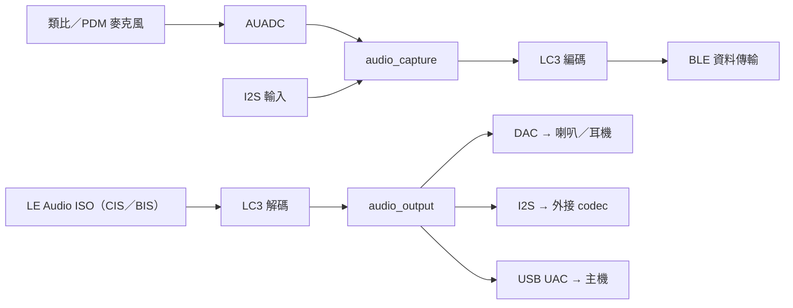

# 音訊與 LE Audio

IPRO7 晶片內有音訊 ADC（接類比或 PDM 麥克風）、DAC 與 I2S。SDK 在其上提供 `components/audio` 的擷取與輸出元件、LC3 等編解碼器、CherryUSB 的 USB 音訊，以及 BLE Host 的 LE Audio 協定。IPRO7AI Reef EVK 板上的喇叭、耳機與麥克風見 [IPRO7AI Reef EVK](../hardware/boards/reef-evk.md)。

!!! abstract "重點"
    - LE Audio：FreeRTOS 範例是單播接收端（耳機角色）：`ipro_le_audio_headset`，以及 `ipro7ai_evk_demo` 的 `config_bt`。廣播的 source 與 sink 只有 Zephyr 範例。
    - LE Audio 需要控制器 `bt54_iso2` 與 `CONFIG_EM_SIZE=32`；LC3 是預編譯函式庫，以 `CONFIG_COMPONENTS_LC3_ENABLE=y` 加入。
    - USB 音訊：耳機的 `UAC.config` 把解碼後的音訊當成 48 kHz 單聲道 USB 麥克風送給主機；`ipro_pdm_mic_demo` 把 PDM 錄音當成 16 kHz 單聲道 USB 麥克風輸出。
    - 未包含於 V2.1.0：USB 轉 BLE 的音訊橋接範例、FreeRTOS 的 LE Audio 廣播範例。

## 架構 { #overview }



| 部分 | 位置 | 說明 |
|---|---|---|
| 音訊 HAL | `bsp/hal/inc/hal_auadc.h`、`hal_dac.h`、`hal_i2s.h` | 音訊 ADC、DAC、I2S |
| 擷取 | `components/audio/include/audio_capture.h` | 類比麥克風、PDM 麥克風或 I2S 輸入，產生 16-bit 單聲道 PCM，最多 4 個消費者各自讀取 |
| 輸出 | `components/audio/include/audio_output.h` | 同一組 API 輸出到 DAC、I2S、UAC 或 dump |
| 處理 | `audio_resampler.h`、`audio_asrc.h`、`audio_speaker_eq.h`、`audio_bass_boost.h`、`mp3_decoder.h` | 重取樣、時脈漂移補償、喇叭 EQ、低音增強、MP3 解碼 |
| 編解碼器 | `components/3rdparty/liblc3`（預編譯）、`libsbc`、`opus`、`minimp3` | LC3 供 LE Audio 與 BLE 語音串流 |
| LE Audio | `components/wireless/bluetooth/ipro_bt_host/upstream/zephyr/subsys/bluetooth/audio/` | Zephyr v4.4.0 的 LE Audio 協定原始碼 |
| USB 音訊 | `components/cherryusb/class/audio/` | USB Audio Class device |

## 音訊硬體 { #audio-hardware }

| 硬體 | HAL | 說明 |
|---|---|---|
| AUADC | `hal_auadc.h` | 音訊 ADC，接類比麥克風或 PDM 數位麥克風；驅動提供 16 或 20 位元解析度 |
| GPDAC | `hal_dac.h` | 兩個 10 位元 DAC 通道，接外部放大器或耳機緩衝 |
| I2S | `hal_i2s.h` | 接外部音訊 codec |
| DMA | `hal_dma.h` | 擷取與播放的資料搬移 |

- `audio_output` 的 DAC 後端以固定 32 kHz 輸出，其他取樣率會先重取樣。
- 喇叭放大器的致能腳位與極性由板級標頭定義：`BOARD_SPK_EN_PIN`、`BOARD_SPK_EN_ACTIVE`（致能時的電位）。未定義 `BOARD_SPK_EN_ACTIVE` 時視為低電位致能。移植到新板時要依放大器設定這兩個值。
- 同時擷取與播放（例如麥克風監聽）時設 `CONFIG_DMA_CHANNEL_ALLOCATOR=y`，讓 DMA 通道在執行時分配。

各板的麥克風與喇叭：

| 板卡 | 麥克風 | 喇叭輸出 |
|---|---|---|
| IPRO7AI Reef EVK | PDM 麥克風、耳機麥克風、AUX-IN | DAC → 喇叭放大器與耳機孔，見 [IPRO7AI Reef EVK](../hardware/boards/reef-evk.md) |
| IPRO7AI EVK | IM69D129 PDM 麥克風（GPIO18／19） | DAC（GPIO23）→ TPA2037D1，致能 GPIO22 高電位有效，見 [IPRO7AI EVK](../hardware/boards/ipro7ai-evk.md) |
| IPRO7 EVB | 外接 PDM 麥克風模組（`ipro_pdm_mic_demo` 用 GPIO0 CLK、GPIO1 DATA） | DAC → 板上放大器，見 [IPRO7 EVB](../hardware/boards/ipro7-evb.md) |

## 音訊元件 { #audio-framework }

在 `.config` 加入：

```ini
CONFIG_AUDIO_CAPTURE=y
CONFIG_AUDIO_OUTPUT=y
CONFIG_DMA_CHANNEL_ALLOCATOR=y
```

`audio_capture` 產生 16-bit 單聲道 PCM 影格，`audio_capture_read()` 由各消費者自己的 StreamBuffer 取資料。`audio_output` 的串流模式（`AUDIO_OUTPUT_MODE_STREAMING`）以環狀 DMA 連續播放，`audio_output_write()` 只在環狀緩衝滿時短暫阻塞；單次模式（`AUDIO_OUTPUT_MODE_ONESHOT`）會阻塞到整段播完。

下例在 Reef 上把 PDM 麥克風即時送到喇叭，`BOARD_MIC_*` 與 `BOARD_SPK_*` 由 Reef 的板級標頭定義：

```c title="PDM 麥克風監聽（依 apps/platform/ipro7ai_reef_demo/src/audio.c）"
#include <FreeRTOS.h>
#include <task.h>

#include "board_config.h"
#include "audio_capture.h"
#include "audio_output.h"

#define RATE_HZ        16000u
#define FRAME_SAMPLES  320u    /* 20 ms */

static void mic_monitor_task(void *arg)
{
    static int16_t frame[FRAME_SAMPLES];
    audio_capture_cfg_t in_cfg = {
        .type          = AUDIO_SRC_DMIC,
        .sample_rate   = RATE_HZ,
        .frame_samples = FRAME_SAMPLES,
        .dmic = {
            .clk_pin         = BOARD_MIC_CLK_PIN,
            .data_pin        = BOARD_MIC_DAT_PIN,
            .channel         = 0,       /* 左聲道 */
            .digital_gain_db = 18.0f,
        },
    };
    audio_output_cfg_t out_cfg = {
        .type              = AUDIO_OUTPUT_DAC,
        .mode              = AUDIO_OUTPUT_MODE_STREAMING,
        .sample_rate       = RATE_HZ,
        .channels          = 1,
        .dac_spk_gpio      = BOARD_SPK_EN_PIN,
        .dac_spk_en_active = BOARD_SPK_EN_ACTIVE ? 1 : -1,
    };
    audio_output_t *out;
    int id;

    (void)arg;
    if (audio_capture_init(&in_cfg) != 0) {
        vTaskDelete(NULL);
    }
    id = audio_capture_add_consumer(sizeof(frame) * 8);
    out = audio_output_create(&out_cfg);
    if (id < 0 || out == NULL ||
        audio_capture_start() != 0 || audio_output_start(out) != 0) {
        vTaskDelete(NULL);
    }
    for (;;) {
        size_t n = audio_capture_read(id, frame, sizeof(frame), 100);
        if (n > 0) {
            /* 第三個參數是每聲道的樣本數 */
            audio_output_write(out, frame, n / sizeof(int16_t));
        }
    }
}
```

實作 USB 音訊裝置的應用若不使用 `audio_output` 的 UAC 後端，要設 `CONFIG_AUDIO_OUTPUT_UAC_EXCLUDE=y`，避免兩邊的 `usbd_audio_*` 回呼名稱衝突。

## LE Audio { #le-audio-pipeline }

LE Audio 以 ISO 通道傳送 LC3 音訊：單播用 CIS，廣播用 BIS。接收端的資料路徑如下：


`.config` 需要的設定（節錄自 `ipro_le_audio_headset`）：

```ini title=".config（節錄）"
CONFIG_BLUETOOTH_LE_ENABLE=y
CONFIG_BT_CTLR_IPRO=y
CONFIG_BT_HOST_IPRO_V44=y
CONFIG_IPRO_BLE_CTLR_LIB="link1_periph"
CONFIG_IPRO_BLE_CTLR_FEATURE="bt54_iso2"
CONFIG_EM_SIZE=32
CONFIG_BT_CONN=1
CONFIG_BT_PERIPHERAL=y
CONFIG_BT_EXT_ADV=y
CONFIG_BT_SMP=y
CONFIG_BT_AUDIO=y
CONFIG_BT_AUDIO_RX=y
CONFIG_BT_BAP_UNICAST_SERVER=y
CONFIG_BT_PACS=y
CONFIG_BT_PAC_SNK=y
CONFIG_BT_ASCS=y
CONFIG_BT_ASCS_MAX_ASE_SNK_COUNT=2
CONFIG_BT_ASCS_MAX_ASE_SRC_COUNT=0
CONFIG_BT_ISO=y
CONFIG_BT_ISO_RX=y
CONFIG_BT_ISO_PERIPHERAL=y
CONFIG_BT_VCP_VOL_REND=y
CONFIG_BT_CAP_ACCEPTOR=y
CONFIG_BT_CSIP_SET_MEMBER=y
CONFIG_COMPONENTS_LC3_ENABLE=y
```

建置不會解析 Kconfig 的相依關係，請以整份 `apps/bluetooth/le_audio/ipro_le_audio_headset/.config` 為起點修改，不要只抄節錄。控制器封存檔的選擇規則見 [BLE 開發](ble.md#controller-variants)。

### 單播耳機 { #unicast-audio }

`apps/bluetooth/le_audio/ipro_le_audio_headset` 以 `IPRO-LE-Audio` 名稱廣播，手機以 LE Audio 單播連線後串流 LC3 到板子。

!!! info "範例定位"
    此應用是 LE Audio 協定與 ISO 資料路徑的參考範例，不是完成的耳機產品。

| 項目 | 內容 |
|---|---|
| 角色 | BAP 單播 server、PACS、ASCS（2 個 sink ASE，無 source ASE）、CAP acceptor 與 CSIP set member、VCP 音量 renderer |
| PACS 能力 | LC3，16／32／48 kHz，7.5／10 ms 影格，單聲道，每影格 26–155 octets，每個 SDU 1 個影格，位置 front-left |
| 安全性 | SMP 配對，配對資料以 `CONFIG_BT_SETTINGS` 存入 Flash |
| 控制器 | `link1_periph`／`bt54_iso2`，EM 32 KB；所有設定都使用除錯版封存檔（`CONFIG_IPRO_BLE_CTLR_CFG_DBG=y`） |

輸出方式由設定檔決定：

| 設定檔 | 板卡 | 解碼後的輸出 |
|---|---|---|
| `.config` | IPRO7 EVB | 晶片內 DAC 與喇叭 |
| `UAC.config` | IPRO7 EVB | USB 麥克風（48 kHz 單聲道）送到主機 |
| `defconfig_reef` | IPRO7AI Reef EVK | DAC，喇叭與耳機孔 |

```bash
make -C apps/bluetooth/le_audio/ipro_le_audio_headset                           # IPRO7 EVB，DAC 輸出
make -C apps/bluetooth/le_audio/ipro_le_audio_headset DEFCONFIG=defconfig_reef  # Reef，輸出於 build_reef/
```

`UAC.config` 以複製覆蓋 `.config` 的方式選用：`cp UAC.config .config && make clean && make`。

`src/bap_server.c` 註冊 PACS 與 ASCS 的順序（節錄並簡化，省略記錄輸出與條件編譯；回呼結構 `unicast_server_cb` 定義在同一檔案）：

```c title="apps/bluetooth/le_audio/ipro_le_audio_headset/src/bap_server.c（節錄）"
static const struct bt_audio_codec_cap lc3_sink_codec_cap =
	BT_AUDIO_CODEC_CAP_LC3(BT_AUDIO_CODEC_CAP_FREQ_16KHZ |
				       BT_AUDIO_CODEC_CAP_FREQ_32KHZ |
				       BT_AUDIO_CODEC_CAP_FREQ_48KHZ,
			       BT_AUDIO_CODEC_CAP_DURATION_7_5 |
				       BT_AUDIO_CODEC_CAP_DURATION_10 |
				       BT_AUDIO_CODEC_CAP_DURATION_PREFER_10,
			       BT_AUDIO_CODEC_CAP_CHAN_COUNT_SUPPORT(1),
			       26, 155, 1,
			       BT_AUDIO_CONTEXT_TYPE_MEDIA |
				       BT_AUDIO_CONTEXT_TYPE_CONVERSATIONAL);

static struct bt_pacs_cap lc3_sink_cap = {
	.codec_cap = &lc3_sink_codec_cap,
};

int bap_server_init(void)
{
	struct bt_pacs_register_param pacs_param = {
		.snk_pac = true,
		.snk_loc = true,
	};
	struct bt_bap_unicast_server_register_param server_param = {
		.snk_cnt = CONFIG_BT_ASCS_MAX_ASE_SNK_COUNT,
		.src_cnt = CONFIG_BT_ASCS_MAX_ASE_SRC_COUNT,
	};
	int err;

	err = bt_pacs_register(&pacs_param);                     /* 1. PACS 服務 */
	if (err != 0 && err != -EALREADY) {
		return err;
	}
	err = bt_pacs_cap_register(BT_AUDIO_DIR_SINK, &lc3_sink_cap);  /* 2. LC3 能力 */
	if (err != 0) {
		return err;
	}
	err = bt_pacs_set_location(BT_AUDIO_DIR_SINK, BT_AUDIO_LOCATION_FRONT_LEFT);
	if (err != 0) {
		return err;
	}
	bt_pacs_set_supported_contexts(BT_AUDIO_DIR_SINK,
				       BT_AUDIO_CONTEXT_TYPE_MEDIA |
				       BT_AUDIO_CONTEXT_TYPE_CONVERSATIONAL |
				       BT_AUDIO_CONTEXT_TYPE_UNSPECIFIED);
	bt_pacs_set_available_contexts(BT_AUDIO_DIR_SINK,
				       BT_AUDIO_CONTEXT_TYPE_MEDIA |
				       BT_AUDIO_CONTEXT_TYPE_CONVERSATIONAL |
				       BT_AUDIO_CONTEXT_TYPE_UNSPECIFIED);

	err = bt_bap_unicast_server_register(&server_param);      /* 3. ASCS 的 ASE */
	if (err != 0 && err != -EALREADY) {
		return err;
	}
	return bt_bap_unicast_server_register_cb(&unicast_server_cb);  /* 4. BAP 回呼 */
}
```

`apps/platform/ipro7ai_evk_demo` 的 `config_bt` 是另一個單播接收端範例：IPRO7AI EVK 上以 `link1`／`bt54_iso2` 接收，經 `audio_output` 由板上喇叭播放。建置：`make -C apps/platform/ipro7ai_evk_demo DEFCONFIG=config_bt`。

### 廣播 { #broadcast-audio }

V2.1.0 的 FreeRTOS 應用沒有 BIS 廣播範例。Host 原始碼包含 `bt_bap_broadcast_source_*` 與 `bt_bap_broadcast_sink_*` API，廣播的參考實作在 Zephyr 範例：

| Zephyr 範例 | 板卡 | 內容 |
|---|---|---|
| `zephyr/samples/bap_broadcast_source` | `ipro7_evb`、`ipro7ai_evk` | 以 2 個 BIS 廣播 16 kHz LC3 正弦波，名稱 `IPRO7 Broadcast Source` |
| `zephyr/samples/bap_broadcast_sink` | `ipro7ai_evk` | 同步到上述廣播，解碼後由 EVK 喇叭播放 |
| `zephyr/samples/le_audio_headset` | `ipro7ai_evk` | 單播耳機，與 FreeRTOS 版使用相同的控制器封存檔與 PACS 能力 |

在 Zephyr 工作區中建置：

```bash
west build -p always -b ipro7_evb ../zephyr/samples/bap_broadcast_source
west build -p always -b ipro7ai_evk ../zephyr/samples/bap_broadcast_sink
```

工作區的建立與燒錄見 [Zephyr RTOS](zephyr.md)。

### 協定 { #audio-profiles }

Host 的 `subsys/bluetooth/audio/` 含 Zephyr v4.4.0 的 LE Audio 協定原始碼（BAP、CAP、PACS、ASCS、VCP、CSIP、MICP、MCP、TMAP 等）。隨附的 FreeRTOS 耳機範例啟用的是：

| 協定 | `.config` | 角色 |
|---|---|---|
| BAP | `CONFIG_BT_BAP_UNICAST_SERVER=y` | 單播 server |
| PACS | `CONFIG_BT_PACS=y`、`CONFIG_BT_PAC_SNK=y` | 公布 sink 能力 |
| ASCS | `CONFIG_BT_ASCS=y` | 音訊串流端點 |
| CAP | `CONFIG_BT_CAP_ACCEPTOR=y` | Acceptor |
| CSIP | `CONFIG_BT_CSIP_SET_MEMBER=y` | Set member |
| VCP | `CONFIG_BT_VCP_VOL_REND=y` | 音量 renderer |

隨附範例沒有啟用 MCP（媒體控制）。

### LC3 { #lc3 }

- 預編譯函式庫 `components/3rdparty/liblc3/lib/libliblc3.a`，標頭 `lc3.h`；以 `CONFIG_COMPONENTS_LC3_ENABLE=y` 加入建置。
- 位元率 16–320 kbps（`LC3_MIN_BITRATE`、`LC3_MAX_BITRATE`）。
- 使用者：`ipro_le_audio_headset` 與 `ipro7ai_evk_demo`（`config_bt`）解碼 LE Audio 串流；`ipro_pdm_mic_demo` 以 16 kHz、10 ms 影格、每影格 40 位元組（32 kbps）編碼後經 BLE 傳送。
- 其他編解碼器：SBC（`3rdparty/libsbc`）、Opus（`3rdparty/opus`，`ipro_agora_sentino` 使用）、minimp3（`ipro7_demo` 使用）。

## USB 音訊 { #usb-audio }

USB 音訊使用 CherryUSB 的 UAC device class：

```ini
CONFIG_COMPONENTS_CHERRYUSB_ENABLE=y
CONFIG_CHERRYUSB_DEVICE=y
CONFIG_CHERRYUSB_DEVICE_AUDIO=y
```

| 範例 | USB 裝置 | 資料來源 |
|---|---|---|
| `ipro_le_audio_headset`（`UAC.config`） | 48 kHz 單聲道麥克風 | 解碼後的 LE Audio 串流 |
| `ipro_pdm_mic_demo` | 16 kHz 單聲道麥克風（`src/uac_mic.c`） | PDM 麥克風，供主機直接錄音 |
| `ipro7_demo` | USB 音訊裝置示範 | `demo/soc/usb_demo/uac_v1_template.c` |

`audio_output` 的 UAC 後端在 `CONFIG_CHERRYUSB_DEVICE_AUDIO=y` 時一起建置；應用自己實作 UAC 裝置時（例如 `ipro_pdm_mic_demo`）設 `CONFIG_AUDIO_OUTPUT_UAC_EXCLUDE=y`。

## PDM 錄音 { #pdm-recording }

`apps/multimedia/ipro_pdm_mic_demo` 示範 PDM 麥克風擷取、DAC 播放與 BLE 傳輸：

- 擷取：16 kHz、16-bit 單聲道，DMA 乒乓緩衝。
- 錄音：邏輯長度最長 4 小時；PSRAM 環狀緩衝保留最近 240 秒（約 7.68 MB），每 30 秒以 `CHUNK_READY` 通知手機取回該段。
- BLE：以 Nordic UART Service 收發命令與資料，裝置名稱 `IPRO-MIC`；即時串流可用 LC3 壓縮。控制器 `link2`／`bt52`，EM 16 KB，`CONFIG_BT_CONN=1`。
- 配對資料以 `CONFIG_BT_SETTINGS` 與 `CONFIG_EASYFLASH4` 存入 Flash，PDS31 睡眠喚醒後可用既有配對重新連線。
- USB：同時列舉為 16 kHz 單聲道 USB 麥克風。
- Android 範例 App 原始碼：`tools/android/IproMicDemo/`。

| 板卡 | 建置 | 輸出 | 主控台 |
|---|---|---|---|
| IPRO7 EVB | `make -C apps/multimedia/ipro_pdm_mic_demo` | `build/build_out/` | 115200 baud |
| IPRO7AI EVK | `make -C apps/multimedia/ipro_pdm_mic_demo BOARD=evk` | `build_config_evk/build_out/` | 921600 baud |

常用 shell 指令：

| 指令 | 說明 |
|---|---|
| `pdm_rec [秒]` | 錄音（1–14400 秒，預設 5 秒） |
| `pdm_stats` | 錄音長度、峰值、RMS、dBFS |
| `pdm_dump [offset] [count]` | 印出 PCM 樣本值 |
| `pdm_gain <dB>` | PDM 數位增益 |
| `pdm_ch left\|right` | 選擇 PDM 聲道 |
| `pdm_stream on\|off` | 開始或停止 BLE 即時串流 |
| `pdm_lc3 on\|off` | 串流時是否使用 LC3 壓縮 |

## 本版限制 { #limitations }

- FreeRTOS 沒有 LE Audio 廣播範例，廣播請參考上述 Zephyr 範例。
- 隨附的 LE Audio 範例只做接收：耳機沒有 source ASE，不會把麥克風音訊回傳手機。
- `bt54_iso2` 至少需要 32 KB EM，而控制器的 PDS 睡眠只支援 16 KB EM 的配置，因此 LE Audio 組態下控制器不會進入 PDS。
- 未包含 USB 轉 BLE 的音訊橋接範例。

## 相關範例與文件 { #reference-apps }

| 範例 | 內容 |
|---|---|
| `ipro_le_audio_headset` | LE Audio 單播耳機，DAC 或 USB 輸出 |
| `ipro7ai_evk_demo`（`config_bt`） | IPRO7AI EVK 上的 LE Audio 單播接收與喇叭播放 |
| `ipro_pdm_mic_demo` | PDM 錄音、BLE 傳輸與 LC3、USB 麥克風 |
| `ipro7ai_reef_demo` | Reef 的喇叭、耳機、PDM／耳機麥克風／AUX-IN 測試指令，見 [IPRO7AI Reef EVK](../hardware/boards/reef-evk.md) |
| `ipro7ai_evk_launcher` | IPRO7AI EVK 的麥克風與喇叭頁面 |
| `ipro7_demo` | I2S、DAC、音訊 ADC 與 USB 音訊示範 |

- [LE Audio 入門](../tutorials/le-audio.md)：在板子上跑起耳機範例
- [BLE 開發](ble.md)：控制器選擇、初始化順序與 GATT
- [Zephyr RTOS](zephyr.md)：Zephyr 的 LE Audio 範例
