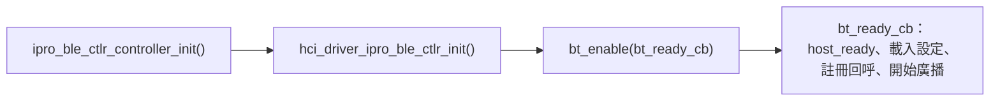

# BLE 開發

FreeRTOS 應用的 BLE 由兩部分組成：Zephyr v4.4.0 的 BLE Host（原始碼）與 IPRO BLE 控制器（預編譯函式庫）。應用以 Zephyr 的 `bt_*` 回呼 API 開發，控制器依 `.config` 從 16 個封存檔中選一個連結。下面的範例程式取自 `apps/bluetooth/ble/ipro_ble_remote`。

!!! abstract "重點"
    - Host：Zephyr v4.4.0，含 GAP、GATT、L2CAP、SMP、ISO 與 LE Audio；Host 與控制器之間是晶片內的 HCI，沒有 UART。
    - 控制器：16 個 IPRO7 封存檔，以 `CONFIG_IPRO_BLE_CTLR_LIB`、`CONFIG_IPRO_BLE_CTLR_FEATURE`、`CONFIG_IPRO_BLE_CTLR_CFG_DBG` 選擇。LE Audio 需要 `bt54_iso2` 與 `CONFIG_EM_SIZE=32`。
    - 初始化順序：`ipro_ble_ctlr_controller_init()` → `hci_driver_ipro_ble_ctlr_init()` → `bt_enable()`。
    - 未包含於 V2.1.0：控制器原始碼、PAwR／ESL 應用。IPRO6S（BLE 與 BR/EDR）使用 SDK V2.0.1，見 [IPRO6S](../hardware/chips/ipro6s.md)。

## 協定堆疊架構 { #stack-architecture }

<div class="ipro-stack">
  <div class="l-app"><strong>應用</strong><span>Zephyr bt_* API：GAP · GATT · SMP · LE Audio</span></div>
  <div class="l-host"><strong>BLE Host（Zephyr v4.4.0）</strong><span>ipro_bt_host：GAP · GATT · L2CAP · SMP · ISO</span></div>
  <div class="l-hci"><strong>晶片內 HCI</strong><span>記憶體內位元組串流（ipro_ble_ctlr_hcitl）</span></div>
  <div class="l-ctlr"><strong>IPRO BLE 控制器（預編譯函式庫）</strong><span>Link Layer · 1M／2M／Coded PHY</span></div>
</div>

```text title="components/wireless/bluetooth/"
ipro_bt_host/
├── upstream/zephyr/        Zephyr v4.4.0 Host 原始碼（include/、subsys/bluetooth/）
├── port/                   FreeRTOS 移植層：HCI 驅動、kernel 介面、設定儲存、加密
└── tinycrypt/
ipro_ble_controller/
├── include/                公開標頭 ipro_ble_controller.h
├── hcitl/                  晶片內 HCI 傳輸
├── lib/                    16 個預編譯封存檔
└── cmake/                  封存檔選擇規則（ipro7_build.cmake）
```

每個 BLE 應用的 `.config` 都需要：

```ini
CONFIG_BLUETOOTH_LE_ENABLE=y
CONFIG_BT_CTLR_IPRO=y
CONFIG_BT_HOST_IPRO_V44=y
```

缺少 `CONFIG_BT_CTLR_IPRO` 或 `CONFIG_BT_HOST_IPRO_V44` 時，建置在 CMake 設定階段就會停止。Host 與控制器元件會匯出自己的 include 路徑，應用的 `CMakeLists.txt` 不需要另外加入 `zephyr/bluetooth/*.h` 的路徑。

Zephyr RTOS 應用使用 Zephyr 本身的 Host，搭配同一組控制器封存檔，見 [Zephyr RTOS](zephyr.md)。

## 控制器選擇 { #controller-variants }

| 設定 | 值 | 未設定時 | 意義 |
|---|---|---|---|
| `CONFIG_IPRO_BLE_CTLR_LIB` | `link1_periph`、`link1`、`link2`、`link4` | `link1_periph` | `link1_periph` 只有 peripheral 與 broadcaster 角色；其餘的數字是連線數 |
| `CONFIG_IPRO_BLE_CTLR_FEATURE` | `bt52`、`bt54_iso2` | `bt52` | `bt54_iso2` 加入 ISO 通道（LE Audio） |
| `CONFIG_IPRO_BLE_CTLR_CFG_DBG` | `y` 或不設定 | 不設定 | 不設定時使用 `_release` 封存檔；設 `y` 使用除錯版 |

檔名規則為 `libipro_ble_controller_ipro7_<LIB>[_bt54_iso2][_release].a`，`bt52` 沒有功能後綴。`lib/` 下的 16 個封存檔：

| LIB | `bt52` | `bt52` release | `bt54_iso2` | `bt54_iso2` release |
|---|---|---|---|---|
| `link1_periph` | `…_link1_periph.a` | `…_link1_periph_release.a` | `…_link1_periph_bt54_iso2.a` | `…_link1_periph_bt54_iso2_release.a` |
| `link1` | `…_link1.a` | `…_link1_release.a` | `…_link1_bt54_iso2.a` | `…_link1_bt54_iso2_release.a` |
| `link2` | `…_link2.a` | `…_link2_release.a` | `…_link2_bt54_iso2.a` | `…_link2_bt54_iso2_release.a` |
| `link4` | `…_link4.a` | `…_link4_release.a` | `…_link4_bt54_iso2.a` | `…_link4_bt54_iso2_release.a` |

設定階段會檢查：

- `CONFIG_EM_SIZE`（BLE Exchange Memory，單位 KB）必須設定。
- `bt54_iso2` 需要 `CONFIG_EM_SIZE` 至少 32。
- 找不到符合設定的封存檔時，建置停止。

另外，`CONFIG_BT_CONN`（Host 的連線數）不可超過封存檔的連線數。Exchange Memory 從 OCRAM 頂端保留，見[記憶體配置](build-system.md#memory-layout)。

隨附應用的設定可作為起點：

| 應用 | LIB | FEATURE | `CONFIG_BT_CONN` | `CONFIG_EM_SIZE` |
|---|---|---|---|---|
| `ipro_ble_remote` | `link1_periph` | `bt52` | 1 | 16 |
| `ipro_ble_transparent` | `link1` | `bt52` | 1 | 32 |
| `ipro_ble_hid_keyboard` | `link1` | `bt52` | 1 | 32 |
| `ipro_throughput_test` | `link2` | `bt52` | 2 | 32 |
| `ipro_pdm_mic_demo` | `link2` | `bt52` | 1 | 16 |
| `ipro_le_audio_headset` | `link1_periph` | `bt54_iso2` | 1 | 32 |

```ini title=".config（節錄自 ipro_ble_remote）"
CONFIG_BLUETOOTH_LE_ENABLE=y
CONFIG_BT_CTLR_IPRO=y
CONFIG_IPRO_BLE_CTLR_LIB="link1_periph"
CONFIG_IPRO_BLE_CTLR_FEATURE="bt52"
CONFIG_EM_SIZE=16
CONFIG_BT_CONN=1
CONFIG_BT_PERIPHERAL=y
CONFIG_BT_BROADCASTER=y
CONFIG_PHY_UPDATE=y
CONFIG_BT_DATA_LEN_UPDATE=y
CONFIG_BT_HOST_IPRO_V44=y
CONFIG_BT_SMP=y
CONFIG_BT_GATT_CLIENT=y
CONFIG_ENABLE_NVDS=y
CONFIG_CFG_NVDS=y
```

建置不解析 Kconfig 的相依關係，請從最接近的隨附應用複製整份 `.config` 再修改。

## 初始化順序 { #bring-up }



```c
ipro_ble_ctlr_controller_init(configMAX_PRIORITIES - 1);
vTaskDelay(pdMS_TO_TICKS(50));
hci_driver_ipro_ble_ctlr_init();
vTaskDelay(pdMS_TO_TICKS(50));
bt_enable(bt_ready_cb);
```

- 在 FreeRTOS 任務中執行，排程器要已啟動（中間的 `vTaskDelay()` 需要排程器）。
- `ipro_ble_ctlr_controller_init()` 建立控制器任務。控制器有無線電時序的硬性期限，優先權要高於應用任務；隨附應用使用 `configMAX_PRIORITIES - 1`。只能呼叫一次，重複呼叫回傳 -1。
- `bt_ready_cb` 中先呼叫 `ipro_ble_ctlr_hcitl_host_ready()`，告知 HCI 初始化完成，控制器才能在事件之間睡眠。
- 啟用 `CONFIG_BT_SETTINGS` 時，在 `bt_ready_cb` 中先 `settings_load_subtree("bt")` 載入配對資料，再開始廣播。

## API 用法 { #api-patterns }

以下三段依序放在同一個 `.c` 檔即可編譯，內容取自 `ipro_ble_remote` 的 `src/services/remote_services.c` 與 `src/app/remote_app.c`。應用使用 Zephyr 的回呼式 API；控制器內部的訊息機制不對應用開放。

### GATT 服務 { #gatt-service }

以 `BT_GATT_SERVICE_DEFINE` 在編譯期定義服務。下例是一個可讀取並通知溫度的服務（UUID 沿用 `ipro_ble_remote` 的環境服務 0xFF30／0xFF31）：

```c title="GATT 服務"
#include <FreeRTOS.h>
#include <task.h>

#include <zephyr/bluetooth/bluetooth.h>
#include <zephyr/bluetooth/conn.h>
#include <zephyr/bluetooth/gatt.h>
#include <zephyr/bluetooth/uuid.h>
#include <zephyr/settings/settings.h>
#include <hci_driver_ipro_ble_ctlr.h>
#include <ipro_ble_controller.h>

#define BT_UUID_ENV_SVC   BT_UUID_DECLARE_16(0xFF30)
#define BT_UUID_ENV_TEMP  BT_UUID_DECLARE_16(0xFF31)

static int16_t temperature = 2500;      /* 0.01 °C */
static bool temp_notify_enabled;

static ssize_t temp_read(struct bt_conn *conn, const struct bt_gatt_attr *attr,
                         void *buf, uint16_t len, uint16_t offset)
{
    return bt_gatt_attr_read(conn, attr, buf, len, offset,
                             &temperature, sizeof(temperature));
}

static void temp_ccc_changed(const struct bt_gatt_attr *attr, uint16_t value)
{
    temp_notify_enabled = (value == BT_GATT_CCC_NOTIFY);
}

BT_GATT_SERVICE_DEFINE(env_svc,
    BT_GATT_PRIMARY_SERVICE(BT_UUID_ENV_SVC),
    BT_GATT_CHARACTERISTIC(BT_UUID_ENV_TEMP,
                           BT_GATT_CHRC_READ | BT_GATT_CHRC_NOTIFY,
                           BT_GATT_PERM_READ,
                           temp_read, NULL, NULL),
    BT_GATT_CCC(temp_ccc_changed, BT_GATT_PERM_READ | BT_GATT_PERM_WRITE),
);

/* attr_env_svc[1] 是溫度特徵的宣告屬性，bt_gatt_notify() 會改用其後的值屬性 */
static int notify_temperature(struct bt_conn *conn)
{
    if (!temp_notify_enabled) {
        return 0;
    }
    return bt_gatt_notify(conn, &attr_env_svc[1], &temperature, sizeof(temperature));
}
```

### 廣播與連線 { #gap-connection }

```c title="廣播與連線回呼"
#define DEVICE_NAME     "IPRO-Remote"
#define DEVICE_NAME_LEN (sizeof(DEVICE_NAME) - 1)

static struct bt_conn *current_conn;

static const struct bt_data ad[] = {
    BT_DATA_BYTES(BT_DATA_FLAGS, (BT_LE_AD_GENERAL | BT_LE_AD_NO_BREDR)),
    BT_DATA(BT_DATA_NAME_COMPLETE, DEVICE_NAME, DEVICE_NAME_LEN),
};

static int start_advertising(void)
{
    struct bt_le_adv_param adv_param = {
        .id = BT_ID_DEFAULT,
        .options = BT_LE_ADV_OPT_CONN,   /* 可連線廣播 */
        .interval_min = 160,             /* 100 ms，單位 0.625 ms */
        .interval_max = 320,             /* 200 ms */
    };

    return bt_le_adv_start(&adv_param, ad, ARRAY_SIZE(ad), NULL, 0);
}

static void connected(struct bt_conn *conn, uint8_t err)
{
    if (err) {
        return;
    }
    current_conn = bt_conn_ref(conn);
    (void)notify_temperature(current_conn);
}

static void disconnected(struct bt_conn *conn, uint8_t reason)
{
    (void)conn;
    (void)reason;
    if (current_conn) {
        bt_conn_unref(current_conn);
        current_conn = NULL;
    }
    /* 這個回呼在 Host 執行緒中執行，不能阻塞。ipro_ble_remote 以 FreeRTOS
     * 計時器在 500 ms 後重新廣播，而不是在這裡直接呼叫。 */
}

static struct bt_conn_cb conn_callbacks = {
    .connected = connected,
    .disconnected = disconnected,
};
```

本版 Host 沒有 `BT_LE_ADV_CONN_NAME` 巨集。裝置名稱請如上放進廣播資料；需要預設參數時可用 `BT_LE_ADV_CONN_FAST_1` 等 Host 提供的巨集。

### 啟動 { #ble-init }

```c title="初始化"
static void bt_ready_cb(int err)
{
    if (err) {
        return;
    }
    ipro_ble_ctlr_hcitl_host_ready();

#if defined(CONFIG_BT_SETTINGS)
    (void)settings_load_subtree("bt");
#endif
    bt_conn_cb_register(&conn_callbacks);
    (void)start_advertising();
}

/* 在應用任務中呼叫 */
int ble_init(void)
{
    int err;

    err = ipro_ble_ctlr_controller_init(configMAX_PRIORITIES - 1);
    if (err) {
        return err;
    }
    vTaskDelay(pdMS_TO_TICKS(50));

    err = hci_driver_ipro_ble_ctlr_init();
    if (err) {
        return err;
    }
    vTaskDelay(pdMS_TO_TICKS(50));

    return bt_enable(bt_ready_cb);
}
```

- 配對資料要保存到 Flash 時，設 `CONFIG_BT_SETTINGS=y` 與 `CONFIG_EASYFLASH4=y`（Host 的設定儲存使用 EasyFlash），分割表要包含 EasyFlash 使用的 PSM 區。可參考 `ipro_pdm_mic_demo` 與 `ipro_le_audio_headset`；`ipro_ble_remote` 的預設設定沒有開啟。
- 連線後提高傳輸量：`ipro_ble_remote` 在 `connected` 中以 `bt_gatt_exchange_mtu()` 交換 MTU，並在 `CONFIG_BT_USER_DATA_LEN_UPDATE` 時以 `bt_conn_le_data_len_update()` 要求 251 位元組的 DLE。

## 效能與吞吐量 { #throughput }

`ipro_throughput_test` 的 README 實測：兩片 IPRO7AI Reef EVK，`link2` 控制器，ATT MTU 247，DLE 251 octets，每封包 244 位元組，連線間隔 50 ms，啟用 `CONFIG_IPRO7_BLE_HOTCODE=y`：

| PHY | 單向吞吐量 |
|---|---|
| 2M | 1.34 Mbps |
| 1M | 747 kbps |

- `CONFIG_IPRO7_BLE_HOTCODE=y` 把控制器、Host 與 FreeRTOS kernel 的每封包路徑放到 OCRAM 執行，約占 88 KB OCRAM。同樣條件下不啟用時（程式在 Flash），2M PHY 只有約 0.6 Mbps。
- 此選項不能與 AI＋影像的 OCRAM 配置，或低功耗設定（`CONFIG_HAL_LP`、`CONFIG_IPRO_PM_*`、`CONFIG_OCRAM_NORET_SPLIT`）同時使用。
- 大量資料建議 2M PHY、連線間隔 30–50 ms、244 位元組的封包。

逐步操作見 [BLE 吞吐量測試](../tutorials/ble-throughput.md)。

## LE Audio { #le-audio }

LE Audio 需要 `CONFIG_IPRO_BLE_CTLR_FEATURE="bt54_iso2"` 與 `CONFIG_EM_SIZE=32`，再加上 `CONFIG_BT_AUDIO=y` 與 BAP、PACS、ASCS 等角色設定，LC3 以 `CONFIG_COMPONENTS_LC3_ENABLE=y` 加入。Host 的 LE Audio 標頭在 `ipro_bt_host/upstream/zephyr/include/zephyr/bluetooth/audio/`。隨附的 FreeRTOS 範例是單播耳機 `ipro_le_audio_headset`；設定、協定與音訊路徑見[音訊與 LE Audio](audio.md)。

## 低功耗 { #low-power }

- `ipro_pdm_mic_demo` 示範 BLE 搭配 PDS31 睡眠：配對資料存在 Flash，喚醒後以既有配對重新連線。
- 控制器的 PDS 睡眠只支援 16 KB EM 的配置；`bt54_iso2`（32 KB EM）組態下控制器不會進入 PDS。
- `CONFIG_IPRO_PM_BLE` 與 `CONFIG_IPRO_PM_PDS_CONNECTED` 會強制從原始碼建置控制器，V2.1.0 無法建置，見[本版限制](#limitations)。
- Zephyr RTOS 目前沒有低功耗模式，BLE 控制器也不會睡眠。

睡眠模式、喚醒來源與量測方法見[低功耗](low-power.md)。

## 本版限制 { #limitations }

- 控制器只以預編譯函式庫提供。以下設定會強制從原始碼建置控制器，在 V2.1.0 無法建置：`CONFIG_IPRO_BLE_CTLR_FORCE_SOURCE_BUILD`、`CONFIG_IPRO_BLE_CTLR_SUBRATING`、`CONFIG_IPRO_BLE_CTLR_CSSA`、`CONFIG_IPRO_PM_BLE`、`CONFIG_IPRO_PM_PDS_CONNECTED`。`ipro_ble_remote` 的 `defconfig_lowpower` 使用了後兩者。
- PAwR 與 ESL：Host 標頭含週期性廣播相關 API，但 V2.1.0 沒有 PAwR／ESL 應用。未包含於 V2.1.0，請洽 INTELPRO。
- `ipro_ble_remote` 的 OTA 服務只在 `defconfig_reef` 開啟，預設 `.config` 沒有 OTA。
- IPRO6S 的 BLE 與 BR/EDR 開發使用 SDK V2.0.1，見 [IPRO6S](../hardware/chips/ipro6s.md)。

## 參考應用 { #reference-apps }

| 應用 | 內容 |
|---|---|
| `ipro_ble_remote` | GATT 服務範例：LED、按鍵、環境、UART、PIR 圖片與圖片上傳；`defconfig_reef` 另加 OTA 與 Reef 硬體服務。附 Android App `ipro_remote_demo.apk` |
| `ipro_ble_transparent` | UART 與 BLE 之間的透明傳輸，AT 指令介面 |
| `ipro_ble_hid_keyboard` | HID over GATT 鍵盤 |
| `ipro_throughput_test` | 雙板吞吐量測試：1M／2M／Coded PHY、DLE、MTU 247 |
| `ipro_le_audio_headset` | LE Audio 單播耳機 |
| `ipro_pdm_mic_demo` | Nordic UART Service、LC3 串流、配對保存、PDS31 睡眠後重新連線 |

- [第一個 BLE 應用](../tutorials/first-ble-app.md)
- [BLE 吞吐量測試](../tutorials/ble-throughput.md)
- [音訊與 LE Audio](audio.md)
- [API 參考](../reference/api/index.md)
