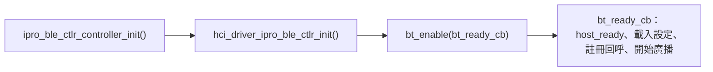

# BLE 開發

FreeRTOS 應用的 BLE 由兩部分組成：Zephyr v4.4.0 的 BLE Host（原始碼）與 IPRO BLE 控制器（預編譯函式庫）。應用以 Zephyr 的 `bt_*` 回呼 API 撰寫，`.config` 的三個設定決定從 16 個控制器封存檔中連結哪一個。本頁範例取自 `apps/bluetooth/ble/ipro_ble_remote`，以 `defconfig_reef` 建置給 IPRO7AI Reef EVK。

!!! abstract "重點"
    - Host：Zephyr v4.4.0，含 GAP、GATT、L2CAP、SMP、ISO 與 LE Audio；Host 與控制器之間是晶片內的 HCI，沒有 UART。
    - 控制器：16 個 IPRO7 封存檔，`link1_periph`／`link1`／`link2`／`link4` × `bt52`／`bt54_iso2` × 除錯版／release 版，由 `CONFIG_IPRO_BLE_CTLR_LIB`、`CONFIG_IPRO_BLE_CTLR_FEATURE`、`CONFIG_IPRO_BLE_CTLR_CFG_DBG` 選擇。
    - 初始化順序：`ipro_ble_ctlr_controller_init()` → `hci_driver_ipro_ble_ctlr_init()` → `bt_enable()`。
    - Reef 的 BLE 組態：`ipro_ble_remote`、`ipro_throughput_test`、`ipro_le_audio_headset` 加 `DEFCONFIG=defconfig_reef`，以及 `ipro_agora_sentino`（BLE 配網）。
    - 未包含於 V2.3.0：控制器原始碼、PAwR／ESL 應用、IPRO6S 的 BLE 控制器。

## 協定堆疊架構 { #stack-architecture }

<div class="ipro-stack">
  <div class="l-app"><strong>應用</strong><span>Zephyr bt_* API：GAP · GATT · SMP · LE Audio</span></div>
  <div class="l-host"><strong>BLE Host（Zephyr v4.4.0）</strong><span>ipro_bt_host：GAP · GATT · L2CAP · SMP · ISO</span></div>
  <div class="l-hci"><strong>晶片內 HCI</strong><span>記憶體內位元組串流（ipro_ble_ctlr_hcitl）</span></div>
  <div class="l-ctlr"><strong>IPRO BLE 控制器（預編譯函式庫）</strong><span>Link Layer · 1M／2M／Coded PHY</span></div>
</div>

```text title="components/wireless/bluetooth/"
ipro_bt_host/
├── upstream/zephyr/        Zephyr v4.4.0 Host 原始碼（include/、subsys/bluetooth/）
├── port/                   FreeRTOS 移植層：HCI 驅動、kernel 介面、設定儲存、加密
└── tinycrypt/
ipro_ble_controller/
├── include/                公開標頭 ipro_ble_controller.h
├── hcitl/                  晶片內 HCI 傳輸
├── plf/ipro7/              控制器 API 標頭（初始化、低功耗、NVDS）
├── lib/                    16 個 IPRO7 預編譯封存檔
└── cmake/                  封存檔選擇規則（ipro7_build.cmake）
```

每個 BLE 應用的 `.config` 都需要：

```ini
CONFIG_BLUETOOTH_LE_ENABLE=y
CONFIG_BT_CTLR_IPRO=y
CONFIG_BT_HOST_IPRO_V44=y
```

缺少 `CONFIG_BT_CTLR_IPRO` 或 `CONFIG_BT_HOST_IPRO_V44` 時，建置在 CMake 設定階段就會停止。Host 與控制器元件會匯出自己的 include 路徑，應用的 `CMakeLists.txt` 不需要另外加入 `zephyr/bluetooth/*.h` 的路徑。

Zephyr RTOS 映像使用 Zephyr 本身的 Host，搭配同一組控制器封存檔；V2.3.0 的 Zephyr 只有 IPRO7 EVB 與 IPRO7AI EVK 的板子定義，見 [Zephyr RTOS](zephyr.md)。

## 控制器選擇 { #controller-variants }

| 設定 | 值 | 未設定時 | 意義 |
|---|---|---|---|
| `CONFIG_IPRO_BLE_CTLR_LIB` | `link1_periph`、`link1`、`link2`、`link4` | `link1_periph` | `link1_periph` 只有 peripheral 與 broadcaster 角色；其餘的數字是連線數 |
| `CONFIG_IPRO_BLE_CTLR_FEATURE` | `bt52`、`bt54_iso2` | `bt52` | `bt54_iso2` 加入 ISO 通道（LE Audio） |
| `CONFIG_IPRO_BLE_CTLR_CFG_DBG` | `y` 或不設定 | 不設定 | 不設定時連結 `_release` 封存檔；設 `y` 連結除錯版 |

檔名規則為 `libipro_ble_controller_ipro7_<LIB>[_bt54_iso2][_release].a`，`bt52` 沒有功能後綴。`lib/` 下的 16 個封存檔：

| LIB | `bt52` | `bt52` release | `bt54_iso2` | `bt54_iso2` release |
|---|---|---|---|---|
| `link1_periph` | `…_link1_periph.a` | `…_link1_periph_release.a` | `…_link1_periph_bt54_iso2.a` | `…_link1_periph_bt54_iso2_release.a` |
| `link1` | `…_link1.a` | `…_link1_release.a` | `…_link1_bt54_iso2.a` | `…_link1_bt54_iso2_release.a` |
| `link2` | `…_link2.a` | `…_link2_release.a` | `…_link2_bt54_iso2.a` | `…_link2_bt54_iso2_release.a` |
| `link4` | `…_link4.a` | `…_link4_release.a` | `…_link4_bt54_iso2.a` | `…_link4_bt54_iso2_release.a` |

設定階段會檢查：

- `CONFIG_EM_SIZE`（BLE Exchange Memory，單位 KB）必須設定。
- `bt54_iso2` 需要 `CONFIG_EM_SIZE` 至少 32。
- `LIB` 或 `FEATURE` 的值不在上表時，建置停止。

`CONFIG_BT_CONN`（Host 的連線數）不可超過封存檔的連線數。Exchange Memory 從 OCRAM 頂端保留，見[記憶體配置](build-system.md#memory-layout)。

V2.3.0 隨附的 Reef 組態可作為起點：

| 應用與組態 | LIB | FEATURE | 除錯版封存檔 | `CONFIG_BT_CONN` | `CONFIG_EM_SIZE` |
|---|---|---|---|---|---|
| `ipro_ble_remote` `defconfig_reef` | `link1_periph` | `bt52` | 否 | 1 | 16 |
| `ipro_throughput_test` `defconfig_reef` | `link2` | `bt52` | 否 | 2 | 32 |
| `ipro_le_audio_headset` `defconfig_reef` | `link1_periph` | `bt54_iso2` | 是 | 1 | 32 |
| `ipro_agora_sentino` `.config` | `link1_periph` | `bt52` | 否 | 1 | 16 |

`ipro_ble_transparent`、`ipro_ble_hid_keyboard` 與 `ipro_pdm_mic_demo` 是 IPRO7 EVB 與 IPRO7AI EVK 的 BLE 範例，不能建置給 Reef。

```ini title="apps/bluetooth/ble/ipro_ble_remote/defconfig_reef（節錄）"
CONFIG_BLUETOOTH_LE_ENABLE=y
CONFIG_BT_CTLR_IPRO=y
CONFIG_IPRO_BLE_CTLR_LIB="link1_periph"
CONFIG_IPRO_BLE_CTLR_FEATURE="bt52"
CONFIG_EM_SIZE=16
CONFIG_BT_CONN=1
CONFIG_BT_PERIPHERAL=y
CONFIG_BT_OBSERVER=y
CONFIG_BT_BROADCASTER=y
CONFIG_PHY_UPDATE=y
CONFIG_BT_DATA_LEN_UPDATE=y
CONFIG_BT_HOST_IPRO_V44=y
CONFIG_BT_SMP=y
CONFIG_BT_GATT_CLIENT=y
CONFIG_ENABLE_NVDS=y
CONFIG_CFG_NVDS=y
```

建置不解析 Kconfig 的相依關係，請從最接近的隨附應用複製整份設定檔再修改，見[建置系統與設定](build-system.md)。

## 初始化順序 { #bring-up }



```c title="apps/bluetooth/ble/ipro_ble_remote/src/app/remote_app.c（節錄，省略錯誤處理）"
ipro_ble_ctlr_controller_init(configMAX_PRIORITIES - 1);
vTaskDelay(pdMS_TO_TICKS(50));
hci_driver_ipro_ble_ctlr_init();
vTaskDelay(pdMS_TO_TICKS(50));
bt_enable(bt_ready_cb);
```

- 在排程器啟動後的 FreeRTOS 任務中執行；中間的 `vTaskDelay()` 需要排程器。
- `ipro_ble_ctlr_controller_init()` 建立控制器任務。控制器有無線電時序的硬性期限，優先權要高於應用任務；隨附應用使用 `configMAX_PRIORITIES - 1`。成功回傳 0，控制器已啟動過回傳 -1，任務建立失敗回傳 -2。
- `bt_ready_cb` 中先呼叫 `ipro_ble_ctlr_hcitl_host_ready()`，告知 HCI 初始化完成，控制器才能在事件之間睡眠。
- 啟用 `CONFIG_BT_SETTINGS` 時，在 `bt_ready_cb` 中先 `settings_load_subtree("bt")` 載入配對資料，再開始廣播。
- Reef 沒有 32.768 kHz 晶振。依 `ipro_throughput_test` 的 README，Reef 在重置後約 7 秒才印出 BLE 就緒的訊息，因為控制器會先檢驗 32 kHz 時脈，再退回 RC32K（記錄中出現 `XTAL32K rejected`）。

## API 用法 { #api-patterns }

以下三段依序放在同一個 `.c` 檔即可編譯，內容取自 `ipro_ble_remote` 的 `src/services/remote_services.c` 與 `src/app/remote_app.c`。應用使用 Zephyr 的回呼式 API；控制器內部的訊息機制不對應用開放。

### GATT 服務 { #gatt-service }

以 `BT_GATT_SERVICE_DEFINE` 在編譯期定義服務。下例是一個可讀取並通知溫度的服務（UUID 沿用 `ipro_ble_remote` 的環境服務 0xFF30／0xFF31；在 Reef 上回報晶片內建溫度感測器的讀值）：

```c title="GATT 服務"
#include <FreeRTOS.h>
#include <task.h>

#include <zephyr/bluetooth/bluetooth.h>
#include <zephyr/bluetooth/conn.h>
#include <zephyr/bluetooth/gatt.h>
#include <zephyr/bluetooth/uuid.h>
#include <zephyr/settings/settings.h>
#include <hci_driver_ipro_ble_ctlr.h>
#include <ipro_ble_controller.h>

#define BT_UUID_ENV_SVC   BT_UUID_DECLARE_16(0xFF30)
#define BT_UUID_ENV_TEMP  BT_UUID_DECLARE_16(0xFF31)

static int16_t temperature = 2500;      /* 0.01 °C */
static bool temp_notify_enabled;

static ssize_t temp_read(struct bt_conn *conn, const struct bt_gatt_attr *attr,
                         void *buf, uint16_t len, uint16_t offset)
{
    return bt_gatt_attr_read(conn, attr, buf, len, offset,
                             &temperature, sizeof(temperature));
}

static void temp_ccc_changed(const struct bt_gatt_attr *attr, uint16_t value)
{
    temp_notify_enabled = (value == BT_GATT_CCC_NOTIFY);
}

BT_GATT_SERVICE_DEFINE(env_svc,
    BT_GATT_PRIMARY_SERVICE(BT_UUID_ENV_SVC),
    BT_GATT_CHARACTERISTIC(BT_UUID_ENV_TEMP,
                           BT_GATT_CHRC_READ | BT_GATT_CHRC_NOTIFY,
                           BT_GATT_PERM_READ,
                           temp_read, NULL, NULL),
    BT_GATT_CCC(temp_ccc_changed, BT_GATT_PERM_READ | BT_GATT_PERM_WRITE),
);

/* attr_env_svc[1] 是溫度特徵值的宣告；
 * bt_gatt_notify() 使用緊接其後的數值屬性 */
static int notify_temperature(struct bt_conn *conn)
{
    if (!temp_notify_enabled) {
        return 0;
    }
    return bt_gatt_notify(conn, &attr_env_svc[1], &temperature, sizeof(temperature));
}
```

### 廣播與連線 { #gap-connection }

```c title="廣播與連線回呼"
#define DEVICE_NAME     "IPRO-Remote"
#define DEVICE_NAME_LEN (sizeof(DEVICE_NAME) - 1)

static struct bt_conn *current_conn;

static const struct bt_data ad[] = {
    BT_DATA_BYTES(BT_DATA_FLAGS, (BT_LE_AD_GENERAL | BT_LE_AD_NO_BREDR)),
    BT_DATA(BT_DATA_NAME_COMPLETE, DEVICE_NAME, DEVICE_NAME_LEN),
};

static int start_advertising(void)
{
    struct bt_le_adv_param adv_param = {
        .id = BT_ID_DEFAULT,
        .options = BT_LE_ADV_OPT_CONN,   /* 可連線 */
        .interval_min = 160,             /* 100 ms，單位 0.625 ms */
        .interval_max = 320,             /* 200 ms */
    };

    return bt_le_adv_start(&adv_param, ad, ARRAY_SIZE(ad), NULL, 0);
}

static void connected(struct bt_conn *conn, uint8_t err)
{
    if (err) {
        return;
    }
    current_conn = bt_conn_ref(conn);
    (void)notify_temperature(current_conn);
}

static void disconnected(struct bt_conn *conn, uint8_t reason)
{
    (void)conn;
    (void)reason;
    if (current_conn) {
        bt_conn_unref(current_conn);
        current_conn = NULL;
    }
    /* 此回呼在 Host 執行緒中執行，不可阻塞。ipro_ble_remote 不在這裡
     * 重新廣播，而是以 FreeRTOS 計時器在 500 ms 後重新開始。 */
}

static struct bt_conn_cb conn_callbacks = {
    .connected = connected,
    .disconnected = disconnected,
};
```

本版 Host 沒有 `BT_LE_ADV_CONN_NAME` 巨集。請如上例把裝置名稱放進廣播資料，或使用 Host 預先定義的參數巨集，例如 `BT_LE_ADV_CONN_FAST_1`。

### 啟動 { #ble-init }

```c title="初始化"
static void bt_ready_cb(int err)
{
    if (err) {
        return;
    }
    ipro_ble_ctlr_hcitl_host_ready();

#if defined(CONFIG_BT_SETTINGS)
    (void)settings_load_subtree("bt");
#endif
    bt_conn_cb_register(&conn_callbacks);
    (void)start_advertising();
}

/* 在應用任務中呼叫 */
int ble_init(void)
{
    int err;

    err = ipro_ble_ctlr_controller_init(configMAX_PRIORITIES - 1);
    if (err) {
        return err;
    }
    vTaskDelay(pdMS_TO_TICKS(50));

    err = hci_driver_ipro_ble_ctlr_init();
    if (err) {
        return err;
    }
    vTaskDelay(pdMS_TO_TICKS(50));

    return bt_enable(bt_ready_cb);
}
```

- 要把配對資料存進 Flash，設定 `CONFIG_BT_SETTINGS=y` 與 `CONFIG_EASYFLASH4=y`（Host 的設定儲存使用 EasyFlash，資料寫在分割表的 `PSM` 分割區）。`ipro_le_audio_headset` 的 `defconfig_reef` 這樣設定；`ipro_ble_remote` 的 `defconfig_reef` 不保存配對資料。
- 連線後提高傳輸量：`ipro_ble_remote` 在 `connected` 中以 `bt_gatt_exchange_mtu()` 交換 MTU，並在 `CONFIG_BT_USER_DATA_LEN_UPDATE` 時以 `bt_conn_le_data_len_update()` 要求 251 位元組的 DLE。

## 在 Reef 上動手做 { #hands-on }

把 `ipro_ble_remote` 建置給 Reef，從手機或電腦連線，透過 GATT 改變 Reef 上 RGB LED 的顏色。需要：U6 接好主控台線的 Reef、IntelProCube 命令列工具（下文以 `<ICUBE>` 表示），以及裝有通用 BLE App（nRF Connect、LightBlue）的手機，或有 Python 與藍牙的 macOS／Linux 電腦。

<div class="ipro-steps" markdown>

1. **確認設定**

    `defconfig_reef` 隨附即完整。下面是其中與本例相關的設定：2 MB Flash 與 boot2 分割表的 Reef 板子設定、應用本身的 OTA 開關，以及 BLE 區塊。新的 Reef BLE 應用保留板子與 BLE 的設定即可；`CONFIG_IPRO_BLE_REMOTE_OTA` 只屬於 `ipro_ble_remote`。

    ```ini title="apps/bluetooth/ble/ipro_ble_remote/defconfig_reef（節錄）"
    CONFIG_IPRO7AI_REEF=y
    CONFIG_IPRO7_FLASH_2M=y
    CONFIG_PARTITION=y
    CONFIG_IPRO_BLE_REMOTE_OTA=y

    CONFIG_BLUETOOTH_LE_ENABLE=y
    CONFIG_BT_CTLR_IPRO=y
    CONFIG_IPRO_BLE_CTLR_LIB="link1_periph"
    CONFIG_IPRO_BLE_CTLR_FEATURE="bt52"
    CONFIG_EM_SIZE=16
    CONFIG_BT_CONN=1
    CONFIG_BT_PERIPHERAL=y
    CONFIG_BT_BROADCASTER=y
    CONFIG_BT_HOST_IPRO_V44=y
    CONFIG_BT_SMP=y
    ```

2. **看懂要寫入的特徵值**

    Reef 專用的 0xFF80 服務有一個 LED Colour 特徵值 0xFF81：3 個位元組 R、G、B。寫入處理函式檢查長度、記錄顏色，再交給 LED 驅動：

    ```c title="apps/bluetooth/ble/ipro_ble_remote/src/services/reef_service.c（節錄）"
    static ssize_t color_write(struct bt_conn *conn, const struct bt_gatt_attr *attr,
                               const void *buf, uint16_t len, uint16_t offset, uint8_t flags)
    {
        const uint8_t *d = buf;

        (void)conn; (void)attr; (void)flags;
        if (offset != 0u) {
            return BT_GATT_ERR(BT_ATT_ERR_INVALID_OFFSET);
        }
        if (len != sizeof(s_ctx.rgb)) {
            return BT_GATT_ERR(BT_ATT_ERR_INVALID_ATTRIBUTE_LEN);
        }
        memcpy(s_ctx.rgb, d, sizeof(s_ctx.rgb));
        IPRO_LOGI(LOG_TAG, "[LED] Colour %u,%u,%u", d[0], d[1], d[2]);
        if (s_ctx.h.led_color) {
            s_ctx.h.led_color(d[0], d[1], d[2]);
        }
        return len;
    }

    BT_GATT_SERVICE_DEFINE(reef_svc,
        BT_GATT_PRIMARY_SERVICE(BT_UUID_REEF_SVC),
        BT_GATT_CHARACTERISTIC(BT_UUID_REEF_LED_COLOR,
                               BT_GATT_CHRC_READ | BT_GATT_CHRC_WRITE,
                               BT_GATT_PERM_READ | BT_GATT_PERM_WRITE,
                               color_read, color_write, NULL),
        /* ... 按鍵事件、音量、提示音與板卡資訊特徵值 ... */
    );
    ```

    這個檔案的 `LOG_TAG` 是 `"REEF_SVC"`。要加入自己的特徵值，照同樣方式多寫一個 `BT_GATT_CHARACTERISTIC` 項目與讀寫處理函式。

3. **建置**

    ```bash
    make -C apps/bluetooth/ble/ipro_ble_remote DEFCONFIG=defconfig_reef
    ```

    輸出：`apps/bluetooth/ble/ipro_ble_remote/build_reef/build_out/ipro_ble_remote_IPRO7.bin`。

4. **連同 boot2 與 A/B 分割表燒錄**

    讓 Reef 進入下載模式（按住 SW1 BOOT、按一下 SW2 RESET、放開 SW1；或在執行中的主控台輸入 `reboot_dl`），再在 IntelProCube 目錄下燒錄：

    ```bash
    cd <ICUBE>
    ./ipro_iot_tool_macos --chipname ipro7 --chip-variant IPRO7AI \
        --port /dev/cu.usbserial-XXXX --baudrate 921600 \
        --boot2 chips/ipro7/builtin_imgs/boot2_v0.6.0/ipro_boot2_IPRO7_v0.6.0.bin \
        --pt <SDK>/apps/bluetooth/ble/ipro_ble_remote/partition_cfg_2M_remote_ab.toml \
        --firmware <SDK>/apps/bluetooth/ble/ipro_ble_remote/build_reef/build_out/ipro_ble_remote_IPRO7.bin
    ```

    燒錄失敗時工具也回傳 0，請確認輸出有 `[All Success]`，再按 SW2（RESET）。這份分割表就是 [OTA 更新](ota.md)使用的配置；燒錄細節見[燒錄與序列埠](../get-started/flash-and-monitor.md)。

5. **看主控台並連線**

    以 115200 baud 開啟主控台。boot2 的 `[BOOT2] IPRO7 Boot2 v0.6.0` 之後，應用會印出下列訊息（省略記錄前綴，中間還有其他行）：

    ```text
    [BLE] Initialized
    [BLE] Services ready
    [OTA] Service ready
    [BLE] All services initialized
    [BLE] Advertising: IPRO-Remote
    ```

    連線到 `IPRO-Remote`，對特徵值 0xFF81 寫入 `FF 00 00`。主控台印出 `Connected! Peer: …`，接著 `[LED] Colour 255,0,0`。再對 0xFF11（LED State）寫入 `01`，LED 就以這個顏色點亮。沒有手機時，可在電腦上執行隨附的 bleak 測試，它會寫入顏色並讀回板卡資訊：

    ```bash
    python3 -m venv .venv && .venv/bin/pip install bleak
    .venv/bin/python apps/bluetooth/ble/ipro_ble_remote/tools/reef_ble_test.py info led
    ```

    畫面印出 `board info:` 與 `LED colour [255, 0, 0] …`，LED 以紅色閃爍。在主控台輸入 `reef status` 可從板子端看到同樣的狀態。

</div>

下一步：以 Reef 組態為起點建立自己的應用，見[建立第一個應用](../tutorials/first-own-app.md)；用主控台與主機端腳本檢查應用，見[測試應用](../tutorials/testing.md)。搭配 Android App 的完整 GATT 操作見[第一個 BLE 應用](../tutorials/first-ble-app.md)。

## 效能與吞吐量 { #throughput }

`ipro_throughput_test` 的 README 實測：兩片執行 `defconfig_reef` 的 Reef EVK（`link2` 控制器），ATT MTU 247，DLE 251 octets，每封包 244 位元組，連線間隔 50 ms，啟用 `CONFIG_IPRO7_BLE_HOTCODE=y`：

| PHY | 單向吞吐量 |
|---|---|
| 2M | 1.34 Mbps |
| 1M | 747 kbps |

- `CONFIG_IPRO7_BLE_HOTCODE=y` 把控制器、Host 與 FreeRTOS kernel 的每封包路徑放到 OCRAM 執行，約占 88 KB OCRAM。同樣條件下不啟用時（程式在 Flash），2M PHY 約 0.6 Mbps。
- 此選項不能與 AI＋影像的 OCRAM 配置，或低功耗設定（`CONFIG_HAL_LP`、`CONFIG_IPRO_PM_*`、`CONFIG_OCRAM_NORET_SPLIT`）同時使用，連結腳本產生器會拒絕。
- 大量資料建議 2M PHY、連線間隔 30–50 ms、244 位元組的封包。

測試在主控台以 `tp slave`、`tp master`、`tp conn`、`tp phy`、`tp start` 操作，見 [BLE 吞吐量測試](../tutorials/ble-throughput.md)。

## LE Audio { #le-audio }

LE Audio 需要 `CONFIG_IPRO_BLE_CTLR_FEATURE="bt54_iso2"` 與 `CONFIG_EM_SIZE=32`，再加上 `CONFIG_BT_AUDIO=y` 與 BAP、PACS、ASCS 等角色設定，LC3 以 `CONFIG_COMPONENTS_LC3_ENABLE=y` 加入。Host 的 LE Audio 標頭在 `ipro_bt_host/upstream/zephyr/include/zephyr/bluetooth/audio/`。隨附的 FreeRTOS 範例是單播耳機 `ipro_le_audio_headset`，以 `DEFCONFIG=defconfig_reef` 建置給 Reef；設定、協定、音訊路徑與目前狀態見[音訊與 LE Audio](audio.md)。

## 低功耗 { #low-power }

- `ipro_ble_remote` 的 `defconfig_reef` 不使用 PDS：Reef 由 USB 供電，相機與音訊也需要時脈。
- 控制器的 PDS 睡眠只接受 16 KB EM 的配置；`bt54_iso2`（32 KB EM）組態下控制器保留原生睡眠，但不進入 PDS。
- `CONFIG_IPRO_PM_BLE` 與 `CONFIG_IPRO_PM_PDS_CONNECTED` 會強制從原始碼建置控制器，V2.3.0 無法建置，見[本版限制](#limitations)。
- BLE 搭配 PDS31 睡眠與配對後重新連線的範例是 `ipro_pdm_mic_demo`，屬於 IPRO7 EVB／IPRO7AI EVK。

睡眠模式、喚醒來源與量測方法見[低功耗](low-power.md)。

## 本版限制 { #limitations }

- 控制器只以預編譯函式庫提供，V2.3.0 不含其原始碼。以下設定需要從原始碼建置控制器，會讓建置停止：`CONFIG_IPRO_BLE_CTLR_FORCE_SOURCE_BUILD`、`CONFIG_IPRO_BLE_CTLR_SUBRATING`、`CONFIG_IPRO_BLE_CTLR_CSSA`、`CONFIG_IPRO_PM_BLE`、`CONFIG_IPRO_PM_PDS_CONNECTED`。
- PAwR 與 ESL：Host 標頭含週期性廣播相關 API，但沒有 PAwR／ESL 應用。未包含於 V2.3.0，請洽 INTELPRO。
- `ipro_ble_remote` 的 OTA 服務只在 `defconfig_reef` 開啟；預設 `.config` 建置的是不含 OTA 的 IPRO7 EVB 映像。
- V2.3.0 不含 IPRO6S 的 BLE 控制器；本套件中的 IPRO6S 應用只有 Wi-Fi。

## 參考應用 { #reference-apps }

| 應用（Reef 建置） | 內容 |
|---|---|
| `ipro_ble_remote`（`DEFCONFIG=defconfig_reef`） | Reef 的 GATT 服務：WS2812 LED、按鍵、晶片溫度、UART、OV5640 JPEG 拍照與動態偵測、圖片上傳、PDM 麥克風音量、提示音，以及 BLE OTA。附 Android App `ipro_remote_demo.apk` 與主機端腳本 `tools/reef_ble_test.py`、`tools/reef_ota.py` |
| `ipro_throughput_test`（`DEFCONFIG=defconfig_reef`） | 雙板吞吐量測試：1M／2M／Coded PHY、DLE、MTU 247 |
| `ipro_le_audio_headset`（`DEFCONFIG=defconfig_reef`） | LE Audio 單播耳機 |
| `ipro_agora_sentino`（`.config`） | 雲端語音應用的 BLE 配網，Wi-Fi 經 IPRO6S FIN 卡 |

`ipro_ble_transparent`（AT 介面的資料通道）、`ipro_ble_hid_keyboard`（HID over GATT）與 `ipro_pdm_mic_demo` 只能建置給 IPRO7 EVB 或 IPRO7AI EVK。

- [第一個 BLE 應用](../tutorials/first-ble-app.md)
- [BLE 吞吐量測試](../tutorials/ble-throughput.md)
- [OTA 更新](ota.md)
- [音訊與 LE Audio](audio.md)
- [API 參考](../reference/api/index.md)
