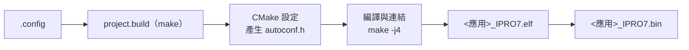

# 建置系統與設定

FreeRTOS 應用由 `make` 驅動 CMake 建置。每個應用目錄下的 `.config` 列出所有 `CONFIG_*` 設定，建置時轉成 C 標頭 `autoconf.h`，並決定哪些元件加入建置。Zephyr 應用以 `west` 建置，見 [Zephyr RTOS](zephyr.md)。

!!! abstract "重點"
    - 建置：`make -C apps/<分類>/<應用>` 或 `./build_freertos.sh <應用> build`，輸出 `build/build_out/<應用>_IPRO7.bin`。
    - `.config` 就是建置設定。Kconfig 檔只用來說明選項，`select`、`depends on` 與預設值都不會自動套用，相依的選項要自己寫進 `.config`。
    - 替代設定以 `DEFCONFIG=<檔名>` 選用，輸出到 `build_<名稱>/`；`BOARD=` 只有 `ipro_pdm_mic_demo` 與 `ipro_agora_sentino` 支援。
    - 工具鏈在 `/opt/toolchain/riscv_ipro7/`，不隨 SDK 提供，請向 INTELPRO 取得。

## 建置流程 { #build-pipeline }



```bash
make -C apps/platform/ipro7ai_reef_demo          # 建置
make -C apps/platform/ipro7ai_reef_demo clean    # 刪除 build/
./build_freertos.sh -l                           # 依分類列出全部應用
./build_freertos.sh ipro7ai_reef_demo build      # 以應用名稱建置，記錄寫入 build/build.log
```

建置時依序發生：

1. 應用的 `Makefile` 呼叫 `make -C <SDK> -f project.build PROJECT_PATH=<應用目錄>`。專案名稱取自應用目錄名稱。
2. `project.build` 從 `.config` 讀取 `CONFIG_CPU_ID` 與 `CONFIG_CROSS_COMPILE`（環境變數 `CROSS_COMPILE` 優先），使用 PATH 上的 `cmake`，找不到時改用隨附的 `tools/cmake/`（僅 Linux x86-64）。根 `CMakeLists.txt` 要求 CMake 3.15 以上。
3. CMake 以 Unix Makefiles 產生器設定到 `build/`，由 `cmake/generate_autoconf.cmake` 把 `.config` 轉成 `build/include/generated/autoconf.h`，再加入 `bsp/`、`components/` 與應用目錄。
4. `make -j4` 編譯與連結。連結器在結尾印出各記憶體區域的用量，`objcopy` 產生 `.bin`。
5. `build/compile_commands.json` 複製到 SDK 根目錄，供編輯器的程式碼索引使用。

輸出檔在 `build/build_out/`：

| 檔案 | 內容 |
|---|---|
| `<應用>_IPRO7.elf` | 含符號的映像，供除錯與 `size` |
| `<應用>_IPRO7.bin` | 燒錄用的二進位檔 |
| `<應用>_IPRO7.map` | 連結 map |
| `<應用>_IPRO7.asm` | 反組譯，僅在 `CONFIG_GENERATE_ASM=y` 時產生 |

檔名後綴取自 `.config` 的 `CONFIG_CHIP`，V2.1.0 的應用都是 `IPRO7`。`cmake/toolchain.cmake` 會先試編 DSP 擴充指令：可用時加上 DSP 相關旗標，否則改用標準 GCC 的旗標。`build_freertos.sh` 的其他動作與選項見[工具命令列](../reference/tools.md)。

## 設定檔 .config { #configuration }

`.config` 每行一個設定，格式與 Linux kernel 相同。建置時的轉換規則：

| `.config` | `autoconf.h` |
|---|---|
| `CONFIG_SHELL=y` | `#define CONFIG_SHELL 1` |
| `CONFIG_EM_SIZE=16` | `#define CONFIG_EM_SIZE 16` |
| `CONFIG_CHIP="IPRO7"` | `#define CONFIG_CHIP "IPRO7"` |
| `# CONFIG_IPRO_BLE_REMOTE_OTA is not set` 或 `CONFIG_X=n` | `#undef`，不定義 |

同名的 CMake 變數也會設定，應用的 `CMakeLists.txt` 可以直接寫 `if(CONFIG_SHELL)`。

選項的說明在根目錄 `Kconfig`、`bsp/Kconfig`、`components/**/Kconfig` 與部分應用的 `Kconfig`，但建置只讀 `.config`，不解析 Kconfig。因此：

- `select` 不會生效。例如 `CONFIG_IPRO7AI_REEF` 與 `CONFIG_MM_SUPPORT` 在 Kconfig 中 select `USE_PSRAM`，`.config` 仍要明寫 `CONFIG_USE_PSRAM=y`。
- Kconfig 的預設值不會套用。`.config` 沒寫的選項就是沒設定。
- 新應用請從最接近的隨附應用複製 `.config` 再修改，不要從空白檔開始。

常用設定：

| 設定 | 說明 |
|---|---|
| `CONFIG_IPRO7=y`、`CONFIG_CHIP="IPRO7"` | 晶片；`CONFIG_CHIP` 也是輸出檔名的後綴 |
| `CONFIG_CPU_ID="intelpro_ipro7"` | 工具鏈目標 |
| `CONFIG_CROSS_COMPILE="/opt/toolchain/riscv_ipro7/bin/riscv64-unknown-elf-"` | 工具鏈前綴 |
| `CONFIG_EVB=y`、`CONFIG_IPRO7AI_EVK=y`、`CONFIG_IPRO7AI_REEF=y` | 板型，三者擇一；決定 `bsp/board/ipro7/` 使用的板級標頭 |
| `CONFIG_FREERTOS_SUPPORT=y` | 使用 FreeRTOS |
| `CONFIG_LINK_FLASH=y` | 程式由 Flash 直接執行（XIP） |
| `CONFIG_IPRO7_FLASH_2M=y`（或 `_4M`、`_8M`） | Flash 連結大小，未設定時 1 MB |
| `CONFIG_USE_PSRAM=y` | 啟用 8 MB PSRAM |
| `CONFIG_PLATFORM_UART_BAUDRATE=115200` | 主控台鮑率，未設定時 115200 |
| `CONFIG_SHELL=y` | 主控台 shell |
| `CONFIG_MM_SUPPORT=y` | ISP、相機與 MJPEG；需同時設 `CONFIG_USE_PSRAM=y` |
| `CONFIG_AI_SUPPORT=y` | NPU 推論執行庫；需同時設 `CONFIG_USE_PSRAM=y` |
| `CONFIG_BLUETOOTH_LE_ENABLE=y` | BLE；控制器與 Host 的設定見 [BLE 開發](ble.md) |

建置後可在 `build/include/generated/autoconf.h` 確認實際生效的值，例如 `ipro_ble_remote`：

```c title="build/include/generated/autoconf.h（節錄）"
#define CONFIG_IPRO7 1
#define CONFIG_CHIP "IPRO7"
#define CONFIG_IPRO_BLE_CTLR_LIB "link1_periph"
#define CONFIG_EM_SIZE 16
/* CONFIG_IPRO_BLE_REMOTE_OTA is not set */
#undef CONFIG_IPRO_BLE_REMOTE_OTA
```

## 替代設定 { #variants }

部分應用附有多組設定檔，對應不同板卡或功能。選用方式：

| 方式 | 範例 | 輸出目錄 |
|---|---|---|
| `DEFCONFIG=<檔名>` | `make -C apps/multimedia/ipro7_uvc_cam DEFCONFIG=defconfig_reef_ov5640` | `build_reef_ov5640/` |
| | `make -C apps/platform/ipro7ai_evk_demo DEFCONFIG=config_ai` | `build_config_ai/` |
| `BOARD=<板>` | `make -C apps/multimedia/ipro_pdm_mic_demo BOARD=evk` | `build_config_evk/` |
| `build_freertos.sh -d` | `./build_freertos.sh build -d defconfig_reef ipro_ble_remote` | `build_reef/` |
| 複製覆蓋 `.config` | `cp UAC.config .config && make clean && make`（`ipro_le_audio_headset`） | `build/` |

- `DEFCONFIG=` 把指定檔複製成 `build_<名稱>/.config` 再建置，應用目錄下的 `.config` 不變。`<名稱>` 是檔名去掉 `defconfig_` 前綴；檔名不以 `defconfig_` 開頭時照原名。
- `BOARD=` 只有兩個應用的 `Makefile` 實作：`ipro_pdm_mic_demo`（預設 `evb`，`BOARD=evk` 選 `config_evk`）與 `ipro_agora_sentino`（預設 `reef`，`BOARD=evk` 選 `config_evk`）。
- 輸出檔名不變，一樣是 `<應用>_IPRO7.bin`，只是位於對應的 `build_<名稱>/build_out/`。
- 各應用附有哪些設定檔，見[範例](../examples/index.md)與應用目錄下的 README。

## 記憶體配置 { #memory-layout }

| 區域 | 起始位址 | 大小 | 用途 |
|---|---|---|---|
| Flash | `0x13000000` | 預設以 1 MB 連結；`CONFIG_IPRO7_FLASH_2M`／`_4M`／`_8M` 改為 2／4／8 MB | 程式碼與唯讀資料，XIP 執行 |
| PSRAM | `0x1e000000` | 8 MB | `CONFIG_USE_PSRAM=y` 時，`.data`、`.bss` 與主要 heap 放在這裡 |
| OCRAM | `0x11010000` | 256 KB，扣除下列保留 | 未啟用 PSRAM 時的主要 RAM；`.ocram_*` 區段、堆疊與需要高速執行的程式碼 |
| HBNRAM | `0x20090000` | 4 KB | 休眠期間保留的資料 |

OCRAM 可用大小依設定而變：

| 設定 | 連結器可用的 OCRAM |
|---|---|
| 未啟用 AI（一般情況） | 256 KB 減 `CONFIG_EM_SIZE`（BLE Exchange Memory，從 OCRAM 頂端保留） |
| `CONFIG_AI_SUPPORT=y` 且 `CONFIG_MM_SUPPORT=y`，未用 BLE（`CONFIG_EM_SIZE` 為 0 或未設） | 64 KB |
| `CONFIG_AI_SUPPORT=y` 且 `CONFIG_MM_SUPPORT=y`，使用 BLE | 48 KB |

AI 與影像同時開啟時，NPU 會占用 OCRAM 的高位區段，再加上 BLE 的 Exchange Memory，OCRAM 就很緊。`ipro7ai_evk_demo` 因此把 AI 與藍牙分成 `config_ai` 與 `config_bt` 兩組設定。

- Flash 連結大小不可超過板上實際容量，預設 1 MB 是為了避免映像在不知不覺中長過實體 Flash。各板的 Flash 容量見各板卡頁面。`ipro7ai_reef_demo` 的 `.config` 預設以 1 MB 連結，開機時若讀到 JEDEC ID 0xEF4015（2 MB），可加上 `CONFIG_IPRO7_FLASH_2M=y`。
- 連結腳本由 `bsp/board/linker/` 產生（範本 `ipro7/ipro7_common.ld.in`，記憶體參數在 `configs/ipro7_flash.cmake`）。應用目錄下有 `<應用>.ld`（例如 `ipro7_uvc_cam.ld`），或 `.config` 設了 `CONFIG_LINKER_SCRIPT="<檔名>"` 時，改用應用自帶的連結腳本。
- 建置結尾印出的記憶體用量是判斷是否放得下的依據。

## 應用結構 { #app-structure }

```text
apps/<分類>/<應用>/
├── .config            建置設定（必要）
├── Makefile           呼叫 SDK 根目錄的 project.build
├── CMakeLists.txt     原始檔、include 路徑與 setup_project()
├── main.c             進入點
├── Kconfig            （選用）應用專屬選項的說明
├── defconfig_*        （選用）替代設定
├── <應用>.ld          （選用）應用自帶的連結腳本
├── src/  include/
└── build/             建置輸出（自動產生）
    ├── include/generated/autoconf.h
    └── build_out/<應用>_IPRO7.{elf,bin,map}
```

應用的 `CMakeLists.txt` 不需要 `cmake_minimum_required()` 或 `project()`，直接使用 SDK 的建置巨集：

| 巨集或屬性 | 作用 |
|---|---|
| `__component_add_include_dirs(<目錄>)` | 加入 include 路徑 |
| `target_sources(app PRIVATE ...)` | 把原始檔加入 `app` 函式庫；`main.c` 不要放在這裡 |
| `set_property(GLOBAL APPEND PROPERTY SDK_LIBS app)` | 連結 `app` 函式庫 |
| `set_property(GLOBAL APPEND PROPERTY SDK_WHOLE_ARCHIVE_LIBS app)` | 以 whole-archive 連結；有註冊 shell 指令時必須加 |
| `__set_main_file(main.c)` | 指定主程式，只編進 ELF |
| `setup_project(<應用>)` | 產生 `<應用>_IPRO7.elf`、`.bin`、`.map`；名稱要與目錄名稱相同 |

所有 FreeRTOS 應用共用 `components/os/freertos/freertos_app_hooks`：heap、FreeRTOS hook（idle、tick、stack overflow、malloc failed）與 assert 都有 weak 預設實作。`main()` 只需要呼叫 `ipro_platform_init()`，再建立任務並啟動排程器。

- `ipro_platform_init()` 依序完成平台初始化（含板級設定）、heap、boot2 分割表、記錄系統與 shell（`CONFIG_SHELL=y` 時）。不要在應用中再初始化一次 shell。
- 不要在 `main.c` 加 heap、hook 或 assert 的樣板程式。要改寫某個 hook（例如 `vApplicationIdleHook`）時，在應用原始碼定義同名的非 weak 版本，連結器會自動採用。

## 建立新應用 { #creating-apps }

以下以 IPRO7AI Reef EVK 為例，從 `ipro7ai_reef_demo` 的設定建立 `apps/platform/my_app`。

<div class="ipro-steps" markdown>

1. **建立目錄，複製設定與 Makefile**

    ```bash
    mkdir -p apps/platform/my_app
    cp apps/platform/ipro7ai_reef_demo/.config apps/platform/my_app/
    cp apps/platform/ipro7ai_reef_demo/Makefile apps/platform/my_app/
    ```

    - `.config` 第一行的註解會成為 `./build_freertos.sh -l` 列出的說明，可改成自己的描述。目標是其他板卡時，`.config` 改從該板的應用複製（例如 IPRO7 EVB 用 `apps/bluetooth/ble/ipro_ble_remote/.config`）。
    - Makefile 只把建置轉給 SDK 根目錄的 `project.build`。其中 `IPRO_SDK_BASE ?= $(abspath ../../../)` 是相對於應用目錄的 SDK 根目錄，適用 `apps/<分類>/<應用>`；放在 `apps/bluetooth/ble/my_app` 這類多一層的位置時改為 `../../../../`。請複製檔案，不要從網頁貼上，Makefile 的指令行必須以 Tab 開頭。

2. **建立 CMakeLists.txt**

    ```cmake title="apps/platform/my_app/CMakeLists.txt"
    __component_add_include_dirs(.)

    # 其他原始檔加在這裡；main.c 只交給 __set_main_file()
    # target_sources(app PRIVATE ${CMAKE_CURRENT_SOURCE_DIR}/src/my_module.c)

    set_property(GLOBAL APPEND PROPERTY SDK_LIBS app)
    set_property(GLOBAL APPEND PROPERTY SDK_WHOLE_ARCHIVE_LIBS app)

    __set_main_file(main.c)
    setup_project(my_app)
    ```

3. **撰寫 main.c**

    ```c title="apps/platform/my_app/main.c"
    #include <FreeRTOS.h>
    #include <task.h>

    #include "freertos_app_hooks.h"
    #include "ipro_log.h"

    #define LOG_TAG "MY_APP"

    static void app_task(void *arg)
    {
        (void)arg;
        for (;;) {
            IPRO_LOGI(LOG_TAG, "running");
            vTaskDelay(pdMS_TO_TICKS(1000));
        }
    }

    int main(void)
    {
        ipro_platform_init();   /* 平台、heap、boot2、log、shell */
        xTaskCreate(app_task, "app", 1024, NULL, 5, NULL);
        vTaskStartScheduler();
        for (;;) {
        }
    }
    ```

4. **建置**

    ```bash
    make -C apps/platform/my_app
    ```

    成功時結尾印出記憶體用量，並產生 `apps/platform/my_app/build/build_out/my_app_IPRO7.bin`。也可以用 `./build_freertos.sh my_app build`。

</div>

燒錄與開啟主控台見[燒錄與序列埠](../get-started/flash-and-monitor.md)。

## 相關文件 { #related }

- [系統架構](architecture.md)：分層、元件與目錄
- [BLE 開發](ble.md)：BLE 相關的 `.config` 設定
- [工具命令列](../reference/tools.md)：`build_freertos.sh` 的完整動作與選項
- [第一個 FreeRTOS 應用](../get-started/first-app-freertos.md)：建置、燒錄與執行的完整流程
