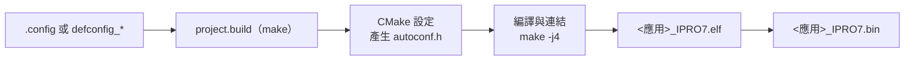

# 建置系統與設定

FreeRTOS 應用由 `make` 驅動 CMake 建置。應用的 `.config` 列出所有 `CONFIG_*` 設定，建置時轉成 C 標頭 `autoconf.h`，並據以決定要編譯哪些元件。本頁說明這套流程與 Reef 各組設定的建置方式；Zephyr 以 `west` 建置，見 [Zephyr RTOS](zephyr.md)。

!!! abstract "重點"
    - 建置：`make -C apps/<分類>/<應用>` 或 `./build_freertos.sh build <應用>`。映像檔是 `build/build_out/<應用>_<CONFIG_CHIP>.bin`：IPRO7 與 IPRO7AI 應用為 `_IPRO7.bin`，IPRO6S 應用為 `_IPRO6.bin`。
    - `.config` 原樣讀取。Kconfig 檔只用來說明選項，`select`、`depends on` 與預設值都不會套用；唯一例外是 Reef 的晶振微調，`.config` 沒寫時建置會自動設為 95。
    - Reef 的建置多半是替代設定：`DEFCONFIG=defconfig_reef` 輸出到 `build_reef/`。直接 `make` 就是 Reef 版本的只有 `ipro7ai_reef_demo`、`ipro_reef_teach` 與 `ipro_agora_sentino`。
    - 發行套件裡 `make menuconfig` 與 `make defconfig` 無法使用，請用文字編輯器修改 `.config` 或 `defconfig_*` 檔。
    - 工具鏈（GCC 14，`/opt/toolchain/riscv_ipro7/`）不隨 SDK 提供，請向 INTELPRO 取得。

## 建置流程 { #build-pipeline }



所有指令都在 SDK 根目錄執行：

```bash
make -C apps/platform/ipro7ai_reef_demo          # 建置出廠韌體
make -C apps/platform/ipro7ai_reef_demo clean    # 刪除 build/
./build_freertos.sh -l                           # 依分類列出全部應用
./build_freertos.sh build ipro7ai_reef_demo      # 以應用名稱建置，記錄寫入 build/build.log
```

建置時依序發生：

1. 應用的 `Makefile` 呼叫 `make -C <SDK> -f project.build PROJECT_PATH=<應用目錄>`。專案名稱取自應用目錄名稱。
2. `project.build` 從設定檔讀取 `CONFIG_CPU_ID` 與 `CONFIG_CROSS_COMPILE`，並尋找 CMake：先用 `PATH` 上的 `cmake`，再用隨附的 `tools/cmake/`（CMake 3.15，僅 Linux x86-64）。兩者都沒有時以 `No cmake found` 停止。
3. CMake 以 Unix Makefiles 產生器設定建置目錄，由 `cmake/generate_autoconf.cmake` 依設定檔寫出 `include/generated/autoconf.h`，再加入 `bsp/`、`components/` 與應用目錄。
4. `make -j4` 編譯與連結。多數 SDK 元件函式庫以 `-Werror` 編譯，其中任何警告都會讓建置停止。連結器在結尾印出各記憶體區域的用量，`objcopy` 產生 `.bin`。
5. `compile_commands.json` 複製到 SDK 根目錄，供編輯器的程式碼索引使用。

CMake 開始前，建置會印出 `[INFO] Build Path: <目錄>` 與 `CPU: intelpro_ipro7`，可以確認使用的目錄與工具鏈目標。

### 工具鏈前綴 { #toolchain }

編譯器前綴依序取第一個有設定的來源：

1. 環境變數或 make 命令列上的 `CROSS_COMPILE`：`make -C <應用> CROSS_COMPILE=<目錄>/bin/riscv64-unknown-elf-`。
2. 設定檔的 `CONFIG_CROSS_COMPILE`。多數隨附設定寫的是 `/opt/toolchain/riscv_ipro7/bin/riscv64-unknown-elf-`。
3. `/opt/toolchain/riscv_ipro7/bin/riscv64-unknown-elf-`（Windows 不適用）。

`cmake/toolchain.cmake` 只在前綴後面接上 `gcc`、`g++`、`ld` 與 `objcopy`，不會另外搜尋路徑。接著它試編 DSP 擴充指令：編譯器接受時加上 DSP 旗標，否則改用標準 GCC 的旗標。

發行套件記載的建置主機是 macOS 與 Linux（bash）。`project.build` 雖有 Windows 分支（以 `python` 解析設定檔、使用 `PATH` 上的 `cmake`），但在 Windows 不設預設前綴，必須自行提供 `CROSS_COMPILE`；`build_freertos.sh` 與 `tools/serial_monitor.py` 需要 POSIX shell。

### 輸出檔 { #outputs }

位於 `build/build_out/`（替代設定則是 `build_<名稱>/build_out/`）：

| 檔案 | 內容 |
|---|---|
| `<應用>_<CHIP>.elf` | 含符號的映像，供除錯與 `size` |
| `<應用>_<CHIP>.bin` | 燒錄用的二進位檔 |
| `<應用>_<CHIP>.map` | 連結 map |
| `<應用>_<CHIP>.asm` | 反組譯，僅在 `CONFIG_GENERATE_ASM=y` 時產生 |

`<CHIP>` 是 `CONFIG_CHIP` 的值：所有 IPRO7 與 IPRO7AI 設定（包括 Reef）為 `IPRO7`，`ipro6_demo`、`ipro6_if_wifi` 與 `ipro6_fmac` 為 `IPRO6`。`build_freertos.sh` 的其他動作與選項見[工具命令列](../reference/tools.md)。

## 設定檔 .config { #configuration }

`.config` 每行一個設定，格式與 Linux kernel 相同。建置時的轉換規則：

| `.config` | `autoconf.h` |
|---|---|
| `CONFIG_SHELL=y` | `#define CONFIG_SHELL 1` |
| `CONFIG_EM_SIZE=16` | `#define CONFIG_EM_SIZE 16` |
| `CONFIG_CHIP="IPRO7"` | `#define CONFIG_CHIP "IPRO7"` |
| `# CONFIG_EASYFLASH4 is not set` 或 `CONFIG_X=n` | `#undef`，不定義 |
| 其他註解行 | C 註解 |

每個設定也會以 `-D` 傳給編譯器，並設成同名的 CMake 變數，應用的 `CMakeLists.txt` 可以直接寫 `if(CONFIG_SHELL)`。

選項的說明在根目錄 `Kconfig`、`bsp/Kconfig`、`components/**/Kconfig` 與部分應用的 `Kconfig`，但建置只讀設定檔，不會解析 Kconfig。因此：

- `select` 不會生效。例如 `CONFIG_IPRO7AI_REEF` 與 `CONFIG_MM_SUPPORT` 在 Kconfig 中 select `USE_PSRAM`，設定檔仍要明寫 `CONFIG_USE_PSRAM=y`。
- Kconfig 的預設值不會套用。設定檔沒寫的選項就是沒設定。
- 只有一個預設值由建置補上：Reef 的設定檔沒有 `CONFIG_IPRO7_XTAL_CAPCODE` 時，`bsp/board/ipro7/CMakeLists.txt` 會加上 `-DCONFIG_IPRO7_XTAL_CAPCODE=95`，並印出 `[board] IPRO7AI Reef: CONFIG_IPRO7_XTAL_CAPCODE=95 (board default)`。設定檔明寫的值優先；`0` 表示沿用晶片開機時的值。這是編譯器定義，不會出現在 `autoconf.h`。
- 新的設定請從最接近的隨附設定複製再修改，不要從空白檔開始。

### 板型設定 { #board-keys }

板型設定經由 `board_config.h` 決定使用 `bsp/board/ipro7/` 裡哪個板級標頭，只能設一個。`board_config.h` 依固定順序判斷，`CONFIG_EVB`／`CONFIG_DVK` 與 `CONFIG_IPRO7AI_EVK` 都排在 `CONFIG_IPRO7AI_REEF` 之前：同時設了 `CONFIG_EVB=y` 與 `CONFIG_IPRO7AI_REEF=y` 的設定會建置成 IPRO7 EVB 版本，而且不會有任何訊息。

| 設定 | 板級標頭 |
|---|---|
| `CONFIG_IPRO7AI_REEF=y` | `ipro7ai_reef_board_config.h`（IPRO7AI Reef EVK） |
| `CONFIG_EVB=y`、`CONFIG_IPRO7AI_EVK=y`、`CONFIG_IPRO7_ARDUINO=y` 等 | 其他 INTELPRO 板卡 |

所有隨附的 Reef 設定都設 `CONFIG_IPRO7AI_REEF=y` 與 `CONFIG_BOARD="IPRO7AI_REEF"`，沒有其他板型設定。

### 常用設定 { #common-settings }

| 設定 | 說明 |
|---|---|
| `CONFIG_IPRO7=y`、`CONFIG_CHIP="IPRO7"` | 晶片；`CONFIG_CHIP` 也是輸出檔名的後綴（IPRO6S 為 `CONFIG_IPRO6=y`、`CONFIG_CHIP="IPRO6"`） |
| `CONFIG_CPU_ID="intelpro_ipro7"` | 工具鏈目標，兩種晶片相同 |
| `CONFIG_CROSS_COMPILE="…/riscv64-unknown-elf-"` | 工具鏈前綴，見[工具鏈前綴](#toolchain) |
| `CONFIG_IPRO7AI_REEF=y`、`CONFIG_BOARD="IPRO7AI_REEF"` | 板型，見[板型設定](#board-keys) |
| `CONFIG_FREERTOS_SUPPORT=y` | 使用 FreeRTOS |
| `CONFIG_LINK_FLASH=y` | 程式由 Flash 直接執行（XIP） |
| `CONFIG_IPRO7_FLASH_2M=y`（或 `_4M`、`_8M`） | Flash 連結大小，未設定時 1 MB |
| `CONFIG_USE_PSRAM=y` | 啟用 8 MB PSRAM |
| `CONFIG_PLATFORM_UART_BAUDRATE=115200` | 主控台鮑率，未設定時 115200 |
| `CONFIG_SHELL=y` | 主控台 shell |
| `CONFIG_MM_SUPPORT=y` | ISP、相機與 MJPEG；需同時設 `CONFIG_USE_PSRAM=y` |
| `CONFIG_AI_SUPPORT=y` | NPU 推論執行庫；需同時設 `CONFIG_USE_PSRAM=y` |
| `CONFIG_BLUETOOTH_LE_ENABLE=y` | BLE；控制器與 Host 的設定見 [BLE 開發](ble.md) |

建置後，建置目錄下的 `include/generated/autoconf.h` 就是實際生效的值。以 `make -C apps/bluetooth/ble/ipro_ble_remote DEFCONFIG=defconfig_reef` 為例：

```c title="apps/bluetooth/ble/ipro_ble_remote/build_reef/include/generated/autoconf.h（節錄）"
#define CONFIG_IPRO7 1
#define CONFIG_CHIP "IPRO7"
#define CONFIG_IPRO7AI_REEF 1
#define CONFIG_BOARD "IPRO7AI_REEF"
#define CONFIG_IPRO7_FLASH_2M 1
/* CONFIG_EASYFLASH4 is not set */
#undef CONFIG_EASYFLASH4
#define CONFIG_IPRO_BLE_REMOTE_OTA 1
#define CONFIG_IPRO_BLE_CTLR_LIB "link1_periph"
#define CONFIG_EM_SIZE 16
```

### 設定工具 { #config-tools }

| 工具 | 在發行套件中 |
|---|---|
| 文字編輯器 | 直接修改 `.config` 或 `defconfig_*` 檔，這是支援的做法 |
| `make menuconfig` | 無法使用：需要未隨附的 `tools/kconfig/menuconfig.py`，應用的 Makefile 也不轉交這個目標 |
| `make defconfig`、`make list-defconfigs` | 部分 Makefile（例如 `ipro_ble_remote`）有這些目標。它們先找未隨附的 `configs/` 目錄，再把應用目錄下的 `defconfig` 複製成 `.config` |
| `make savedefconfig`、`make show-config` | 把 `.config` 複製成 `defconfig`；印出 `.config` |
| `tools/script/parse_kconfig_dynamic.py` | 把 Kconfig 樹印成 JSON（需要 `kconfiglib`），建置不會用到 |

## 替代設定 { #variants }

支援多種板卡或功能的應用會附多個設定檔。選用其中一個，不必動到 `.config`：

| 方式 | 範例 | 建置目錄 |
|---|---|---|
| `DEFCONFIG=<檔名>` | `make -C apps/bluetooth/ble/ipro_ble_remote DEFCONFIG=defconfig_reef` | `build_reef/` |
| `build_freertos.sh -d <檔名>` | `./build_freertos.sh -d defconfig_reef build ipro_ble_remote` | `build_reef/` |
| `BOARD=<板>` | `make -C apps/multimedia/ipro_agora_sentino`（預設 `BOARD=reef`，即 `.config`） | `build/` |

- `DEFCONFIG=` 把指定檔複製成 `build_<名稱>/.config` 再建置。`<名稱>` 是檔名去掉 `defconfig_` 前綴與副檔名：`defconfig_reef_ov5640` 輸出到 `build_reef_ov5640/`，`config_evk` 輸出到 `build_config_evk/`。
- 輸出檔名不變，一樣是 `<應用>_IPRO7.bin`，位於 `build_<名稱>/build_out/`。
- `BOARD=` 只有兩個 Makefile 實作：`ipro_agora_sentino`（預設 `reef`，即 `.config`；`BOARD=evk` 選 `config_evk`）與 `ipro_pdm_mic_demo`（IPRO7 EVB／IPRO7AI EVK 的應用），其他應用會忽略它。`build_freertos.sh` 沒有 `BOARD` 選項，請以 `-d` 指定設定檔。
- `make clean` 的行為取決於應用的 Makefile。把 `clean` 交給 `project.build` 的應用（`ipro_ble_remote`、`ipro_throughput_test`、`ipro_le_audio_headset`、`ipro7_uvc_cam`、`ipro_agora_sentino`），`make clean DEFCONFIG=<檔名>` 會刪除 `build_<名稱>/`；`ipro7ai_reef_demo`、`ipro_reef_teach` 與 `ipro_ai_link` 只刪 `build/`，`ipro7_jpeg_decode` 刪 `build/` 與所有 `build_*/`。其他建置目錄請自行刪除。
- 命令列的 `-j N` 或 `build_freertos.sh -j N` 只作用在外層 make；實際編譯固定以 `-j4` 執行。

本版的 Reef 設定：

| 應用 | 建置指令 | Flash 連結大小 | 主控台 |
|---|---|---|---|
| `ipro7ai_reef_demo` | `make -C apps/platform/ipro7ai_reef_demo` | 1 MB | 115200 |
| `ipro7ai_reef_demo` + Wi-Fi | `make -C apps/platform/ipro7ai_reef_demo DEFCONFIG=defconfig_wifi_ipro6s` | 1 MB | 115200 |
| `ipro_reef_teach` | `make -C apps/ai/ipro_reef_teach` | 2 MB | 115200 |
| `ipro_ble_remote` | `make -C apps/bluetooth/ble/ipro_ble_remote DEFCONFIG=defconfig_reef` | 2 MB | 115200 |
| `ipro_throughput_test` | `make -C apps/bluetooth/ble/ipro_throughput_test DEFCONFIG=defconfig_reef` | 1 MB | 115200 |
| `ipro_le_audio_headset` | `make -C apps/bluetooth/le_audio/ipro_le_audio_headset DEFCONFIG=defconfig_reef` | 2 MB | 115200 |
| `ipro7_uvc_cam` 網路攝影機 | `make -C apps/multimedia/ipro7_uvc_cam DEFCONFIG=defconfig_reef_ov5640` | 自帶 `ipro7_uvc_cam.ld` | 115200 |
| `ipro7_uvc_cam` 剪刀石頭布 | `make -C apps/multimedia/ipro7_uvc_cam DEFCONFIG=defconfig_reef_rps` | 自帶 `ipro7_uvc_cam.ld` | 115200 |
| `ipro7_jpeg_decode` | `make -C apps/multimedia/ipro7_jpeg_decode DEFCONFIG=defconfig_reef` | 1 MB | **921600** |
| `ipro_ai_link` | `make -C apps/test/ipro_ai_link DEFCONFIG=defconfig_reef` | 2 MB | 115200 |
| `ipro_agora_sentino` | `make -C apps/multimedia/ipro_agora_sentino` | 2 MB | 115200 |

`ipro_ble_remote`、`ipro_throughput_test`、`ipro_le_audio_headset`、`ipro7_uvc_cam`、`ipro_ai_link` 與 `ipro7_jpeg_decode` 直接 `make` 會建置成其他板卡的版本；在 Reef 上一律指定 Reef 的設定檔。除了 `ipro_throughput_test/defconfig_reef`，所有 Reef 設定都設了 `CONFIG_USE_PSRAM=y`。各設定的燒錄方式（包括分割表、boot2 與 `mfg` 資料）見[範例](../examples/index.md)與應用的 README。

## 記憶體配置 { #memory-layout }

| 區域 | 起始位址 | 大小 | 用途 |
|---|---|---|---|
| Flash | `0x13000000` | 預設以 1 MB 連結；`CONFIG_IPRO7_FLASH_2M`／`_4M`／`_8M` 改為 2／4／8 MB | 程式碼與唯讀資料，XIP 執行 |
| PSRAM | `0x1e000000` | 8 MB | `CONFIG_USE_PSRAM=y` 時，`.data`、`.bss` 與主要 heap 放在這裡 |
| OCRAM | `0x11010000` | 256 KB，扣除下列保留 | 未啟用 PSRAM 時的主要 RAM；`.ocram_*` 區段、堆疊與需要高速執行的程式碼 |
| HBNRAM | `0x20090000` | 4 KB | 休眠期間保留的資料 |

OCRAM 可用大小依設定而變：

| 設定 | 連結器可用的 OCRAM |
|---|---|
| 未啟用 AI（一般情況） | 256 KB 減 `CONFIG_EM_SIZE`（BLE Exchange Memory，從 OCRAM 頂端保留） |
| `CONFIG_AI_SUPPORT=y` 且 `CONFIG_MM_SUPPORT=y`，未用 BLE（`CONFIG_EM_SIZE` 為 0 或未設） | 64 KB |
| `CONFIG_AI_SUPPORT=y` 且 `CONFIG_MM_SUPPORT=y`，使用 BLE | 48 KB |

AI 與影像同時開啟時，NPU 會占用 OCRAM 的高位區段，再加上 BLE 的 Exchange Memory，OCRAM 就很緊；三者都需要的應用，可能得拆成不同的設定。

- Flash 連結大小不可超過板上實際容量，預設 1 MB 是為了避免映像在不知不覺中長過實體 Flash。Reef 的 IPRO7AI 內封 2 MB Flash（見 [IPRO7AI Reef EVK](../hardware/boards/reef-evk.md)），上表的 Reef 設定各以 1 MB 或 2 MB 連結。`ipro7ai_reef_demo` 的 `.config` 註明 1 MB 配置適用兩種內封 Flash，加上 `CONFIG_IPRO7_FLASH_2M=y` 可讓連結器使用整顆 Flash。
- 以 2 MB 連結不會加大韌體分割區：映像仍要放得進燒錄時所用分割表的韌體區（`partition_cfg_2M.toml` 為 1180 KB）。
- 連結腳本由 `bsp/board/linker/` 產生（範本 `ipro7/ipro7_common.ld.in`，記憶體參數在 `configs/ipro7_flash.cmake`）。應用目錄下有 `<應用>.ld`（例如 `ipro7_uvc_cam.ld`），或設定檔設了 `CONFIG_LINKER_SCRIPT="<檔名>"` 時，改用該連結腳本，Flash 大小設定也就不適用。
- 建置結尾印出的記憶體用量是判斷是否放得下的依據。

## 應用結構 { #app-structure }

```text
apps/<分類>/<應用>/
├── .config            建置設定（必要）
├── Makefile           呼叫 SDK 根目錄的 project.build
├── CMakeLists.txt     原始檔、include 路徑與 setup_project()
├── main.c             進入點
├── Kconfig            （選用）應用專屬選項的說明
├── defconfig_*        （選用）替代設定
├── <應用>.ld          （選用）應用自帶的連結腳本
├── src/  include/
└── build/             建置輸出（自動產生）
    ├── include/generated/autoconf.h
    └── build_out/<應用>_IPRO7.{elf,bin,map}
```

應用的 `CMakeLists.txt` 不需要 `cmake_minimum_required()` 或 `project()`，直接使用 SDK 的建置巨集：

| 巨集或屬性 | 作用 |
|---|---|
| `__component_add_include_dirs(<目錄>)` | 加入 include 路徑 |
| `target_sources(app PRIVATE ...)` | 把原始檔加入 `app` 函式庫；`main.c` 不要放在這裡 |
| `set_property(GLOBAL APPEND PROPERTY SDK_LIBS app)` | 連結 `app` 函式庫 |
| `set_property(GLOBAL APPEND PROPERTY SDK_WHOLE_ARCHIVE_LIBS app)` | 以 whole-archive 連結；有註冊 shell 指令時必須加 |
| `__set_main_file(main.c)` | 指定主程式，只編進 ELF |
| `setup_project(<應用>)` | 產生 `<應用>_<CHIP>.elf`、`.bin`、`.map`；名稱要與目錄名稱相同 |

在 `CMakeLists.txt` 用 `if(CONFIG_…)`，可以只在需要的設定加入原始檔。出廠韌體就是這樣加入 Wi-Fi 與 RTSP 的原始檔，同一個目錄同時建置 `.config` 與 `defconfig_wifi_ipro6s`：

```cmake title="apps/platform/ipro7ai_reef_demo/CMakeLists.txt（節錄）"
# Wi-Fi through the IPRO6S_FIN in CARD1 (ipronet_host over SDIO).
if(CONFIG_WIFI_USE_IPRO6S)
    target_sources(app PRIVATE ${CMAKE_CURRENT_SOURCE_DIR}/src/wifi_ipro6s.c)
    ...
endif()

# RTSP MJPEG camera stream over that Wi-Fi; camera ch0 at sensor / 2.
if(CONFIG_WIFI_USE_IPRO6S AND CONFIG_RTSP_SERVER)
    target_sources(app PRIVATE ${CMAKE_CURRENT_SOURCE_DIR}/src/wifi_rtsp.c)
    target_compile_definitions(app PRIVATE CAM_SCALE_DIV=2u)
endif()
```

所有 FreeRTOS 應用共用 `components/os/freertos/freertos_app_hooks`：heap、FreeRTOS hook（idle、tick、stack overflow、malloc failed）與 assert 都有 weak 預設實作。`main()` 只需呼叫 `ipro_platform_init()`、建立任務並啟動排程器。

- `ipro_platform_init()` 依序完成平台初始化（板卡設定與主控台 UART）、heap、boot2 分割表、日誌，以及 `CONFIG_SHELL=y` 時的 shell。應用不要再初始化一次 shell。
- `main.c` 不要再加 heap、hook 或 assert 的樣板程式碼。要覆寫某個 hook（例如 `vApplicationIdleHook`），在自己的原始檔定義同名的非 weak 版本即可，連結器會自動採用。

## 在 Reef 上動手做 { #hands-on }

為出廠韌體建立自己的替代設定，確認建置如何處理它，再上板執行。範例依 `.config` 註解的建議，讓 `ipro7ai_reef_demo` 以整顆 2 MB 內封 Flash 連結。

<div class="ipro-steps" markdown>

1. **建立設定檔。** 複製 `.config` 並加一行：

    ```bash
    cp apps/platform/ipro7ai_reef_demo/.config apps/platform/ipro7ai_reef_demo/defconfig_2m
    echo 'CONFIG_IPRO7_FLASH_2M=y' >> apps/platform/ipro7ai_reef_demo/defconfig_2m
    ```

    ```ini title="apps/platform/ipro7ai_reef_demo/defconfig_2m（新增的一行）"
    CONFIG_IPRO7_FLASH_2M=y
    ```

2. **看這個設定在哪裡用到。** 連結腳本產生器把它轉成 `flash` 記憶體區域的大小：

    ```cmake title="bsp/board/linker/configs/ipro7_flash.cmake（節錄）"
    elseif(CONFIG_IPRO7_FLASH_2M)
        set(FLASH_SIZE "2M")
        message(STATUS "IPRO7 flash: 2M (CONFIG_IPRO7_FLASH_2M=y, SF3 external flash)")
    ...
    else()
        set(FLASH_SIZE "1M")
        message(STATUS "IPRO7 flash: 1M (default, on-chip)")
    endif()
    ```

3. **建置。**

    ```bash
    make -C apps/platform/ipro7ai_reef_demo DEFCONFIG=defconfig_2m
    ```

    建置輸出中會有（路徑已縮短）：

    ```text
    [INFO] Using defconfig: defconfig_2m -> <SDK>/apps/platform/ipro7ai_reef_demo/build_2m/.config
    [INFO] Build Path: <SDK>/apps/platform/ipro7ai_reef_demo/build_2m
    -- IPRO7 flash: 2M (CONFIG_IPRO7_FLASH_2M=y, SF3 external flash)
    -- [board] IPRO7AI Reef: CONFIG_IPRO7_XTAL_CAPCODE=95 (board default)
    Memory region         Used Size  Region Size  %age Used
               flash:          …         2 MB       …%
    ```

    映像檔是 `apps/platform/ipro7ai_reef_demo/build_2m/build_out/ipro7ai_reef_demo_IPRO7.bin`；原本的 `.config` 與 `build/` 都沒有變動。

4. **確認生效的設定。**

    ```bash
    grep -E '^#define CONFIG_(IPRO7AI_REEF|IPRO7_FLASH_2M) ' \
        apps/platform/ipro7ai_reef_demo/build_2m/include/generated/autoconf.h
    ```

    ```text
    #define CONFIG_IPRO7AI_REEF 1
    #define CONFIG_IPRO7_FLASH_2M 1
    ```

5. **燒錄並執行。** 以 `build_2m/` 下的映像檔，比照出廠韌體燒錄（見[燒錄與序列埠](../get-started/flash-and-monitor.md)），或一個指令完成：

    ```bash
    export IPRO_FLASH_TOOL=<ICUBE>/ipro_iot_tool_macos
    ./build_freertos.sh -d defconfig_2m -p /dev/cu.usbserial-XXXX \
        -P <ICUBE>/chips/ipro7/partition/partition_cfg_2M.toml \
        build flash monitor ipro7ai_reef_demo
    ```

6. **看主控台**（115200 baud）。開頭幾行中（略去日誌前綴），`Build:` 行是這次建置的時間，`[XTAL]` 行是建置補上的微調值：

    ```text
    Build:<時間>,<日期>
    [XTAL] capcode <開機值> -> 95
      IPRO7AI Reef carrier demo
      UART0 TX=20 RX=21  RGB=G24  SPK_EN=G25(hi)
    shell ready - `reef`, `led`, `btn`, `spk`, `mic`, `sd`, `fin`, `cam`, `hp`
    ```

</div>

要還原時，重新燒錄 `build/` 下的映像即可。接下來：依[建立第一個自己的應用](../tutorials/first-own-app.md)寫一個自己的應用，再用[測試你的應用](../tutorials/testing.md)驗證它。

## 建立新應用 { #creating-apps }

[建立第一個自己的應用](../tutorials/first-own-app.md)從空目錄一步步建立 Reef 應用。它遵循的規則：

- 應用放在 `apps/<分類>/<應用>/`。複製來的 Makefile 以 `IPRO_SDK_BASE ?= $(abspath ../../../)` 找到 SDK 根目錄；多一層（例如 `apps/bluetooth/ble/<應用>`）時要改成 `../../../../`。Makefile 請用複製的，不要從網頁貼上：recipe 行必須以 tab 開頭。
- `.config` 從 `apps/platform/ipro7ai_reef_demo/.config` 開始，刪掉用不到的部分。第一行的註解就是 `./build_freertos.sh -l` 顯示的說明。
- `CMakeLists.txt` 使用[應用結構](#app-structure)列出的巨集；`setup_project()` 的名稱要與目錄名稱相同。
- `main.c` 保持精簡：

    ```c title="main.c"
    #include <FreeRTOS.h>
    #include <task.h>

    #include "freertos_app_hooks.h"

    static void app_task(void *arg)
    {
        (void)arg;
        for (;;) {
            vTaskDelay(pdMS_TO_TICKS(1000));
        }
    }

    int main(void)
    {
        ipro_platform_init();   /* platform, heap, boot2, log, shell */
        xTaskCreate(app_task, "app", 1024, NULL, 5, NULL);
        vTaskStartScheduler();
        for (;;) {
        }
    }
    ```

## 本版限制 { #limitations }

- 沒有互動式設定工具：發行套件中 `make menuconfig` 與 `make defconfig` 無法使用（見[設定工具](#config-tools)）。
- 不解析 Kconfig，相依的選項必須自己寫進設定檔；建置唯一補上的預設值是 Reef 的晶振微調。
- `BOARD=` 只在 `ipro_agora_sentino` 與 `ipro_pdm_mic_demo` 有作用。
- 發行套件只記載 macOS 與 Linux 建置主機。

## 相關文件 { #related }

- [建立第一個自己的應用](../tutorials/first-own-app.md)：從空目錄建立 Reef 應用。
- [測試你的應用](../tutorials/testing.md)：主控台檢查、自我測試與 `build_freertos.sh test`。
- [架構](architecture.md)：分層、元件與目錄。
- [BLE 開發](ble.md)：`.config` 中的 BLE 設定。
- [工具命令列](../reference/tools.md)：`build_freertos.sh` 的所有動作與選項。
- [範例](../examples/index.md)：各應用附帶的設定檔。
