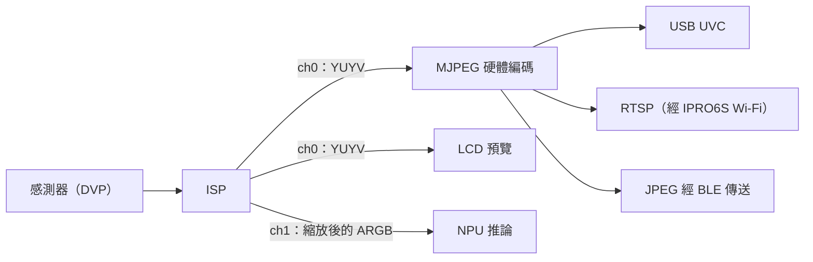

# 相機與影像

IPRO7 經 DVP 介面接相機感測器，影像進入晶片內的 ISP 後可輸出兩路：一路給預覽或 MJPEG 硬體編碼，另一路縮放後交給 NPU。SDK 提供感測器驅動、ISP 元件、MJPEG 與 CherryUSB 的 UVC，範例涵蓋 USB 攝影機、LCD 預覽、NPU 偵測與 RTSP 串流。

!!! abstract "重點"
    - 感測器：SC101IOT（IPRO7 EVB、IPRO7AI EVK）；OV5640、OV2640（IPRO7AI Reef EVK，需在 `.config` 開啟）。
    - 影像功能需要 `CONFIG_MM_SUPPORT=y`，且要同時設 `CONFIG_USE_PSRAM=y`；影格緩衝在 PSRAM。
    - USB 攝影機：`ipro7_uvc_cam`，DVP → ISP → MJPEG 硬體編碼 → UVC。
    - Zephyr 尚未提供相機驅動；相機開發請用 FreeRTOS。

## 影像管線 { #camera-video }



- ISP 的兩個輸出通道各自設定解析度與影格率：channel 0 給預覽或編碼，channel 1 從感測器畫面取一塊區域縮放成模型輸入大小，交給 NPU。
- SC101IOT 由 ISP 韌體做自動曝光、白平衡等 3A 處理，IQ 參數在 `components/isp_iq_param/sc101iot/`；OV5640 與 OV2640 使用感測器內建的 3A。
- MJPEG 編碼與解碼都有硬體支援（`hal_mjpeg.h`、`hal_mjdec.h`）。

## 元件與設定 { #configuration }

| 部分 | 位置 | 說明 |
|---|---|---|
| 相機 HAL | `bsp/hal/inc/hal_cam.h`、`hal_isp.h`、`hal_mjpeg.h`、`hal_mjdec.h` | DVP 擷取、ISP、MJPEG 編碼與解碼 |
| 感測器 | `components/sensor/` | 感測器驅動與 SCCB；`camera_module_init()` 依序偵測已註冊的感測器 |
| ISP 控制 | `components/isp_firmware/` | ISP 設定、3A、影像參數處理 |
| ISP 演算法 | `components/isp_algorithm/` | 預編譯 `libisp_algorithm.a` |
| IQ 參數 | `components/isp_iq_param/`、`components/isp_iq_cmd/` | 感測器 IQ 參數與調校指令 |
| UVC | `components/cherryusb/class/video/` | USB Video Class device |
| RTSP | `components/network/rtsp_server/` | RTSP MJPEG 串流（`CONFIG_RTSP_SERVER`） |
| EVK 相機 | `components/board/ipro7ai_evk/` | IPRO7AI EVK 的相機函式庫（`evk_cam.h`） |

```ini title=".config（相機與 USB 攝影機）"
CONFIG_USE_PSRAM=y
CONFIG_MM_SUPPORT=y
CONFIG_COMPONENTS_SENSOR_ENABLE=y
# Reef 的感測器另外開啟：
# CONFIG_SENSOR_OV5640=y
# CONFIG_SENSOR_OV2640=y
CONFIG_COMPONENTS_CHERRYUSB_ENABLE=y
CONFIG_CHERRYUSB_DEVICE=y
CONFIG_CHERRYUSB_DEVICE_VIDEO=y
```

Kconfig 中 `CONFIG_MM_SUPPORT` 會 select `USE_PSRAM`，但建置不解析 Kconfig，`CONFIG_USE_PSRAM=y` 必須寫進 `.config`，原因見[建置系統與設定](build-system.md#configuration)。

### 支援的感測器 { #sensors }

| 感測器 | `.config` | 輸出 | 使用的板卡 |
|---|---|---|---|
| SC101IOT | `CONFIG_COMPONENTS_SENSOR_ENABLE=y` 即包含 | 1280×720，DVP，SCCB 位址 0x68 | IPRO7 EVB、IPRO7AI EVK |
| OV5640 | `CONFIG_SENSOR_OV5640=y` | 1280×720 YUV422（2×2 binning），SCCB 0x3C | IPRO7AI Reef EVK |
| OV2640 | `CONFIG_SENSOR_OV2640=y` | 1280×720 YUV422（由 UXGA 縮放），SCCB 0x30 | IPRO7AI Reef EVK |

`components/sensor/` 另含 GC6133 與 GC032A 驅動，隨附範例未使用。

## USB 攝影機 ipro7_uvc_cam { #uvc-cam }

`apps/multimedia/ipro7_uvc_cam` 讓開發板列舉成一般的 UVC 攝影機：DVP 感測器 → ISP → MJPEG 硬體編碼 → USB 等時傳輸。主機開啟串流後就持續輸出。

| 設定檔 | 板卡與感測器 | UVC 影格 | 主控台 |
|---|---|---|---|
| `.config` | IPRO7 EVB＋SC101IOT | 320×240 MJPEG | 921600 baud |
| `defconfig_reef_ov5640` | IPRO7AI Reef EVK＋OV5640 | 1280×720 與 640×360 MJPEG，由主機選擇 | 115200 baud |
| `defconfig_reef_rps` | IPRO7AI Reef EVK＋OV5640 | 640×360 MJPEG，畫面上疊加與 NPU 對玩的剪刀石頭布 | 115200 baud |

```bash
make -C apps/multimedia/ipro7_uvc_cam DEFCONFIG=defconfig_reef_ov5640   # 輸出於 build_reef_ov5640/build_out/
make -C apps/multimedia/ipro7_uvc_cam DEFCONFIG=defconfig_reef_rps      # 輸出於 build_reef_rps/build_out/
make -C apps/multimedia/ipro7_uvc_cam                                   # IPRO7 EVB
```

- 影格率宣告為 30 fps。USB 為 Full-Speed，720p 畫面較複雜時編碼後的影格較大，實際影格率會降低；需要穩定 30 fps 時讓主機選 640×360。
- 解析度與格式寫在原始碼中（`uvc.c` 的描述元與 `uvc_isp.h`），沒有對應的 `.config` 設定。
- 預設 `.config` 啟用 `CONFIG_AI_SUPPORT`，開機時嘗試從 `mfg` 分割區載入 NPU 模型並在畫面上畫出偵測框；載入失敗時照常串流，只是沒有偵測。
- `defconfig_reef_rps` 的模型與遊戲邏輯取自 `apps/ai/ipro7ai_evk_rps`，模型直接連結進韌體（`CONFIG_RPS_EMBED_MODEL=y`）。
- 此應用使用自帶的連結腳本 `ipro7_uvc_cam.ld`。

## IPRO7AI EVK 相機函式庫 { #evk-camera }

`components/board/ipro7ai_evk` 把 EVK 的 SC101IOT 相機包成 `evk_cam_*` API：

- channel 0：YUYV，320×180（等比縮放加黑邊，預設）或 320×240（中央裁切），PSRAM 乒乓緩衝，供 LCD 預覽。
- channel 1：ARGB，從感測器取一塊區域縮放成模型輸入，同一時間只有一張影格在 NPU 處理中。

```ini title=".config（IPRO7AI EVK 相機）"
CONFIG_IPRO7AI_EVK=y
CONFIG_COMPONENTS_IPRO7AI_EVK_ENABLE=y
CONFIG_EVK_CAMERA=y
CONFIG_MM_SUPPORT=y
CONFIG_COMPONENTS_SENSOR_ENABLE=y
CONFIG_USE_PSRAM=y
```

影格回呼在中斷內執行，只記下位址並喚醒處理任務：

```c title="EVK 相機預覽骨架（依 apps/ai/ipro7ai_evk_rps/src/rps_ui.c）"
#include <FreeRTOS.h>
#include <task.h>
#include <semphr.h>

#include "evk.h"

static SemaphoreHandle_t s_sem;
static volatile uint32_t s_latest;

static void frame_cb(uint32_t yuyv_addr, void *arg)   /* 中斷內執行 */
{
    BaseType_t woken = pdFALSE;

    (void)arg;
    s_latest = yuyv_addr;
    xSemaphoreGiveFromISR(s_sem, &woken);
    portYIELD_FROM_ISR(woken);
}

static void preview_task(void *arg)
{
    (void)arg;
    s_sem = xSemaphoreCreateBinary();
    evk_begin();                                /* 啟動面板；相機待命、放大器關閉 */
    evk_cam_set_fit(EVK_CAM_FIT_LETTERBOX);     /* 320×180 */
    evk_cam_set_frame_cb(frame_cb, NULL);
    if (evk_cam_start() != EVK_CAM_OK) {
        vTaskDelete(NULL);
    }
    for (;;) {
        xSemaphoreTake(s_sem, portMAX_DELAY);
        /* s_latest 是 channel 0 的 YUYV 影格位址，在這裡繪製或處理 */
    }
}
```

要把 channel 1 交給 NPU，在 `evk_cam_start()` 之前以 `evk_cam_set_npu_input()` 設定緩衝位址、輸出大小與感測器區域，並以 `evk_cam_set_npu_frame_cb()` 接收影格。完整用法見 `apps/ai/ipro7ai_evk_rps` 與 `apps/ai/ipro7ai_evk_person_detect`；NPU 的部分見 [AI 與 NPU](ai-npu.md)。

## 使用相機的範例 { #camera-apps }

| 範例 | 板卡與感測器 | 內容 |
|---|---|---|
| `ipro7_uvc_cam` | EVB＋SC101IOT；Reef＋OV5640 | USB 攝影機 |
| `ipro7ai_reef_demo` | Reef＋OV5640／OV2640 | `cam` 指令檢查相機；`defconfig_wifi_ipro6s` 經 IPRO6S FIN 卡的 Wi-Fi 以 RTSP 串流 MJPEG，見 [IPRO7AI Reef EVK](../hardware/boards/reef-evk.md) |
| `ipro_ble_remote`（`defconfig_reef`） | Reef＋OV5640 | 拍攝 1280×720 JPEG，經 BLE 圖片服務傳到手機；畫面動態偵測 |
| `ipro7ai_evk_person_detect` | EVK＋SC101IOT | LCD 預覽，疊加 NPU 的人與寵物偵測框 |
| `ipro7ai_evk_rps` | EVK＋SC101IOT | 與 NPU 玩剪刀石頭布 |
| `ipro7ai_evk_launcher` | EVK＋SC101IOT | 相機、LCD、麥克風與喇叭整合，以 NPU 辨識的手勢切換頁面 |
| `ipro7ai_evk_demo` | EVK＋SC101IOT | 面板、相機與音訊的硬體驗證指令 |
| `ipro7_demo` | EVB | ISP、MJPEG 編碼與解碼的測試程式（`demo/mm/`） |

## 本版限制 { #limitations }

- Zephyr 尚未提供相機、ISP 與 USB 驅動。
- ISP 的 IQ 參數只隨附 SC101IOT；OV5640 與 OV2640 使用感測器內建的 3A。
- 未包含 LVGL 等 GUI 函式庫；EVK 的 LCD 以 `components/board/ipro7ai_evk` 的逐列繪圖函式輸出。

## 相關文件 { #related }

- [AI 與 NPU](ai-npu.md)：模型、推論執行庫與 NPU 範例
- [網路](networking.md)：RTSP 串流使用的 Wi-Fi 與 lwIP
- [IPRO7AI Reef EVK](../hardware/boards/reef-evk.md)、[IPRO7AI EVK](../hardware/boards/ipro7ai-evk.md)：板上相機接頭與腳位
- [建置系統與設定](build-system.md)：`DEFCONFIG=` 與記憶體配置
