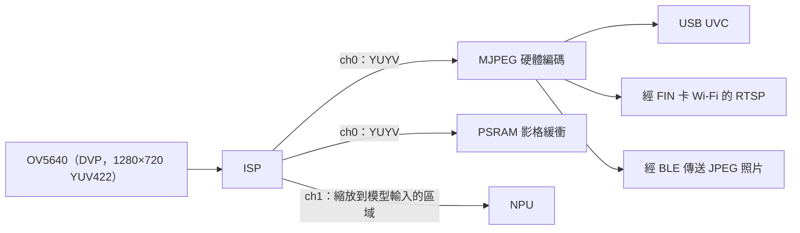

# 相機與影像

IPRO7AI 經 8 位元 DVP 介面接相機感測器。晶片內的 ISP 有兩個輸出通道：通道 0 給預覽或 MJPEG 硬體編碼，通道 1 縮小後交給 NPU。SDK 提供感測器驅動、ISP 與 MJPEG 元件，以及 CherryUSB 的 UVC 類別。IPRO7AI Reef EVK 的相機是接在 FPC1 的 OV5640 模組；`ipro7ai_reef_demo` 可從 shell 啟動相機，`ipro7_uvc_cam` 則把板子變成 USB 攝影機。

!!! abstract "重點"
    - Reef 相機：FPC1 上的 OV5640 FLEX-24 模組，1280×720 YUV422，自動曝光與白平衡由感測器處理。SW7 撥到 **CAM**，接排線前先拔掉 USB-C。
    - 設定：`CONFIG_MM_SUPPORT=y`、`CONFIG_USE_PSRAM=y`、`CONFIG_COMPONENTS_SENSOR_ENABLE=y`、`CONFIG_SENSOR_OV5640=y`；當 USB 攝影機再加 UVC 設定。
    - 範例：`ipro7ai_reef_demo`（`cam` 指令）、`ipro7_uvc_cam`（`defconfig_reef_ov5640` 攝影機、`defconfig_reef_rps` NPU 遊戲）、`defconfig_wifi_ipro6s` 經 Wi-Fi 的 RTSP 串流、`ipro7_jpeg_decode` 的 JPEG 解碼。
    - MJPEG 硬體只能編碼；JPEG 圖片由 CPU 解碼。Zephyr 沒有相機驅動。

## 影像管線 { #camera-video }



- 每個 ISP 通道有各自的輸出尺寸。通道 0 是主機或您的程式看到的畫面；通道 1 取感測器影像的一塊區域，縮放成模型的輸入（例如剪刀石頭布版本把正中央 512×512 的方塊縮成 128×128）。
- OV5640 與 OV2640 驅動讓感測器自己做自動曝光、增益與白平衡，因此不啟動 ISP 韌體的 3A。IQ 參數表只提供給其他 INTELPRO 板卡使用的 SC101IOT 感測器。
- ISP 的 DMA 把影格寫進 PSRAM；CPU 讀取前要先使該範圍的 D-cache 失效（`L1C_DCACHE_INVALID_RANGE`）。
- Reef 的 OV5640 模組讀出時上下顛倒；`ipro7ai_reef_demo/src/cam.c` 在擷取 DMA 翻轉（`CAM_DVP_VFLIP`），而不是在感測器端翻轉。

## 元件與設定 { #configuration }

| 部分 | 位置 | 說明 |
|---|---|---|
| 相機 HAL | `bsp/hal/inc/hal_cam.h`、`hal_isp.h`、`hal_mjpeg.h` | DVP 擷取、ISP、MJPEG 編碼器 |
| 感測器 | `components/sensor/` | 感測器驅動與 SCCB；`camera_module_init()` 依序偵測已註冊的感測器 |
| ISP 控制 | `components/isp_firmware/` | ISP 設定與影像參數處理 |
| ISP 演算法 | `components/isp_algorithm/` | 預編譯的 `libisp_algorithm.a` |
| IQ 參數 | `components/isp_iq_param/`、`components/isp_iq_cmd/` | IQ 參數表與調校指令（SC101IOT） |
| UVC | `components/cherryusb/class/video/` | USB Video Class 裝置 |
| RTSP | `components/network/rtsp_server/` | RTSP MJPEG 串流（`CONFIG_RTSP_SERVER`） |

```ini title=".config（Reef 相機，取自 apps/multimedia/ipro7_uvc_cam/defconfig_reef_ov5640）"
CONFIG_IPRO7AI_REEF=y
CONFIG_BOARD="IPRO7AI_REEF"
CONFIG_USE_PSRAM=y
CONFIG_MM_SUPPORT=y
CONFIG_COMPONENTS_SENSOR_ENABLE=y
CONFIG_SENSOR_OV5640=y
# USB 攝影機
CONFIG_COMPONENTS_CHERRYUSB_ENABLE=y
CONFIG_CHERRYUSB_DEVICE=y
CONFIG_CHERRYUSB_DEVICE_VIDEO=y
```

Kconfig 中 `CONFIG_MM_SUPPORT` 與 `CONFIG_IPRO7AI_REEF` 會 select `USE_PSRAM`，但建置系統不套用 Kconfig 的 `select`，所以 `.config` 一定要寫 `CONFIG_USE_PSRAM=y`；見[建置系統與設定](build-system.md#configuration)。

### 支援的感測器 { #sensors }

| 感測器 | `.config` | 輸出 | 說明 |
|---|---|---|---|
| OV5640 | `CONFIG_SENSOR_OV5640=y` | 1280×720 YUV422（2×2 binning），SCCB 位址 0x3C | Reef 的 FPC1 採 OV5640 FLEX-24 腳位。30 fps，光線暗時降到 15 fps |
| OV2640 | `CONFIG_SENSOR_OV2640=y` | 1280×720 YUV422（由 UXGA 縮放），SCCB 0x30 | `ipro7ai_reef_demo` 與 OV5640 驅動一起開啟 |
| SC101IOT | 隨 `CONFIG_COMPONENTS_SENSOR_ENABLE=y` 編入 | 1280×720 | IPRO7 EVB 與 IPRO7AI EVK 的感測器 |

OV5640 與 OV2640 驅動需要明確開啟，其他板卡不必負擔它們的空間。`components/sensor/` 另有 GC6133、GC032A 驅動，沒有隨附範例使用。

## 在 Reef 上動手做 { #hands-on }

偵測 OV5640、啟動串流、確認影格率與錯誤計數，再以 ASCII 圖形看一張畫面。這些都在 `ipro7ai_reef_demo` 中執行，它的相機模組 `src/cam.c` 可直接在您的應用程式中重用。

<div class="ipro-steps" markdown>

1. **硬體與設定**

    拔掉 USB-C，把相機排線接到 FPC1，SW7 撥到 **CAM**，再插回 USB-C。demo `.config` 中的相機設定：

    ```ini title="apps/platform/ipro7ai_reef_demo/.config（摘錄）"
    CONFIG_IPRO7AI_REEF=y
    CONFIG_BOARD="IPRO7AI_REEF"
    CONFIG_USE_PSRAM=y
    CONFIG_MM_SUPPORT=y
    CONFIG_COMPONENTS_SENSOR_ENABLE=y
    CONFIG_SENSOR_OV5640=y
    CONFIG_SENSOR_OV2640=y
    ```

2. **程式碼**

    `cam.h` 包裝了上電順序、SCCB 偵測，以及送進 PSRAM 的 ISP 通道 0 串流（感測器尺寸除以 `CAM_SCALE_DIV`，預設 4）。shell 的 `cam` 指令這樣呼叫它：

    ```c title="apps/platform/ipro7ai_reef_demo/src/app_cli.c（摘錄自 cmd_cam）"
    if (strcmp(argv[1], "probe") == 0) {
        if (cam_probe() == 0) {
            uint16_t w, h;
            cam_sensor_size(&w, &h);
            printf("sensor %s at SCCB 0x%02X, %ux%u\n", cam_sensor_name(),
                   cam_sensor_addr(), w, h);
        } else {
            printf("no sensor found\n");
        }
    } else if (strcmp(argv[1], "start") == 0) {
        int rc = cam_start();
        printf(rc == CAM_OK ? "streaming - `cam status` in a second\n"
                            : "start failed (%d)\n", rc);
    } else if (strcmp(argv[1], "status") == 0) {
        cam_stats_t st;
        uint16_t w, h, ow, oh;
        /* ... */
        cam_get_stats(&st);
        cam_out_size(&ow, &oh);
        printf("ch0     : YUYV %ux%u, frames %u, %u.%u fps, luma mean %u\n", ow, oh,
               (unsigned)st.frames, (unsigned)(st.fps_x10 / 10), (unsigned)(st.fps_x10 % 10),
               (unsigned)st.luma_mean);
        printf("errors  : fifo %u, vsync %u, hsync %u\n", (unsigned)st.fifo_err,
               (unsigned)st.vsync_err, (unsigned)st.hsync_err);
    }
    ```

    `cam_latest_frame()` 回傳最新一張完整 YUYV 影格的位址，供您自己處理。`ipro_ble_remote` 的 Reef 建置就是在 CMake 中加入這個模組重用它，只是換了縮放倍率：

    ```cmake title="apps/bluetooth/ble/ipro_ble_remote/CMakeLists.txt（摘錄）"
    if(CONFIG_IPRO7AI_REEF)
        set(REEF_DEMO_SRC ${CMAKE_SOURCE_DIR}/apps/platform/ipro7ai_reef_demo/src)
        __component_add_include_dirs(${REEF_DEMO_SRC})
        target_sources(app PRIVATE
            ${REEF_DEMO_SRC}/cam.c
            # ... the remote's other Reef sources
        )
        target_compile_definitions(app PRIVATE CAM_SCALE_DIV=1u)
    endif()
    ```

    建立自己的應用程式見[建立第一個應用程式](../tutorials/first-own-app.md)。

3. **建置**

    ```bash
    make -C apps/platform/ipro7ai_reef_demo
    ```

4. **燒錄**

    進入下載模式（按住 SW1、按一下 SW2、放開 SW1），再到 IntelProCube 目錄執行：

    ```bash
    cd <ICUBE>
    ./ipro_iot_tool_macos --chipname ipro7 --chip-variant IPRO7AI \
        --port /dev/cu.usbserial-XXXX --baudrate 921600 \
        --pt chips/ipro7/partition/partition_cfg_2M.toml \
        --firmware <SDK>/apps/platform/ipro7ai_reef_demo/build/build_out/ipro7ai_reef_demo_IPRO7.bin
    ```

    確認輸出有 `[All Success]` 後按 SW2。其他作業系統見[燒錄與序列埠主控台](../get-started/flash-and-monitor.md)。

5. **執行並確認**

    在 U6 主控台（115200 baud）：

    ```text
    ipro /> cam probe
    sensor __rti_name_ov5640 at SCCB 0x3C, 1280x720
    ipro /> cam start
    streaming - `cam status` in a second
    ipro /> cam status
    sensor  : __rti_name_ov5640 @0x3C 1280x720, streaming
    ch0     : YUYV 320x180, frames …, … fps, luma mean …
    errors  : fifo 0, vsync 0, hsync 0
    dvp     : byte order lower-first, vsync high, hsync high
    ```

    間隔一秒執行兩次 `cam status`：影格數持續增加，錯誤計數不變。接著 `cam bar on` 再 `cam snap`，會印出有直條紋的 ASCII 縮圖（感測器的彩條測試圖）；`cam bar off` 後再 `cam snap` 就是實際畫面。出現 `no sensor found` 時檢查排線、SW7 與模組；demo README 的相機章節列出下一步可用的檢查（`cam pins`、`cam sync`、`cam order`）。

</div>

每次建置後自動檢查相機的作法見[測試您的應用程式](../tutorials/testing.md)。

## USB 攝影機 ipro7_uvc_cam { #uvc-cam }

`apps/multimedia/ipro7_uvc_cam` 讓 Reef 在 USB-C 上列舉成一般的 UVC 攝影機：OV5640 → ISP → MJPEG 硬體編碼 → USB Full Speed 等時端點。主機使用內建的 UVC 驅動即可。

| Reef 設定 | 串流（MJPEG） | NPU | 產出 |
|---|---|---|---|
| `defconfig_reef_ov5640` | 1280×720（畫面複雜時約 15 fps，受限於 Full-Speed USB）或 640×360（30 fps），由主機選擇 | 不使用 | `build_reef_ov5640/build_out/ipro7_uvc_cam_IPRO7.bin` |
| `defconfig_reef_rps` | 640×360，畫面上疊加剪刀石頭布遊戲 | 128×128 分類器，模型連結進韌體 | `build_reef_rps/build_out/ipro7_uvc_cam_IPRO7.bin` |

```bash
make -C apps/multimedia/ipro7_uvc_cam DEFCONFIG=defconfig_reef_ov5640
```

燒錄方式同 demo，使用 `--chip-variant IPRO7AI` 與 `--pt chips/ipro7/partition/partition_cfg_2M.toml`。主控台為 115200 baud，會顯示：

```text
[UVC] Bringing up USB UVC webcam (720p MJPEG)...
[UVC] Streaming pipeline started
```

把 Reef 的 USB-C 接到電腦，用任何相機程式開啟（USB VID 0x3896、PID 0x0701）。shell 可調校感測器：`cam rd <reg> [n]`、`cam wr <reg> <hexbytes>`、`cam grid [cols rows]`。

- 畫面尺寸與格式寫死在共用相機管線的描述元中（`apps/ai/ipro_reef_teach/image/uvc.c`、`uvc_isp.h`），沒有 `.config` 設定。
- 這個應用程式使用自己的連結腳本 `ipro7_uvc_cam.ld`。
- 預設的 `.config` 是給 IPRO7 EVB 與 SC101IOT 感測器用的。
- 剪刀石頭布版本的逐步說明見 [AI 與 NPU](ai-npu.md#hands-on)。

## JPEG 解碼 { #jpeg-decode }

IPRO7 的 MJPEG 硬體只支援編碼：`hal_mjdec.h` 雖然存在，但硬體解碼器在 IPRO7 上無法完成任何一張影格。`apps/multimedia/ipro7_jpeg_decode` 在 CPU 上以 TJpgDec R0.03 解碼 JPEG，外加包裝層 `jdec_rgb`：輸出真正的 RGB565（小端或大端）或 RGB888，並為相機 MJPEG 影格補上省略的標準 Huffman 表。

```bash
make -C apps/multimedia/ipro7_jpeg_decode DEFCONFIG=defconfig_reef   # 產出在 build_reef/build_out/
```

這個版本的主控台是 **921600** baud。`jdec run all` 解碼內建測試圖，逐一與同一解碼器的 PC 版比對，最後印出 `14 images, 0 failed -> ALL PASS`。以 CMake 3.18 以上建置時解碼器以 `-O2` 編譯，192 MHz 下一張 1280×720 4:2:0 圖約 570 ms（應用程式 README）。要在自己的應用程式中使用，複製 `jdec_rgb.c`、`jdec_rgb.h` 與 `tjpgd/`。

## IPRO7AI EVK 相機函式庫 { #evk-camera }

`components/board/ipro7ai_evk`（`evk_cam_*`）是 IPRO7AI EVK 與其 SC101IOT 感測器的相機函式庫，Reef 不使用。該板卡請洽 INTELPRO。

## 使用相機的範例 { #camera-apps }

| 範例 | Reef 設定 | 內容 |
|---|---|---|
| `ipro7ai_reef_demo` | `.config` | `cam` 指令：偵測、串流、狀態、ASCII 快照、彩條、暫存器讀寫、DVP 腳位活動 |
| `ipro7ai_reef_demo` | `defconfig_wifi_ipro6s` | 經 IPRO6S FIN 卡 Wi-Fi，把通道 0（640×360）以 RTSP MJPEG 串流到 `rtsp://<ip>:8554/av0_0`；見[網路](networking.md)與 [Wi-Fi 與 RTSP 串流](../tutorials/wifi-rtsp.md) |
| `ipro7_uvc_cam` | `defconfig_reef_ov5640`、`defconfig_reef_rps` | USB 攝影機；串流畫面上疊加 NPU 剪刀石頭布遊戲 |
| `ipro7_jpeg_decode` | `defconfig_reef` | 軟體 JPEG 解碼成 RGB565／RGB888 |
| `ipro_ble_remote` | `defconfig_reef` | 1280×720 JPEG 照片經 BLE 影像服務傳到手機；畫面有動態時自動拍照；有插 SD 卡時另存到 `sd:/REMOTE/` |
| `ipro_reef_teach` | `.config` | `image` 模式：USB 攝影機加上從 IPRO AI Studio 教出來的板上分類器；見[影像辨識](../teach/image.md) |

IPRO7 EVB 與 IPRO7AI EVK 的相機範例（`ipro7ai_evk_*`、`ipro7_demo`）列在[範例](../examples/index.md)。

## 本版限制 { #limitations }

- IPRO7 沒有硬體 JPEG 解碼；請用 `ipro7_jpeg_decode`。
- USB 為 Full Speed，畫面複雜時 720p MJPEG 約只有 15 fps。
- ISP IQ 參數表只有 SC101IOT；OV5640 與 OV2640 使用感測器自己的 3A。
- Zephyr 沒有相機、ISP 與 USB 驅動。

## 相關文件 { #related }

- [AI 與 NPU](ai-npu.md)：把 ISP 通道 1 交給 NPU
- [網路](networking.md)：RTSP 串流使用的 Wi-Fi
- [IPRO7AI Reef EVK](../hardware/boards/reef-evk.md)：FPC1、SW7 與相機腳位
- [相機 API](../reference/api/camera.md)
- [建置系統與設定](build-system.md)：`DEFCONFIG=` 與記憶體配置
