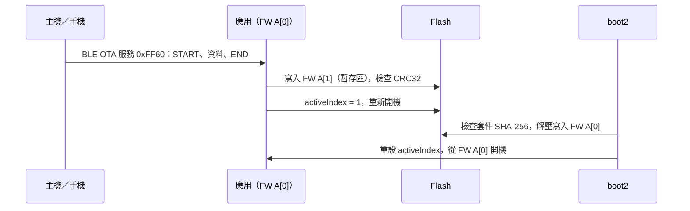

# OTA 更新

FreeRTOS 應用的 OTA 由 boot2 完成：應用把 OTA 套件寫進分割表中閒置的 FW 位置並切換啟用索引，重新開機後 boot2 檢查套件、解壓寫入執行區再開機。SDK 隨附打包工具 `tools/create_ota.py`，以及在 IPRO7AI Reef EVK 上經 BLE 更新的完整參考 `ipro_ble_remote`（`defconfig_reef`）。Zephyr 應用則使用 MCUboot 與 MCUmgr。

!!! abstract "重點"
    - 套件：`tools/create_ota.py` 把 IntelProCube 產生的 `whole_img.bin` 包成 `.xz.ota`（512 位元組標頭＋XZ 壓縮內容）。
    - 參考：`ipro_ble_remote` 的 `defconfig_reef`＋`partition_cfg_2M_remote_ab.toml`＋boot2 v0.5.2；預設 `.config` 不含 OTA。
    - Zephyr：`zephyr/samples/ble_ota`，MCUboot（swap-move）＋經 BLE 的 MCUmgr SMP。
    - 未包含：簽章套件需要的產品設定檔、IPRO6S FIN 卡的韌體套件；boot2 與標準分割表隨 IntelProCube 提供。

## 架構 { #architecture }



依 `ipro_ble_remote` 的 README，套件驗證失敗時 boot2 會進入 USB 救援模式，不會抹除原本的執行區。

## 分割表與 A/B 配置 { #partitions }

`apps/bluetooth/ble/ipro_ble_remote/partition_cfg_2M_remote_ab.toml`（2 MB Flash，含 boot2）：

| 位址 | 分割區 | 大小 | 用途 |
|---|---|---|---|
| 0x000000 | boot2 | 64 KB | IntelProCube 的 boot2 v0.5.2 |
| 0x010000 | PT0／PT1 | 4 KB＋4 KB | 分割表 |
| 0x012000 | FW A[0] | 824 KB | 執行區，boot2 把套件解壓到這裡 |
| 0x0E0000 | FW A[1] | 512 KB | OTA 暫存區，應用把 `.xz.ota` 寫到這裡 |
| 0x160000 | PSM | 112 KB | 持久設定 |
| 0x17C000 | backup | 4 KB | |
| 0x17D000 | media | 16 KB | |
| 0x1FF000 | factory | 4 KB | |

- 這個配置需要 2 MB Flash；`defconfig_reef` 設定 `CONFIG_IPRO7_FLASH_2M=y`。
- boot2 映像位於 IntelProCube 目錄的 `chips/ipro7/builtin_imgs/boot2_v0.5.2/ipro_boot2_IPRO7_v0.5.2.bin`，不在 SDK 套件中。

!!! danger "不要以標準分割表做 OTA"
    在 IPRO7AI Reef EVK 上，不要用標準的 `partition_cfg_2M.toml` 做 OTA：寫入它的第二個 FW 位置並切換後，板子完全沒有輸出，只能進下載模式重新燒錄。請使用 `partition_cfg_2M_remote_ab.toml`。

## OTA 封裝（create_ota.py） { #ota-package }

`tools/create_ota.py` 的輸入必須是含 boot header 的合併映像，例如 IntelProCube 命令列工具以 `--build` 產生的 `chips/ipro7/img_create_iot/whole_img.bin`，不是 SDK 建置輸出的 `.bin`；輸入格式不符時腳本會停止。

```bash
# 1. 以 IntelProCube 產生 whole_img.bin（在 IntelProCube 目錄執行；工具即使失敗也以 0 結束，
#    請在輸出中確認 "PT Check: whole_img.bin"）
./ipro_iot_tool_macos --chipname ipro7 --chip-variant IPRO7AI --build \
    --boot2 chips/ipro7/builtin_imgs/boot2_v0.5.2/ipro_boot2_IPRO7_v0.5.2.bin \
    --pt <SDK>/apps/bluetooth/ble/ipro_ble_remote/partition_cfg_2M_remote_ab.toml \
    --firmware <SDK>/apps/bluetooth/ble/ipro_ble_remote/build_reef/build_out/ipro_ble_remote_IPRO7.bin

# 2. 封裝（預設 XZ 壓縮）
python3 <SDK>/tools/create_ota.py chips/ipro7/img_create_iot/whole_img.bin \
    --hw-ver <hw-version> --fw-ver <fw-version> -o firmware.xz.ota
```

| 參數 | 說明 |
|---|---|
| `<input>` | 合併映像（開頭為 `IPNP` boot header） |
| `--raw` | 不壓縮。未指定 `-o` 時，輸出檔為輸入檔名去掉副檔名再加 `.ota`（`--raw`）或 `.xz.ota` |
| `-o FILE` | 輸出檔 |
| `--hw-ver`、`--fw-ver` | 寫入標頭的硬體與韌體版本字串（各最多 15 字元）；請明確指定，不要依賴預設值 |
| `--sign-key`、`--product`、`--hw-id`、`--fw-version`、`--force-version`、`--key-id` | 簽章套件用；需要 `tools/ota_products.py`，V2.1.0 未附，無法使用 |

| 標頭位移 | 內容 |
|---|---|
| 0–15 | 魔術字串 `IPRO_OTA_Ver1.0` |
| 16–19 | 類型：`XZ  ` 或 `RAW ` |
| 20–23 | 內容長度（little-endian） |
| 32–47、48–63 | 硬體版本、韌體版本字串 |
| 64–95 | 內容的 SHA-256 |
| 96–511 | 保留（0xFF）；簽章套件時放簽章區塊 |
| 512 起 | 內容（XZ，32 KB 字典，配合 boot2 的解壓器） |

`ipro_ble_remote` 的 `tools/make_reef_ota.sh` 把上面兩步包成一個指令，見下節。

## BLE OTA（ipro_ble_remote） { #ble-ota }

`ipro_ble_remote` 的預設 `.config`（IPRO7 EVB）不含 OTA（`# CONFIG_IPRO_BLE_REMOTE_OTA is not set`）。只有 `defconfig_reef` 設定 `CONFIG_IPRO_BLE_REMOTE_OTA=y`，並搭配 boot2 與 A/B 分割表；套件只記載這個 IPRO7AI Reef EVK 的流程。其他板子要使用 OTA 服務，同樣需要 boot2 與類似的 A/B 分割表。

<div class="ipro-steps" markdown>

1. **建置**

    ```bash
    make -C apps/bluetooth/ble/ipro_ble_remote DEFCONFIG=defconfig_reef
    ```

    產出：`apps/bluetooth/ble/ipro_ble_remote/build_reef/build_out/ipro_ble_remote_IPRO7.bin`

2. **第一次燒錄 boot2、A/B 分割表與韌體**：在 IntelProCube 目錄執行（macOS 為例，Linux 與 Windows 的命令見[第一個 BLE 應用](../tutorials/first-ble-app.md#steps)步驟 3）：

    ```bash
    ./ipro_iot_tool_macos --chipname ipro7 --chip-variant IPRO7AI \
        --port /dev/cu.usbserial-XXXX --baudrate 921600 \
        --boot2 chips/ipro7/builtin_imgs/boot2_v0.5.2/ipro_boot2_IPRO7_v0.5.2.bin \
        --pt <SDK>/apps/bluetooth/ble/ipro_ble_remote/partition_cfg_2M_remote_ab.toml \
        --firmware <SDK>/apps/bluetooth/ble/ipro_ble_remote/build_reef/build_out/ipro_ble_remote_IPRO7.bin
    ```

    工具即使失敗也以 0 結束，請以輸出中的 `[All Success]` 判斷。開機訊息先出現 `[BOOT2] IPRO7 Boot2 v0.5.2`，再從 FW A（0x12000）啟動應用。

3. **產生 OTA 套件**：修改程式並重新建置後執行（Linux 改用 `ipro_iot_tool_linux`）

    ```bash
    IPRO_FLASH_TOOL=<IntelProCube>/ipro_iot_tool_macos \
        sh apps/bluetooth/ble/ipro_ble_remote/tools/make_reef_ota.sh
    ```

    產出：`apps/bluetooth/ble/ipro_ble_remote/build_reef/build_out/ipro_ble_remote_reef.xz.ota`

4. **經 BLE 推送**：`tools/reef_ota.py` 以 bleak 連線名稱為 `IPRO-Remote` 的裝置（可用環境變數 `REMOTE_NAME` 改變）並傳送套件。

    ```bash
    python3 -m venv .venv && .venv/bin/pip install bleak
    .venv/bin/python apps/bluetooth/ble/ipro_ble_remote/tools/reef_ota.py \
        apps/bluetooth/ble/ipro_ble_remote/build_reef/build_out/ipro_ble_remote_reef.xz.ota
    ```

    傳送完成後裝置重新開機，boot2 安裝新韌體後從 FW A 啟動。README 的實測（2026-10-06，macOS，MTU 247）：345 KB 套件傳輸 13–17 秒。

</div>

手機 App 也必須傳送 `.xz.ota` 套件，不是 `.bin`。OTA 服務規格（完整說明見 `apps/bluetooth/ble/ipro_ble_remote/OTA_IMPLEMENTATION_GUIDE.md`）：

| 特徵值 | UUID | 屬性 | 格式 |
|---|---|---|---|
| OTA Control | `0xFF61` | Write | `01`＋大小（u32 LE）START；`02`＋CRC32（u32 LE）END；`03` ABORT；`04` VERIFY；`05` REBOOT |
| OTA Data | `0xFF62` | Write Without Response | 序號 u16、長度 u16、保留 u16，接著資料；每包資料最多 MTU−9 位元組（上限 512） |
| OTA Status | `0xFF63` | Read、Notify | 狀態、錯誤碼、進度 %、保留 u16；狀態 0 閒置、1 接收中、2 驗證中、3 就緒、4 完成（送 REBOOT）、0xFF 錯誤 |

- CRC32 為標準 CRC-32（與 `zlib.crc32` 相同），涵蓋整個傳送的檔案。
- 裝置最多排隊 20 包並邊收邊寫 Flash；傳送端要節流，例如每 8 包讀一次 OTA Status（`reef_ota.py` 的做法），否則封包會被丟棄、END 回報錯誤。

## 其他更新路徑 { #other-paths }

| 路徑 | 內容 |
|---|---|
| IPRO6S FIN 卡韌體 | `ipro6s_ota <http url>`（`ipro7ai_reef_demo` 的 `defconfig_wifi_ipro6s`、`ipro7_sdio_wifi`）經 HTTP 下載套件，以 `ipronet_ota_update()`（`components/network/ipronet_host/ipronet_ota.h`）傳給 IPRO6S。套件為 IntelProCube 產生、硬體版本為 IPRO6 的 `.xz.ota`；FIN 卡的韌體套件未包含於 V2.1.0，請洽 INTELPRO |
| 共用 OTA 程式 | `apps/platform/common/ota/`：把套件寫入第二個 FW 位置、檢查 SHA-256、切換啟用索引的核心，加上 UART（zmodem）與 USB CDC 接收端，以及簽章檢查 `ota_sig`。V2.1.0 沒有應用編入這些檔案，可作為自行實作的參考 |

## Zephyr：MCUboot 與 MCUmgr { #zephyr-mcuboot }

Zephyr 應用的開機鏈是 boot2 → MCUboot（`boot_partition`）→ image-0（`slot0_partition`）；新映像上傳到 `slot1_partition`，MCUboot 以 swap-move 交換。`zephyr/samples/ble_ota` 以 MCUmgr SMP 經 BLE 上傳映像，裝置廣播名稱為 `IPRO7 OTA`。

```bash
cd zephyr-workspace
# v1：MCUboot＋已簽章應用，west flash 會先合併再燒錄
west build -p always -b ipro7ai_evk --sysbuild ../zephyr/samples/ble_ota -d build/ota
west flash -d build/ota

# v2：要上傳的映像為 build/ota_v2/ble_ota/zephyr/zephyr.signed.bin
west build -p always -b ipro7ai_evk --sysbuild ../zephyr/samples/ble_ota -d build/ota_v2 \
    -- -Dble_ota_CONFIG_MCUBOOT_IMGTOOL_SIGN_VERSION=\"2.0.0\"
```

- 以支援 MCUmgr 的手機 App 或 `mcumgr`／`smpmgr` 命令列工具上傳 `zephyr.signed.bin`，選「Test and confirm」或「Test only」；新映像第一次開機時會自行確認（`boot_write_img_confirmed()`），之後重置也會保留。
- 映像以 MCUboot 的開發金鑰（`bootloader/mcuboot/root-rsa-2048.pem`）簽章，產品必須換成自己的金鑰。
- 範例也開啟了 shell 上的 MCUmgr 傳輸，但經 2000000 baud 主控台上傳映像並不可靠，請用 BLE。
- `zephyr/samples/mcuboot_app` 是驗證開機鏈的最小範例；`tools/zephyr/merge_mcuboot.py` 負責合併 MCUboot 與應用，`west flash` 會自動呼叫。

## 本版限制 { #limitations }

- 簽章 OTA 套件（`create_ota.py --sign-key`）需要的 `tools/ota_products.py` 未包含於 V2.1.0。
- BLE OTA 只有 IPRO7AI Reef EVK 的參考流程（`defconfig_reef`）；`ipro_ble_remote` 的預設建置不含 OTA。
- 沒有經 Wi-Fi 或 Ethernet 更新 IPRO7 韌體的範例；`ipro6s_ota` 只更新 IPRO6S。
- boot2 映像與標準分割表隨 IntelProCube 提供，不在 SDK 套件中。
- Zephyr 的 `ble_ota` 使用 MCUboot 開發金鑰。

## 相關文件 { #related }

- [IPRO7AI Reef EVK](../hardware/boards/reef-evk.md)：燒錄設定與跳線。
- [燒錄與序列埠](../get-started/flash-and-monitor.md)：IntelProCube 命令列工具。
- [BLE 開發](ble.md)：`ipro_ble_remote` 的 GATT 服務。
- [Zephyr RTOS](zephyr.md)：sysbuild 與 `west flash`。
- [網路](networking.md)：`ipronet_host` 與 FIN 卡。
