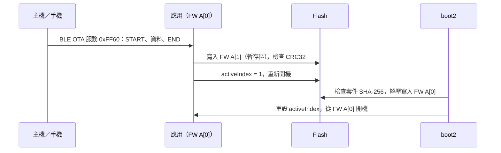

# OTA 更新

FreeRTOS 應用的 OTA 由 boot2 完成：執行中的應用把 OTA 套件寫進分割表中閒置的 FW 位置並切換啟用索引，重新開機後 boot2 檢查套件、解壓寫入執行區再開機。SDK 隨附打包工具 `tools/create_ota.py`，以及在 IPRO7AI Reef EVK 上經 BLE 更新的完整參考：`ipro_ble_remote` 的 `defconfig_reef`，搭配 A/B 分割表、打包腳本、Python 傳送程式與 Android App。

!!! abstract "重點"
    - 參考：`ipro_ble_remote` 的 `defconfig_reef`＋`partition_cfg_2M_remote_ab.toml`＋boot2 v0.5.2（隨 IntelProCube 提供）；預設 `.config` 不含 OTA。
    - 套件：`tools/create_ota.py` 把 IntelProCube 產生的合併映像 `whole_img.bin` 包成 `.xz.ota`（512 位元組標頭＋XZ 內容）；Reef 用 `make_reef_ota.sh` 一次完成兩個步驟。
    - 傳送端：`tools/reef_ota.py`（Python，bleak）或 `ipro_remote_demo.apk`（Android），經 BLE OTA 服務 0xFF60。
    - IPRO6S FIN 卡以 `ipro7ai_reef_demo` `defconfig_wifi_ipro6s` 的 `ipro6s_ota <http url>` 經 Wi-Fi 更新。
    - 在 Reef 上絕對不要以標準 `partition_cfg_2M.toml` 做 OTA。未包含：簽章套件需要的產品設定（`tools/ota_products.py`）。

## 架構 { #architecture }



依 `ipro_ble_remote` 的 README，套件通過 SHA-256 檢查後 boot2 才抹除執行區。檢查失敗時 boot2 停在 USB 救援模式，原本的執行區不受影響。

## 分割表與 A/B 配置 { #partitions }

`apps/bluetooth/ble/ipro_ble_remote/partition_cfg_2M_remote_ab.toml`（2 MB Flash，含 boot2）：

| 位址 | 分割區 | 大小 | 用途 |
|---|---|---|---|
| 0x000000 | boot2 | 64 KB | IntelProCube 的 boot2 v0.5.2 |
| 0x010000 | PT0／PT1 | 4 KB＋4 KB | 分割表 |
| 0x012000 | FW A[0] | 824 KB | 執行區，boot2 把套件解壓到這裡 |
| 0x0E0000 | FW A[1] | 512 KB | OTA 暫存區，應用把 `.xz.ota` 寫到這裡 |
| 0x160000 | PSM | 112 KB | 持久設定 |
| 0x17C000 | backup | 4 KB | |
| 0x17D000 | media | 16 KB | |
| 0x1FF000 | factory | 4 KB | |

- 這個配置需要 2 MB Flash；`defconfig_reef` 設定 `CONFIG_IPRO7_FLASH_2M=y`。
- boot2 映像位於 IntelProCube 目錄的 `chips/ipro7/builtin_imgs/boot2_v0.5.2/ipro_boot2_IPRO7_v0.5.2.bin`，不在 SDK 套件中。
- 分割表刻意不含 boot2 項目：有這個項目時，燒錄工具寫出的 boot2 標頭開機 ROM 不會載入。boot2 請以 `--boot2` 指定。

!!! danger "不要以標準分割表做 OTA"
    在 IPRO7AI Reef EVK 上，絕對不要用標準的 `partition_cfg_2M.toml` 做 OTA：寫進它第二個 FW 位置（0x12A000）並切換後的映像不會開機，主控台沒有任何輸出，只能進下載模式重新燒錄。請使用 `partition_cfg_2M_remote_ab.toml`。

## OTA 封裝（create_ota.py） { #ota-package }

`tools/create_ota.py` 的輸入必須是以 `IPNP` boot header 開頭的合併映像，例如 IntelProCube 命令列工具以 `--build` 產生的 `chips/ipro7/img_create_iot/whole_img.bin`，不是 SDK 建置輸出的 `.bin`；輸入格式不符時腳本會停止。

```bash
# 1. 以 IntelProCube 產生 whole_img.bin（在 IntelProCube 目錄下執行；失敗時工具也回傳 0，
#    請確認輸出有 "PT Check: whole_img.bin"）
cd <ICUBE>
./ipro_iot_tool_macos --chipname ipro7 --chip-variant IPRO7AI --build \
    --boot2 chips/ipro7/builtin_imgs/boot2_v0.5.2/ipro_boot2_IPRO7_v0.5.2.bin \
    --pt <SDK>/apps/bluetooth/ble/ipro_ble_remote/partition_cfg_2M_remote_ab.toml \
    --firmware <SDK>/apps/bluetooth/ble/ipro_ble_remote/build_reef/build_out/ipro_ble_remote_IPRO7.bin

# 2. 打包（預設 XZ 壓縮）
python3 <SDK>/tools/create_ota.py chips/ipro7/img_create_iot/whole_img.bin \
    --fw-ver <fw-version> -o firmware.xz.ota
```

| 參數 | 意義 |
|---|---|
| `<input>` | 合併映像（以 `IPNP` boot header 開頭） |
| `--raw` | 不壓縮。未指定 `-o` 時，輸出檔名是輸入檔名換成 `.ota`（`--raw`）或 `.xz.ota` 副檔名 |
| `-o FILE` | 輸出檔案 |
| `--hw-ver`、`--fw-ver` | 寫入標頭的硬體與韌體版本字串（各最多 15 個字元）。boot2 不檢查硬體版本 |
| `--sign-key`、`--product`、`--hw-id`、`--fw-version`、`--force-version`、`--key-id` | 簽章套件用。需要 V2.2.0 未包含的 `tools/ota_products.py`，因此無法使用 |

| 標頭位移 | 內容 |
|---|---|
| 0–15 | 識別字串 `IPRO_OTA_Ver1.0` |
| 16–19 | 類型：`XZ  ` 或 `RAW ` |
| 20–23 | 內容長度（little-endian） |
| 32–47、48–63 | 硬體與韌體版本字串 |
| 64–95 | 內容的 SHA-256 |
| 96–511 | 保留（0xFF）；簽章套件在此放簽章區塊 |
| 512 起 | 內容（XZ，字典 32 KB，與 boot2 解碼器一致） |

Reef 可用 `apps/bluetooth/ble/ipro_ble_remote/tools/make_reef_ota.sh` 一次完成上述兩步，並以建置時間作為韌體版本，見[在 Reef 上動手做](#hands-on)。

## BLE OTA（ipro_ble_remote） { #ble-ota }

只有 `defconfig_reef` 開啟 OTA 服務。`ipro_ble_remote` 的預設 `.config` 建置的是不含 OTA 的 IPRO7 EVB 映像（`# CONFIG_IPRO_BLE_REMOTE_OTA is not set`）。

```ini title="apps/bluetooth/ble/ipro_ble_remote/defconfig_reef（節錄）"
CONFIG_IPRO7AI_REEF=y
CONFIG_IPRO7_FLASH_2M=y
CONFIG_LINK_FLASH=y
CONFIG_PARTITION=y
CONFIG_IPRO_BLE_REMOTE_OTA=y
```

服務與特徵值（給 App 開發者的完整說明在 `apps/bluetooth/ble/ipro_ble_remote/OTA_IMPLEMENTATION_GUIDE.md`）：

| 特徵值 | UUID | 屬性 | 格式 |
|---|---|---|---|
| OTA Control | `0xFF61` | Write | `01`＋大小（u32 LE）START；`02`＋CRC32（u32 LE）END；`03` ABORT；`04` VERIFY；`05` REBOOT |
| OTA Data | `0xFF62` | Write Without Response | 序號 u16、長度 u16、保留 u16，接著是資料；每個封包的資料最多 MTU − 9 位元組 |
| OTA Status | `0xFF63` | Read、Notify | 狀態、錯誤碼、進度 %、保留 u16；狀態 0 閒置、1 接收中、2 驗證中、3 就緒、4 完成（送 REBOOT）、0xFF 錯誤 |

- 要傳送 `.xz.ota` 套件，不是 `.bin`。CRC32 是對整個傳送檔案計算的標準 CRC-32（與 `zlib.crc32` 相同）。
- 送出 START 後裝置會先抹除暫存區；等狀態變成 1（接收中）再送資料。
- 裝置最多排隊 20 個封包，邊收邊寫 Flash。傳送端要控制節奏（`reef_ota.py` 每 8 個封包讀一次 OTA Status），否則封包會被丟棄，END 時回報錯誤。
- 先協商較大的 MTU；README 建議連線後要求 MTU 513 以上。

## 在 Reef 上動手做 { #hands-on }

先以 UART 燒錄一次 `ipro_ble_remote`，修改程式後經 BLE 安裝新版，再從建置時間確認更新成功。需要：U6 接好主控台線的 Reef、IntelProCube 命令列工具（`<ICUBE>`），以及有藍牙與 Python 3 的 macOS 或 Linux 電腦（或裝有 `ipro_remote_demo.apk` 的 Android 手機）。

<div class="ipro-steps" markdown>

1. **確認設定**

    直接使用隨附的 `DEFCONFIG=defconfig_reef`；讓 OTA 運作的設定見 [BLE OTA](#ble-ota) 的節錄。要在自己的 Reef 應用加入 OTA，保留 `CONFIG_IPRO7_FLASH_2M=y` 與 `CONFIG_PARTITION=y`，以 boot2 和類似 `partition_cfg_2M_remote_ab.toml` 的 A/B 分割表燒錄，再如下把套件寫進閒置的 FW 位置。

2. **看懂應用如何暫存套件**

    OTA 服務透過 boot2 的分割表 API 取得閒置的 FW 位置，把套件寫進去，CRC32 檢查通過後把該位置設為啟用：

    ```c title="apps/bluetooth/ble/ipro_ble_remote/src/services/ota_service.c（節錄）"
    static int ota_get_backup_partition(uint32_t *addr, uint32_t *size)
    {
        int ret = hal_boot2_partition_addr_inactive("FW", addr, size);
        if (ret != 0) {
            IPRO_LOGE(LOG_TAG, "Failed to get backup partition: %d", ret);
            return -1;
        }
        return 0;
    }

    static int ota_switch_partition(void)
    {
        int ret;
        PtTable_Entry_Config pt_entry;

        ret = hal_boot2_get_active_entries(PT_ENTRY_FW_CPU0, &pt_entry);
        if (ret != 0) {
            IPRO_LOGE(LOG_TAG, "Failed to get partition entry: %d", ret);
            return -1;
        }
        /* 省略與 pt_entry.maxLen[] 比對大小的檢查 */

    #if defined(CONFIG_IPRO7AI_REEF)
        /* The Reef image runs under boot2 (partition_cfg_2M_remote_ab.toml): the
         * slot holds an OTA package that boot2 checks and unpacks by its own
         * header, so the entry length is not used. */
        pt_entry.len = 0;
    #else
        pt_entry.len = g_ota_ctx.firmware_size;
    #endif

        ret = hal_boot2_update_ptable(&pt_entry);
        if (ret != 0) {
            IPRO_LOGE(LOG_TAG, "Failed to update partition table: %d", ret);
            return -1;
        }
        return 0;
    }
    ```

    之後 REBOOT 指令重置晶片，boot2 在開機途中安裝套件。

3. **建置並燒錄第一版**

    ```bash
    make -C apps/bluetooth/ble/ipro_ble_remote DEFCONFIG=defconfig_reef
    ```

    讓 Reef 進入下載模式（按住 SW1 BOOT、按一下 SW2 RESET、放開 SW1），再執行：

    ```bash
    cd <ICUBE>
    ./ipro_iot_tool_macos --chipname ipro7 --chip-variant IPRO7AI \
        --port /dev/cu.usbserial-XXXX --baudrate 921600 \
        --boot2 chips/ipro7/builtin_imgs/boot2_v0.5.2/ipro_boot2_IPRO7_v0.5.2.bin \
        --pt <SDK>/apps/bluetooth/ble/ipro_ble_remote/partition_cfg_2M_remote_ab.toml \
        --firmware <SDK>/apps/bluetooth/ble/ipro_ble_remote/build_reef/build_out/ipro_ble_remote_IPRO7.bin
    ```

    確認輸出有 `[All Success]`（失敗時工具也回傳 0），再按 SW2（RESET）。以 115200 baud 開啟主控台，會先看到 `[BOOT2] IPRO7 Boot2 v0.5.2`，接著應用從 FW A（0x12000）啟動並印出 `[OTA] Service ready`。燒錄細節見[燒錄與序列埠](../get-started/flash-and-monitor.md)。

4. **修改程式並產生 OTA 套件**

    做任何修改後以同一個 `make` 指令重新建置，再把新版打包（Linux 用 `ipro_iot_tool_linux`）：

    ```bash
    IPRO_FLASH_TOOL=<ICUBE>/ipro_iot_tool_macos \
        sh apps/bluetooth/ble/ipro_ble_remote/tools/make_reef_ota.sh
    ```

    輸出：`apps/bluetooth/ble/ipro_ble_remote/build_reef/build_out/ipro_ble_remote_reef.xz.ota`，約 345 KB。

5. **經 BLE 傳送**

    ```bash
    python3 -m venv .venv && .venv/bin/pip install bleak
    .venv/bin/python apps/bluetooth/ble/ipro_ble_remote/tools/reef_ota.py \
        apps/bluetooth/ble/ipro_ble_remote/build_reef/build_out/ipro_ble_remote_reef.xz.ota
    ```

    腳本會尋找 `IPRO-Remote`（名稱不同時設定 `REMOTE_NAME`），印出目前映像的板卡資訊，送出套件，再等板子重新上線。README 的實測：macOS、MTU 247，345 KB 套件傳輸 13–17 秒。

6. **確認結果**

    Reef 主控台會印出下列訊息（省略記錄前綴，中間還有其他行）：

    ```text
    [OTA] START: … bytes, … packets (… bytes/pkt, MTU=…)
    [OTA] Progress: 5% (…)
    [OTA] Transfer complete: … bytes in … ms (… bytes/s)
    [OTA] END: CRC32=0x…, …/… bytes
    [OTA] CRC32 OK! Switching partition...
    [OTA] Ready to reboot
    [OTA] Rebooting...
    [BOOT2] IPRO7 Boot2 v0.5.2
    ```

    電腦端 `reef_ota.py` 印出 `verified, slot switched; rebooting`，板子重新連上後印出 `running: IPRO7AI Reef; camera …; SD …; build <date> <time>`。建置時間比更新前印出的晚，就表示新映像已在執行。

</div>

下一步：[建立第一個應用](../tutorials/first-own-app.md)說明如何以 Reef 組態建立新應用；[測試應用](../tutorials/testing.md)說明如何像上面這樣用主控台與主機端腳本檢查結果。

## 其他更新路徑 { #other-paths }

| 路徑 | 說明 |
|---|---|
| IPRO6S FIN 卡韌體 | 以 `DEFCONFIG=defconfig_wifi_ipro6s` 建置的 `ipro7ai_reef_demo` 有主控台指令 `ipro6s_ota <http url>`：經 Wi-Fi 下載套件，再以 `ipronet_ota_update()`（`components/network/ipronet_host/ipronet_ota.h`）交給 FIN 卡，約需 30–60 秒，完成時主控台印出 `[ota] RESULT OK`。套件是 IntelProCube 產生、硬體版本為 IPRO6 的 `FW_OTA.bin.xz.ota`；其他晶片的套件在開始前就會被主機端拒絕。FIN 卡的韌體是以 `defconfig_ipro6_sdio` 建置的 `ipro6_if_wifi`，其中的 `CONFIG_RNM_OTA=y` 提供裝置端功能。見[網路](networking.md) |
| 共用 OTA 程式 | `apps/platform/common/ota/`：把套件寫進閒置 FW 位置、檢查 SHA-256 並切換啟用索引的核心，UART（zmodem）與 USB CDC 接收端，以及 `ota_sig` 簽章檢查。隨附的組態都不會建置這些檔案，可作為自行實作接收端的參考 |

## Zephyr：MCUboot 與 MCUmgr { #zephyr-mcuboot }

Zephyr 映像不使用 boot2 套件，而是經 MCUboot 更新：boot2 啟動 MCUboot，由 MCUboot 從 `slot1_partition` 以 swap-move 換入新映像。範例 `zephyr/samples/ble_ota` 以 MCUmgr SMP 經 BLE 上傳映像。V2.2.0 的 Zephyr 只有 IPRO7 EVB 與 IPRO7AI EVK 的板子定義，沒有 Reef；建置與燒錄見 [Zephyr RTOS](zephyr.md)。

## 本版限制 { #limitations }

- 簽章 OTA 套件（`create_ota.py --sign-key`）需要的 `tools/ota_products.py` 未包含於 V2.2.0。
- BLE OTA 的參考流程是 `ipro_ble_remote` 的 `defconfig_reef`；`ipro_ble_remote` 的預設建置不含 OTA。
- 沒有經 Wi-Fi 或 Ethernet 更新 IPRO7 韌體的範例；`ipro6s_ota` 只更新 IPRO6S FIN 卡。
- `build_freertos.sh flash` 無法指定 boot2 映像；支援 OTA 的映像第一次燒錄請如上使用 IntelProCube 命令列。
- boot2 映像與標準分割表隨 IntelProCube 提供，不在 SDK 套件中。

## 相關文件 { #related }

- [IPRO7AI Reef EVK](../hardware/boards/reef-evk.md)：下載模式、開關與 U6 主控台接頭。
- [燒錄與序列埠](../get-started/flash-and-monitor.md)：IntelProCube 命令列工具。
- [BLE 開發](ble.md)：`ipro_ble_remote` 的 GATT 服務。
- [網路](networking.md)：`ipronet_host` 與 FIN 卡。
- [Zephyr RTOS](zephyr.md)：sysbuild、MCUboot 與 `west flash`。
