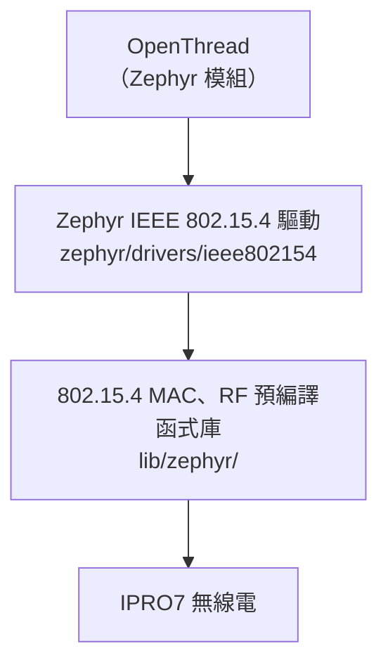

# Thread 與 Matter

!!! info "交付狀態"
    - **Matter**：未包含於 V2.1.0，沒有 Matter 協定堆疊、應用或建置命令。請洽 INTELPRO。
    - **Thread**：只在 Zephyr RTOS 下提供，使用 Zephyr 的 OpenThread 與 IPRO7 的 IEEE 802.15.4 驅動。FreeRTOS 應用不含 Thread。

以下內容不代表此版本已通過 Thread 或 Matter 認證。

## 交付狀態 { #overview }

| 項目 | V2.1.0 |
|---|---|
| Matter 協定堆疊、應用 | 未包含 |
| Thread（OpenThread） | Zephyr RTOS，範例板卡 `ipro7_evb`；FreeRTOS 不含 |
| Thread Border Router | 未包含 |
| IEEE 802.15.4 無線 | Zephyr 驅動，搭配預編譯的 MAC 與 RF 函式庫 |
| BLE（可作為配網通道） | FreeRTOS 與 Zephyr 皆有，但沒有與 Matter 整合 |

## OpenThread（Zephyr RTOS） { #openthread }



RF 驅動與 802.15.4 MAC 以預編譯函式庫連結（`components/wireless/rf/ipro7_rf/lib/zephyr/`、`components/wireless/ieee802154/lib/zephyr/`）。OpenThread 本身是 `west.yml` 允許清單中的 Zephyr 模組。

SDK 以設定片段搭配 Zephyr 內建的 `samples/net/openthread/shell`：

| 檔案（`zephyr/samples/ieee802154_shell/`） | 內容 |
|---|---|
| `ot.conf` | Thread 1.4、OpenThread CLI ping、CSL 需要的無線電時間戳與定時傳送、堆疊大小，以及 RF 晶體微調值 |
| `csl.conf` | 疊加在 `ot.conf` 上：CSL 接收端的休眠終端裝置（SSED），重置後恢復的 CSL 週期與逾時、訊框追蹤 |
| `app.overlay` | 啟用 `ieee802154` 節點並設為預設的 802.15.4 裝置 |

```ini title="ot.conf（節錄）"
CONFIG_OPENTHREAD_THREAD_VERSION_1_4=y
CONFIG_OPENTHREAD_PING_SENDER=y
CONFIG_NET_PKT_TIMESTAMP=y
CONFIG_NET_PKT_TXTIME=y
CONFIG_SOC_IPRO7_XTAL_CAPCODE=165
```

```ini title="csl.conf（節錄）"
CONFIG_OPENTHREAD_CSL_RECEIVER=y
CONFIG_IEEE802154_IPRO_OT_CSL_PERIOD_US=500000
CONFIG_IEEE802154_IPRO_OT_CSL_TIMEOUT_S=20
```

!!! warning "RF 晶體微調值依板子而定"
    `ot.conf` 的 `CONFIG_SOC_IPRO7_XTAL_CAPCODE=165` 是在 IPRO7 EVB 上量得的值；IPRO7AI Reef EVK 使用 95。其他板子請以 `ipro154 xtal` 與 `ipro154 cfo` 量測後調整，頻率偏差過大會影響與其他 Thread 裝置的連線。

## 試用 { #reference-apps }

<div class="ipro-steps" markdown>

1. **建立 workspace**：依[第一個 Zephyr 應用](../get-started/first-app-zephyr.md)完成 `tools/zephyr/bootstrap.sh` 並 `source zephyr-workspace/env.sh`。

2. **建置 OpenThread shell**（在 `zephyr-workspace/` 執行，`<SDK>` 為 SDK 根目錄的絕對路徑）

    ```bash
    west build -b ipro7_evb zephyr/samples/net/openthread/shell -d build/ot -- \
        -DEXTRA_CONF_FILE=<SDK>/zephyr/samples/ieee802154_shell/ot.conf \
        -DEXTRA_DTC_OVERLAY_FILE=<SDK>/zephyr/samples/ieee802154_shell/app.overlay
    ```

    要試 SSED／CSL 時，把 `csl.conf` 也加進 `EXTRA_CONF_FILE`。

3. **燒錄**：`west flash -d build/ot`（沒有 probe 時加 `-- --boot shell` 或 `--boot manual`，見 [Zephyr RTOS](zephyr.md)）。

4. **操作**：以 `tools/zephyr/monitor.sh --port /dev/cu.usbserial-XXXX` 開啟主控台（2000000 baud），用 `ot` 指令操作 OpenThread CLI。組網需要另一個 Thread 裝置或 Border Router，V2.1.0 未附 Border Router。

</div>

只想測試 802.15.4 收發時，可建置 SDK 的 `ieee802154_shell` 範例（Zephyr 的 IEEE 802.15.4 與網路 shell）：

```bash
west build -b ipro7_evb ../zephyr/samples/ieee802154_shell -d build/154
```

驅動另提供 `ipro154` 除錯指令：

| 指令 | 用途 |
|---|---|
| `ipro154 stats` | 驅動與 HAL 計數器 |
| `ipro154 clk` | 無線電與核心時脈的比率 |
| `ipro154 cfo` | 各發送端的頻率偏移、SFD 相關性與 RSSI |
| `ipro154 xtal` | RF 晶體微調值 |
| `ipro154 crc` | 把 CRC 錯誤的訊框計入 HAL 計數器 |
| `ipro154 trace` | HAL 訊框追蹤（`on`／`off`／`clear`／`dump`） |

`tools/zephyr/csl_pcap.py` 可分析 802.15.4 sniffer 擷取檔中的 CSL 時序。

## 整合前需確認的事項 { #configuration }

- **RTOS**：Thread 只能在 Zephyr 下使用，無法在 FreeRTOS 應用中以設定選項開啟。同時需要低功耗、相機、USB 或 NPU 的產品，要先確認這些功能在 Zephyr 下的狀態（見 [Zephyr RTOS](zephyr.md)）。
- **低功耗**：本版 Zephyr 不會讓 SoC 進入 PDS／HBN。`csl.conf` 示範 CSL 的通訊行為，不代表裝置已達到休眠功耗。
- **RF 晶體**：每種板子都要設定並驗證 `CONFIG_SOC_IPRO7_XTAL_CAPCODE`。
- **Border Router 與配網**：V2.1.0 沒有 Border Router；請規劃外部 Border Router、網路憑證的配發方式與安全儲存。
- **資源**：確認 Flash／RAM 預算、持久儲存、熵來源（`CONFIG_ENTROPY_GENERATOR`）與更新方式（MCUboot，見 [OTA 更新](ota.md)）。
- **驗證順序**：依序驗證板級驅動、無線連線、IP 傳輸與安全儲存，再進行協定整合、配網、重啟恢復與互通性測試。

## Matter 規劃 { #matter-architecture }

Matter 是以 IP 為基礎的應用層協定，可經 Wi-Fi、Ethernet 或 Thread 傳輸，並以 BLE 配網。V2.1.0 已有這些傳輸路徑的元件——FreeRTOS 下的 Ethernet 與經 IPRO6S 的 Wi-Fi（見[網路](networking.md)）、Zephyr 下的 Thread、兩者都有的 BLE——但沒有 Matter 協定堆疊、裝置配網流程、裝置證明憑證或 Matter 的 OTA。具備這些元件不等於已整合 Matter。Matter 支援的規劃與時程請洽 INTELPRO。

## 相關文件 { #related }

- [Zephyr RTOS](zephyr.md)：工作區、燒錄、功能範圍與限制。
- [網路](networking.md)：FreeRTOS 下的 lwIP、Ethernet 與 IPRO6S Wi-Fi。
- [BLE 開發](ble.md)：BLE Host 與控制器。
