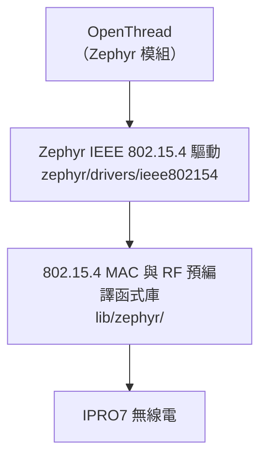

# Thread 與 Matter

Thread 在 Zephyr RTOS 下使用 IPRO7 的 IEEE 802.15.4 無線電，由 Zephyr 的 OpenThread 搭配 SDK 的 802.15.4 驅動提供。FreeRTOS 應用沒有 802.15.4 與 Thread，本版也沒有 Matter 協定堆疊。

!!! abstract "重點"
    - **Thread**：只在 Zephyr RTOS 下提供，範例板卡為 `ipro7_evb`。給 Zephyr OpenThread shell 範例用的設定片段在 `zephyr/samples/ieee802154_shell/`。
    - **IPRO7AI Reef EVK**：V2.2.1 沒有 Reef 的 Thread 路徑。Reef 沒有 Zephyr 板卡定義，它執行的 FreeRTOS 應用也不含 802.15.4。
    - **Matter**：未包含於 V2.2.1，沒有 Matter 協定堆疊、應用或建置命令。請洽 INTELPRO。
    - 本頁內容不代表此版本已通過 Thread 或 Matter 認證。

## 交付狀態 { #overview }

| 項目 | 本版 |
|---|---|
| Matter 協定堆疊與應用 | 未包含 |
| Thread（OpenThread） | Zephyr RTOS，範例板卡 `ipro7_evb`；FreeRTOS 沒有 |
| Thread Border Router | 未包含 |
| IEEE 802.15.4 無線電 | Zephyr 驅動，搭配預編譯的 MAC 與 RF 函式庫 |
| BLE（可用於配網） | FreeRTOS 與 Zephyr 皆可用，但未與 Matter 整合 |

## OpenThread（Zephyr RTOS） { #openthread }



RF 驅動與 802.15.4 MAC 以預編譯函式庫連結（`components/wireless/rf/ipro7_rf/lib/zephyr/`、`components/wireless/ieee802154/lib/zephyr/`）。OpenThread 是 `west.yml` 允許清單中的 Zephyr 模組。

SDK 為 Zephyr 本身的 `samples/net/openthread/shell` 提供設定片段：

| 檔案（`zephyr/samples/ieee802154_shell/`） | 內容 |
|---|---|
| `ot.conf` | Thread 1.4、OpenThread CLI 的 ping、CSL 需要的無線電時間戳記與定時傳送、堆疊大小，以及 RF 晶振微調 |
| `csl.conf` | 疊加在 `ot.conf` 上：CSL 接收端（sleepy end device）、CSL 週期與逾時，以及驅動的封包追蹤 |
| `app.overlay` | 啟用 `ieee802154` 節點，並設為預設的 802.15.4 裝置 |

```ini title="zephyr/samples/ieee802154_shell/ot.conf（節錄）"
CONFIG_OPENTHREAD_THREAD_VERSION_1_4=y
CONFIG_OPENTHREAD_PING_SENDER=y
CONFIG_NET_PKT_TIMESTAMP=y
CONFIG_NET_PKT_TXTIME=y
CONFIG_SOC_IPRO7_XTAL_CAPCODE=165
```

```ini title="zephyr/samples/ieee802154_shell/csl.conf（節錄）"
CONFIG_OPENTHREAD_CSL_RECEIVER=y
CONFIG_IEEE802154_IPRO_OT_CSL_PERIOD_US=500000
CONFIG_IEEE802154_IPRO_OT_CSL_TIMEOUT_S=20
```

!!! warning "RF 晶振微調值依板子而定"
    `ot.conf` 中的 `CONFIG_SOC_IPRO7_XTAL_CAPCODE=165` 是在 IPRO7 EVB 上量得的。換到其他板子時，請以 `ipro154 xtal` 與 `ipro154 cfo` 量測後設定自己的值：頻率誤差太大會影響與其他 Thread 裝置的連線。

## 在 IPRO7 EVB 上試用 { #reference-apps }

本版沒有 Reef 的 Thread 操作步驟。在 IPRO7 EVB 上：

<div class="ipro-steps" markdown>

1. **建立工作區**：依 [Zephyr RTOS](zephyr.md#workspace) 執行 `tools/zephyr/bootstrap.sh` 與 `source zephyr-workspace/env.sh`。

2. **建置 OpenThread shell**（在 `zephyr-workspace/` 執行；`<SDK>` 是 SDK 根目錄的絕對路徑）

    ```bash
    west build -b ipro7_evb zephyr/samples/net/openthread/shell -d build/ot -- \
        -DEXTRA_CONF_FILE=<SDK>/zephyr/samples/ieee802154_shell/ot.conf \
        -DEXTRA_DTC_OVERLAY_FILE=<SDK>/zephyr/samples/ieee802154_shell/app.overlay
    ```

    要試 CSL 接收端時，把 `csl.conf` 也加進 `EXTRA_CONF_FILE`。

3. **燒錄**：`west flash -d build/ot`；沒有探針時加上 `-- --boot shell` 或 `-- --boot manual`（見 [Zephyr RTOS](zephyr.md)）。

4. **使用**：以 `../tools/zephyr/monitor.sh --port /dev/cu.usbserial-XXXX`（2,000,000 baud）開啟主控台，用 `ot` 指令操作 OpenThread CLI。建立或加入網路需要另一個 Thread 裝置或 Border Router。

</div>

只想測試 802.15.4 封包收發時，建置 SDK 的 `ieee802154_shell` 範例（Zephyr 的 IEEE 802.15.4 與網路 shell）：

```bash
west build -b ipro7_evb ../zephyr/samples/ieee802154_shell -d build/154
```

驅動另外提供 `ipro154` 除錯指令：

| 指令 | 用途 |
|---|---|
| `ipro154 stats` | 驅動與 HAL 的計數器 |
| `ipro154 clk` | 無線電時脈與 kernel 時脈的比率 |
| `ipro154 cfo` | 各發送端的頻率偏移、SFD 相關值與 RSSI |
| `ipro154 xtal` | RF 晶振微調值 |
| `ipro154 crc` | 把 CRC 錯誤的封包計入 HAL 計數器 |
| `ipro154 trace` | HAL 封包追蹤（`on`／`off`／`clear`／`dump`） |

`tools/zephyr/csl_pcap.py` 可分析 802.15.4 sniffer 擷取檔中的 CSL 時序。

## 整合前需確認的事項 { #configuration }

- **RTOS**：Thread 只在 Zephyr 下提供，沒有任何設定能把它加進 FreeRTOS 應用。產品若還需要低功耗、相機、USB 或 NPU，先確認它們在 Zephyr 下的狀態（[Zephyr RTOS](zephyr.md)）。
- **板卡**：本版的 Zephyr 板卡是 IPRO7 EVB 與 IPRO7AI EVK；產品板需要自己的板卡定義。
- **低功耗**：本版 Zephyr 不會讓 SoC 進入 PDS 或 HBN。`csl.conf` 展示的是 CSL 時序行為，不代表裝置能達到睡眠等級的電流。
- **RF 晶振**：每一種板子設計都要設定並驗證 `CONFIG_SOC_IPRO7_XTAL_CAPCODE`。
- **Border Router 與配網**：未附 Border Router。請規劃外部 Border Router、網路憑證如何配發，以及如何安全儲存。
- **資源**：確認 flash 與 RAM 預算、永久儲存、熵來源（`CONFIG_ENTROPY_GENERATOR`）與更新路徑（MCUboot，見 [OTA 更新](ota.md)）。
- **驗證順序**：先驗證板子驅動、無線連線、IP 傳輸與安全儲存，再進行協定整合、配網、重開機後的復原與互通性。

## Matter 規劃 { #matter-architecture }

Matter 是 IP 層的應用協定，可跑在 Wi-Fi、乙太網路或 Thread 上，並以 BLE 配網。本版各種傳輸都有對應元件：FreeRTOS 下經 IPRO6S 的 Wi-Fi 與乙太網路（[網路](networking.md)）、Zephyr 下的 Thread、兩者皆有的 BLE；但沒有 Matter 協定堆疊、配網流程、裝置認證憑證或 Matter OTA。具備傳輸元件不等於完成 Matter 整合。Matter 的規劃與時程請洽 INTELPRO。

## 相關文件 { #related }

- [Zephyr RTOS](zephyr.md)：工作區、燒錄、功能與限制。
- [網路](networking.md)：lwIP、Reef 經 IPRO6S FIN 卡的 Wi-Fi、乙太網路。
- [BLE 開發](ble.md)：BLE host 與控制器。
