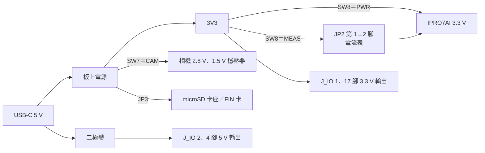

# 電源與功耗量測

量測電流前，先確認 Reef 的電源從哪裡來、要量的那一段電流在哪裡斷開，再讓板子進入要量測的狀態。SDK 沒有提供適用所有板型的電流數值；請以晶片規格書的量測條件為準，並在自己的板子上實測。

## 開發板電源架構 { #power }

### IPRO7AI Reef EVK { #reef-power }

Reef V4.0 只從 USB-C 供電，由板上電源產生 3.3 V（3V3）與相機用的電壓。IPRO7AI 的 3.3 V 由 SW8 選擇來源：PWR 時直接取自板上 3.3 V，MEAS 時改經 JP2，讓電流表或外部電源串在中間。



| 開關／跳線 | 位置 | 對電源的作用 |
|---|---|---|
| SW8 | PWR | 一般使用：IPRO7AI 的 3.3 V 直接由板上電源供應 |
| | MEAS | IPRO7AI 的 3.3 V 改經 JP2 供應；JP2 必須接電流表或外部 3.3 V 電源 |
| JP2 | — | 3 pin：1＝3V3（板上 3.3 V）、2＝SOC（IPRO7AI 的 3.3 V）、3＝GND；只在 SW8＝MEAS 時使用 |
| SW7 | CAM | 相機的 2.8 V 與 1.5 V 穩壓器開啟 |
| | GPIO | 相機穩壓器關閉，16 支相機腳位改接到 J_IO |
| JP3 | ON | microSD 卡座一直有電 |
| | GPIO | 卡座電源由 GPIO14 控制：低準位或未驅動時有電，高準位時斷電；FIN 卡的 `fin cycle` 需要這個位置 |

- 除錯排座 U6 不供電；接上 IPRO Debug Probe 或 USB 轉 UART 線之外，仍要接 USB-C。
- J_IO 的 2、4 腳是 USB 5 V 經二極體的輸出，1、17 腳是 3.3 V 輸出，都不能用來對板子供電。

!!! warning "上電前"
    - 只從 USB-C 供電。
    - SW8 平常放在 PWR。放在 MEAS 時，JP2 沒有接電流表或外部 3.3 V 電源就不要接 USB-C：IPRO7AI 沒有電，周邊的 3.3 V 卻會經 IO 腳倒灌。
    - 插拔相機排線前先拔掉 USB-C。

其他開發板（IPRO7 EVB、IPRO7AI EVK）的電源架構見各板的硬體文件，請洽 INTELPRO。

## 電源設計建議 { #design-recommendations }

| 項目 | 建議 |
|---|---|
| 輸入保護 | 電源輸入端加 TVS，防靜電與突波 |
| 去耦電容 | 每支電源腳放一顆 100 nF，盡量靠近晶片 |
| 大容量電容 | 5 V 與 3.3 V 電源放 10 µF–47 µF 穩定電源 |
| 上電順序 | 依晶片規格書與板子的電源時序設計 |
| 接地 | 使用完整的接地層，類比與數位區域分開 |
| LDO 選擇 | 類比電源（AVDD）使用低雜訊 LDO |
| 電流量測 | 在 SoC 的電源路徑上保留可斷開的量測點，例如 Reef 的 SW8 與 JP2 |

天線與匹配電路見[腳位與周邊對照](pinmux.md#antenna)。

## 量測電流 { #current-measurement }

記錄每次量測的條件，結果才能比較：量測點、CPU 時脈、RF 發射功率、啟用的周邊、記憶體保留設定與睡眠模式。

### 量測點 { #measurement-points }

| 量測點 | 接法 | 包含的電路 |
|---|---|---|
| 整塊板子 | USB-C 與電腦之間串接 USB 電流表 | 板上所有電路，含 LED、喇叭擴大機、相機與 microSD 卡 |
| IPRO7AI 的 3.3 V | SW8＝MEAS，電流表接在 JP2 的 1、2 腳之間 | IPRO7AI 的 3.3 V 腳及其去耦電容、開機腳上拉電阻；不含周邊 |

### 量測 IPRO7AI 的電流 { #reef-soc-current }

<div class="ipro-steps" markdown>

1. **燒錄要量測的韌體**：例如開箱韌體 `ipro7ai_reef_demo`，步驟見 [IPRO7AI Reef EVK 上手](boards/reef-evk.md#quick-start)。確認它在 SW8＝PWR 時可以正常開機。

2. **接上電流表**：拔掉 USB-C，把電流表接在 JP2 的第 1 腳（3V3）與第 2 腳（SOC）之間，再把 SW8 撥到 MEAS。要以外部電源供電時，改把外部 3.3 V 電源接在 JP2 的第 2 腳（SOC）與第 3 腳（GND）。

3. **上電並確認開機**：接上 USB-C，以 115200 baud 開啟主控台並輸入 `reef status`。

    ```bash
    python3 tools/serial_monitor.py /dev/cu.usbserial-XXXX --send "reef status" --timeout 5
    ```

    主控台印出板子狀態，表示 IPRO7AI 經 JP2 正常供電；電流表讀到的就是 IPRO7AI 3.3 V 的電流。沒有任何輸出時，檢查電流表的檔位與 JP2 的接線。

4. **讀取各狀態的電流**：在主控台執行要量測的動作，等數值穩定後記錄讀數與當時的條件。

5. **恢復一般供電**：先拔掉 USB-C，把 SW8 撥回 PWR，再拆下電流表。

</div>

### 睡眠電流 { #lp-test }

`apps/test/ipro_lp_test`（PDS31 進出與 RTC 喚醒，`lp` 指令）只隨附 IPRO7 EVB 的設定（`CONFIG_EVB=y`）；本版沒有 Reef 的睡眠電流測試設定。

PDS31 睡眠時，OCRAM 只保留前 64 KB；其餘部分只在 MISC 電源域保持供電時保留（`bsp/hal/inc/hal_pm.h` 的 `pm_pds_set_misc_keep()`）。HBN RAM 的 4 KB 在休眠期間保留。晶片在 PDS 時 UART 關閉，睡眠期間輸入的字元會遺失。

### 應用中的自動低功耗 { #ipro-pm }

應用通常不自己呼叫睡眠。`components/sys/ipro_pm` 接手 FreeRTOS 的 tickless idle，依每段空閒時間選擇可進入的最深模式：`IPRO_PM_MODE_WFI`（CPU 時脈閘控）、`IPRO_PM_MODE_NATIVE`（BLE 核心以自己的 32 kHz 計時器睡眠時的 WFI）、`IPRO_PM_MODE_PDS`（PDS31）。啟用 `CONFIG_IPRO_PM=y` 後，shell 指令 `pm stats` 列出各模式的停留比例與平均電流估計值；估計值不能取代實測。設定方式見[低功耗指南](../guides/low-power.md)。

## 相關文件 { #documents }

- [IPRO7AI Reef EVK](boards/reef-evk.md#jumpers)：SW7、SW8、JP2、JP3 的位置與設定。
- [低功耗指南](../guides/low-power.md)：PDS、`ipro_pm` 與 BLE 低功耗設定。
- IPRO7 規格書與硬體設計指南（電氣特性、電源時序）：見[文件下載](../documents/index.md)。
