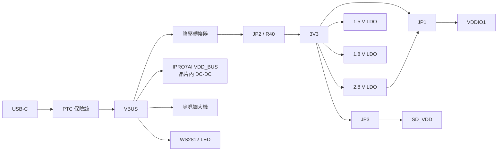
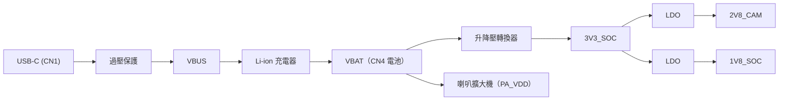
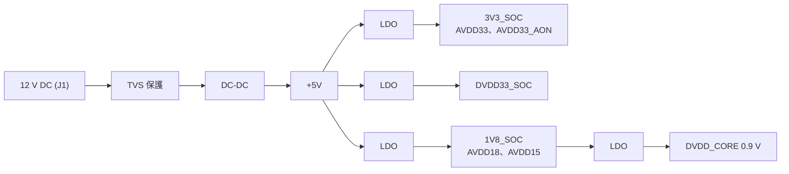

# 電源與功耗量測

量測電流前，先確認開發板的電源從哪裡來、要量哪一段電流該在哪裡斷開，再用 SDK 的低功耗測試應用讓晶片進入睡眠。SDK 沒有提供適用所有板型的電流數值；請以晶片規格書的量測條件為準，並在自己的板子上實測。

## 開發板電源架構 { #power }

### IPRO7AI Reef EVK { #reef-power }

Reef 只從 USB-C 供電。VBUS 同時供應板上的降壓轉換器、IPRO7AI 自己的 DC-DC（VDD_BUS）、喇叭擴大機與 WS2812 LED；其餘電路都在 3V3 上。



| 電源 | 來源 | 供電對象 |
|---|---|---|
| VBUS | USB-C 經 PTC 保險絲 | 降壓轉換器、IPRO7AI 的 VDD_BUS、喇叭擴大機、WS2812 LED |
| SoC 內部 | VDD_BUS 經晶片內 DC-DC | VDDIO_PSRAM、AVDD_RF |
| 3V3 | 降壓轉換器經 JP2（或 R40） | AVDD33、VDDIO3、VDDIO1（JP1 1-2）、各 LDO、PDM 麥克風、耳機麥克風偏壓、耳機緩衝器、電源指示燈、SD_VDD |
| VDD_2V8 | 3V3 經 2.8 V LDO | 相機 DOVDD 與 AVDD（經磁珠）、SCCB 上拉、VDDIO1（JP1 2-3） |
| VDD_1V5 | 3V3 經 1.5 V LDO，隨 2.8 V 一起開啟 | 相機 DVDD |
| 1V8 | 3V3 經 1.8 V LDO | 只接到 J_IO 腳 7 |
| SD_VDD | 3V3 經 JP3 | SD 卡槽與 FIN 卡；JP3 2-3 時由 GPIO14 經 P-MOSFET 開關（低電位 = 開） |

相機電源沒有 GPIO 控制，隨 3V3 上電；感測器由下拉電阻保持在重置狀態，直到 GPIO34 放開。

### IPRO7AI EVK { #evk-power }



| 電源 | 來源 | 供電對象 |
|---|---|---|
| VBUS | USB-C 經過壓保護 | Li-ion 充電器 |
| VBAT | 充電器輸出與電池（CN4） | 升降壓轉換器、喇叭擴大機 |
| 3V3_SOC | VBAT 經升降壓轉換器 | SoC 與各 LDO |
| 2V8_CAM | 3V3_SOC 經 LDO | 相機 AVDD；經 J6 跳線供應 VDDIO1 |
| 1V8_SOC | 3V3_SOC 經 LDO | 相機與數位麥克風 |

J6 的接法見 [IPRO7AI EVK](boards/ipro7ai-evk.md#features)。

### IPRO7 EVB { #evb-power }

EVB 由 J1 輸入 12 V DC，先降到 5 V，再由多顆 LDO 產生各電源軌；輸入端有 TVS 保護。



| 電源軌 | 電壓 | 用途 | 說明 |
|---|---|---|---|
| +12V | 12 V | 外部 DC 輸入 | J1，TVS 保護 |
| +5V | 5 V | 系統主電源 | 由 12 V 降壓產生 |
| 3V3_SOC | 3.3 V | SoC IO 電源 | GPIO、周邊供電 |
| AVDD33 | 3.3 V | 類比電源 | ADC／DAC、RF 前端 |
| DVDD33_SOC | 3.3 V | 數位電源 | 數位邏輯 |
| 1V8_SOC | 1.8 V | 低壓 IO 電源 | 1.8 V IO 介面 |
| AVDD18 | 1.8 V | 類比低壓電源 | RF 電路 |
| AVDD15 | 1.5 V | 類比核心電源 | 內部類比電路 |
| DVDD_CORE | 0.9 V | 數位核心電源 | CPU、記憶體核心 |

## 電源設計建議 { #design-recommendations }

| 項目 | 建議 |
|---|---|
| 輸入保護 | DC 輸入端加 TVS，防靜電與突波 |
| 去耦電容 | 每支電源腳放一顆 100 nF，盡量靠近晶片 |
| 大容量電容 | +5 V 與 +3.3 V 放 10 µF–47 µF 穩定電源 |
| 上電順序 | 依晶片規格書與板子的電源時序設計 |
| 接地 | 使用完整的接地層，類比與數位區域分開 |
| LDO 選擇 | 類比電源（AVDD）使用低雜訊 LDO |

天線與匹配電路見 [腳位與周邊對照](pinmux.md#antenna)。

## 量測電流 { #current-measurement }

記錄每次量測的條件，結果才能比較：量測點、CPU 時脈、RF 發射功率、啟用的周邊、記憶體保留設定與睡眠模式。USB 轉 UART 橋接晶片、LED、感測器與穩壓器本身的耗電要另外扣除或斷開。

### 量測點 { #measurement-points }

| 開發板 | 量測點 | 包含的電路 |
|---|---|---|
| IPRO7AI Reef EVK | USB-C 與電腦之間串接 USB 電流表 | 整塊板子 |
| IPRO7AI Reef EVK | 拔掉 JP2（並確認 R40 沒有裝），由電流表與外部電源供應 3V3；USB-C 保持連接 | 3V3 上的電路：IO 電源、相機 LDO、麥克風、SD_VDD 等。不含 SoC 的 VDD_BUS、喇叭擴大機與 LED，它們由 VBUS 供電 |
| IPRO7AI EVK | USB-C 與電腦之間串接 USB 電流表，並拔掉電池 | 整塊板子；接著電池時，量到的電流會包含充電電流 |
| IPRO7 EVB | J1 的 12 V 輸入 | 整塊板子，含所有穩壓器 |

### 以 ipro_lp_test 量測睡眠電流 { #lp-test }

`apps/test/ipro_lp_test` 讓晶片經 `hal_lp` 低功耗框架進入 PDS（Level 31）睡眠，再由 RTC 喚醒。它的 `.config` 是 IPRO7 EVB（`CONFIG_EVB=y`），不啟用 PSRAM 與 BLE，主控台為 115200 baud。

<div class="ipro-steps" markdown>

1. **建置並燒錄**（IPRO7 EVB）

    ```bash
    ./build_freertos.sh build flash -p /dev/cu.usbserial-XXXX ipro_lp_test
    ```

2. **開啟主控台**：以任一序列埠終端程式開啟主控台（115200 8N1）輸入下列指令；也可以用 `tools/serial_monitor.py` 一次送出一個指令：

    ```bash
    python3 tools/serial_monitor.py /dev/cu.usbserial-XXXX --send "lp rtc" --timeout 3
    ```

3. **確認 RTC 在計數**：`lp rtc` 執行兩次，數值應該增加。

4. **單次睡眠**：`lp sleep 5000` 睡 5 秒後由 RTC 喚醒，在這段時間讀電流表。

5. **連續睡眠取平均**：`lp auto on` 讓 idle 任務反覆進入 1 秒的 PDS，適合量平均電流。`lp status` 顯示睡眠統計，`lp reset` 清除統計，`lp auto off` 結束。

</div>

晶片在 PDS 時 UART 關閉，睡眠期間輸入的字元會遺失；`lp auto on` 之後若 `lp auto off` 沒有回應，請再輸入一次。只輸入 `lp` 會列出所有子指令。

### 應用中的自動低功耗 { #ipro-pm }

應用通常不自己呼叫睡眠。`components/sys/ipro_pm` 接手 FreeRTOS 的 tickless idle，依每段空閒時間選擇可進入的最深模式：`IPRO_PM_MODE_WFI`（CPU 時脈閘控）、`IPRO_PM_MODE_NATIVE`、`IPRO_PM_MODE_PDS`。啟用 `CONFIG_IPRO_PM=y` 後，shell 指令 `pm stats` 列出各模式的停留比例與能耗估計值；估計值不能取代實測。設定方式與 BLE 連線中的 PDS 見 [低功耗指南](../guides/low-power.md)。

## 相關文件 { #documents }

- [IPRO7AI Reef EVK](boards/reef-evk.md#jumpers)：JP1–JP3 跳線。
- [IPRO7AI EVK](boards/ipro7ai-evk.md)、[IPRO7 EVB](boards/ipro7-evb.md)。
- [低功耗指南](../guides/low-power.md)：PDS、`ipro_pm` 與 BLE 低功耗設定。
- IPRO7 規格書與硬體設計指南（電氣特性、電源時序）：見 [文件下載](../documents/index.md)。
