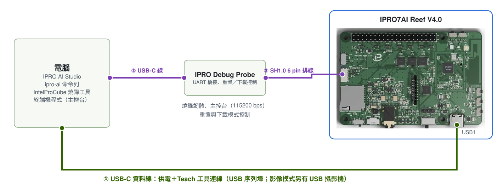

# 燒錄 Edge AI 韌體

三個 Teach 工具都在 Edge AI 韌體 `ipro_reef_teach` 裡。完成本頁後，Reef 會帶著自己的分割表、開機模式與聲紋模型開機，電腦列舉出目前模式的 USB 裝置，IPRO AI Studio 就能找到板子。韌體只需燒錄一次；之後影像與感測器的模型由 Studio 經 USB-C 部署，不必再燒錄。

## 前置需求 { #prerequisites }

- IPRO7AI Reef EVK V4.0，以及一條接 Reef USB-C（USB1）的資料線：燒錄時板子也由它供電。
- IPRO Debug Probe：以 USB-C 線接電腦，再以兩端腳序對調的 SH1.0 6 pin 排線接 Reef 的 U6，見[除錯排座 U6](../hardware/boards/reef-evk.md#debug-connector)。探針不對 Reef 供電。
- IntelProCube v0.6.3 命令列燒錄工具（`ipro_iot_tool_macos`、`ipro_iot_tool_linux`、`ipro_iot_tool.exe`），在它的工具目錄下執行。未包含於 SDK，請洽 INTELPRO。
- 韌體檔：IPRO Edge AI 套件的 `firmware/` 資料夾，或以 SDK V2.2.0 自行建置（需要[工具鏈](../get-started/environment.md)與 Python 3）。



平常使用 Teach 工具只需要 Reef 的 USB-C（①）。燒錄韌體或看主控台時，另接探針（②、③）。主控台在探針的「IPRO7 UART」序列埠，115200 baud、8N1；燒錄時速率為 921600 baud。

## 燒錄需要的檔案 { #files }

| 檔案 | 說明 | 來源 |
|---|---|---|
| `ipro_reef_teach_IPRO7.bin` | Edge AI 韌體 | 套件 `firmware/`；或 SDK 建置輸出 `apps/ai/ipro_reef_teach/build/build_out/` |
| `partition_reef_teach.toml` | Edge AI 韌體的分割表 | 套件 `firmware/`；或 SDK `apps/ai/ipro_reef_teach/` |
| `model_b.spkb` | 聲紋模型（437,200 B，CRC `db073b9e`） | 套件 `firmware/`；或 SDK `apps/ai/ipro_reef_teach/model/` |
| `reef_teach_mfg.bin` | mfg 酬載：開機時的模式加上聲紋模型 | 套件 `firmware/`（開機為 `image` 模式）；或以 `mfg_payload.py` 產生 |

影像與感測器的模型不在 mfg 酬載裡，之後由 IPRO AI Studio 部署。

## 從 SDK 建置（選用） { #build }

使用套件 `firmware/` 的檔案時跳過這一節。在 SDK 根目錄執行：

<div class="ipro-steps" markdown>

1. **建置韌體**

    ```bash
    make -C apps/ai/ipro_reef_teach
    ```

    輸出：`apps/ai/ipro_reef_teach/build/build_out/ipro_reef_teach_IPRO7.bin`。應用的 `.config` 已設定 Reef 板型（`CONFIG_IPRO7AI_REEF=y`）、2 MB Flash、AI 支援與看門狗，不需要另外選擇設定檔。

2. **產生 mfg 酬載**：`--mode` 是開機時進入的模式，可以是 `image`、`voice` 或 `sensor`（預設 `image`）。

    ```bash
    python3 apps/ai/ipro_reef_teach/mfg_payload.py \
        --voice apps/ai/ipro_reef_teach/model/model_b.spkb \
        --mode image -o reef_teach_mfg.bin
    ```

    酬載包含模式扇區、聲紋模型與它的提交紀錄，所以板子開機時就能找到經 CRC 檢查的聲紋模型。

</div>

## 燒錄步驟 { #flashing }

<div class="ipro-steps" markdown>

1. **接線**：Reef 的 USB-C 接電腦供電；IPRO Debug Probe 接電腦與 Reef 的 U6。使用影像辨識時，先在斷電狀態下把 OV5640 相機排線插進 FPC1，並確認 SW7 在 CAM。

2. **確認序列埠**：列出電腦上的序列埠（macOS 執行 `ls /dev/cu.*`，Windows 看「裝置管理員」的「連接埠 (COM 和 LPT)」）。用終端機程式以 115200 baud 開啟探針的「IPRO7 UART」序列埠，按 SW2（RESET），從開機訊息確認這就是要燒錄的那一片。macOS 上一律用 `/dev/cu.*`。

3. **進入下載模式**，依情況選一種：

    - **主控台輸入 `reboot_dl`（建議）**：Edge AI 韌體在每個模式都有 shell。輸入後關閉終端機程式，進入下載模式後主控台不會有輸出。
    - **由探針控制**：Windows 與 Linux 上，IntelProCube 會自動經探針讓 Reef 進入下載模式。macOS 上改用 IntelProCube 目錄的 `utils/ipro_flash.sh`，它會找出探針、讓 Reef 進入下載模式，再把參數原樣交給 `ipro_iot_tool_macos`（此時可省略 `--port`）。
    - **按鍵**：按住 SW1（BOOT），按一下 SW2（RESET），再放開 SW1。

    韌體當掉、主控台沒有任何輸出時，`reboot_dl` 無效，請改用探針或按鍵；進入下載模式後照樣可以重新燒錄。

4. **燒錄韌體、分割表與 mfg 酬載**：在 IntelProCube 目錄下執行。`--chip-variant IPRO7AI` 是 Reef 的 Flash 腳位設定，一定要帶；`--skip-ota` 與 `--pt` 指定 Edge AI 韌體自己的分割表。

    === "macOS"

        ```bash
        ./ipro_iot_tool_macos --chipname ipro7 --chip-variant IPRO7AI \
            --port /dev/cu.usbserial-XXXX --baudrate 921600 --skip-ota \
            --pt <SDK>/apps/ai/ipro_reef_teach/partition_reef_teach.toml \
            --firmware ipro_reef_teach_IPRO7.bin \
            --mfg reef_teach_mfg.bin
        ```

    === "Linux"

        ```bash
        ./ipro_iot_tool_linux --chipname ipro7 --chip-variant IPRO7AI \
            --port /dev/ttyUSB0 --baudrate 921600 --skip-ota \
            --pt <SDK>/apps/ai/ipro_reef_teach/partition_reef_teach.toml \
            --firmware ipro_reef_teach_IPRO7.bin \
            --mfg reef_teach_mfg.bin
        ```

    === "Windows"

        ```powershell
        .\ipro_iot_tool.exe --chipname ipro7 --chip-variant IPRO7AI --port COM5 --baudrate 921600 --skip-ota --pt <SDK>\apps\ai\ipro_reef_teach\partition_reef_teach.toml --firmware ipro_reef_teach_IPRO7.bin --mfg reef_teach_mfg.bin
        ```

    `--firmware`、`--mfg` 與 `--pt` 寫成檔案的實際路徑。使用套件的檔案時，`--pt` 指向套件 `firmware/` 裡的 `partition_reef_teach.toml`。

5. **確認 `[All Success]`**：燒錄工具失敗時也會以 0 結束，輸出中出現 `[All Success]` 才算成功。成功後工具會重置板子，板子從 Flash 開機。

6. **確認 USB 裝置**：Reef 的 USB-C 接著電腦時，電腦會列舉出目前模式的 USB 裝置。套件的 mfg 酬載開機為 `image` 模式，電腦出現名為 **IPRO7 UVC Cam** 的相機與序列埠。

</div>

!!! warning "不要用 Studio 的 Board 頁燒錄 Edge AI 韌體"
    IPRO AI Studio 的 **Board** 頁也有 **Flash** 按鈕，但它以標準 2 MB 分割表寫入單一韌體檔，不寫 mfg 酬載。Edge AI 韌體需要自己的分割表與 mfg 酬載，請用本頁的 IntelProCube 指令。

## 只更新韌體 { #firmware-only }

之後只更新韌體時，同一個指令省略 `--mfg`。板上的模式、三個工具的模型與已註冊的聲紋都會保留：

```bash
./ipro_iot_tool_macos --chipname ipro7 --chip-variant IPRO7AI \
    --port /dev/cu.usbserial-XXXX --baudrate 921600 --skip-ota \
    --pt <SDK>/apps/ai/ipro_reef_teach/partition_reef_teach.toml \
    --firmware ipro_reef_teach_IPRO7.bin
```

要改變開機模式或換回出廠的聲紋模型時，再以 `mfg_payload.py` 產生酬載並帶 `--mfg` 燒錄。板子原本跑的是使用標準分割表的其他韌體時，改燒 Edge AI 韌體後，影像與感測器的模型要重新部署。

## 分割表與 mfg 分割區 { #mfg-slots }

`partition_reef_teach.toml` 把韌體分割區縮小、mfg 分割區放大，讓三個工具的模型同時放得下；其他分割區的位置與 IntelProCube 的標準 2 MB 分割表相同。

| 分割區 | 標準 2 MB 分割表 | Edge AI 韌體的分割表 | 用途 |
|---|---|---|---|
| FW | 0x003000，1180 KB | 0x003000，640 KB | 韌體 |
| mfg | 0x12A000，824 KB | 0x0A3000，1364 KB | 開機模式與三個模型分格 |
| media | 0x1FB000，16 KB | 0x1FB000，16 KB | 聲紋辨識：已註冊者的聲紋與門檻 |

mfg 分割區內的配置（位移相對於 mfg 起點）：

| 位移 | 大小 | 內容 | 可放的模型 |
|---|---|---|---|
| 0x000000 | 4 KB | 分割區標頭 | |
| 0x001000 | 4 KB | 開機模式（`RTMD`）；空白時為 `image` | |
| 0x002000 | 448 KB | 聲紋模型（`model_b.spkb` 437 KB） | 444 KB |
| 0x072000 | 512 KB | 影像模型（`.inm`＋類別名稱；MobileNetV2 0.35 為 461 KB） | 508 KB |
| 0x0F2000 | 256 KB | 感測器模型（`.inm`＋前處理參數；large 為 191 KB） | 252 KB |
| 0x132000 | 140 KB | 未使用 | |

每個分格的最後 4 KB 是提交紀錄。部署時，板子先在記憶體中檢查模型的大小、CRC-32 與格式，再依序抹除提交紀錄、寫入「安裝中」紀錄、寫入並讀回比對模型，最後寫入提交字。所以斷電、重置或拔線時，板上只會留下舊模型、新模型或沒有模型三種結果之一，不會載入寫了一半的模型。

板子回報沒有模型時，原因會出現在開機訊息、`ipro-ai model list` 與影像辨識的相機畫面上：

| 原因 | 意思 | 處理 |
|---|---|---|
| `empty` | 這一格沒有模型 | 部署一個 |
| `install_interrupted` | 上次部署沒有完成 | 重新部署 |
| `crc` | 已提交的模型內容與 CRC 不符 | 重新部署 |
| `too_big` | 分格裡的資料比這個韌體的分格大 | 重新部署 |
| `no_xip` | 分割區無法讀取 | 以正確的分割表重新燒錄韌體 |

## 切換模式 { #modes }

Edge AI 韌體一次執行一個工具，稱為模式。模式存在 Flash，重新開機後維持不變；切換時板子重新開機（約 2 秒），三個工具的模型都不會清除。

| 模式 | 工具 | USB 裝置 | VID:PID | Studio 頁面 | 主控台指令 |
|---|---|---|---|---|---|
| `image` | 影像辨識 | IPRO7 UVC Cam：USB 攝影機＋序列埠 | 3896:0705 | **Teach** | `teach` |
| `voice` | 聲紋辨識 | IPRO Reef Voice：序列埠 | 3896:0720 | **Audio** | `spk` |
| `sensor` | 感測器辨識 | IPRO Reef Sensor：序列埠 | 3896:0721 | **Sensor** | `sens` |

切換方式：

- **IPRO AI Studio**：開啟要用的工具那一頁。板子在別的模式時，頁面上方出現 **Switch to Teach**、**Switch to Audio** 或 **Switch to Sensor**；按下後頁面會自己再找到板子。
- **主控台**：`mode` 顯示目前的模式；`mode image`、`mode voice` 或 `mode sensor` 切換並重新開機。

    ```text
    mode
    mode: image (of image voice sensor); `mode <image|voice|sensor>` restarts into another
    ```

- **命令列**：`ipro-ai deploy <套件.ipkg> --switch` 先切到套件所屬的模式再部署；`ipro-ai model list --all` 逐一切換、列出三個模式的模型，最後切回原模式。
- **USB 指令**：聲紋與感測器的序列埠協定為 `APP` 與 `APP <模式>`；影像工具為 16 位元組的 `TAPP` 標頭。格式見《IPRO7AI Edge AI 程式設計指南》。

## 開機訊息 { #boot-log }

在主控台按 SW2（RESET）或輸入 `reboot`，開機訊息先列出目前的模式，最後一行說明該工具已就緒，例如 `voice` 模式：

```text
RTCH:   mode: voice (`mode <image|voice|sensor>` to switch)
SPKM: model 'b3-e12': 437200 B, trunk 16/16 layers on the NPU, ...
RTCH: voice ready - shell `spk`, IPRO AI Studio Audio page over USB-C
```

其他模式的最後一行：

| 模式 | 就緒訊息 |
|---|---|
| `image` | ``image Teach ready - shell `teach`, IPRO AI Studio Teach page over USB-C`` |
| `voice` | `voice ready - …`；板上沒有有效的聲紋模型時為 `voice NO MODEL: flash the voice model to its mfg slot - …` |
| `sensor` | ``sensor Teach ready - shell `sens`, IPRO AI Studio Sensor page over USB-C; model: deployed``；還沒部署模型時，`model:` 後面是沒有模型的原因 |

`sensor` 模式的開機訊息另有一行 `SENM: model …`，列出模型大小、NPU 層數、類別數、資料來源與視窗。每個模式也會印出 `[WDT] AON watchdog armed: …`，表示看門狗已啟用。

## 看門狗 { #watchdog }

Edge AI 韌體啟用了 AON 看門狗（`CONFIG_APP_WATCHDOG=y`，標稱 8 秒）。系統停住時，例如 NPU 執行了損毀的模型，看門狗會讓板子重新開機，回到原本的模式，模型都保留。Reef 的看門狗時脈偏快，實際約在 5.6～8 秒觸發。進入下載模式前看門狗會自動關閉，不影響燒錄。

| 主控台指令 | 作用 |
|---|---|
| `watchdog` | 看門狗的狀態：時限、餵狗間隔與次數 |
| `watchdog test` | 停止餵狗，確認看門狗會把板子重新開機 |

沒有操作、板子卻自己重新開機（主控台重新出現開機訊息）時，見[疑難排解](troubleshooting.md#runtime)。

## 確認結果 { #verify }

1. IntelProCube 的輸出有 `[All Success]`。
2. 主控台的開機訊息顯示 `mode:` 與該模式的就緒訊息。
3. 電腦列舉出該模式的 USB 裝置（例如 **IPRO7 UVC Cam**）。
4. `ipro-ai device info --json` 的 `version` 顯示 `"fw": "ipro_reef_teach"`、`"platform": "2.0"`，`caps.modes` 為 `["image", "voice", "sensor"]`。

## 疑難排解 { #troubleshooting }

| 症狀 | 原因 | 處理 |
|---|---|---|
| 工具結束了，但輸出沒有 `[All Success]` | 燒錄失敗；工具失敗時也以 0 結束 | 確認板子在下載模式、序列埠正確，再燒一次 |
| 交握成功，但 Flash ID 為 `00000000`，ErrorCode `003D` | 沒有帶 `--chip-variant IPRO7AI` | 加上 `--chip-variant IPRO7AI` 再燒錄 |
| 交握失敗或打不開序列埠 | 終端機程式仍占用序列埠，或板子不在下載模式 | 關閉終端機程式，重新進入下載模式 |
| macOS 用 `utils/ipro_flash.sh` 時出現 `[Errno 83] Device error`，ErrorCode `0003` | 探針讓 Reef 進入下載模式後，它的序列埠短暫消失 | 等一兩秒，再執行一次同樣的指令 |
| 主控台看不到任何字 | 排線兩端腳序相同，或開到探針的另一個序列埠 | 改用兩端腳序對調的排線；開啟「IPRO7 UART」序列埠，115200 baud |
| 燒到了另一片板子 | 多片板子同時接著，`--port` 指到別片 | 燒錄前以開機訊息確認板子；不確定時一次只接一片 |
| 開機後相機畫面顯示 `NO MODEL: NO MFG PARTITION` | 燒錄時用的分割表不是 `partition_reef_teach.toml` | 以正確的分割表重新燒錄 |

## 下一步 { #next-steps }

- [影像辨識](image.md)：套件的 mfg 酬載開機即為 `image` 模式。
- [聲紋辨識](voice.md)、[感測器辨識](sensor.md)：以 Studio 的 **Switch to …** 或主控台的 `mode` 切換。
