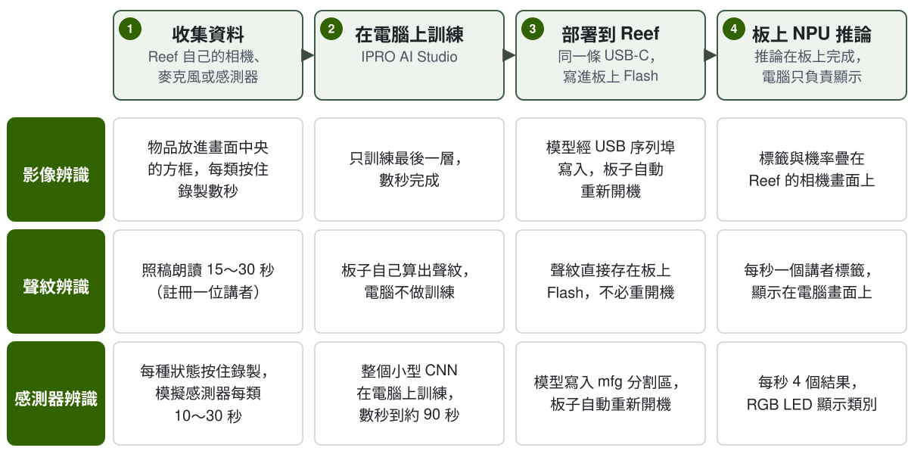

# IPRO AI Teach

IPRO AI Teach 讓 IPRO7AI Reef EVK 不寫程式就學會辨識：用板子自己的相機、麥克風或感測訊號收資料，在電腦上以 IPRO AI Studio 訓練，再經同一條 USB-C 部署到板子，由 IPRO7AI 的 NPU 執行推論。三個辨識工具（影像、聲紋、感測器）都在同一個 Edge AI 韌體 `ipro_reef_teach` 裡，一次執行一個，切換時三個模型都保留在板上。

!!! info "取得方式"
    IPRO AI Studio（macOS、Windows）與可直接燒錄的 Edge AI 韌體檔隨 IPRO Edge AI 套件提供，請洽 INTELPRO。SDK 內含 Edge AI 韌體的原始碼 `apps/ai/ipro_reef_teach` 與瀏覽器版影像 Teach `tools/teach_web`。

!!! abstract "重點"
    - 一份韌體、三種模式：`image`（影像辨識）、`voice`（聲紋辨識）、`sensor`（感測器辨識）。模式存在 Flash，切換時板子重新開機，約 2 秒。
    - 電腦端使用 IPRO AI Studio 的 **Teach**、**Audio**、**Sensor** 三頁；訓練在電腦的 CPU 上執行，不需要 GPU。
    - 推論全在板上的 NPU 完成；影像、聲音與感測資料不會上傳到網路，聲紋辨識的聲音不會離開板子。
    - 硬體：IPRO7AI Reef EVK V4.0。韌體只需燒錄一次，之後換模型都經 USB-C 部署。

## 介紹影片 { #video }

<video controls preload="metadata" playsinline width="100%" poster="/ipro-sdk-docs/assets/videos/ipro-ai-teach-2-intro.jpg">
  <source src="/ipro-sdk-docs/assets/videos/ipro-ai-teach-2-intro.mp4" type="video/mp4">
</video>

硬體導覽、燒錄，以及影像、聲紋、感測器三個工具從收資料到在板上辨識的流程（約 3 分鐘）。

## 三個工具 { #tools }

| | 影像辨識 | 聲紋辨識 | 感測器辨識 |
|---|---|---|---|
| 做什麼 | 辨識相機畫面中央方框裡的物品 | 每秒標示一次誰在說話：已註冊的人顯示名字，其他人顯示 Speaker 1、Speaker 2… | 依感測訊號判斷機器或環境的狀態；沒教過的狀態回答 `UNKNOWN`，或只錄正常狀態做異常偵測 |
| 資料來源 | OV5640 相機模組 | 板上 PDM 麥克風 | 韌體內建的 5 種模擬感測器、板上麥克風，或自行加入的感測器 |
| 韌體模式 | `image` | `voice` | `sensor` |
| USB 裝置（VID:PID） | IPRO7 UVC Cam（3896:0705），USB 攝影機＋序列埠 | IPRO Reef Voice（3896:0720），序列埠 | IPRO Reef Sensor（3896:0721），序列埠 |
| IPRO AI Studio 頁面 | **Teach** | **Audio** | **Sensor** |
| 類別或人數 | 2～8 類（含 BACKGROUND） | 最多 19 人存在板上的 Flash | 最多 8 類（開啟 UNKNOWN 時教 7 類） |
| 結果頻率 | 隨相機影格 | 每秒 1 次 | 每秒 4 次 |
| 結果顯示 | 疊在 Reef 的相機畫面上 | Audio 頁的時間軸；聆聽時 RGB LED 亮紅燈 | Sensor 頁；RGB LED 以顏色顯示類別 |

聲紋辨識不在電腦上訓練：註冊一個人時，板子自己算出聲紋並存在 Flash，電腦只送出指令與顯示結果。

## 需要準備 { #requirements }

| 項目 | 說明 | 影像 | 聲紋 | 感測器 |
|---|---|---|---|---|
| IPRO7AI Reef EVK V4.0 | 見 [IPRO7AI Reef EVK](../hardware/boards/reef-evk.md) | ● | ● | ● |
| OV5640 相機模組 | FLEX-24 排線，接 FPC1；SW7 撥到 CAM | ● | | |
| USB-C 資料線 | 接 Reef 的 USB-C 與電腦：供電、工具連線與模型傳輸。只能充電的線無法使用 | ● | ● | ● |
| 電腦 | macOS 11 以上，或 Windows 64 位元（x64） | ● | ● | ● |
| IPRO AI Studio | 0.4.2，見[安裝 IPRO AI Studio](install.md) | ● | ● | ● |
| IPRO Debug Probe | 接 Reef 的除錯排座 U6；只在燒錄韌體、看主控台時需要 | ● | ● | ● |
| IntelProCube v0.6.3 | 命令列燒錄工具；只在燒錄韌體時需要 | ● | ● | ● |
| Edge AI 韌體檔 | IPRO Edge AI 套件的 `firmware/`，或以 SDK 自行建置，見[燒錄 Edge AI 韌體](firmware.md) | ● | ● | ● |

感測器辨識不需要外接感測器：韌體內建 5 種模擬感測器，只要一片 Reef 與一條 USB-C 線就能走完整個流程。接上自己的感測器需要在韌體加入資料來源，見[感測器辨識](sensor.md#own-sensor)。

## 整體流程 { #workflow }

1. **安裝 IPRO AI Studio。** 在 macOS 或 Windows 安裝並開啟 Studio，允許它使用相機。見[安裝 IPRO AI Studio](install.md)。

2. **燒錄 Edge AI 韌體（只需一次）。** 經 IPRO Debug Probe 以 IntelProCube 燒錄 `ipro_reef_teach`、它的分割表與 mfg 酬載（開機模式＋聲紋模型）。輸出出現 `[All Success]` 才算成功。見[燒錄 Edge AI 韌體](firmware.md)。

3. **接上 USB-C，確認板子。** 電腦列舉出目前模式的 USB 裝置，例如 **IPRO7 UVC Cam**；Studio 的頁面以這個裝置找到板子。板子在別的模式時，頁面上方出現 **Switch to …** 按鈕。

4. **收集資料。** 影像：把物品放進方框，按住 **Hold to record**。聲紋：在 **TEACH A VOICE** 輸入名字，按 **Record** 朗讀。感測器：選擇資料來源，每種狀態按住 **Hold to record**。

5. **訓練。** 影像與感測器在電腦上按 **Train**，數秒到約 90 秒完成。聲紋註冊完成即可使用，不需要訓練。

6. **部署。** 按 **Deploy**：Studio 依序完成 **Compile the model**、**Send and write**、**Restart the board**，板子重新開機後載入新模型。

7. **在板上執行並確認。** 影像結果疊在相機畫面上；聲紋按 **Start listening** 看時間軸；感測器看 **On the board** 區每秒 4 次的結果。

## 本節頁面 { #pages }

-   **[安裝 IPRO AI Studio](install.md)**

    ---

    在 macOS 與 Windows 安裝 Studio、第一次開啟、相機權限、Studio 如何找到板子，以及 `ipro-ai` 命令列。

-   **[燒錄 Edge AI 韌體](firmware.md)**

    ---

    建置或取得韌體、產生 mfg 酬載、以 IntelProCube 燒錄、只更新韌體、mfg 分割區、切換模式、開機訊息與看門狗。

-   **[影像辨識](image.md)**

    ---

    切到 `image` 模式、確認相機、建立類別、錄製、訓練、部署，在板上看結果並補錄再訓練。

-   **[聲紋辨識](voice.md)**

    ---

    切到 `voice` 模式、註冊講者、即時辨識、替匿名講者取名、刪除聲紋、門檻與陌生人模式。

-   **[感測器辨識](sensor.md)**

    ---

    模擬感測器與麥克風、錄製、訓練選項、UNKNOWN 與異常偵測、部署、即時結果，以及接上自己的感測器。

-   **[瀏覽器版影像 Teach](browser.md)**

    ---

    以 SDK 的 `tools/teach_web` 在 Chrome 或 Edge 完成影像 Teach，不需安裝 Studio。

-   **[疑難排解](troubleshooting.md)**

    ---

    找不到板子、模式不對、相機沒有畫面、燒錄失敗、部署被拒、看門狗重新開機等狀況的原因與處理。

## 本版限制 { #limitations }

- 一次只執行一個工具；切換模式時板子重新開機（約 2 秒）。
- 每個工具只有一個模型分格：部署在提交前被中斷時，該工具會沒有模型，重新部署即可；沒有上一個模型可以回復。
- 模型經完整性檢查（大小、CRC-32），但不驗證簽章：任何能連上板子 USB 的電腦都可以部署 CRC 正確的模型，不能當作安全功能。
- 影像辨識需要 OV5640 相機模組；影像辨識沒有「不認識」這個答案，沒教過的物品會被歸到最像的一類。
- 主控台只接受 ASCII 字元；含中文的講者名字請在 Studio 的 Audio 頁輸入。
- 本版的 Edge AI 韌體支援 IPRO7AI Reef EVK；其他 IPRO7AI 板需自行確認分割區、相機與麥克風腳位。
