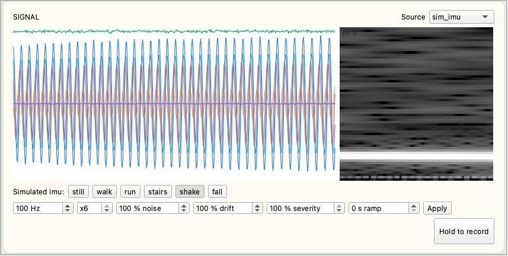
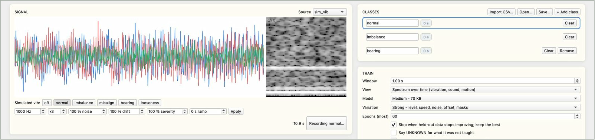
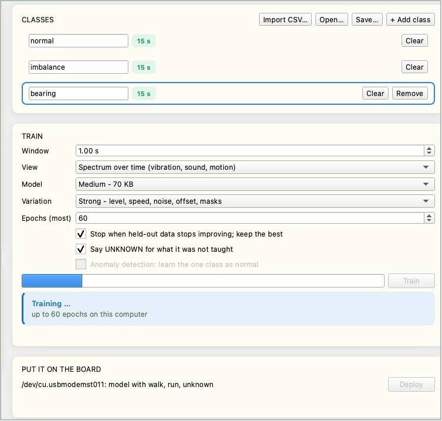
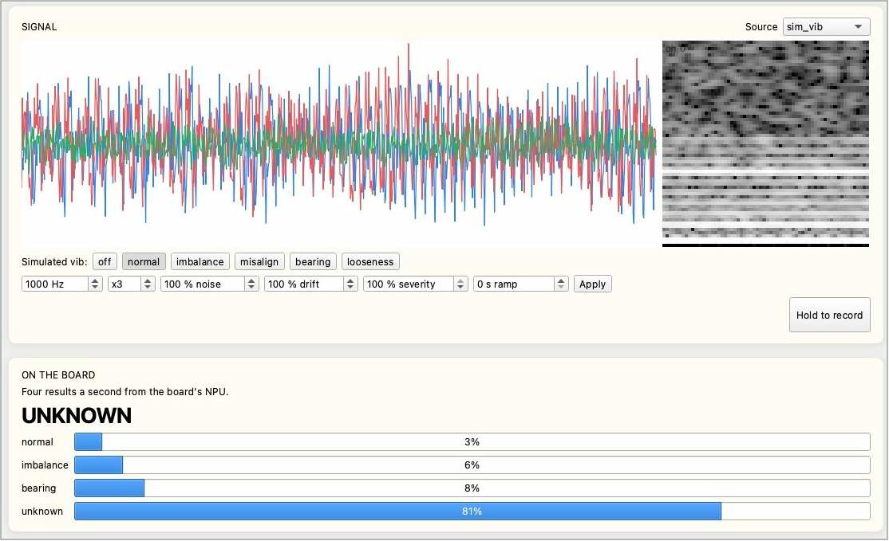

# 感測器辨識

讓 Reef 從感測訊號判斷機器或環境的狀態，例如馬達是否不平衡、人是在走路還是跌倒。每種狀態錄一段、在電腦上訓練、部署到板子，之後由板上的 NPU 每秒判斷 4 次。全程在 IPRO AI Studio 的 **Sensor** 頁完成。韌體內建 5 種模擬感測器，還沒接上自己的感測器之前，只要一片 Reef 和一條 USB-C 線就能把整個流程走一遍。

## 前置需求 { #prerequisites }

- IPRO7AI Reef EVK 已燒錄 Edge AI 韌體，見[燒錄 Edge AI 韌體](firmware.md)。感測器模型由 Studio 部署，不需要另外燒錄。
- 一條可傳資料的 USB-C 線，接 Reef 的 USB-C 與電腦。
- 已安裝 IPRO AI Studio，見[安裝 IPRO AI Studio](install.md)。
- 使用模擬感測器或板上麥克風時不需要其他硬體；自己的感測器需要先在韌體加入資料來源，見[接上自己的感測器](#own-sensor)。

## 運作方式 { #how-it-works }

- 資料來源（模擬感測器、麥克風或您的感測器）的取樣值存進板上 1 MB 的環形緩衝，並經 USB-C 原樣串流到 Studio。
- Studio 把每一段訊號（一個「視窗」）轉成 64×64×8 的特徵圖，在電腦上訓練整個小型 CNN，再編譯成 NPU 模型。
- 部署時，模型連同前處理參數、類別名稱與資料來源一起寫進感測器模型分格，板子自動重新開機。
- 板子用與 Studio 相同的算法做前處理，交給 NPU 推論，每秒送出 4 個結果到 Studio，並以 RGB LED 的顏色顯示目前的類別。

## 連上板子 { #connect }

<div class="ipro-steps" markdown>

1. **切到 `sensor` 模式**：開啟 Sensor 頁後按頁面上方的 **Switch to Sensor**，或在主控台輸入 `mode sensor`。開機訊息顯示目前的模型，例如：

    ```text
    SENM: model 63672 B, 5/5 layers on the NPU, 6 classes, sim_vib 1000 Hz x3, window 1000, spectrogram
    ```

    還沒部署模型時，這裡說明沒有模型的原因。

2. **接上 USB-C**：電腦出現名為 **IPRO Reef Sensor** 的序列埠。

3. **開啟 Sensor 頁**：在 Studio 左側導覽列按 **Sensor**（macOS 為 Command＋6，Windows 為 Ctrl＋6）。

4. **確認狀態列**：**Board** 顯示 `ready`，**Source** 顯示目前的資料來源、取樣率與通道數，例如 `sim_vib 1000 Hz x3`。找不到板子時，**Put it on the board** 區顯示 `Connect a Reef running the Edge AI firmware to its own USB-C port.`。

</div>

## Sensor 頁介面 { #page-layout }

| 區塊 | 說明 |
|---|---|
| 狀態列 | **Board**、**Source**、**Held-out accuracy**（保留驗證的正確率，90% 以上以綠色顯示）、**Last deploy**（上次部署的時間） |
| **Signal** | 即時波形（左）與頻譜（右）；右上角的 **Source** 選擇資料來源 |
| 模擬狀態與參數 | 使用模擬感測器時出現：上排按鈕切換模擬的狀態，下排設定取樣率、通道數、雜訊、漂移、嚴重度與漸進時間，按 **Apply** 生效 |
| **Hold to record** | 按住錄製目前選取的類別，放開即停止 |
| **Classes** | 類別清單，每列有名稱、已錄秒數、**Clear** 與 **Remove**；上方有 **Import CSV…**、**Open…**、**Save…**、**+ Add class** |
| **Train** | 訓練選項、進度條、**Train** 按鈕、訓練結果與混淆矩陣 |
| **Put it on the board** | 板子的序列埠與目前的模型、**Deploy** 按鈕；下方逐步顯示部署進度 |
| **On the board** | 板子每秒 4 次的辨識結果：大字為目前的判斷，下方為每個類別的機率 |

## 選擇資料來源 { #source }

在 **Signal** 區右上角的 **Source** 選擇資料來源。切換來源時，Studio 會帶入建議的視窗長度與檢視方式。

| 來源 | 通道（單位） | 取樣率 | 可模擬的狀態 | 建議的視窗與檢視方式 |
|---|---|---|---|---|
| `sim_vib` | 三軸加速度 x、y、z（g） | 1 kHz | `off` 停機、`normal` 正常、`imbalance` 不平衡、`misalign` 不對心、`bearing` 軸承故障、`looseness` 鬆動 | 1 秒，頻譜 |
| `sim_imu` | 加速度 ax、ay、az（g），角速度 gx、gy、gz（500 dps） | 100 Hz | `still` 靜止、`walk` 走路、`run` 跑步、`stairs` 上下樓梯、`shake` 搖晃、`fall` 跌倒 | 2.56 秒，頻譜 |
| `sim_env` | 溫度、氣壓、濕度 | 10 Hz | `normal` 正常、`heating` 加熱、`cooling_fail` 冷卻故障、`leak` 洩漏、`door_open` 開門、`sensor_fault` 感測器故障 | 60 秒，波形 |
| `sim_motor` | 三相電流 A、B、C（A） | 2 kHz | `off` 停機、`normal` 正常、`overload` 過載、`phase_loss` 缺相、`broken_bar` 轉子斷條、`bearing` 軸承故障、`unbalanced` 三相不平衡 | 2 秒，頻譜 |
| `sim_sound` | 聲壓（單通道） | 8 kHz | `quiet` 安靜、`hum` 嗡嗡聲、`alarm` 警報聲、`knock` 敲擊聲、`hiss` 漏氣嘶聲、`voice` 人聲 | 0.5 秒，頻譜 |
| `mic` | Reef 的 PDM 麥克風（經 100 Hz 高通濾波） | 16 kHz | （真實聲音） | 1 秒，頻譜 |

模擬感測器每錄一次都會重新抽取轉速、準位與雜訊，準位也每 10 秒緩慢變化一次，所以同一個狀態錄兩次，差異就像同一台機器運轉兩次。

使用模擬感測器時，波形下方有兩排控制項：

- **狀態按鈕**：例如 `Simulated vib: off normal imbalance misalign bearing looseness`，按一下即切換模擬的狀態。按 Reef 上的 SW4 也會依序切換狀態。
- **參數**：設定好後按 **Apply** 生效。

| 參數 | 範圍 | 意思 |
|---|---|---|
| 取樣率（Hz） | 1～16000 | 模擬的取樣頻率 |
| 通道數（x） | 1～6 | 模擬的通道數 |
| noise（%） | 0～1000 | 雜訊的強度 |
| drift（%） | 0～1000 | 漂移的強度 |
| severity（%） | 0～100 | 狀態特徵的強弱；30% 代表故障剛開始出現 |
| ramp（s） | 0～3600 | 切換到新狀態時，從無到達到設定嚴重度所花的時間，用來模擬慢慢惡化的故障 |



## 錄製 { #record }

<div class="ipro-steps" markdown>

1. **命名類別**：清單預設有 `normal` 與 `fault` 兩類。點名稱可以改名，按 **+ Add class** 新增，最多 8 類。名稱可用英文字母、數字與 `_ - .`，最多 15 個字元，不能有空白（空白會換成底線）。

2. **選取類別、設定狀態**：點一下要錄的類別（外框變藍），讓機器處在那個狀態；使用模擬感測器時，按對應的狀態按鈕。

3. **按住 Hold to record**：錄製中按鈕顯示 `Recording <類別>…`，放開即停止。類別旁的秒數會累加，累積到 10 秒以上時轉為綠色。

4. **依序錄完每一類**：錄錯了按 **Clear** 清掉該類的錄音，**Remove** 刪除整個類別。

</div>



錄製要點：

- 模擬感測器每類錄 10～30 秒就足夠。
- **每一次按住的時間要超過視窗長度的 2 倍。** 每段錄音的最後四分之一保留下來做驗證；錄太短的類別無法評分。比一個視窗還短時顯示 `too short: hold for at least one window`。
- 資料串流中斷時顯示 `the stream skipped: kept as <N> takes`，錄音會分成 N 段保留。
- 慢速訊號（例如溫度）要錄得比較長，至少涵蓋 15 個視窗。

**匯入 CSV**：在別處錄好的資料，按 **Import CSV…** 加進目前選取的類別。

- 一欄一個通道、一列一個取樣點，以逗號分隔；第一列若是標題列會自動略過。
- 取樣率必須與板子目前的資料來源相同，欄數必須等於來源的通道數；不符時顯示 `<N> columns` 錯誤。
- 數值要用板子串流出來的原始計數，不要換算成伏特或 g：前處理的頻譜以一個計數為下限，換算過單位的資料看起來會和即時訊號不一樣。

## 訓練 { #train }

| 選項 | 選擇 | 說明 |
|---|---|---|
| **Window** | 0.05～60 秒（預設 1.00 s） | 每次判斷看多長的訊號；切換資料來源時帶入建議值 |
| **View** | Spectrum over time (vibration, sound, motion) | 頻譜隨時間的變化；適合振動、聲音、動作 |
| | Waveform (slow signals: temperature, pressure) | 原始波形；適合溫度、氣壓等慢速訊號 |
| **Model** | Small - fastest, 21 KB | 最小、最快 |
| | Medium - 70 KB（預設） | 大部分情況的起點 |
| | Large - most capacity, 200 KB | 容量最大，適合類別多或差異細微的情況 |
| **Variation** | Strong - level, speed, noise, offset, masks（預設） | 訓練時加上準位、速度、雜訊、偏移與遮罩等變化，適合大多數訊號 |
| | Light - level and a little noise | 只加準位變化與少量雜訊；適合非常細微、緩慢、容易被強烈變化掩蓋的特徵 |
| **Epochs (most)** | 5～300（預設 60） | 訓練回合數的上限 |
| Stop when held-out data stops improving; keep the best | 勾選（預設） | 保留驗證的分數連續 8 個回合沒有進步就停止，保留分數最好的那一回合 |
| Say UNKNOWN for what it was not taught | 勾選／不勾 | 另外學一個 UNKNOWN 類別，見下文 |
| Anomaly detection: learn the one class as normal | 只錄一類時才能勾選 | 異常偵測，見下文 |

<div class="ipro-steps" markdown>

1. **設定選項後按 Train**：進度條顯示訓練進度，下方顯示 `Training… up to <n> epochs on this computer`。至少要有 2 類有錄音（異常偵測要剛好 1 類），否則顯示 `Not ready to train`。

    

2. **看結果**：完成後顯示 `Trained in <秒數> s`，以及訓練用的視窗數（training windows）與從每段錄音尾端保留驗證的視窗數（held out）。保留驗證的分數以板子實際執行的 int8 模型計算。

3. **看混淆矩陣**（`true \ said`）：每一列是實際的類別，每一欄是模型的判斷，對角線以外的數字就是判錯的次數。

</div>

若顯示 `<k> of <n> classes have no held-out data`，表示有類別每次錄的時間太短，請把那幾類重錄得比視窗長度的 2 倍更長。訓練時間依類別數、錄音長度、模型大小與是否開啟 UNKNOWN 而定，INTELPRO 的實測從約 4 秒（2 類、各 15 秒）到約 90 秒（3 類各 15 秒、Medium、開啟 UNKNOWN）。

**讓模型會說 UNKNOWN**：勾選 **Say UNKNOWN for what it was not taught** 後，Studio 用您錄的資料自動產生各種變形，學成一個額外的 UNKNOWN 類別，並替每個類別訂出分數下限。遇到沒錄過的狀態時，板子回答 `UNKNOWN`，而不是硬把它歸到某一個已知類別。開啟後最多可以教 7 類（UNKNOWN 占一類）。

**只錄正常狀態：異常偵測**：只有一個類別有錄音時（通常是「正常」），可以勾選 **Anomaly detection: learn the one class as normal**。Studio 把正常資料加上各種人工製造的異常（新的音調、撞擊、雜訊爆發、準位跳動或漂移、讀值卡住、轉速大幅改變、某個通道失效、訊號削峰、峰值或諧波變強、通道增益改變、緩慢的拍頻），讓模型學會「正常」與「其他一切」的差別，所以從沒錄過的故障也會被判成 `ANOMALY`。Studio 調整判定門檻，讓加上變化的正常資料中約 1% 被判為異常。錄得到的故障，用分類模式（每種故障錄一類）通常比異常偵測更可靠。

## 部署 { #deploy }

<div class="ipro-steps" markdown>

1. **確認板子**：**Put it on the board** 區顯示板子的序列埠與目前的模型，例如 `/dev/cu.usbmodemXXXX: no model yet`。

2. **按 Deploy**：Studio 依序執行並打勾：**Compile the model**（編譯模型，顯示模型大小與 NPU 層數）、**Send and write**（傳送並寫入，板子回覆 `TDEP OK`）、**Restart the board**（板子重新開機並載入新模型）。

3. **確認完成**：顯示 **On the board** 與 `<類別名稱> - results below, four a second.`，狀態列的 **Last deploy** 顯示部署的時間。

</div>

部署通常在數秒內完成，模型越大，傳送與寫入越久。感測器模型只有一格：寫入途中被中斷時會沒有模型，重新部署即可。

## 看即時結果 { #run }

部署完成後，**On the board** 區每秒更新 4 次：

- **大字**：目前的判斷，是類別名稱、`UNKNOWN`（沒教過的狀態）或 `ANOMALY`（異常偵測模式下的異常）。
- **長條圖**：每個類別的機率。
- Reef 的 RGB LED 也以不同顏色顯示目前的類別，不接電腦也看得出結果。



用模擬感測器測試時，切換到沒有教過的狀態，就能檢查 UNKNOWN 是否作用；把 ramp 設成數十秒，可以觀察故障逐漸變嚴重時判斷在什麼時候改變。狀態轉換的當下，一個視窗可能同時含兩種狀態，偶爾出現 UNKNOWN 屬正常現象，請以連續幾次的結果判斷。

感測器模式的主控台指令：

| 指令 | 作用 |
|---|---|
| `sens status` | 目前的資料來源、模型與狀態 |
| `sens src <來源>` | 切換資料來源：`sim_vib`、`sim_imu`、`sim_env`、`sim_motor`、`sim_sound`、`mic` |
| `sens sim <狀態>` | 切換模擬感測器的狀態（`sens status` 列出可用的狀態） |
| `sens print on`／`sens print off` | 在主控台印出每一筆結果 |

## 確認結果 { #verify }

1. 部署後 **On the board** 區每秒更新 4 次，大字隨模擬狀態按鈕或機器的實際狀態改變。
2. 每一個教過的狀態，大字顯示對應的類別名稱，該類的機率最高。
3. 開啟 UNKNOWN 時，切換到沒有教過的狀態，大字顯示 `UNKNOWN`。
4. RGB LED 的顏色隨類別改變；重新開機後模型仍在（開機訊息出現 `SENM: model …`）。

## 儲存與再訓練 { #iterate }

- **Save…**：把所有錄音存進一個資料夾：每類一個 `.npz` 檔，加上記錄取樣率與類別順序的 `sensor_teach.json`。
- **Open…**：開回由 **Save…** 存的資料夾，繼續補錄或重新訓練。
- 同一個資料夾也可以不開視窗，以命令列訓練成模型套件再部署（`--source` 必須是錄製時的資料來源）：

    ```bash
    ipro-ai train sensor rec/ --source sim_vib --out vib.ipkg
    ipro-ai deploy vib.ipkg --switch
    ```

    預設值與 Sensor 頁相同（Medium、Strong、最多 60 回合、8 回合沒進步就停止）；`--size`、`--window`、`--mode spectrogram|wave`、`--unknown`、`--anomaly` 等選項對應頁面上的設定。

## 接上自己的感測器 { #own-sensor }

隨附的 Edge AI 韌體只有 5 種模擬感測器與板上麥克風這些資料來源，沒有內建任何外接感測器的驅動。接上自己的感測器有兩種方式：

**方式一：在韌體加入資料來源（建議）**

由韌體工程師在 SDK 的 `apps/ai/ipro_reef_teach/sensor/sensor_src.c` 的來源表加一個項目：I2C 或 SPI 元件以 `ipro_ai_source_sampled_register()` 註冊（平台定時呼叫您的讀取函式），串流資料以 `ipro_ai_source_ring_register()` 註冊（可在中斷中推入）。兩者都宣告在 `components/ai/source/include/ipro_ai_source.h`。規則如下：

- 取樣值為 int16，多通道時交錯排列，所有通道同一個取樣率。
- 最多 8 個通道；取樣率不限，只要 1 MB 的環形緩衝放得下一個視窗。以平台定時呼叫的輪詢式來源，取樣率最高 1 kHz（系統節拍）。
- 來源要回報名稱、取樣率、通道數與單位。

Reef 的 40-pin 排針 J_IO 第 3、5 腳是 I2C（SDA GPIO19、SCL GPIO18，板上 4.7 kΩ 上拉），訊號為 3.3 V，見 [40-pin 擴充排針 J_IO](../hardware/boards/reef-evk.md#j-io)。建置與燒錄方式同[燒錄 Edge AI 韌體](firmware.md)，只更新韌體時省略 `--mfg`。

Studio 不需要任何修改：它從板子讀取資料來源的名稱、取樣率與通道數，新的來源會出現在 **Source** 選單。模型會記錄訓練時的資料來源名稱，板子只在同一個來源上執行這個模型。

**方式二：匯入 CSV**

在別處以同樣的感測器、取樣率與通道數錄好的資料，可以用 **Import CSV…** 加進類別。部署後的模型仍要在板上有對應的資料來源才能執行，所以這個方式用來補充訓練資料，不能取代方式一。

## 規格 { #specs }

| 項目 | 規格 |
|---|---|
| 類別數 | 最多 8 類；開啟 UNKNOWN 時最多教 7 類 |
| 通道數 | 最多 8 個（模擬感測器 1～6 個） |
| 取樣率 | 1 Hz～16 kHz |
| 視窗長度 | 0.05～60 秒；上限還受 1 MB 環形緩衝限制，例如 16 kHz 單通道 32 秒、1 kHz 三通道 170 秒 |
| 前處理 | 頻譜模式：每通道 64 個時間片段、每段 128 點 FFT，頻率解析度為取樣率／128，每個視窗至少 128 個取樣點；波形模式：每通道重取樣成 4096 點 |
| 模型輸入 | 64×64×8，int8 |
| 網路 | 四層 3×3、步距 2 的卷積加 1×1 分類層，每一層都在 NPU 上執行 |
| 部署到板上的模型大小 | Small 約 17 KB、Medium 約 64 KB、Large 約 191 KB |
| 板上時間 | Large 模型：NPU 約 4.6 ms；前處理約 56 ms（1 秒視窗、三通道、頻譜） |
| 結果輸出 | 每秒 4 次，經 USB-C 送到 Studio，並以 RGB LED 顯示 |
| 模型存放位置 | 感測器模型分格，可放 252 KB |

## 使用建議 { #tips }

- **模擬感測器只用來熟悉流程。** 換成真實感測器後，請重新收集資料、訓練，並在現場驗證。
- **異常偵測只認得您錄的「正常」。** 請在機器的各種正常負載、轉速下都錄一段正常資料；否則較重的正常負載可能被判成異常，而真正的過載反而可能被當成正常。
- 頻率特徵明顯的故障（例如軸承、鬆動、缺相）最容易抓到；只有振幅變大的故障（例如過載、三相不平衡）在異常偵測模式下較難發現，請改用分類模式。
- 慢速訊號（溫度、氣壓）用波形模式，每段錄音至少涵蓋 15 個視窗；異常偵測的正常資料要錄得夠長。
- 頻譜模式的每個視窗至少要有 128 個取樣點；取樣率很低時改用波形模式或加長視窗。
- 特徵頻率差距小於「取樣率／128」的故障，只會表現為隨時間緩慢起伏的拍頻，需要 2 秒以上的視窗，而且仍是最難辨識的情況。
- 模型只在訓練時用的資料來源（名稱、取樣率、通道數）上執行；換了來源或參數就要重新訓練、部署。

## 疑難排解 { #troubleshooting }

| 症狀 | 原因 | 處理 |
|---|---|---|
| **Put it on the board** 顯示 `Connect a Reef running the Edge AI firmware to its own USB-C port.` | 找不到在 `sensor` 模式的板子 | 確認韌體與 USB-C 線；USB-C 要接在 Reef 本身的埠；按 **Switch to Sensor** |
| `Not ready to train` | 板子沒連上，或有錄音的類別不到 2 類（異常偵測要剛好 1 類） | 連上板子並補錄類別 |
| `too short: hold for at least one window` | 按住的時間比一個視窗還短 | 按久一點 |
| `<k> of <n> classes have no held-out data` | 有類別每次錄的時間太短 | 每次按住超過視窗長度的 2 倍 |
| **Import CSV…** 顯示 `<N> columns` | CSV 的欄數和資料來源的通道數不同 | 一欄一個通道、一列一個取樣點 |
| **Open…** 顯示 `Not a Sensor Teach folder` | 資料夾裡沒有 `sensor_teach.json` | 開啟由 **Save…** 存的資料夾 |
| 部署失敗：`the board did not come back with the model within 30 s` | 板子沒有在 30 秒內帶著新模型回來 | 拔插 USB-C，確認主控台的開機訊息，再部署一次 |
| 部署失敗：`the board refused it: …`，訊息含 `size` | 模型超過分格容量 | 改用較小的 **Model**（Medium 或 Small） |
| 換了資料來源後，原本訓練好的模型不能用 | 模型只適用於訓練時的資料來源 | 在新的資料來源上重新錄製與訓練 |
| 即時結果在狀態轉換時出現 `UNKNOWN` | 視窗同時含兩種狀態 | 正常現象；以連續幾次的結果判斷 |
| 異常偵測在正常的重負載下也報警 | 正常資料沒有涵蓋這種負載 | 在各種正常負載、轉速下補錄正常資料，重新訓練 |

其他狀況見[疑難排解](troubleshooting.md)。

## 下一步 { #next-steps }

- [燒錄 Edge AI 韌體](firmware.md)：加入自己的資料來源後只更新韌體。
- 《IPRO7AI Edge AI 程式設計指南》：資料來源、前處理與應用框架的完整介面，向 INTELPRO 索取，見[文件下載](../documents/index.md)。
