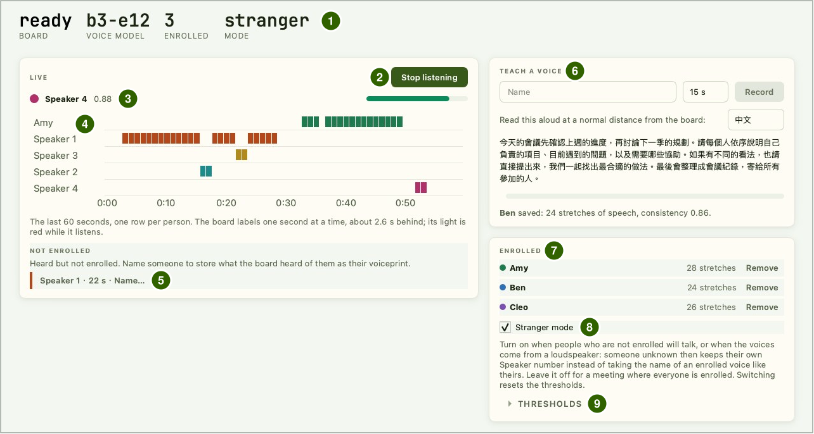
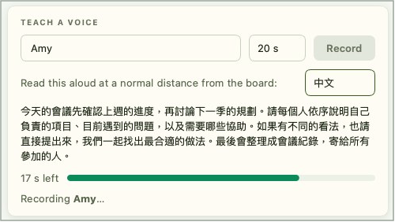
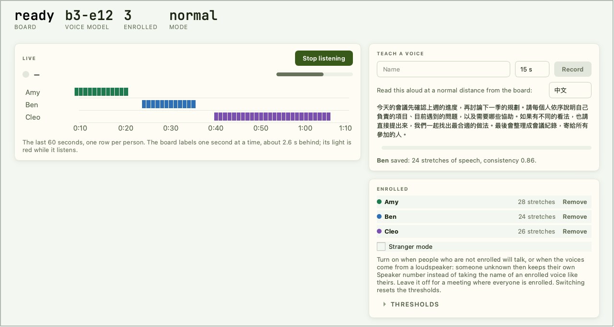

# 聲紋辨識

讓每個人照稿朗讀約 20 秒完成註冊，之後 Reef 每秒標示一次現在是誰在說話：已註冊的人顯示名字，沒註冊的人顯示 Speaker 1、Speaker 2…，事後也可以替他們取名。所有運算都在板子上完成，聲紋存在板上的 Flash，聲音不會離開板子。電腦端使用 IPRO AI Studio 的 **Audio** 頁；本頁畫面中的人名（Amy、Ben、Cleo）均為示意。

!!! note "錄音前先取得同意"
    註冊或聆聽前，請先徵得在場每一位的同意。

## 前置需求 { #prerequisites }

- IPRO7AI Reef EVK 已燒錄 Edge AI 韌體，聲紋模型 `model_b.spkb` 隨 mfg 酬載一起燒錄，見[燒錄 Edge AI 韌體](firmware.md)。
- 一條可傳資料的 USB-C 線，接 Reef 的 USB-C 與電腦。聲紋辨識使用板上的 PDM 麥克風，不需要相機。
- 已安裝 IPRO AI Studio，見[安裝 IPRO AI Studio](install.md)。
- 安靜的環境；註冊與聆聽都用 Reef 自己的麥克風。

## 運作方式 { #how-it-works }

- 板上的 PDM 麥克風收音，重取樣成 16 kHz，放進保留最近 32 秒的環形緩衝。
- 每秒取最近 2.6 秒的聲音，算出對數梅爾頻譜，經 NPU 上的聲紋網路與 CPU 上的池化、全連接層，得到一組 192 維的聲紋。
- **註冊**時，板子把朗讀期間每一段有聲音的 2.6 秒都算成聲紋，取平均後存進 Flash 的 media 分割區。
- **聆聽**時，板子把每秒的聲紋與已註冊的人比對（餘弦相似度）。最高分達到名稱門檻就顯示那個人的名字；沒有人達到時，再與目前的匿名講者比對，低於新講者門檻就成為一位新的匿名講者。
- 電腦端只送出指令並顯示板子回傳的標籤。錄音與聆聽期間，Reef 的 RGB LED 亮紅燈。

## 連上板子 { #connect }

<div class="ipro-steps" markdown>

1. **切到 `voice` 模式**：開啟 Audio 頁後按頁面上方的 **Switch to Audio**，或在主控台輸入 `mode voice`。板子重新開機後，主控台出現：

    ```text
    SPKM: model 'b3-e12': 437200 B, trunk 16/16 layers on the NPU, ...
    RTCH: voice ready - shell `spk`, IPRO AI Studio Audio page over USB-C
    ```

    出現 `NO MODEL` 時，板上沒有有效的聲紋模型，見[更換聲紋模型](#voice-model)。

2. **接上 USB-C**：電腦出現名為 **IPRO Reef Voice** 的序列埠。

3. **開啟 Audio 頁**：在 Studio 左側導覽列按 **Audio**（macOS 為 Command＋7，Windows 為 Ctrl＋7）。頁面會自己找到板子，不需要選擇序列埠。

4. **確認狀態列**：**BOARD** 顯示 `ready`，**VOICE MODEL** 顯示 `b3-e12`，**ENROLLED** 是已註冊人數，**MODE** 是 `normal` 或 `stranger`。

</div>

板子的 USB 序列埠同一時間只能給一個程式使用，用 Audio 頁時請關閉其他開著這個序列埠的程式。離開 Audio 頁時，聆聽會自動停止。

## Audio 頁介面 { #page-layout }



| 編號 | 區塊 | 說明 |
|---|---|---|
| 1 | 狀態列 | **BOARD**（板子狀態）、**VOICE MODEL**（聲紋模型）、**ENROLLED**（已註冊人數）、**MODE**（`normal` 或 `stranger`） |
| 2 | **Start listening** | 開始聆聽；聆聽中變成 **Stop listening**，再按一次停止 |
| 3 | 目前說話者 | 名字與相似度分數 |
| 4 | 時間軸（**LIVE**） | 最近 60 秒，每人一列，每一格代表一秒 |
| 5 | **NOT ENROLLED** | 聽到但還沒註冊的人，每人一個標籤，例如 `Speaker 1 · 22 s · Name…`；點標籤可以替他取名 |
| 6 | **TEACH A VOICE** | 輸入名字，選擇朗讀長度（15 s、20 s、30 s），按 **Record** 註冊；右側選擇朗讀稿的語言（中文或 English），下方顯示註冊結果 |
| 7 | **ENROLLED** | 已註冊的人，每人一列，顯示收進聲紋的語音段數，可按 **Remove** 刪除 |
| 8 | **Stranger mode** | 陌生人模式的開關，見[門檻與陌生人模式](#thresholds) |
| 9 | **THRESHOLDS** | 展開後調整名稱門檻與新講者門檻 |

## 註冊講者 { #enroll }

<div class="ipro-steps" markdown>

1. **輸入名字與長度**：在 **TEACH A VOICE** 輸入名字（可以含空白與中文），選擇朗讀長度，預設 20 s。聆聽中不能註冊，先按 **Stop listening**。

2. **就定位**：請要註冊的人坐在之後實際說話的位置，與板子保持平常的距離。

3. **按 Record 並朗讀**：請他把出現的朗讀稿念出來，一直念到時間結束。進度條旁顯示剩餘秒數，下方顯示 `Recording <名字>…`。

    

4. **看結果**：時間到後顯示 `<名字> saved: <n> stretches of speech, consistency <值>.`，新的名字出現在 **ENROLLED** 清單。stretches of speech 是收進聲紋的語音段數，consistency 是這些語音段彼此的一致程度。

</div>

**一致程度低於 0.8 時請重新註冊**：靠近板子一點，在之後實際說話的位置、用平常的聲音再錄一次，Studio 會直接提示。以同一個名字再註冊一次會取代原本的聲紋，頁面會先以 **Record again** 對話框詢問。

註冊失敗時顯示 `Could not save <名字>:` 與原因：

| 頁面訊息 | 處理 |
|---|---|
| `Too little speech was heard. …` | 說大聲一點或靠近一點，並持續朗讀到時間結束 |
| `The board's voice list is full. Remove someone first.` | 已註冊人數已滿，先刪除一位 |
| `The board has no voice model.` | 板上沒有聲紋模型，見[更換聲紋模型](#voice-model) |
| `The board's microphone did not start.` | 麥克風沒有啟動；拔插 USB-C 後再試 |
| `Recording was cancelled.` | 註冊被取消，重新按 **Record** |
| `The board refused: check the name, or wait for what it is doing to finish.` | 檢查名字，或等板子目前的工作（例如聆聽）結束後再試 |

## 即時辨識 { #listen }

<div class="ipro-steps" markdown>

1. **保持安靜，按 Start listening**：每次開始聆聽時，板子從當下的聲音開始追蹤背景噪音，所以按下的那一刻請盡量保持安靜。RGB LED 亮紅燈。

2. **開始說話**：板子每秒送出一個標籤，內容是最近 2.6 秒的判斷，所以標籤比實際說話晚約 2.6 秒。沒有人說話的時段不標示。時間軸的顏色與 **ENROLLED** 清單的圓點顏色對應。

3. **按 Stop listening 停止**。

</div>

## 替匿名講者取名 { #name-speaker }

沒有註冊的人被板子聽到 3 秒以後，會以 Speaker 1、Speaker 2… 出現在時間軸，並出現在 **NOT ENROLLED** 區，例如 `Speaker 2 · 26 s · Name…`（26 s 是板子聽到他的秒數）。

1. 點那個標籤的 **Name…**。
2. 在 **Name a speaker** 對話框輸入名字，按確定。

板子把剛才聽到的這位講者的聲音存成他的聲紋，之後就以名字顯示，不必再朗讀註冊。



## 刪除聲紋 { #remove }

在 **ENROLLED** 清單按某人的 **Remove**，在對話框確認後即刪除他的聲紋。全部刪除後，狀態列的 **ENROLLED** 回到 0，清單顯示 `Nobody enrolled yet.`；時間軸上已顯示的紀錄不受影響。

## 門檻與陌生人模式 { #thresholds }

展開 **THRESHOLDS**，可以調整兩個門檻（餘弦相似度，範圍 0.1～0.95），按 **Set** 生效。門檻與模式和聲紋一起存在板上，重新開機後維持不變。

| 門檻 | 一般模式預設 | 陌生人模式預設 | 作用 |
|---|---|---|---|
| **Name match**（名稱門檻） | 0.60 | 0.50 | 一段聲音和某位已註冊者的相似度達到這個值，才顯示他的名字。調高：被標上名字的人變少、標成匿名的變多；調低則相反 |
| **New speaker**（新講者門檻） | 0.50 | 0.50 | 沒被認出的聲音和現有匿名講者的相似度都低於這個值時，成為一位新的匿名講者。同一個人被拆成好幾位時調低；不同的人被併成同一位時調高 |

勾選或取消 **Stranger mode** 切換陌生人模式，狀態列的 **MODE** 隨之顯示 `stranger` 或 `normal`；切換時兩個門檻都會重設為該模式的預設值。也可以在主控台輸入 `spk mode stranger` 或 `spk mode normal`。

陌生人模式讓沒有註冊的人不容易被標上別人的名字：比對前先扣除房間裡所有聲音共有的部分（麥克風、房間與喇叭造成的影響），並讓已經聽過的未註冊者保留自己的 Speaker 編號。

| 情況 | 建議 |
|---|---|
| 會有沒註冊的人說話；或聲音來自喇叭、錄音的播放 | 開啟陌生人模式 |
| 與會者全部都已註冊 | 維持關閉。在遠距離收音的場合，陌生人模式會讓已註冊的人更常被標成匿名講者 |

陌生人模式需要品質好的註冊：一致程度偏低的人更常被標成匿名講者，兩位未註冊者也可能被併成同一個編號。註冊後顯示的一致程度低於 0.8 時，請重新註冊。

## 主控台指令 { #console }

聲紋模式的主控台（U6，115200 baud）提供與 Audio 頁相同的操作，適合除錯：

| 指令 | 作用 |
|---|---|
| `spk status` | 模型、狀態、已註冊名單、USB 連線 |
| `spk enroll 20 <名字>` | 朗讀 20 秒註冊（8～30 秒） |
| `spk live on`／`spk live off`／`spk stop` | 開始聆聽／停止聆聽／停止目前的工作 |
| `spk del <名字>` | 刪除某人的聲紋 |
| `spk name <k> <名字>` | 替匿名講者 k 取名 |
| `spk thresh <名稱門檻> <新講者門檻>` | 設定兩個門檻，例如 `spk thresh 0.60 0.50` |
| `spk mode normal`／`spk mode stranger` | 切換一般模式／陌生人模式；兩個門檻重設為該模式的預設值 |
| `spk echo on` | 在主控台印出每一行事件，以及每秒對每位已註冊者的分數 |

主控台只接受 ASCII 字元；含中文的名字請在 Audio 頁輸入。

## 確認結果 { #verify }

1. 註冊後，名字出現在 **ENROLLED** 清單，consistency 為 0.8 以上。
2. 按 **Start listening** 後 RGB LED 亮紅燈；已註冊的人開始說話後約 2.6 秒，時間軸在他那一列出現色塊，目前說話者顯示他的名字與相似度。
3. 沒註冊的人說話時，時間軸出現 Speaker k，**NOT ENROLLED** 區出現他的標籤。
4. 重新開機後回到 Audio 頁，**ENROLLED** 人數不變。

## 更換聲紋模型 { #voice-model }

聲紋模型 `model_b.spkb`（模型名稱 `b3-e12`）隨 mfg 酬載燒錄。要不經燒錄改以 USB 部署時，先做成模型套件，再以命令列部署到聲紋工具：

```bash
ipro-ai model pack model_b.spkb -o voice.ipkg
ipro-ai deploy voice.ipkg --switch
```

已註冊的聲紋以模型的 CRC 標記：換成另一個聲紋模型後，已註冊名單會清空，需要重新註冊。只更新韌體、不換模型時，模型與已註冊的人都會保留。IPRO AI Studio 0.4.2 的 Audio 頁沒有部署模型的按鈕。

## 規格與限制 { #specs }

| 項目 | 規格 |
|---|---|
| 收音 | Reef 板上 PDM 麥克風，重取樣成 16 kHz，經 100 Hz 高通濾波 |
| 標示頻率 | 每秒一個標籤，依據最近 2.6 秒的聲音 |
| 聲紋 | 192 維；板上算一次約 140 ms，其中前處理約 118 ms、NPU 約 9 ms |
| 聲紋模型 | `model_b.spkb`（b3-e12），437,200 B；網路主幹 16 層全在 NPU 上執行 |
| 註冊長度 | Audio 頁可選 15、20、30 秒；主控台 8～30 秒 |
| 可存的人數 | 19 人存在 Flash 的 media 分割區（16 KB）；超過的暫存在記憶體，重新開機後消失 |
| 語音偵測 | 以能量判斷：比追蹤到的背景噪音高 3 dB 才算語音 |
| 模型存放位置 | 聲紋模型分格，可放 444 KB |

- 在其他麥克風錄的聲紋，和 Reef 聽到的同一個人相似度會明顯偏低。註冊與聆聽都要用 Reef 自己的麥克風。
- 經喇叭播放的聲音，不同人的聲紋會變得比較像；用喇叭或錄音播放測試時，請開啟陌生人模式。
- 每個人說話短於 2.6 秒的段落，以及兩人同時說話的時段，無法分開標示。
- 語音偵測以音量判斷，音樂、電視聲等也會被當成語音。請在安靜的環境使用，避開持續的背景聲音。
- 匿名講者是邊聽邊分群的，結束後不會再合併；同一個人被拆成兩位時，替其中一位取名，或調整新講者門檻。
- 實際場域的口音、迴響與說話距離各不相同，正式使用前請先實地試用，必要時調整門檻或模式。

## 疑難排解 { #troubleshooting }

| 症狀 | 原因 | 處理 |
|---|---|---|
| Audio 頁顯示 `The board has no voice model.`，或主控台顯示 `NO MODEL` | 板上沒有有效的聲紋模型 | 以帶 `--mfg` 的指令重新燒錄，或以 `ipro-ai deploy` 部署聲紋模型 |
| Audio 頁顯示 `The board did not answer.`，或找不到板子 | 別的程式占用了板子的序列埠，或板子不在 `voice` 模式 | 關閉其他使用該序列埠的程式；按 **Switch to Audio** |
| 未註冊的人一直被標上某位已註冊者的名字 | 一般模式下名稱門檻偏低；喇叭播放的聲音尤其如此 | 開啟陌生人模式，或調高 **Name match** |
| 已註冊的人常被標成 Speaker k | 註冊時的位置、麥克風或音量和實際使用時不同，或名稱門檻太高 | 在實際位置以 Reef 的麥克風重新註冊；或稍微調低 **Name match** |
| 同一個人被拆成好幾位 Speaker | 新講者門檻太高 | 調低 **New speaker**，或替其中一位取名 |
| 沒人說話時也出現標籤 | 音樂、電視等持續聲音被當成語音 | 移除背景聲源，在安靜的環境使用 |
| 換了聲紋模型後，已註冊的人都不見了 | 聲紋與模型綁在一起 | 以新模型重新註冊 |

其他狀況見[疑難排解](troubleshooting.md)。

## 下一步 { #next-steps }

- [感測器辨識](sensor.md)：用同一片 Reef 判斷機器或環境的狀態。
- [燒錄 Edge AI 韌體](firmware.md#modes)：模式切換與 USB 裝置一覽。
