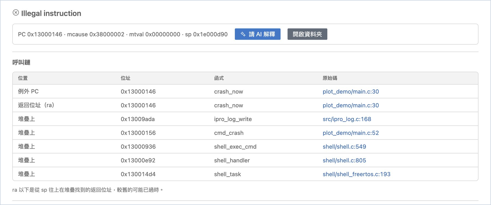
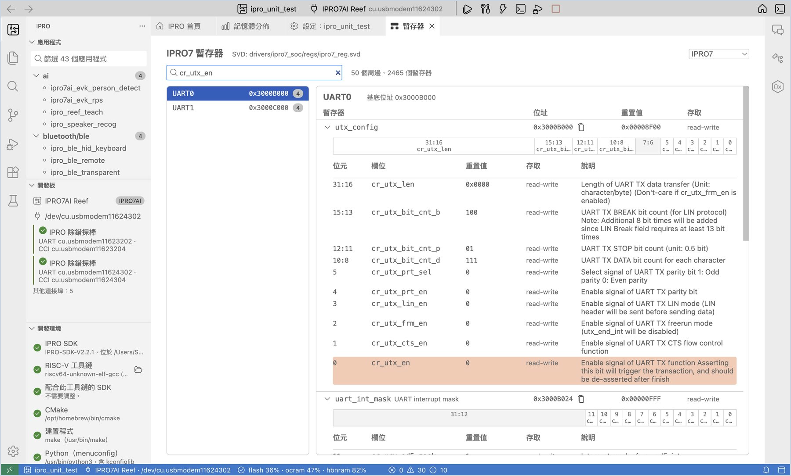

# 除錯與分析

板子當機或行為不對時，這些工具幫你找出是哪一行程式、當時暫存器與記憶體的狀態，以及某個暫存器欄位的意思。本版尚未開放以 JTAG 除錯的功能。

## 當機位址自動解碼 { #crash-decode }

IPRO7 韌體當機時，會從序列埠印出例外的程式位址（MEPC）、返回位址（ra）與堆疊回溯。IPRO Monitor 會在每個位址下面多印一行灰色的解碼結果（畫面上以箭頭開頭，下例以 `->` 表示），例如例外的程式位址：

```text
MEPC   : 0x13000146
    -> 0x13000146 crash_now  …/apps/user/plot_demo/main.c:30
```

解碼結果是函式名稱與原始碼的檔案、行號。

!!! warning "重要"
    解碼使用的是目前應用程式最近一次建置的 ELF 檔，所以板子上的韌體必須和目前的建置一致。側邊欄「開發板」顯示「執行中：其他韌體」時，解碼結果不可信，請先重新燒錄（見[開發板的 Flash 與韌體核對](flash.md#board-flash)）。

## 當機傾印 { #crash-dump }

只看位址不夠時，可以讓板子在當機後把暫存器與整個 RAM 傳回電腦，IDE 再從堆疊找出完整的呼叫鏈。

<div class="ipro-steps" markdown>

1. **開啟當機傾印。** 在應用程式的 `.config` 加上 `CONFIG_EXCEPTION_DUMP=y`（可用「設定（Kconfig）」搜尋 `EXCEPTION_DUMP`，見[修改設定](develop.md#kconfig)），建置並燒錄。

2. **讓板子當機。** 開著序列埠監看，讓板子當機。

    **應該看到**：通知「板子當機了，可以傳出 RAM 與暫存器的當機傾印。要收集嗎？約需一分鐘；板子會等 2 分鐘。」

3. **收集。** 按 **收集當機傾印**。

    **應該看到**：進度「正在從 <連接埠> 接收當機傾印…」。傳完後（256 KB OCRAM 加 8 MB PSRAM，實測約 64 秒）編輯區開出「當機傾印」。

4. **看「當機傾印」的內容。**

    **應該看到**：

    - 最上面是例外的種類（例如 `Illegal instruction`），下一行是摘要：PC、mcause、mtval 與 sp。
    - 「呼叫鏈」表格依序列出例外 PC、返回位址（ra），以及在堆疊上找到的返回位址；每一列有位址、函式與原始碼位置，按原始碼位置會打開那一行。
    - 「暫存器」列出當機時的所有暫存器。

5. **請 AI 解釋（選用）。** 需要時按 **請 AI 解釋**，AI 助理會讀呼叫鏈上的程式碼並說明原因（見[請 AI 分析當機](ai.md#analyze-crash)）；按 **開啟資料夾** 可以看傳回的原始檔案。

</div>



!!! note
    - 呼叫鏈中 ra 以下的項目，是從 sp 往上在堆疊找到的返回位址，愈後面的愈可能是之前留下的舊資料。
    - 當機傾印存在應用程式的 `build/crash/<日期>` 資料夾。之後要再看，選 IPRO 選單的 **當機傾印…**。
    - 傳輸中有區塊校驗失敗時，畫面會標示「傾印不完整」，並列出收到的部分。

## 暫存器參考 { #registers }

「暫存器參考」依晶片的 SVD 檔列出所有周邊、暫存器與欄位，寫驅動或看暫存器傾印時可以直接查。

<div class="ipro-steps" markdown>

1. **開啟暫存器參考。** 首頁按 **暫存器參考（SVD）**。

    **應該看到**：「IPRO7 暫存器」，旁邊是 SVD 檔的位置與周邊、暫存器的總數（IPRO7 為 50 個周邊、2465 個暫存器）。右上角可以切換晶片。

2. **搜尋。** 在搜尋框輸入周邊、暫存器或欄位名稱（例如 `cr_utx_en`），或直接輸入位址（例如 UART0 的 `0x3000B000`）。

    **應該看到**：左邊是周邊與它的基底位址，右邊是暫存器與位址、重置值、存取權限。展開暫存器，可以看到 32 位元的欄位圖與每個欄位的說明。

3. **複製位址。** 按暫存器旁的 **複製位址**，把位址複製到剪貼簿。

</div>


