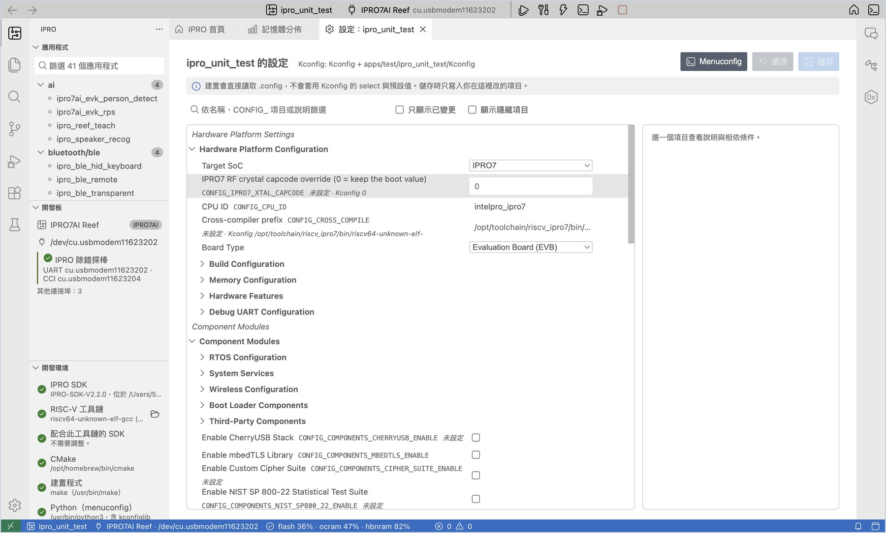
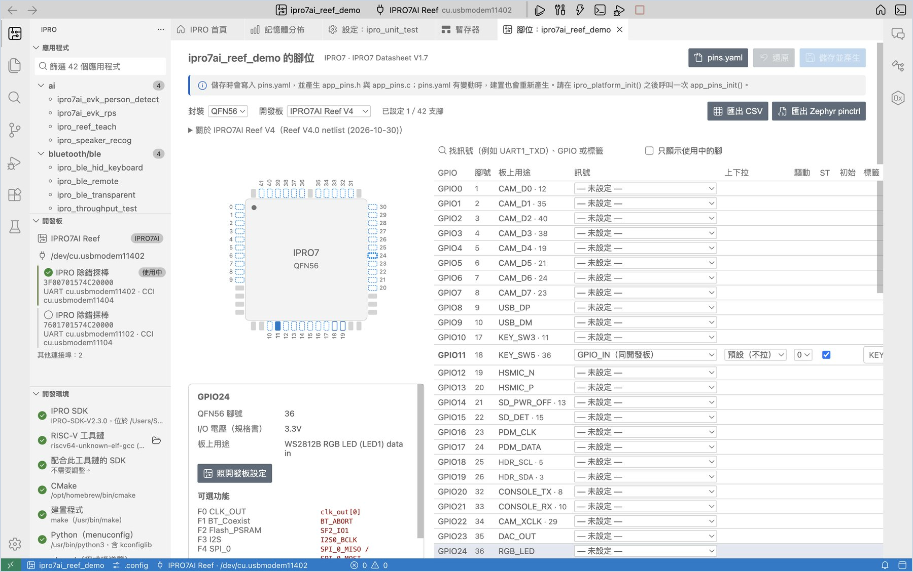
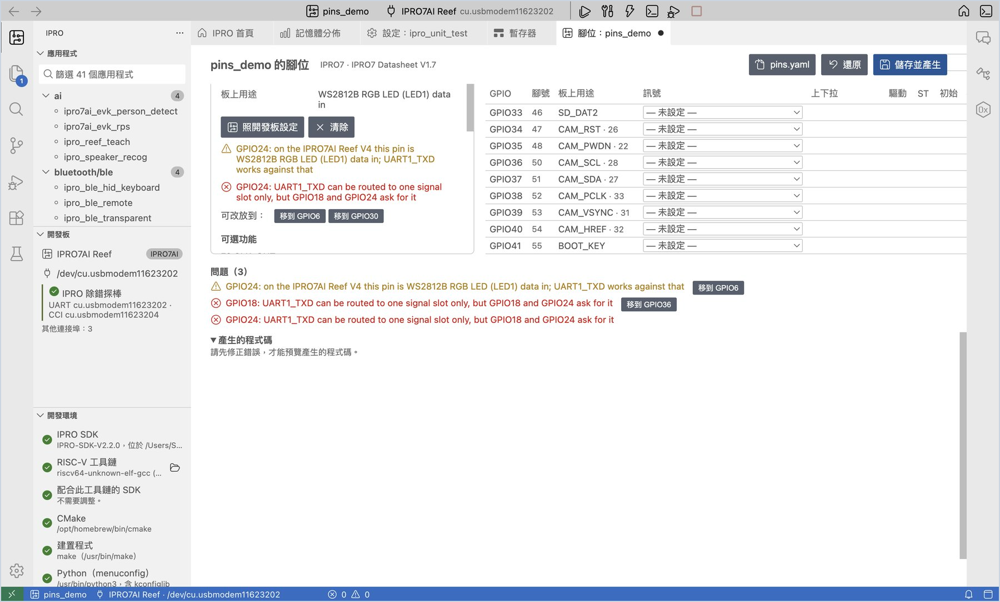
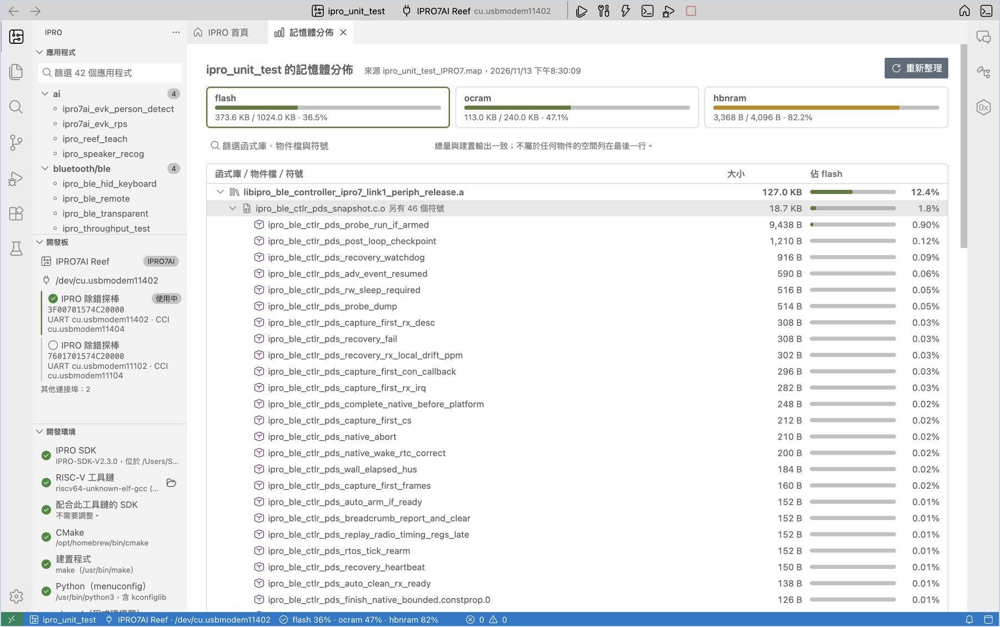

# 開發應用程式

寫程式時最常用的幾個檢視：修改設定（Kconfig）、設定腳位、處理建置錯誤，以及看記憶體用到哪裡。

## 修改設定（Kconfig） { #kconfig }

每個應用程式的功能與參數都記在它的 `.config`。「設定」檢視以表單修改它，不必開終端機。

1. **開啟設定。** 在應用程式上按右鍵，選 **設定（Kconfig）…**（或首頁的「設定（Kconfig）」）。

    **應該看到**：「設定：<應用程式>」分頁，左邊依 Kconfig 選單列出所有項目，右邊是選中項目的說明。

2. **修改項目。** 在搜尋框輸入要改的項目，例如 `LOG_BUFFER_SIZE`，把值改成 `512`。

    **應該看到**：該列左側出現綠色標記，分頁標題出現未儲存的圓點，右上角按鈕變成「儲存 1」。右邊面板顯示這個項目的型別、範圍、相依條件、`.config` 中原本的值與 Kconfig 的預設值。

3. **儲存。** 按 **儲存**（macOS `Cmd+S`，Windows `Ctrl+S`）。

    **應該看到**：通知「已將 1 項設定寫入 … 的 .config（舊檔保留為 .config.old）。下次建置會重新設定 CMake。」

!!! warning "重要"
    SDK 建置直接讀取 `.config`，不會套用 Kconfig 的 select 與預設值。「設定」只寫入你改的那幾行；如果 menuconfig 會連帶改變其他項目，畫面上會列出來，由你決定要不要 **一併套用**。

其他用法：

- 勾選 **只顯示已變更**，只看還沒儲存的修改；按 **還原** 放棄全部修改。
- 勾選 **顯示隱藏項目**，可以看到相依條件不成立、menuconfig 會隱藏但建置仍會讀取的項目。
- 習慣文字介面時，右鍵選 **Menuconfig**，在終端機裡編輯同一份設定；選 **開啟 .config** 則直接編輯檔案。

## 設定腳位 { #pins }

「腳位設定」以封裝圖與表格指定每支 GPIO 的功能，檢查衝突與開發板上的接線，並產生初始化程式碼 `app_pins.h`、`app_pins.c`。

1. **開啟腳位設定。** 在應用程式上按右鍵，選 **腳位設定…**（或首頁的「腳位設定」）。

    **應該看到**：左邊是 QFN56 封裝圖，右邊是 GPIO 表格。「開發板」自動選成 IPRO7AI Reef V4，「板上用途」欄列出每支腳在板子上接了什麼，接到 40-pin 排針的腳後面附排針腳號。

2. **指定一支腳。** 點 GPIO24 那一列，在「訊號」選 **GPIO_OUT（同開發板）**，「標籤」輸入 `RGB_LED`。

    **應該看到**：封裝圖上 24 號腳變成藍色；右邊面板列出這支腳的可選功能、I/O 電壓與板上接線；下方「產生的程式碼」的 `app_pins.c` 多了 GPIO24 那一行，並顯示「沒有問題。」

3. **試一個衝突。** 試著把 GPIO24 的訊號改成 `UART1_TXD`。

    **應該看到**：24 號腳變成琥珀色，「問題」列出警告，說明這支腳在 Reef V4 上接的是 RGB LED，並列出這個訊號「可改放到」哪些空著的腳；按 **移到 GPIO…** 就會把設定搬過去。確認後把 GPIO24 改回 **GPIO_OUT（同開發板）**。

4. **找能接某個訊號的腳。** 在搜尋框輸入 `SDH_0`。

    **應該看到**：表格只剩能接 SDH_0 的腳，封裝圖上這幾支腳被框起來。清掉搜尋字，表格恢復完整。

5. **儲存並產生程式碼。** 按 **儲存並產生**（`Cmd+S`／`Ctrl+S`）。

    **應該看到**：通知「已儲存 pins.yaml，並產生 app_pins.h 與 app_pins.c。」應用程式資料夾多了 `pins.yaml`、`app_pins.h`、`app_pins.c`，`CMakeLists.txt` 多了一行 `app_pins.c`。

6. **在程式中呼叫。** 在 `main.c` 加上 `#include "app_pins.h"`，並在 `ipro_platform_init();` 的下一行呼叫一次 `app_pins_init();`，然後按 **建置、燒錄並監看**。

    **應該看到**：應用程式照常執行。之後只要 `pins.yaml` 有變動，建置時 **IPRO Build** 會先顯示 `pins: wrote app_pins.c from pins.yaml`，再開始編譯。

| 功能 | 說明 |
|---|---|
| 只顯示使用中的腳 | 只列出已設定的腳，方便核對 |
| 匯出 CSV | 寫出給硬體工程師的腳位表 `pins.csv` |
| 匯出 Zephyr pinctrl | 把同一份腳位設定寫成 Zephyr 的 pinctrl 片段 `app_pins_pinctrl.dtsi` |
| 照開發板設定 | 把選中的腳設成開發板上的用途 |

!!! note
    - `app_pins.h` 和 `app_pins.c` 由 IDE 產生，請不要手改。被手改過的檔案 IDE 不會直接覆蓋，而是先問你要不要 **覆蓋**。
    - `pins.yaml` 有錯誤時建置會停下來，錯誤列在「問題」面板。
    - 腳位資料取自 IPRO7 規格書。

## 建置與錯誤 { #build }

1. **建置。** 按 **建置**（`Cmd+Alt+B`／`Ctrl+Alt+B`）。

    **應該看到**：成功時通知「<應用程式> 建置完成，耗時 N 秒」，並附上記憶體用量。

2. **前往錯誤。** 程式有錯時，通知寫「<應用程式> 編譯失敗。第一個錯誤在 <檔案>:<行>：<訊息>」。按 **前往錯誤**，編輯器會跳到那一行；「問題」面板列出所有錯誤與警告。

3. **修正後再建置一次。** 需要時可以在通知上按 **請 AI 修正**（見 [AI 助理](ai.md#fix-build)）。

| 命令 | 什麼時候用 |
|---|---|
| 建置 | 一般情況。只重新編譯有變動的檔案。 |
| 重新設定並建置 | 改了 `CMakeLists.txt` 或建置組態後，重新執行 CMake 設定。 |
| 清除建置 | 刪除應用程式的 `build` 資料夾，下一次建置從頭開始。 |

建置組態（Debug／Release／MinSizeRel）在設定 `ipro.build.profile` 選擇，見[設定一覽](reference.md#settings)。

## 看記憶體用到哪裡 { #memory }

1. **開啟記憶體分佈。** 建置成功後，按狀態列的記憶體用量，或首頁的 **查看記憶體分佈**。

    **應該看到**：「<應用程式> 的記憶體分佈」，flash、ocram、hbnram 各一個分頁，下面依大小列出函式庫、物件檔與符號，以及各自佔該區段的比例。在符號上按兩下，會在工作區中尋找它。

2. **篩選。** 在篩選框輸入函式庫、物件檔或符號的名字，只看相關的項目。

- 「（應用程式本身）」是應用程式資料夾裡的物件檔。
- 「（合併的字串與常數）」是所有物件共用的字串池；log 字串多時這一項會很大。
- 數字依連結器 map 檔統計；建置輸出的總量另含對齊與填充，所以兩者可能略有差異。

### 大小變化與記憶體預算 { #memory-budget }

1. **看大小變化。** 改程式後再建置一次，看 **IPRO Build** 輸出的最後幾行。

    **應該看到**：例如 `Memory since the last build: flash +3,072 B, ocram 0 B, …`，下面列出變化最大的符號，例如 `+3,072 B  my_table  (flash, (application) main.c.o)`。建置完成的通知也會在用量後面加上變化，例如 `flash 8.2% (+3,072 B)`。第一次建置或清除建置後沒有上一版可比，這幾行不會出現。

2. **設定記憶體預算。** 要替記憶體設上限：開啟設定（macOS `Cmd+,`，Windows `Ctrl+,`），搜尋 `ipro.build`，在 **Memory Budget** 填入各區段的百分比上限，例如 `{ "flash": 90, "ocram": 95 }`。

    **應該看到**：超過上限時通知「… 超出記憶體預算：flash 92.1% > 90%」，按 **記憶體分佈** 可以看是誰用掉的。

3. **超出預算就停下（選用）。** 再勾選 **Fail Over Budget**，超出預算就算建置失敗，「建置、燒錄並監看」會在燒錄前停下。

