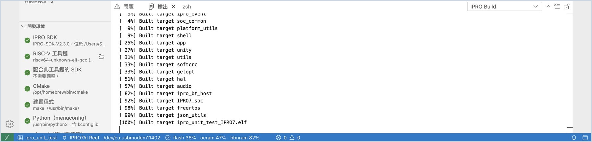
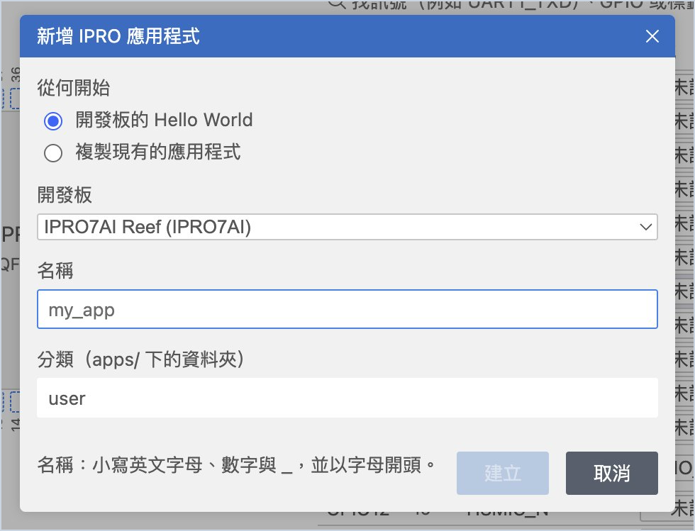
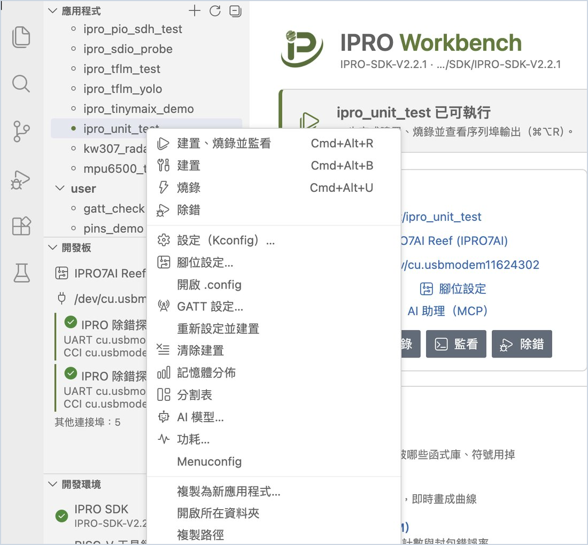

# 第一次執行

先用 SDK 內附的單元測試 `ipro_unit_test` 走完一輪「建置 → 燒錄 → 看板子輸出」，確認電腦、探棒與開發板（本頁以 IPRO7AI Reef EVK V4.0 示範）都正常；再建立自己的第一個應用程式 `my_app`，在 **IPRO Monitor** 看到它的輸出。

## 前置需求 { #prerequisites }

- 已完成[安裝 IPRO Workbench](install.md)：「開發環境」每一列都是綠色勾勾，IDE 已開啟 IPRO SDK。
- IPRO 除錯探棒以 USB 接電腦並接上 IPRO7AI Reef EVK V4.0，側邊欄「開發板」列出探棒的兩個連接埠（見[接上開發板](install.md#connect-board)）。

## 執行 ipro_unit_test { #unit-test }

1. **選應用程式。** 在側邊欄「應用程式」點 **ipro_unit_test**（在 `test` 分類下，可在搜尋框輸入 `unit`）。

    **應該看到**：工具列與狀態列都顯示 `ipro_unit_test`，首頁橫幅寫「ipro_unit_test 已可執行」。

2. **建置、燒錄並監看。** 按首頁的 **建置、燒錄並監看**（macOS `Cmd+Alt+R`，Windows `Ctrl+Alt+R`）。也可以在應用程式清單上按兩下該應用程式。

    **應該看到**，依序是：

    1. 「輸出」的 **IPRO Build** 顯示編譯過程，最後列出 flash、ocram、hbnram 的用量。
    2. **IPRO Flash** 顯示燒錄進度，最後一行是 `[All Success]`。
    3. 下方開出 **IPRO Monitor** 終端機，開發板重新開機，跑完測試後出現 `ALL TESTS PASSED`。

3. **看狀態列與首頁。**

    **應該看到**：狀態列顯示記憶體用量，例如 `flash 36% · ocram 47% · hbnram 82%`；首頁「應用程式」卡片也有用量條。側邊欄「開發板」多一行「執行中：ipro_unit_test（… 建置）」，表示板子跑的正是剛建置的韌體。

| 輸出 | 內容 |
|---|---|
| IPRO Build | CMake 設定與編譯過程、記憶體用量、與上一次建置相比的大小變化 |
| IPRO Flash | IntelProCube 的燒錄過程；成功時最後一行是 `[All Success]` |
| IPRO Monitor | 板子的序列埠輸出（終端機），可以直接打字送指令給板子 |

任何一步失敗，IDE 都會停在那一步並跳出說明與處理按鈕，例如「前往錯誤」「重試」「選擇連接埠」。常見訊息見[疑難排解](troubleshooting.md#messages)。

!!! tip "只做其中一步"
    只想建置、只想燒錄或只想開監看時，用工具列上的個別按鈕，或快捷鍵：建置 `Cmd+Alt+B`，燒錄 `Cmd+Alt+U`，監看 `Cmd+Alt+M`（Windows 把 `Cmd` 換成 `Ctrl`）。

## 建立自己的應用程式 { #own-app }

1. **開啟新增應用程式。** 在「應用程式」清單上方按 **＋**（新增應用程式…），或首頁的「從範本或範例新增應用程式」。

2. **填寫並建立。** 「從何開始」選 **開發板的 Hello World**，開發板選 **IPRO7AI Reef**（用 IPRO6S EVK 時選 **IPRO6S EVK**），名稱輸入 `my_app`，分類保留 `user`，按 **建立**。

    名稱只能用小寫英文字母、數字與底線，並以字母開頭。

    **應該看到**：清單多了 `user/my_app`，它成為目前的應用程式，編輯器打開它的 `main.c`。

3. **執行。** 按 **建置、燒錄並監看**。

    **應該看到**：IPRO Monitor 出現 `Hello from my_app`。

「從何開始」可以選：

| 從何開始 | 開發板 | 建立的內容 |
|---|---|---|
| 開發板的 Hello World | 任何一塊 | 最小的應用程式，執行後印出 `Hello from <名稱>` |
| 指定板子的 BLE peripheral（GATT 服務來自 gatt.yaml） | IPRO7、IPRO7AI 的開發板 | 會廣播的 BLE peripheral：`gatt.yaml` 與它產生的 `app_gatt.h`、`app_gatt.c`，加上 `app_ble.c`（藍牙啟動、廣播與寫入時的處理）。勾選 **加上 OTA** 時另見下方 |
| IPRO6S EVK 的 Wi-Fi station（複製 ipro6_demo，Wi-Fi 設定） | IPRO6S EVK | 複製 `ipro6_demo`，以它的 Wi-Fi 設定檔當 `.config`，可以直接跑 [Wi-Fi 傳輸速率（iperf）](measure.md#iperf) |
| IPRO7AI Reef 的 AI 視覺（複製 ipro7_uvc_cam：USB 相機，模型在 NPU 上執行） | IPRO7AI Reef EVK V4.0 | 複製 `ipro7_uvc_cam`，以剪刀石頭布的設定檔 `defconfig_reef_rps` 當 `.config`；純視訊鏡頭的 `defconfig_reef_ov5640` 留著當第二個[設定檔](develop.md#configurations) |
| 複製現有的應用程式 | 依來源 | 選一個現有的應用程式，複製後把所有用到舊名稱的地方改成新名稱 |

Wi-Fi station 與 AI 視覺兩個選項，只在 SDK 有 `ipro6_demo`（含 `defconfig_ipro6_lpwifi`）與 `ipro7_uvc_cam`（含 `defconfig_reef_rps`）時出現。

### 建立 BLE peripheral { #own-app-ble }

1. **填寫並建立。** 在「新增 IPRO 應用程式」的「從何開始」選 **指定板子的 BLE peripheral（GATT 服務來自 gatt.yaml）**，開發板選 **IPRO7AI Reef**，名稱輸入 `my_ble`，按 **建立**。

    **應該看到**：通知「已在 user 建立 my_ble。」，清單多了 `user/my_ble`，應用程式資料夾有 `gatt.yaml`、`app_gatt.h`、`app_gatt.c`、`app_ble.c`、`main.c` 與 `README.md`。

2. **執行。** 按 **建置、燒錄並監看**。

    **應該看到**：IPRO Monitor 出現 `advertising as IPRO-my_ble`。用手機上的 BLE 工具（例如 nRF Connect）掃描，找得到 `IPRO-my_ble`；連上後看得到 `demo` 服務，裡面有 `counter`（讀取、通知：開機後的秒數）與 `message`（讀取、寫入：最長 20 位元組的文字，寫入時板子會印出來）。

3. **改服務。** 在應用程式上按右鍵選 **GATT 設定…**，見[設定 GATT 服務](develop.md#gatt)。

**加上 OTA**（只適用 IPRO7AI 的開發板，需要 SDK V2.3.0）：勾選「加上 OTA：經 BLE 與主控台 UART、A/B 分割表、boot2（2 MB 的板子）」後，應用程式另外帶有 SDK `ipro_ota` 元件的設定（`CONFIG_IPRO_OTA`、`CONFIG_IPRO_OTA_BLE`、`CONFIG_IPRO_OTA_UART`）與 A/B 分割表 `partition_cfg_2M_ota_ab.toml`，IDE 也把這份分割表選為它的「燒錄時使用」。燒錄時 IDE 一併寫入 boot2；之後的更新用 [OTA 包](flash.md#ota)送到板子。SDK 沒有 OTA 元件時，這個勾選框不能勾，滑鼠移上去會顯示「這份 SDK 沒有 OTA 元件（components/sys/ipro_ota）。」

要從現有的範例開始，在清單的應用程式上按右鍵，選 **複製為新應用程式…**，或在「從何開始」選 **複製現有的應用程式**。新的應用程式放在 SDK 的 `apps/<分類>/<名稱>`。

## 應用程式的右鍵選單 { #app-menu }

在「應用程式」清單的應用程式上按右鍵，可以直接做這些事：

| 項目 | 用途 |
|---|---|
| 建置、燒錄並監看／建置／燒錄／除錯 | 與工具列相同 |
| 設定（Kconfig）…／Menuconfig／開啟 .config | 修改應用程式的設定，見[開發應用程式](develop.md#kconfig) |
| 腳位設定… | 指定 GPIO 的功能並產生程式碼，見[設定腳位](develop.md#pins) |
| GATT 設定… | 定義 BLE 服務與特性並產生程式碼，見[設定 GATT 服務](develop.md#gatt) |
| 重新設定並建置／清除建置 | 重新執行 CMake 設定後建置；刪除建置結果 |
| 記憶體分佈 | 看記憶體用到哪裡，見[看記憶體用到哪裡](develop.md#memory) |
| 分割表／AI 模型…／功耗… | 見[燒錄與開發板](flash.md)與[測試與量測](measure.md#power) |
| 複製為新應用程式… | 以這個應用程式為起點建立新的應用程式 |
| 開啟所在資料夾／複製路徑 | 在檔案總管（Finder）中開啟，或複製資料夾路徑 |

## 下一步 { #next-steps }

- [開發應用程式](develop.md)：修改設定、設定腳位、設定 GATT 服務、處理建置錯誤，以及看記憶體用到哪裡。
- [燒錄與開發板](flash.md)：燒錄時的檢查、分割表與 AI 模型，以及 IPRO6S EVK。
- [序列埠監看](monitor.md)：篩選、時間戳記、存檔與序列埠繪圖。
- 任何一步失敗時，見[疑難排解](troubleshooting.md)。
