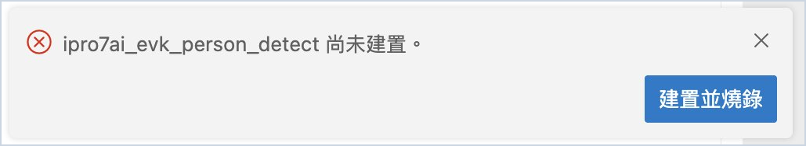
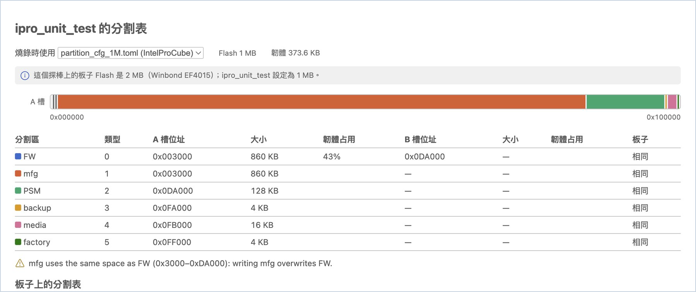
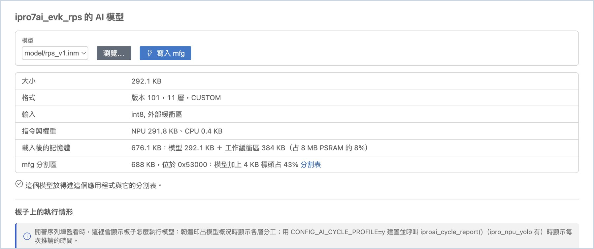
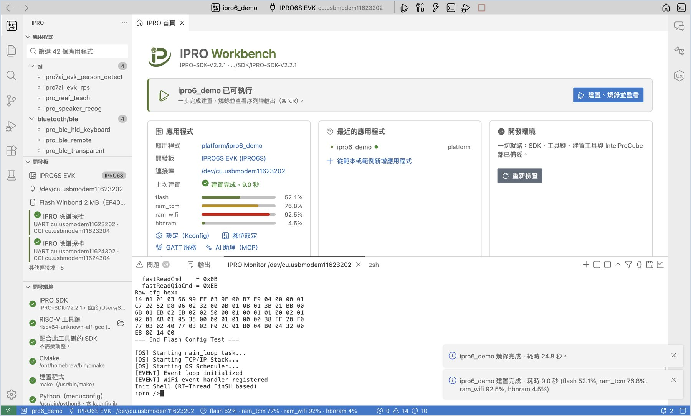
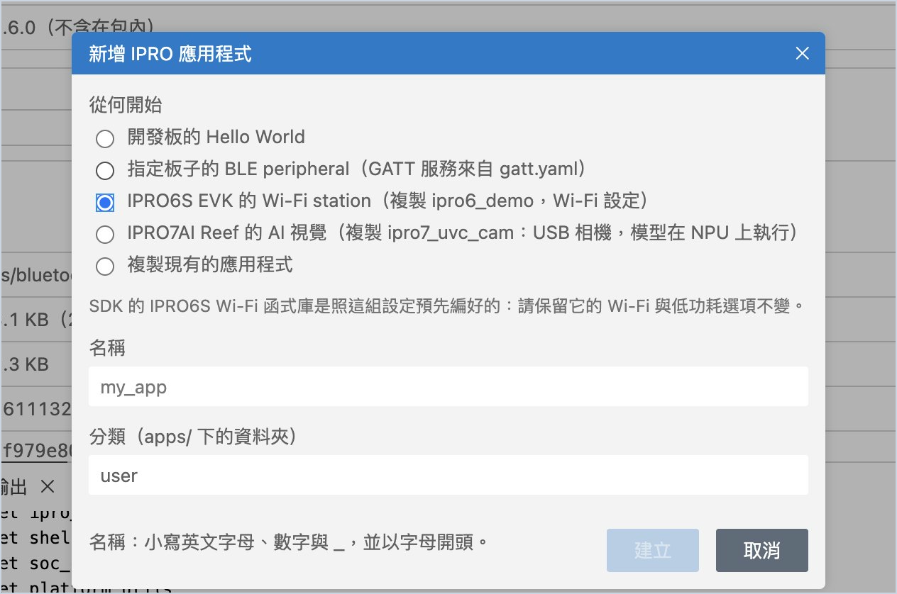

# 燒錄與開發板

燒錄時 IDE 替你做了哪些檢查，以及分割表、開發板 Flash、韌體核對與 AI 模型寫入；最後一節是 [IPRO6S EVK](#ipro6s) 的操作與它和 IPRO7 系列不同的地方。

## 燒錄 { #flash }

1. **燒錄。** 選好應用程式並建置後，按 **燒錄**（`Cmd+Alt+U`／`Ctrl+Alt+U`）。

    **應該看到**：「輸出」切到 **IPRO Flash**，顯示 IntelProCube 的燒錄過程，最後一行是 `[All Success]`；通知「<應用程式> 燒錄完成，耗時 N 秒」。

2. **監看會先關閉。** 燒錄前，IDE 會自動關閉所有序列埠監看（同一個連接埠不能同時被兩個程式使用）。用 **建置、燒錄並監看** 時，燒錄成功後會再開啟監看。

!!! warning "重要"
    IntelProCube 燒錄失敗時有時不會回報錯誤。IDE 以輸出中出現 `[All Success]` 才算燒錄成功；板子重新開機後，IDE 還會核對板子印出的建置時間（見下方[開發板的 Flash 與韌體核對](#board-flash)）。

燒錄失敗時，IDE 會依原因給出處理按鈕：

| 狀況 | IDE 的處理 |
|---|---|
| 應用程式還沒建置 | 提示「尚未建置」，提供 **建置並燒錄** |
| 找不到 IntelProCube | 提供 **安裝 IntelProCube** 或 **瀏覽…** 指定已有的 |
| 開發板沒有回應 | 提示檢查探棒排線與電源，提供 **選擇連接埠** 與 **重試** |
| 連接埠被其他程式使用 | 請你關閉那個程式後 **重試** |
| 分割表比板子的 Flash 大 | 燒錄前先詢問，可以 **仍要燒錄** 或改開 **分割表** |
| IntelProCube 沒有這塊板子要用的分割表 | 不燒錄（少了分割表，板子燒完會開不了機），提供 **分割表** 與 **安裝 IntelProCube** |

## 分割表 { #partitions }

分割表決定韌體、OTA 的 B 槽、AI 模型（mfg）等資料放在 Flash 的哪裡。

1. **開啟分割表。** 在應用程式上按右鍵，選 **分割表**（或首頁「工具」的 **分割表**）。

    **應該看到**：「<應用程式> 的分割表」。「燒錄時使用」顯示這次燒錄用的分割表（預設是 IntelProCube 依 `.config` 的 Flash 大小選的那份）；旁邊是 `.config` 設定的 Flash 大小與韌體大小；IDE 知道板子的 Flash 時，會多一行比較，例如「這個探棒上的板子 Flash 是 2 MB（Winbond EF4015）；ipro_unit_test 設定為 1 MB。」下面是 Flash 分佈圖（A 槽、B 槽各一列）與每個分割區的位址、大小，以及韌體占 FW 分割區的比例。

2. **看檢查結果。** 看表格下方的檢查結果。

    **應該看到**：沒有問題時不列任何項目。有問題時會說明，例如 1M 分割表的 mfg 與 FW 用同一塊空間（寫入 AI 模型會蓋掉韌體）、2M 分割表的 FW B 槽壓在 mfg 上（OTA 更新會蓋掉 AI 模型），或韌體大於 A 槽。

3. **使用應用程式附的分割表。** 應用程式自己附有分割表時，畫面會提示「這個應用程式附有 …」。在「燒錄時使用」選它，之後這個應用程式的燒錄都會用它。

4. **和板子上的分割表比對。** 開著序列埠監看時按 **重置板子**。

    **應該看到**：「板子上的分割表」比對板子開機印出的分割表，每個分割區標示「相同」「不同」或「板子上沒有」。全部相同時顯示「板子上次開機印出的分割表和這個相同。」

!!! warning
    燒錄會寫入「燒錄時使用」的分割表。和板子上的分割表不同時，位置變動的分割區（例如 mfg 裡的 AI 模型）資料會遺失。

## 開發板的 Flash 與韌體核對 { #board-flash }

板子開機時會印出 Flash 的識別碼與韌體的建置時間。開著序列埠監看時，IDE 會讀這些訊息，顯示在側邊欄「開發板」：

| 顯示 | 意思 |
|---|---|
| Flash Winbond 2 MB（EF4015） | 這個探棒上的板子所用的 Flash 與容量 |
| 晶片 ID … | 燒錄時 IntelProCube 讀到的晶片 ID |
| 執行中：ipro_unit_test（… 建置） | 板子開機印出的建置時間，和這個應用程式最近一次建置的韌體相符 |
| 執行中：其他韌體（… 建置） | 板子上的不是最近一次建置的版本，燒錄後才會執行它 |

剛燒錄完卻出現「其他韌體」時，表示燒錄可能沒有真正寫進板子。IDE 會提醒，並提供 **重新燒錄**。

分割表用到的空間超過板子的 Flash 時（例如在 2 MB 的板子上選了 4 MB 的分割表），燒錄前 IDE 會先問你，避免超出的部分沒有寫入。按 **分割表** 改選，或確認無誤後按 **仍要燒錄**。

## AI 模型 { #ai-model }

IPRO7AI 的 NPU 模型（`.inm`）放在 Flash 的 mfg 分割區，不和韌體一起連結。更新模型只要寫入 mfg，不必重燒韌體。

1. **選模型。** 在應用程式上按右鍵，選 **AI 模型…**（或首頁「工具」的 **AI 模型**）。從「模型」選應用程式資料夾裡的 `.inm`，或按 **瀏覽…** 選其他檔案。

    **應該看到**：模型的大小、格式版本與層數、輸入、NPU 與 CPU 的指令與權重大小、載入後占用的記憶體（模型加工作緩衝區，對照 8 MB PSRAM），以及要放進的 mfg 分割區。最下面寫「這個模型放得進這個應用程式與它的分割表。」或放不下的原因。

2. **寫入 mfg。** 放得下時按 **寫入 mfg**。

    **應該看到**：通知「已把 … 寫入 mfg 分割區，花了 N 秒。」只寫模型，韌體不動。

3. **看板子上的執行情形。** 板子執行模型時（序列埠監看開著），「板子上的執行情形」顯示各層在 NPU 或 CPU 上執行；韌體以 `CONFIG_AI_CYCLE_PROFILE=y` 建置並呼叫 `iproai_cycle_report()` 時，還會顯示每次推論的時間與 NPU、CPU 的忙碌比例。

!!! note
    IntelProCube 的 1M 分割表沒有給模型的獨立空間（mfg 與 FW 重疊），IDE 會拒絕寫入。請在「分割表」改選應用程式附的分割表（例如有獨立 mfg 的那份）後再寫入。

## IPRO6S EVK { #ipro6s }

IPRO Workbench 可以建置、燒錄並監看 IPRO SDK 的 IPRO6 應用程式（`.config` 裡是 `CONFIG_CHIP="IPRO6"`），開發板是 IPRO6S EVK。本節以 IPRO SDK 2.2.1 的 `platform/ipro6_demo` 示範。晶片的規格與 SDK 隨附的應用見 [IPRO6S](../hardware/chips/ipro6s.md)。

| 項目 | 版本 |
|---|---|
| IPRO Workbench | 0.1.1 以上 |
| IPRO SDK | 2.2.1 以上 |
| IntelProCube | 0.7.0.1 以上（附有 IPRO6S 用的分割表 `partition_cfg_fw_direct.toml`） |

### 建置、燒錄並監看 ipro6_demo { #ipro6s-run }

1. **接上探棒與開發板。** 用 USB 線把 IPRO 除錯探棒接到電腦，再把探棒接上 IPRO6S EVK。

    **應該看到**：側邊欄「開發板」出現「IPRO 除錯探棒」與它的 UART、CCI 兩個連接埠。

2. **選應用程式。** 在側邊欄「應用程式」點 **ipro6_demo**（在 `platform` 分類下，可在搜尋框輸入 `ipro6`）。

    **應該看到**：工具列顯示 `ipro6_demo`，開發板自動換成 **IPRO6S EVK**，側邊欄「開發板」的晶片標籤是 `IPRO6S`。開發板是依應用程式的晶片決定的，不必自己選。

3. **選連接埠（選用）。** 同時接著兩塊板子時（例如 Reef 與 IPRO6S EVK 各一支探棒），按工具列的開發板名稱，選 **選擇連接埠…**，選 IPRO6S EVK 那支探棒的 UART。只接一塊板子時可以略過。

4. **建置、燒錄並監看。** 按 **建置、燒錄並監看**（`Cmd+Alt+R`／`Ctrl+Alt+R`）。

    **應該看到**，依序是：

    1. **IPRO Build** 編譯到 `[100%] Built target ipro6_demo_IPRO6.elf`。
    2. **IPRO Flash** 的第一行是「Partition table: …/chips/ipro6/partition/partition_cfg_fw_direct.toml」，接著的指令帶有 `--chipname ipro6 --chip-variant IPRO6S` 與 `--pt …/partition_cfg_fw_direct.toml`；最後一行是 `[All Success]`。
    3. **IPRO Monitor** 開啟，板子重新開機，最後出現 `Init Shell (RT-Thread FinSH based)` 與提示字元 `ipro />`。

5. **送指令。** 在監看裡輸入 `help` 後按 Enter。

    **應該看到**：板子列出它支援的指令，其中有 Wi-Fi 指令（`stack_wifi`、`wifi_sta_connect`、`wifi_ap_start`）與 `iperf`。[測試與量測](measure.md)的 [Wi-Fi 傳輸速率（iperf）](measure.md#iperf)就是使用這些指令。

!!! warning "重要"
    IPRO6S EVK 一定要用 `partition_cfg_fw_direct.toml` 燒錄，IDE 會自動選它。IntelProCube 的版本太舊、沒有這份分割表時，IDE 不會燒錄，並顯示「IntelProCube 沒有 partition_cfg_fw_direct.toml，也就是 ipro6_demo 燒錄要用的分割表；少了它，板子燒完會開不了機。請更新 IntelProCube，或替 ipro6_demo 選一個分割表。」這時按 **安裝 IntelProCube** 安裝新版後再燒錄。

### 建立 IPRO6S EVK 的應用程式 { #ipro6s-new-app }

1. **開啟新增應用程式。** 在「應用程式」清單上方按 **＋**（新增應用程式…）。

2. **填寫並建立。** 「從何開始」選 **開發板的 Hello World**，「開發板」選 **IPRO6S EVK**，名稱輸入 `my_wifi_app`，按 **建立**。

    **應該看到**：清單多了 `user/my_wifi_app`，工具列的開發板是 **IPRO6S EVK**，編輯器打開它的 `main.c`。

3. **執行。** 按 **建置、燒錄並監看**。

    **應該看到**：IPRO Monitor 出現 `Hello from my_wifi_app`。

### 和 IPRO7 系列不同的地方 { #ipro6s-differences }

IPRO6 系列的板子開機時不印韌體的建置時間、分割表與 Flash 識別碼，所以下列依賴這些訊息的功能在 IPRO6S EVK 上不適用：

| 功能 | 在 IPRO6S EVK 上 |
|---|---|
| 核對板子上的韌體（「開發板」的「執行中：…」） | 不顯示。請以 **IPRO Flash** 的 `[All Success]` 與監看裡的開機訊息確認燒錄結果。 |
| 分割表和板子上的比對（「板子上的分割表」） | 不比對。「分割表」仍會顯示燒錄時要寫入的分割表。 |
| 開機時辨識板子的 Flash | 開機時不辨識。燒錄過一次後，「開發板」會顯示 IntelProCube 在燒錄過程中讀到的 Flash（例如「Flash Winbond 2 MB」）。 |
| AI 模型 | 不適用（NPU 是 IPRO7AI 的功能）。 |

建置、燒錄、序列埠監看、[設定（Kconfig）](develop.md#kconfig)、[腳位設定](develop.md#pins)、[記憶體分佈](develop.md#memory)與 [Wi-Fi 傳輸速率（iperf）](measure.md#iperf)的用法和其他各頁相同。
