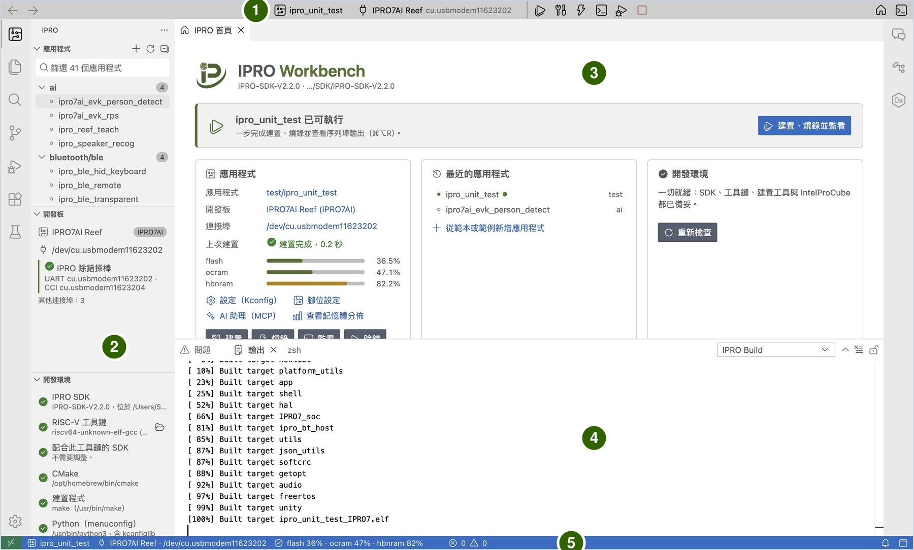
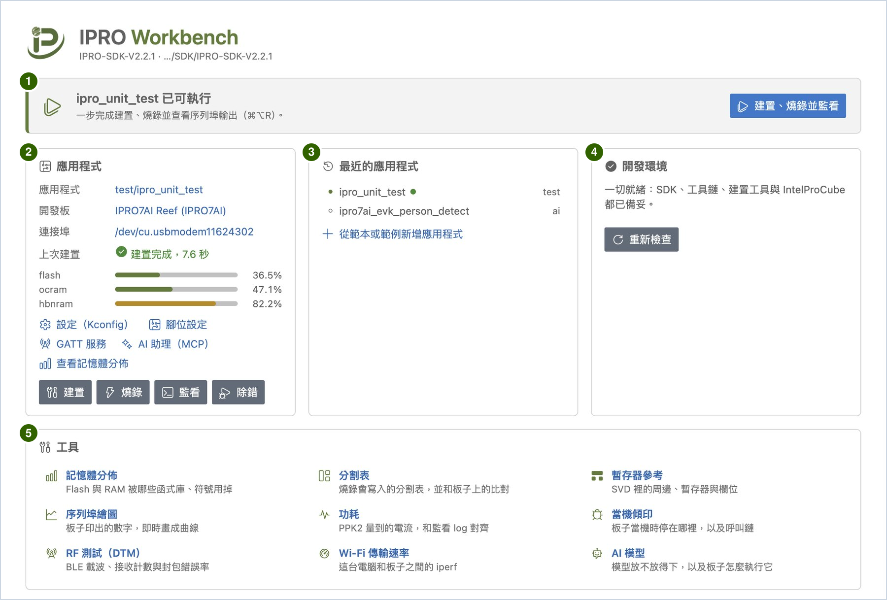

# IPRO Workbench

IPRO Workbench 是 INTELPRO 為 IPRO 系列晶片提供的整合開發環境（IDE）。在同一個視窗裡就能建置 IPRO SDK 的應用程式、燒錄到開發板、看板子的序列埠輸出，並提供 C/C++ 程式碼導覽、設定檔切換、腳位設定、GATT 設定、記憶體分析、OTA 包、感測器儀表板、當機分析、板上測試、RF、Wi-Fi 傳輸速率與功耗量測，以及能自己動手建置與燒錄的 AI 助理。

本節對應 IPRO Workbench 0.2.0，以 [IPRO7AI Reef EVK V4.0](../hardware/boards/reef-evk.md) 加上 IPRO 除錯探棒（IPRO Debug Probe）示範。每一步都寫「做什麼」和「應該看到什麼」；畫面和本節不一樣時，請看[疑難排解](troubleshooting.md)。使用 IPRO6S EVK 時，建置、燒錄與監看的步驟相同，不同的地方集中在[燒錄與開發板](flash.md)的 [IPRO6S EVK](flash.md#ipro6s) 一節。習慣在 VS Code 開發時，見 [VS Code Extension](../guides/vscode.md)。

!!! info "取得方式"
    IPRO Workbench 0.2.0 預覽版的 macOS 與 Windows 安裝檔在 [GitHub 的 IPRO Workbench 發行頁](https://github.com/INTELPRO-INC/ipro-workbench/releases/tag/v0.2.0)，不需要 GitHub 帳號；安裝步驟見[安裝 IPRO Workbench](install.md)。尚未提供 Linux 版。

    請搭配 IPRO SDK V2.3.0 使用。較舊的 SDK 也能用，只是本節標示「SDK V2.3.0」的功能無法使用。

## 能做什麼 { #features }

| 功能 | 說明 |
|---|---|
| [補齊開發環境](install.md#environment) | 自動檢查 SDK、RISC-V 工具鏈、CMake、Python、IntelProCube 與開發板，缺的項目一鍵從 GitHub 安裝。 |
| [建置、燒錄並監看](first-run.md#unit-test) | 一個按鍵完成建置、燒錄與開啟序列埠監看；每一步的輸出分開顯示，任何一步失敗就停下並說明原因。 |
| [應用程式管理](first-run.md#own-app) | 依分類列出 SDK 裡的應用程式；從開發板的 Hello World、BLE peripheral、IPRO6S EVK 的 Wi-Fi station、IPRO7AI Reef EVK V4.0 的 AI 視覺，或現有範例建立新的應用程式。 |
| [設定（Kconfig）](develop.md#kconfig) | 以表單修改應用程式的 `.config`，只寫入你改的項目，並列出每個項目的說明與相依條件。 |
| [設定檔](develop.md#configurations) | 列出應用程式的 `defconfig_*`、`config_*` 設定檔；選一個建置，結果放在與 `make DEFCONFIG=<檔案>` 相同的 `build_<名稱>` 資料夾，`.config` 不動。 |
| [腳位設定](develop.md#pins) | 在封裝圖與表格上指定每支 GPIO 的功能，檢查衝突與開發板上的接線，並產生初始化程式碼。 |
| [GATT 設定](develop.md#gatt) | 以表單定義 BLE 服務與特性，檢查 UUID、長度與應用程式設定，並產生 GATT 服務的程式碼。 |
| [記憶體分析](develop.md#memory) | 列出 flash、ocram、hbnram 各被哪些函式庫、物件檔與符號用掉；比較每次建置的大小變化，並可設定記憶體預算。 |
| [燒錄與開發板](flash.md) | 分割表檢視與檢查、分割表是 boot2 配置時一併寫入 boot2、辨識板子的 Flash、核對板子上執行的韌體、把 AI 模型寫入 mfg 分割區；IPRO6S EVK 以它專用的分割表燒錄。 |
| [OTA 包](flash.md#ota) | 製作應用程式的 boot2 OTA 包並顯示是否簽章；經主控台 UART 傳送到板子安裝，或只讓板子檢查（SDK V2.3.0）。 |
| [經開發板的 USB 燒錄](flash.md#usb-flash) | 選的連接埠是開發板自己的 USB 埠時，經 boot2 的 USB 下載模式燒錄，不需要探棒（macOS，SDK V2.3.0）。 |
| [序列埠監看](monitor.md) | 篩選、時間戳記、存檔與完整記錄、序列埠繪圖，以及在第二個連接埠同時監看。 |
| [感測器儀表板](monitor.md#dashboard) | 把板子印出的 `名稱:數值` 顯示成數值卡、量表、指示燈、傾斜圖與曲線，並以按鈕送指令給板子；版面寫在應用程式的 `dashboard.yaml`。 |
| [除錯與分析](debug.md) | 當機位址自動解碼成原始碼行號（IPRO7 系列與 IPRO6S）、收集並分析當機傾印、查暫存器與欄位。 |
| [測試與量測](measure.md) | 板上測試結果進入「測試」檢視、RF 測試（BLE DTM）、Wi-Fi 傳輸速率（iperf，含掃描、板子的 MAC 與訊號、Wi-Fi 記憶體 profile）、功耗曲線與電池壽命估算。 |
| [AI 助理](ai.md) | 內建的 IPRO AI 助理會自己建置、讀輸出、改設定、腳位與 GATT 服務；IDE 外的 AI 助理（例如 Claude Code）也能透過 MCP 使用同一組工具，並能開啟 SDK、選開發板、連接埠與設定檔、在板子的主控台上打字。 |

## 視窗各區 { #window }

| 編號 | 區域 | 用途 |
|---|---|---|
| 1 | 工具列 | 目前的應用程式、開發板與連接埠，以及建置、燒錄、監看等按鈕。按應用程式或開發板的名稱可以更換。 |
| 2 | IPRO 側邊欄 | 「應用程式」列出 SDK 裡的應用程式；「開發板」顯示探棒、連接埠與板子正在執行的韌體；「開發環境」逐項列出檢查結果。 |
| 3 | 編輯區 | IPRO 首頁、原始碼，以及設定、腳位、記憶體分佈、分割表等檢視都開在這裡。 |
| 4 | 下方面板 | 「輸出」的 **IPRO Build**、**IPRO Flash**、**IPRO Setup** 分別顯示建置、燒錄與安裝過程；「終端機」裡的 **IPRO Monitor** 是序列埠監看。 |
| 5 | 狀態列 | 目前的應用程式、開發板與記憶體用量；環境有缺項時會在這裡提醒。 |

## IPRO 首頁 { #home }

IPRO 首頁是開啟 SDK 後編輯區的第一個分頁；關掉之後，按工具列右邊的房屋圖示（**IPRO 首頁**）可以再打開。

| 編號 | 區域 | 用途 |
|---|---|---|
| 1 | 橫幅 | 永遠提示「下一步」：還沒開 SDK 時請你開啟 SDK，環境缺項時請你補齊環境，一切就緒後顯示「<應用程式> 已可執行」與 **建置、燒錄並監看** 按鈕。 |
| 2 | 應用程式 | 目前的應用程式、開發板與連接埠（按一下可以更換）；開發板有使用前要注意的事項時，列在開發板下方（例如 IPRO7AI Reef EVK V4.0 的「使用相機前，SW7 要切到 CAM。…」）；設定（Kconfig）、腳位設定、GATT 服務、AI 助理（MCP）的連結；建置、燒錄、監看、除錯按鈕。建置過後還會顯示記憶體用量。 |
| 3 | 最近的應用程式 | 最近用過的應用程式，按一下就切換過去；也可以從這裡新增應用程式。 |
| 4 | 開發環境 | 環境檢查的摘要與 **重新檢查**；有缺項時顯示 **補齊環境**。 |
| 5 | 工具 | 十個工具頁的入口：記憶體分佈、分割表、暫存器參考、序列埠繪圖、功耗、當機傾印、RF 測試（DTM）、Wi-Fi 傳輸速率、AI 模型、OTA 包。每一項下面有一行說明，按名稱就開啟那一頁。 |

工具頁都開在編輯區，版面相同：最上面是標題與這一頁針對的應用程式，接著是選項與按鈕，再下面是結果。同樣的命令也在 IPRO 選單與命令選擇區（輸入 `IPRO`）裡；[感測器儀表板](monitor.md#dashboard)不在「工具」卡片上，從 IPRO 選單或命令選擇區開啟。

## 支援的環境 { #requirements }

| 項目 | 內容 |
|---|---|
| 電腦 | macOS 12 以上（Apple Silicon）；Windows 11（x64） |
| IPRO SDK | IPRO SDK V2.3.0。標示「SDK V2.3.0」的功能需要這一版；其他功能在 2.2.x 上也能使用（IPRO6S EVK 需要 2.2.1 以上） |
| 晶片 | IPRO7、IPRO7AI、IPRO6S（建置 SDK 的 IPRO6 應用程式） |
| 開發板 | IPRO7AI Reef EVK V4.0，見 [IPRO7AI Reef EVK](../hardware/boards/reef-evk.md)；IPRO6S EVK，見 [IPRO6S EVK](flash.md#ipro6s)；IPRO7AI Sensor Tag（[感測器儀表板](monitor.md#dashboard)與[經開發板的 USB 燒錄](flash.md#usb-flash)的範例） |
| 燒錄與連線 | IPRO 除錯探棒（USB），燒錄使用 IntelProCube（IPRO6S EVK 需要 0.7.0.1 以上）；macOS 上也能經開發板自己的 USB 燒錄（SDK V2.3.0） |
| 介面語言 | 繁體中文、英文、簡體中文、日文 |

## 整體流程 { #workflow }

1. **安裝並補齊環境。** 安裝 IPRO Workbench，按 **補齊環境** 安裝缺少的工具，再開啟 SDK、接上開發板，見[安裝 IPRO Workbench](install.md)。

2. **第一次執行。** 用 `ipro_unit_test` 走完一輪建置、燒錄與看板子輸出，再從開發板的 Hello World 建立自己的應用程式，見[第一次執行](first-run.md)。

3. **開發應用程式。** 以表單修改 `.config`、選擇要建置的設定檔、設定腳位並產生初始化程式碼、定義 GATT 服務並產生程式碼、處理建置錯誤，並看記憶體用到哪裡，見[開發應用程式](develop.md)。

4. **燒錄與更新。** 燒錄前後 IDE 會檢查分割表與板子的 Flash、核對板子上執行的韌體，也能把 AI 模型寫入 mfg 分割區、製作 OTA 包並經主控台 UART 送到板子、經開發板自己的 USB 燒錄；IPRO6S EVK 的操作與不同的地方也在這裡，見[燒錄與開發板](flash.md)。

5. **看序列埠輸出。** 在 **IPRO Monitor** 看板子的輸出、送指令給板子，並可篩選、存檔、畫成曲線，或以感測器儀表板顯示，見[序列埠監看](monitor.md)。

6. **除錯與量測。** 當機位址自動解碼成原始碼行號，需要時收集當機傾印、查暫存器，再於板子上執行測試、以 BLE DTM 做 RF 測試、以 iperf 量 Wi-Fi 傳輸速率、看功耗曲線，見[除錯與分析](debug.md)與[測試與量測](measure.md)。

## 完整操作手冊 { #manual }

《IPRO Workbench 操作手冊》V1.2 的 PDF 附在 GitHub 的 0.2.0 發行版：[繁體中文版](https://github.com/INTELPRO-INC/ipro-workbench/releases/download/v0.2.0/IPRO-Workbench-Operation-Manual-V1.2-zh-TW.pdf)（67 頁）、[英文版](https://github.com/INTELPRO-INC/ipro-workbench/releases/download/v0.2.0/IPRO-Workbench-Operation-Manual-V1.2-en.pdf)（73 頁）。V1.2 是為 0.1.1 寫的，0.2.0 的手冊之後提供；0.2.0 新增與改變的操作以本節為準。要離線閱讀或列印時，請下載 PDF。

## 本節頁面 { #pages }

-   **[安裝 IPRO Workbench](install.md)**

    ---

    下載與核對安裝檔、在 macOS 與 Windows 安裝、介面語言、補齊開發環境、開啟 SDK、接上開發板。

-   **[第一次執行](first-run.md)**

    ---

    用 `ipro_unit_test` 走完建置、燒錄與監看，建立自己的應用程式，以及應用程式的右鍵選單。

-   **[開發應用程式](develop.md)**

    ---

    修改設定（Kconfig）、設定檔、設定腳位並產生程式碼、設定 GATT 服務、建置與錯誤、記憶體分佈與記憶體預算。

-   **[燒錄與開發板](flash.md)**

    ---

    燒錄前後的檢查、分割表、開發板的 Flash 與韌體核對、把 AI 模型寫入 mfg 分割區、OTA 包、經開發板的 USB 燒錄，以及 IPRO6S EVK。

-   **[序列埠監看](monitor.md)**

    ---

    開啟監看與輸入指令、篩選、時間戳記、存檔與完整記錄、序列埠繪圖、同時監看另一個連接埠、感測器儀表板。

-   **[除錯與分析](debug.md)**

    ---

    當機位址自動解碼、收集與分析當機傾印、暫存器參考。

-   **[測試與量測](measure.md)**

    ---

    板上測試進入「測試」檢視、RF 測試（BLE DTM）、Wi-Fi 傳輸速率（iperf）與 Wi-Fi 記憶體 profile、功耗曲線與 CR2032 電池壽命估算。

-   **[AI 助理](ai.md)**

    ---

    開啟 AI 功能、請 AI 修正建置錯誤與分析當機，以及讓 IDE 外的 AI 助理經 MCP 使用 IDE。

-   **[疑難排解](troubleshooting.md)**

    ---

    畫面上的訊息、工具列與側邊欄的狀態、macOS 與 Windows 特有的狀況，以及回報問題時要附的資訊。

-   **[快捷鍵、命令與設定](reference.md)**

    ---

    快捷鍵、IPRO 命令、`ipro.*` 設定、MCP 工具與 IDE 用到的檔案位置。

## 本版範圍 { #limitations }

本節對應 IPRO Workbench 0.2.0 預覽版。這一版有下列限制：

- 安裝檔沒有 Apple（未經公證）或 Microsoft 的簽章，第一次開啟或安裝時作業系統會提示（處理方式見[安裝](install.md#install)）。
- 以 JTAG 除錯的功能尚未開放。當機時請改用[除錯與分析](debug.md)的當機解碼與當機傾印。
- 自動更新關閉。新版本請到發行頁下載後重新安裝。
- [Wi-Fi 傳輸速率（iperf）](measure.md#iperf)：板子的網路名稱與密碼不能有空白；板子會把密碼回顯在序列埠監看裡。板子送到 Windows 電腦時，防火牆要允許連入 TCP 連接埠 5001。
- [經開發板的 USB 燒錄](flash.md#usb-flash)只有 macOS 版提供；Windows 上請用 IPRO 除錯探棒燒錄。
- 在 Windows 上建置 IPRO SDK 要用 RISC-V 工具鏈 14.2.1（環境檢查會安裝它）；13.1.1 無法連結 SDK 預先編好的函式庫。
- IPRO6 系列的板子開機時不印分割表與 Flash 識別碼，所以分割表不會和板子上的比對，開機時也不辨識板子的 Flash；用 IPRO SDK 2.2.1 以前的版本時，「開發板」也不會顯示板子上執行的是哪一版韌體（見[和 IPRO7 系列不同的地方](flash.md#ipro6s-differences)）。
- 尚未提供 Linux 版。
