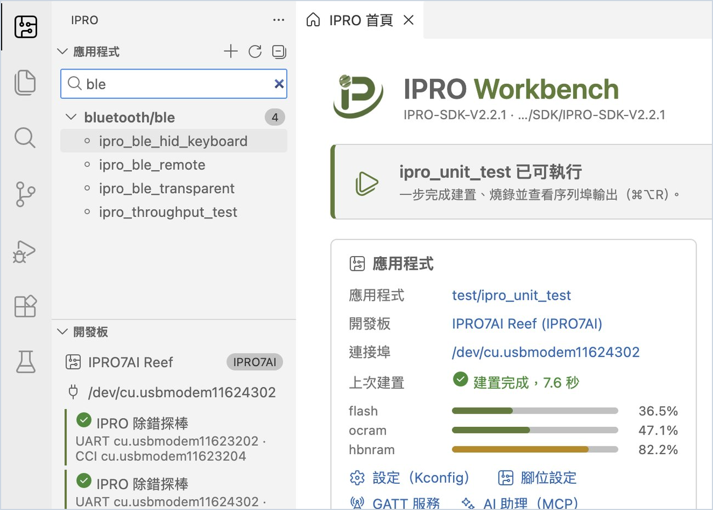

# 安裝 IPRO Workbench

本頁從安裝 IPRO Workbench 開始，一路到 IDE 找到開發板為止。完成後，電腦上有 IPRO Workbench 0.1.0 與開發需要的工具，IDE 開啟了 IPRO SDK，側邊欄「開發板」列出 IPRO 除錯探棒，首頁橫幅會顯示「已可執行」。

## 需要準備 { #prerequisites }

| 項目 | 說明 |
|---|---|
| 電腦 | macOS 12 以上（Apple Silicon）或 Windows 11（x64），可以連上 GitHub。IDE、工具與 SDK 合計約需 4 GB 磁碟空間。 |
| 安裝檔 | macOS：`IPRO-Workbench-0.1.0-mac-arm64.dmg`；Windows：`IPRO-Workbench-0.1.0-win-x64.exe`。從 GitHub 的 IPRO Workbench 發行頁下載（見[下載與核對](#download)），不需要 GitHub 帳號。 |
| 開發板 | IPRO7AI Reef EVK V4.0，見 [IPRO7AI Reef EVK](../hardware/boards/reef-evk.md) |
| 探棒與線材 | IPRO 除錯探棒（IPRO Debug Probe），以及接電腦用的 USB 線 |
| macOS 另需 | Xcode 命令列工具與 Homebrew 的 CMake、Ninja（見[補齊開發環境](#environment)） |

## 下載與核對 { #download }

| 系統 | 安裝檔 | 大小 |
|---|---|---|
| macOS 12 以上（Apple Silicon） | [`IPRO-Workbench-0.1.0-mac-arm64.dmg`](https://github.com/INTELPRO-INC/ipro-workbench/releases/download/v0.1.0/IPRO-Workbench-0.1.0-mac-arm64.dmg) | 199 MB |
| Windows 11（x64） | [`IPRO-Workbench-0.1.0-win-x64.exe`](https://github.com/INTELPRO-INC/ipro-workbench/releases/download/v0.1.0/IPRO-Workbench-0.1.0-win-x64.exe) | 160 MB |

<div class="ipro-steps" markdown>

1. **下載安裝檔。** 開啟 IPRO Workbench 的發行頁 <https://github.com/INTELPRO-INC/ipro-workbench/releases/latest>，在 **Assets** 下載自己系統的安裝檔。

2. **核對下載的檔案**，確認沒有損壞或被替換：

    === "macOS"

        在「終端機」執行：

        ```bash
        shasum -a 256 IPRO-Workbench-0.1.0-mac-arm64.dmg
        ```

    === "Windows"

        在 PowerShell 執行：

        ```powershell
        (Get-FileHash .\IPRO-Workbench-0.1.0-win-x64.exe -Algorithm SHA256).Hash
        ```

    **應該看到**：和下面同一個檔案的值相同（Windows 以大寫顯示）。發行頁的 `SHA256SUMS.txt` 也列有這些值。

    ```text title="IPRO Workbench 0.1.0 安裝檔的 SHA-256"
    # IPRO-Workbench-0.1.0-mac-arm64.dmg
    f1c562e6e0584dedb78b173a37fcd1b51b30fdf906927dc3f91d757cfe210d5b
    # IPRO-Workbench-0.1.0-win-x64.exe
    b517d14225cc1a99b7b0cc3d382b89049fc1c5966b6e6a374690e4ce0bece586
    ```

</div>

發行頁上的 ZIP、`latest-mac.yml`、`latest.yml` 與 blockmap 檔是給內建更新功能用的，不必下載。

## 安裝 { #install }

<div class="ipro-steps" markdown>

1. **執行安裝檔。**

    === "macOS"

        打開 `IPRO-Workbench-0.1.0-mac-arm64.dmg`，把 **IPRO Workbench** 拖進「應用程式」資料夾。

    === "Windows"

        按兩下 `IPRO-Workbench-0.1.0-win-x64.exe`。

        Windows 可能顯示「Windows 已保護您的電腦」。按 **其他資訊**，確認應用程式名稱後按 **仍要執行**。

        安裝精靈詢問安裝對象時，選只為目前的使用者安裝（不需要系統管理員權限）；接著可以更改安裝資料夾，按 **安裝**，完成後按 **完成**。

        **應該看到**：開始功能表與桌面出現 IPRO Workbench。

2. **開啟 IPRO Workbench。**

    === "macOS"

        從「應用程式」開啟 IPRO Workbench。

        第一次開啟時，如果 macOS 說無法驗證開發者，請到「系統設定 → 隱私權與安全性」，往下找到 IPRO Workbench 那一則，按 **仍要打開**（部分 macOS 版本寫「強制打開」），再開啟一次即可。

    === "Windows"

        從開始功能表開啟 IPRO Workbench。

    **應該看到**：IPRO Workbench 視窗，中間是「IPRO 首頁」，左邊是 IPRO 側邊欄（應用程式、開發板、開發環境）。macOS 與 Windows 相同。

</div>

!!! tip "大量部署（Windows）"
    IT 人員大量部署時，可以用無人值守安裝：`IPRO-Workbench-0.1.0-win-x64.exe /S`，或以 `/D=<資料夾>` 指定安裝位置（`/D` 必須是最後一個參數）。

## 介面語言 { #language }

系統語言是繁體中文時，IPRO Workbench 第一次啟動就是中文。要換語言，按 `Cmd+Shift+P`（Windows 為 `Ctrl+Shift+P`）開啟命令選擇區，輸入 `Configure Display Language`，選擇語言後依提示重新啟動。

## 補齊開發環境 { #environment }

IPRO Workbench 會自己檢查開發需要的每一項工具，結果列在側邊欄的「開發環境」。

| 項目 | 用途 | 「補齊環境」能否自動安裝 |
|---|---|---|
| IPRO SDK | 應用程式、驅動與範例的來源 | 可以，從 GitHub 安裝最新發行版 |
| RISC-V 工具鏈 | 編譯韌體 | 可以 |
| CMake、建置程式 | 產生並執行建置 | Windows 可以（與 Ninja、Python 同一包）；macOS 請用 Homebrew 安裝 |
| Python（menuconfig） | 設定（Kconfig）與 Menuconfig | 需要另外安裝 kconfiglib 套件（見下方） |
| IntelProCube | 燒錄 | 可以 |
| OpenOCD（除錯） | JTAG 除錯（本版尚未開放） | Windows 可以；未安裝不影響建置與燒錄 |
| 開發板 | 找到 IPRO 除錯探棒 | 接上探棒即可 |
| 配合此工具鏈的 SDK | Windows 才有：讓 SDK 2.2.0 能在 Windows 上建置 | 可以 |
| macOS 隔離標記 | macOS 才有：從瀏覽器下載的工具會被系統擋下 | 可以，確認後移除 |

<div class="ipro-steps" markdown>

1. **看首頁最上方的橫幅。** 缺東西時它會寫「完成環境設定」，並說明還缺幾項。

2. **（macOS）安裝 Xcode 命令列工具與建置工具。** 在「終端機」執行（已安裝可略過）：

    ```bash
    xcode-select --install
    brew install cmake ninja
    ```

3. **安裝缺少的項目。** 按 **補齊環境**。

    **應該看到**：下方「輸出」面板切到 **IPRO Setup**，逐項顯示從 GitHub 下載與安裝的過程。工具裝在家目錄的 `IPRO/tools/<工具>/<版本>`（Windows 為 `%USERPROFILE%\IPRO\tools`）。完成後，「開發環境」每一列都是綠色勾勾，首頁橫幅換成下一步。在一般網路下約需兩分鐘。

4. **安裝 kconfiglib。** 「Python（menuconfig）」一列顯示缺少 kconfiglib 時，在終端機執行該列提示的指令，再按「開發環境」上方的重新檢查：

    === "macOS"

        ```bash
        python3 -m pip install kconfiglib
        ```

    === "Windows"

        ```powershell
        python -m pip install kconfiglib windows-curses
        ```

5. **使用已有的工具（選用）。** 電腦上已經有工具鏈或 IntelProCube 時，不必重裝：在「開發環境」該列按資料夾圖示（**使用這台電腦上已有的…**），選工具所在的資料夾即可。

6. **（macOS）移除隔離標記。** 出現「macOS 隔離標記」一列時，表示有工具是用瀏覽器或聊天軟體下載的，執行時會被系統擋下。按該列的鎖頭圖示，確認後 IDE 會移除標記。

</div>

## 開啟 SDK { #open-sdk }

IPRO Workbench 以 IPRO SDK 資料夾為工作區。SDK 的內容與命令列的建置方式見[開始使用](../get-started/index.md)。

<div class="ipro-steps" markdown>

1. **開啟 SDK。** 首頁按 **開啟 SDK…**，選 IPRO SDK 資料夾（例如家目錄的 `IPRO/SDK/IPRO-SDK-V2.2.0`）。還沒有 SDK 時按 **從 GitHub 安裝 SDK…**。

    **應該看到**：側邊欄「應用程式」依分類列出 SDK 裡的應用程式，搜尋框寫著「篩選 N 個應用程式」。

2. **篩選應用程式。** 在搜尋框輸入關鍵字（例如 `ble`），清單只留下相關的應用程式。清掉文字即恢復。

</div>



## 接上開發板 { #connect-board }

<div class="ipro-steps" markdown>

1. **接上探棒與開發板。** 用 USB 線把 IPRO 除錯探棒接到電腦，再把探棒接上 IPRO7AI Reef EVK V4.0（接法見 [IPRO7AI Reef EVK：除錯排座 U6](../hardware/boards/reef-evk.md#debug-connector)）。

    **應該看到**：側邊欄「開發板」出現「IPRO 除錯探棒」與它的兩個連接埠，例如 macOS 的 `UART cu.usbmodemXXXX · CCI cu.usbmodemYYYY`，Windows 的 `UART COM5 · CCI COM6`。工具列的開發板旁邊顯示同一個 UART 連接埠。

2. **工具列顯示琥珀色的「無探棒」時**，表示 IDE 找不到探棒：檢查 USB 線，盡量直接接電腦而不經過集線器。

</div>

!!! note "UART 與 CCI"
    探棒有兩個連接埠：UART 是板子的主控台（序列埠監看與燒錄都走它），CCI 是另一組介面。IDE 會自動挑 UART；要手動更換，按工具列的開發板名稱，選 **選擇連接埠…**。

## 疑難排解 { #troubleshooting }

| 症狀 | 原因 | 處理 |
|---|---|---|
| macOS 第一次開啟時說無法驗證開發者 | 安裝檔沒有 Apple 的簽章 | 到「系統設定 → 隱私權與安全性」，按 **仍要打開** |
| 安裝時顯示「Windows 已保護您的電腦」 | 安裝檔沒有 Microsoft 的簽章 | 按 **其他資訊**，確認應用程式名稱是 IPRO-Workbench 後按 **仍要執行** |
| （macOS）CMake 或建置程式顯示找不到 | macOS 的建置工具不由 IDE 安裝 | 在終端機執行 `xcode-select --install` 與 `brew install cmake ninja` 後，按 **重新檢查** |
| Python 一列顯示沒有 kconfiglib | 沒有安裝 kconfiglib 套件 | macOS 執行 `python3 -m pip install kconfiglib`，Windows 在命令提示字元執行 `python -m pip install kconfiglib windows-curses`，再按 **重新檢查** |
| 工具列顯示琥珀色的「無探棒」 | IDE 找不到 IPRO 除錯探棒 | 檢查 USB 線，盡量直接接電腦；探棒接上後幾秒內會自動出現 |

其他狀況見[疑難排解](troubleshooting.md)。

## 下一步 { #next-steps }

- [第一次執行](first-run.md)：用 `ipro_unit_test` 走完一輪建置、燒錄與監看，再建立自己的應用程式。
- [IPRO7AI Reef EVK](../hardware/boards/reef-evk.md)：開發板的接頭、開關與除錯排座。
- 習慣在 VS Code 開發時，見 [VS Code Extension](../guides/vscode.md)。
